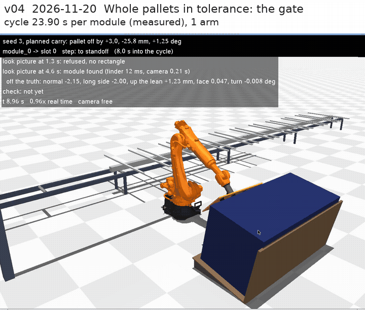
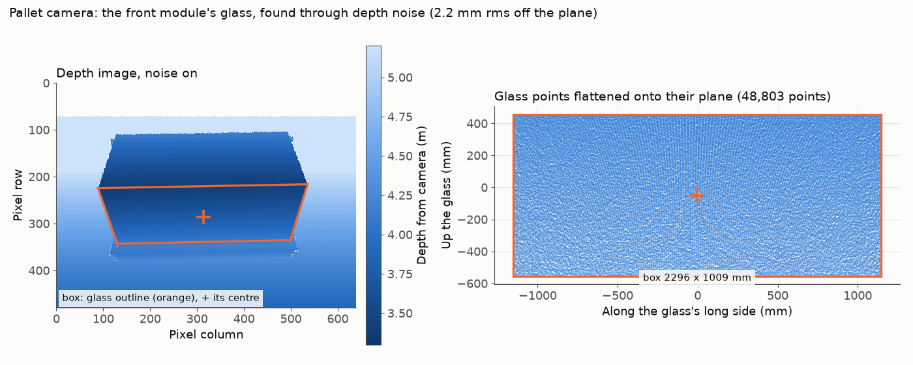
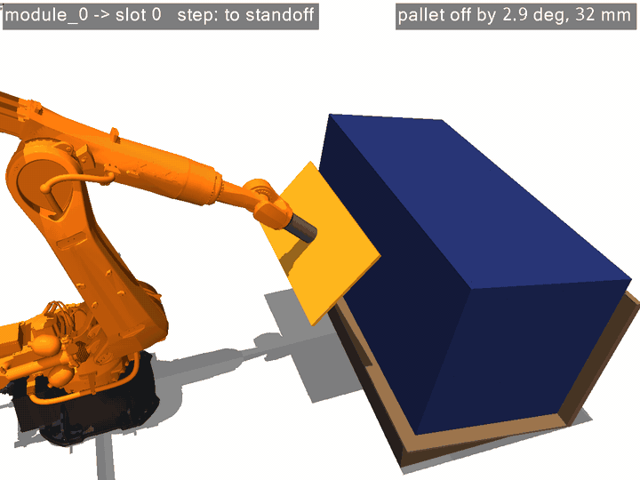

# solar-bay-assembly

A simulated robot cell that is to take in bolts, rails, torque tubes and solar modules and
put out an assembled bay of nine modules, as simple as it can be and transportable on a
flat rack by truck. The owner steers it by ranked measures: cycle time and expected
failures per bay first, then part count and placement error, then mass in transit and the
error of the infed parts that the cell tolerates. `score_layout` prints them for every
layout, and [`docs/scorecard.md`](docs/scorecard.md) defines each one.

## Results

<!-- BEGIN results: written by tools/evolution/pages.py; do not edit -->

### A stand-in cell: one KUKA arm picking modules in physics



| Version | Cycle time | Failures per bay | Arms | Part count | Placement error | Mass in transit | Gates |
|---|---|---|---|---|---|---|---|
| v04 | 23.90 s per module (measured) | none | 1 | none | 1.95 mm (measured) | none | none |

[A stand-in cell: one KUKA arm picking modules in physics: progress and versions](docs/directions/stand-in-cell.md)

### One 40 ft base: the cell on the real parts


| Version | Cycle time | Failures per bay | Arms | Part count | Placement error | Mass in transit | Gates |
|---|---|---|---|---|---|---|---|
| v10 | 560.45 s per bay (planned) | 0.385 | 4 | 39 | none | 3426.3 kg | all 3 pass |

[One 40 ft base: the cell on the real parts: progress and versions](docs/directions/one-40ft-flat-rack.md)

### Two 20 ft flat racks side by side

No version yet.

[Two 20 ft flat racks side by side: progress and versions](docs/directions/two-20ft-flat-racks.md)

<!-- END results -->

## The technology

**Perception.** The stand-in cell finds a module from a depth image. A depth camera 4 m up
casts one ray per pixel, with an optional noise model; the finder turns the image into 3D
points, fits the plane of the front glass and then the module's outline
(`src/plane_fit.h`, `src/rectangle_fit.h`, `src/module_finder.h`). Over 100 pictures of
pallets set down up to 30 mm and 3 degrees off, the found pose was never more than 0.8 mm
or 0.03 degrees from the true one. A second camera on the floor, the check camera, looks
up at the held module and corrects the set-down for any error frozen in at the grip.
Pictures and the figures are in [`docs/stand-in-cell.md`](docs/stand-in-cell.md).





**Motion planning.** Planning is RRT-Connect with path shortening, written here
(`src/rrt.h`, `src/motion_planner.h`), over a collision test that counts the carried module
as part of the arm, and a timing step that follows a path of waypoints without stopping at
each (`src/path_timing.h`). OMPL's RRT-Connect is behind a switch (`--planner ompl`); the
hand-written search is the default. The comparison, by a rule fixed before the numbers
existed, reads "Verdict: hand-written better"
([`docs/ompl-comparison.md`](docs/ompl-comparison.md)).


**The layout checker.** A layout of the cell is data (`layouts/<name>.json`), and
`check_layout` checks it for transport, hold, reach, clearance, load, ways in and out, time,
what is allowed, ports and approaches. The chosen layout stands on a 40 ft flat rack
([`docs/flat-rack-cell.md`](docs/flat-rack-cell.md)); the next section shows it at work. What
travels is the stowed cell: the transport envelope and the weight limit bind the equipment,
not the bay it builds. Five earlier layouts built the bay inside a container with open sides
(run 011). They are history, kept as a record with their pictures in
[`docs/layout.md`](docs/layout.md), and that the bay fits inside a container was never a
requirement.

**The planner and scheduler of a bay.** `plan_layout` plans every move of every arm for one
bay of a layout free of collision, and schedules the four arms on one clock. A verifier
checks the schedule, and the plan is committed (`plans/`), replayed and checked by a test,
and played back in the viewer. With run 011's order of work (`flat_rack_3_pin_arms`) a bay
takes 644.28 s planned and 416.32 s by the time model
([`docs/flat-rack-cell.md`](docs/flat-rack-cell.md)). With the order of the chosen layout,
`flat_rack_3_pin_arms_ordered`, it takes 560.45 s
([`docs/flat-rack-order.md`](docs/flat-rack-order.md); its recording is v10's, above).


**Physics.** The simulator is MuJoCo 4.0.0. The stand-in cell runs in physics with its
cameras, and a gate runs eight whole pallets (240 modules) in it and fails if one is not
placed within 3 mm and 0.15 degrees ([`docs/gate.md`](docs/gate.md)). The flat rack cell is
kinematic but for one module: the module arm takes module 4 from the pallet, turns it flat
and sets it on its rails in physics, on its servos and with its real payload, along the
committed plan's own timing, within 0.2 mm of its place and never nearer anything than
20.25 mm ([`docs/flat-rack-physics.md`](docs/flat-rack-physics.md), `//:run_physics`).
Those 22.07 s are why `physics_share` is 0.039; the failures are still modelled. One part of it has a physics test, the locating nose that pulls a
module's holes into line before pinning (`tests/locate_physics_test.cc`,
[`docs/bay-hardware.md`](docs/bay-hardware.md)).

## Building and running

The build tool is Bazel, run through Bazelisk, which fetches the version named in
`.bazelversion`. Dependencies are fetched on the first build, which compiles MuJoCo from
source and takes several minutes. Always `--config=opt` (`AGENTS.md` says why):

```
bazel test --config=opt //...
```

The programs, each run as `bazel run --config=opt //:<program> -- <arguments>`:

```
bazel run --config=opt //:score_layout -- flat_rack_3_pin_arms   # a layout's scorecard; -- --all for every layout
bazel run --config=opt //:check_layout -- --list                 # the checks of a layout (-- <name>)
bazel run --config=opt //:plan_layout -- flat_rack_3_pin_arms --summary
                                                                 # the planned bay, phase by phase
bazel run --config=opt //:viewer_layout -- flat_rack_3_pin_arms --play
                                                                 # the committed plan in a window; needs a display
bazel run --config=opt //:run_cell -- --pretty --nominal --modules 2
                                                                 # the stand-in cell: pick and place, print the scores
bazel run --config=opt //:view_cell -- --nominal                 # the same in a window; needs a display
bazel run --config=opt //:print_perception -- --pretty           # also print_profile, print_plane_fit, print_points,
                                                                 # print_cell, print_depth, print_plan, print_check, print_rrt,
                                                                 # print_pallet, print_bay
```

The stand-in cell's options and the other programs are in
[`docs/stand-in-cell.md`](docs/stand-in-cell.md).

## Layout

| Path | What it holds |
|---|---|
| `MODULE.bazel` | External dependencies |
| `BUILD.bazel` | Build targets |
| `bazel/` | Build rules written for this repository |
| `models/` | The cells as MuJoCo model files: arm, tool, pallet, conveyor, camera, the bay's parts, the container and the flat rack |
| `src/` | Programs and libraries |
| `tests/` | Tests |
| `layouts/` | The layouts of the new cell, as data, one file each |
| `plans/` | The committed motion plan of a layout's bay, one file each |
| `scores/` | The committed scorecard of each layout with a plan, and `rates.json`, the rates of failure by kind of operation |
| `versions/` | `versions.json`, the registry of versions of the cell |
| `tools/` | Scripts that make the plots and recordings, under `tools/architecture/` the scripts that measure the design principles, capture behavior and run the checks, and under `tools/evolution/` the scripts that add a version and write the pages |
| `docs/` | The scorecard, the stand-in cell, the designs, the gate's description, pictures and recordings; the pages of the research directions (`docs/directions/`); the design principles and the backlog (`docs/architecture/`), the decision records (`docs/adr/`) |

The world frame has its origin on the floor under the arm's base, +Z up, +X
toward the pallet and the conveyor on the -X side. Lengths are metres, angles
radians.

## Where the rest went

The stand-in cell's task, its programs and options, and its status with every figure as it
was at commit 940a01b are in [`docs/stand-in-cell.md`](docs/stand-in-cell.md). That
includes the bay's real parts and the container, the new cell on the flat rack and the
closed container, the cycle, the gate, the check camera and the comparison of the planner
with OMPL.
