# solar-panel-pick-place

A simulated factory cell in which a 6-axis KUKA arm with a suction tool moves
solar modules from a pallet onto the rails of a torque tube. Perception,
motion planning and control are hand-written in C++ against MuJoCo.

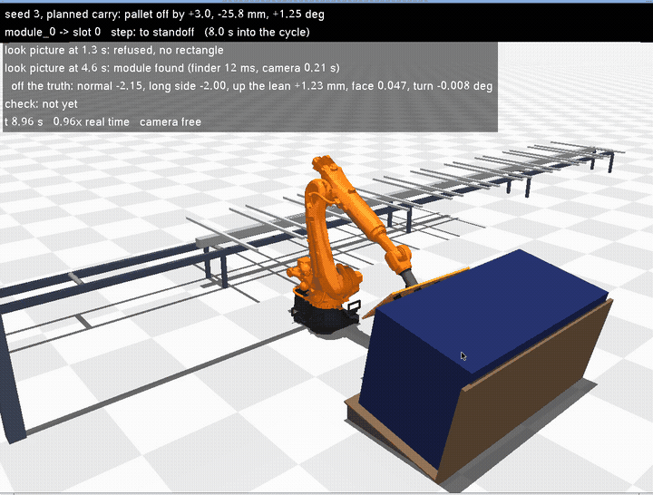

One cycle at twice real speed: the camera finds the front module, the arm
grips it and lifts it off the stack, holds it over the check camera on the
floor, and sets it on the rails. The pallet here was set down 26 mm and
1.25 degrees off, and the pallet camera's calibration is off by 1 mm and
0.05 degrees.

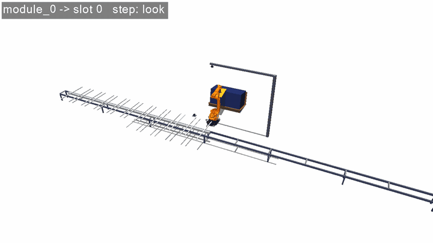

Ten modules fill a tube, at 7.5 times real speed. The tube steps along after
each one.

## Task

1. **Pick.** Modules stand on edge on the pallet, side by side, with their
   weight on their frames. The pallet is tilted slightly so they lean back.
   The arm finds the front module from a depth image and grips its face. The
   pallet's pose is uncertain and the front face moves back after every pick.
2. **Transfer.** The arm carries the module to the other side of itself,
   turning it from near-vertical to flat, along a path that keeps the arm and
   the module clear of the stack, the pallet and the conveyor.
3. **Place.** The arm sets the module flat on rails already mounted on a
   torque tube and releases it.
4. **Index.** The torque tube lies on a conveyor, which moves it along so the
   next module goes down in the same spot.

The result is a placement error and a cycle time over randomized trials.

## Building

The build tool is Bazel, run through Bazelisk, which fetches the version named
in `.bazelversion`. Dependencies are fetched on the first build, which compiles
MuJoCo from source and takes several minutes.

```
bazel test //...             # build everything and run the tests
bazel run //:run_cell -- --pretty --nominal --modules 2
                             # pick and place two modules, print the scores
bazel run //:view_cell -- --nominal
                             # the same in a window; needs a display
bazel run //:viewer_cell     # the cell at rest in a window
```

`run_cell` takes `--seed N`, `--trials T`, `--modules M`, `--nominal` (pallet
exactly where the script assumes), `--xy MM` and `--yaw DEG` (how far off the
pallet may be set down), `--phases` (time and result of every step) and
`--pretty` (aligned table; CSV without it).

In a viewer window: left drag rotates, right drag moves, scroll zooms, Space
pauses, S steps while paused, `[` and `]` change camera, Backspace starts
again, Escape quits.

Smaller programs, each for one part:

```
bazel run //:print_profile     # a trapezoid and an S-curve as CSV
bazel run //:print_plane_fit   # plane-fit error over made-up pallet views
bazel run //:print_points      # one made-up pallet view as CSV
bazel run //:print_cell        # what is in the cell, contacts, speed
bazel run //:print_depth       # one depth image from the cell's camera
bazel run //:print_perception  # found module pose against the true one
bazel run //:print_plan        # planned carries: time, length, clearance
bazel run //:print_rrt         # the planner on a 2D toy world, as CSV
bazel run //:print_pallet      # how still the untouched stack stands
bazel run //:viewer_arm        # also _pallet, _conveyor, _suction
```

Add `-- --pretty` to `print_profile`, `print_plane_fit`, `print_perception`
and `print_plan` for an aligned table. For speed
measurements build optimized with `--config=opt`; plain `-c opt` fails inside
MuJoCo's own code.

## Layout

| Path | What it holds |
|---|---|
| `MODULE.bazel` | External dependencies |
| `BUILD.bazel` | Build targets |
| `bazel/` | Build rules written for this repository |
| `models/` | The cell as MuJoCo model files: arm, tool, pallet, conveyor, camera |
| `src/` | Programs and libraries |
| `tests/` | Tests |
| `tools/` | Scripts that make the README's plots and recordings |
| `docs/` | The gate's description, pictures and recordings |

The world frame has its origin on the floor under the arm's base, +Z up, +X
toward the pallet and the conveyor on the -X side. Lengths are metres, angles
radians.

## Status

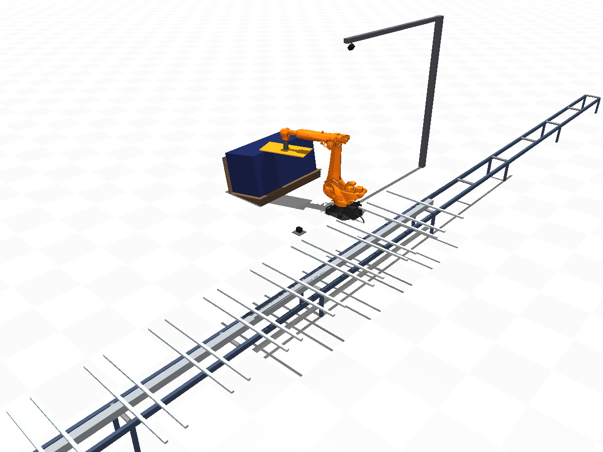


The cell exists and the cycle picks each module from where the camera sees
it, and can carry it to the other side along a planned path.

**The cell** (`models/cell.xml`). A KUKA KR 210 R2700-2, converted from the
vendor's robot description, with a suction tool. A pallet tilted 10 degrees
holding 30 modules standing on edge, the front face 1.95 m from the arm. A
conveyor carrying a torque tube with rails for 10 modules, which moves one
step after each placement and is swapped for an empty one when full. A depth
camera 4 m up, looking down at the stack. Suction is a weld switched on at
the moment of gripping, which holds the module at whatever pose it had.
Left alone for 10 simulated seconds, the stack moves less than 0.01 mm.

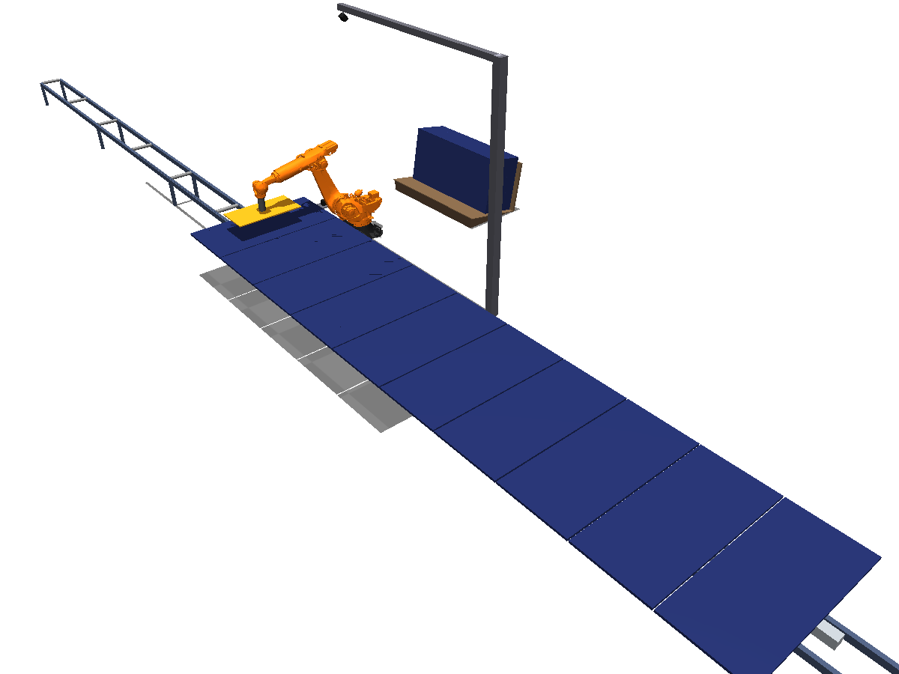

**The cycle** (`src/pick_place.h`). The arm goes to the front module, touches
the glass, grips, lifts along the glass, pulls back, turns the module flat,
swings it to the other side, turns it across the tube, sets it on the rails
and lets go; the conveyor then steps. Tool poses become joint angles by
inverse kinematics (`src/ik.h`), and the motors follow S-curve joint moves
(`src/arm_follower.h`) at 90% of KUKA's speed limits. A cycle takes about 25
simulated seconds.

Without a camera the script assumes the pallet is exactly where the drawing
says. With the pallet there, a module lands within 0.1 mm of its slot, for
all 30 modules of a pallet. With the pallet set down up to 30 mm and
3 degrees off, none of 20 trials placed a module: the cups meet the glass
early, or the glass is out of the grip's 10 mm reach.

With the camera, one depth picture per pick gives the front module's pose and
the pick is built from that. The picture for the next pick is taken while the
conveyor steps, so it adds 0.3 s to a cycle. Over 20 pallets set down up to
30 mm and 3 degrees off, with noisy pictures, 20 of 20 modules were placed,
at worst 0.13 mm along the tube, 0.60 mm across it and 0.012 degrees off.
A whole pallet of 30 was placed onto three tubes within 0.23 mm, 0.62 mm and
0.016 degrees, 25.9 s a cycle on average. With the camera's calibration
off by 1 mm and 0.05 degrees, 20 of 20 were still placed, but up to 2.7 mm
along and 4.0 mm across from the slot: the script cannot see that error.
`bazel run --config=opt //:run_cell -- --pretty --trials 20` prints the
table; add `--calibration 1,0.05` or `--blind` for the other two.


The pick on a pallet set down 2.9 degrees and 32 mm off: approach, touch,
grip, lift along the glass, pull back, clear.

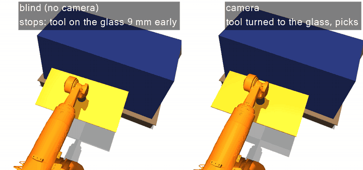

The same pallet without and with the camera. Blind, the tool meets the
glass 9 mm early and the cycle stops.

**Finding the module** (`src/module_finder.h`). The camera's depth image is
made by casting one ray per pixel (`src/depth_camera.h`), with an optional
noise model: depth noise that grows with distance, and dropped or blurred
pixels at depth edges. The finder turns the image into 3D points, crops to
where the stack can be, fits the plane of the front glass, flattens its
points onto that plane and fits the module's outline (`src/rectangle_fit.h`).
Over 100 pictures of pallets set down up to 30 mm and 3 degrees off, at four
stack depths and with the noise on, the found pose was never more than 0.8 mm
or 0.03 degrees from the true one, and it refuses when the arm is in the
way or the pallet is empty. A camera calibration that is off passes straight
into the answer: about 4.4 mm per milliradian of tilt.


Left, the pallet camera's depth image with noise, the front glass marked.
Right, the 48,803 points on the glass flattened onto their plane, with the
box that holds them; the scatter off the plane is 2.2 mm rms.

**Planning** (`src/motion_planner.h`). A collision test with the carried
module counted as part of the arm (`src/collision.h`), RRT-Connect with path
shortening (`src/rrt.h`), and timing that follows a path of waypoints without
stopping at each (`src/path_timing.h`). With `--carry planned` the cycle
replaces its three hand-chosen carry moves with one planned move. The
planner's picture of the cell is built from what the cell knows: the stack
where the camera saw it, the tube where the conveyor's encoder says, and each
module already moved where the script put it. The path is planned while the
arm lifts the module off the stack, in about 0.3 s of computing against 5.7 s
of motion, so it costs no cycle time; if no path is found the cycle stops and
says why. Over a whole pallet the planned carry takes 5.8 s on average
against 7.8 s hand-chosen (a cycle 23.9 s against 25.9 s), places the same
30 of 30 within the same error, and plans every path at least 45 mm clear of
everything. The hand-chosen carry is still the default.
`bazel run --config=opt //:run_cell -- --pretty --trials 20 --carry planned`.
The search for the path can be switched from the hand-written RRT-Connect to
OMPL's with `--planner ompl` on `run_cell` and `print_plan`
(`MotionPlanOptions::search` in code); the hand-written one is the default.

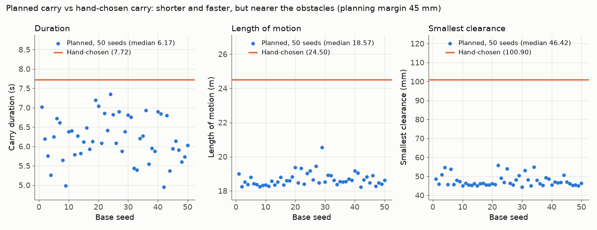

The planner's carry from 50 different random seeds against the hand-chosen
one: shorter and quicker, and closer to things, because it plans to a 45 mm
margin. "Length of motion" is the planner's own measure, the distance moved
by the farthest point of arm and module summed over the joints.

**Check after pickup** (`src/held_module_finder.h`). The first picture cannot
know where the module ends up sitting on the tool: any error in it, above
all the pallet camera's calibration, is frozen in at the grip and goes
straight into the placement. With `--check` the planned carry passes over a
second depth camera on the floor, looking up. The arm holds still for 0.2 s,
the camera finds the module's underside, and the set-down is corrected so
that the module, not the tool, lands on the slot. Over 20 pallets:

| Pallet camera | Check | Worst placement, along / across the tube |
|---|---|---|
| exact | off | 0.13 mm / 0.60 mm |
| exact | on | 0.09 mm / 0.21 mm |
| off by 1 mm and 0.05 degrees | off | 2.68 mm / 4.00 mm |
| off by 1 mm and 0.05 degrees | on | 0.10 mm / 0.28 mm |
| the same, and the check camera off by as much | on | 1.74 mm / 1.39 mm |

The check costs 0.6 s a cycle. It removes the pallet camera's error and not
its own: what remains is the check camera's calibration. If the check camera
does not see a module where one should be, it looks once more and then the
cycle stops, saying whether the vacuum still holds a module (a camera fault)
or not (a failed pick).
`bazel run --config=opt //:run_cell -- --pretty --trials 20 --check --calibration 1,0.05`.

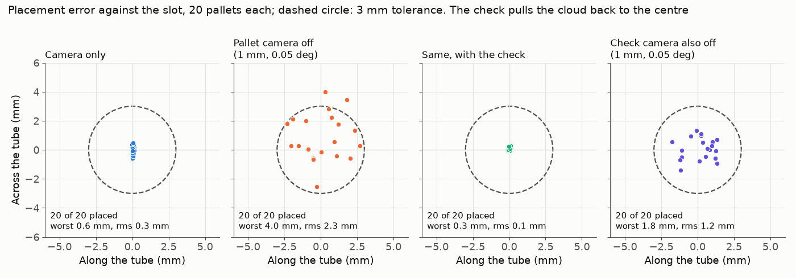

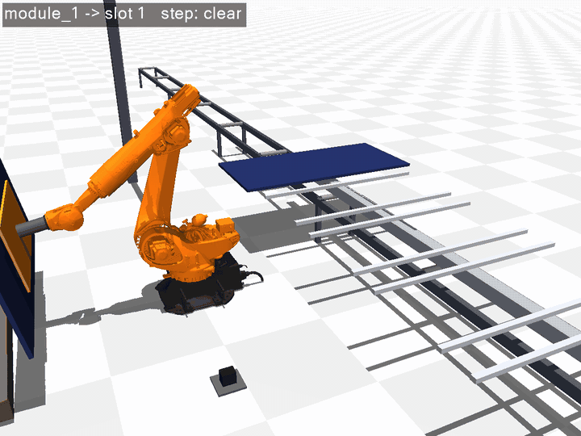

The second module held over the check camera, then set down beside the
first.

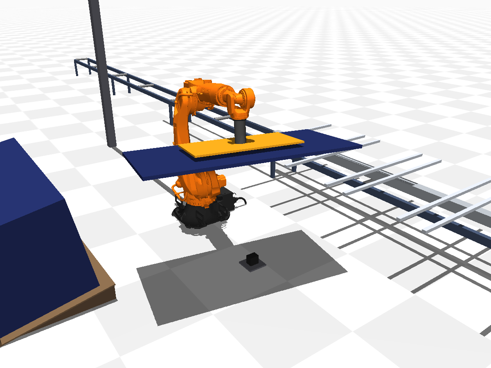

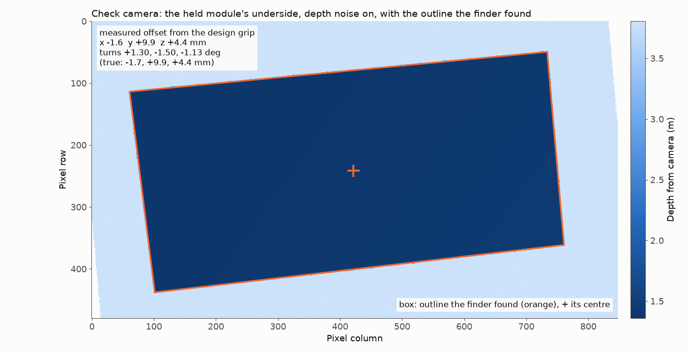

What the check camera sees in its test rig, with the outline the finder
found. This module was gripped 10 mm and 1.5 degrees off on purpose; the
measured offset is within 0.1 mm of the true one.

**The gate** (`tests/gate_test.cc`, [docs/gate.md](docs/gate.md)). Part of
`bazel test --config=opt //...`, and so of CI. Eight whole pallets, 240
modules, each pallet set down up to 30 mm and 3 degrees off, with noisy
pictures and both cameras' calibrations off by 1 mm and 0.05 degrees. It
fails if any module is not placed, or lands more than 3 mm or 0.15 degrees
from its slot. That tolerance is an assumption, not a tracker maker's
figure. On this tree all 240 are in tolerance, at worst 1.95 mm and
0.059 degrees, in about four minutes. A change that skips the correction
after the check turns it red. Every failure is saved with the command that
reruns it, and a rerun gives the same numbers bit for bit.
`bazel run --config=opt //:run_gate -- --trials 40` runs a larger batch;
30 pallets run that way, 900 modules, were all in tolerance, at worst
2.14 mm and 0.063 degrees.

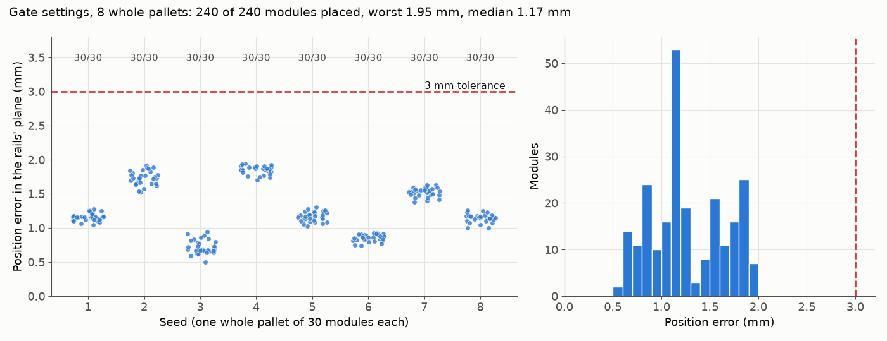

Each pallet's modules land together, off by that pallet's share of the check
camera's calibration error.

**Built before the cell.** `src/profile.h` and `src/joint_move.h` time moves
within velocity, acceleration and jerk limits. `src/plane_fit.h` finds the
plane most of a cloud of 3D points lies on, by RANSAC; on made-up clouds with
2 mm of noise it recovers a module face's distance within 0.5 mm and its lean
within 0.05 degrees.

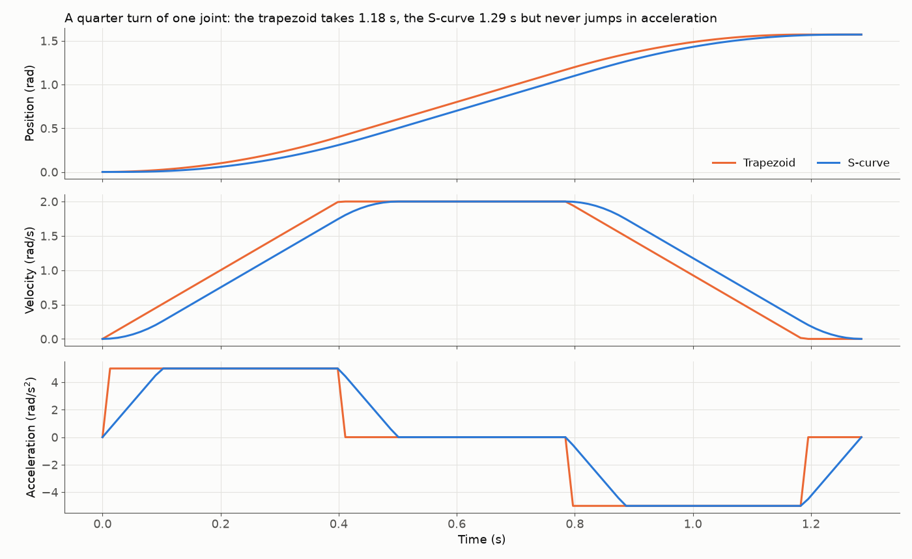

**Where the simulation is kinder than a real cell.** The motors' rotor
inertia and gearbox friction are estimates; KUKA publishes neither. A welded
grip never slips. The module is rigid. The follower's model of the arm is
the simulator's own.

The depth noise numbers are an assumption, not a camera's datasheet, and
glass is harder for a real depth camera than for this one.

**The planner against OMPL.** The hand-written planner was compared with OMPL
2.0.2 through that switch, on four moves and over whole pallets, by a rule
fixed before the numbers existed (`docs/ompl-comparison.md`). The result is
"Verdict: hand-written better". Given the same problem and the same seeds,
OMPL's RRT-Connect (`--planner ompl`) returns the paths the hand-written
search returns on the three carries, 150 of 150 plans, and over three pallets
places the same 90 of 90 modules. It failed the rule on the bare arm's return,
where the hand-written search tries the straight line first and needs 664
collision queries against OMPL's median of 2,735 (5.80 ms against 24.19 ms).
The one OMPL planner that passed on every move, BIT*, gave a median trajectory
of 6.037 s against 5.734 s on one carry, 5.3% longer where the rule allows 5%,
in a row that does not repeat from run to run. The document gives the tables,
what was made equal between the two and what was not, and the facts for
deciding whether OMPL should become the default; it does not decide that.
