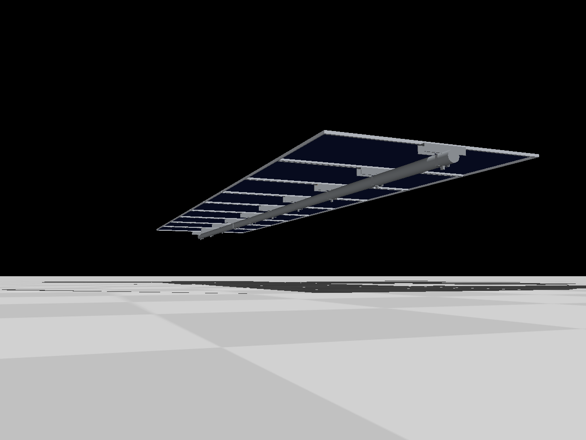
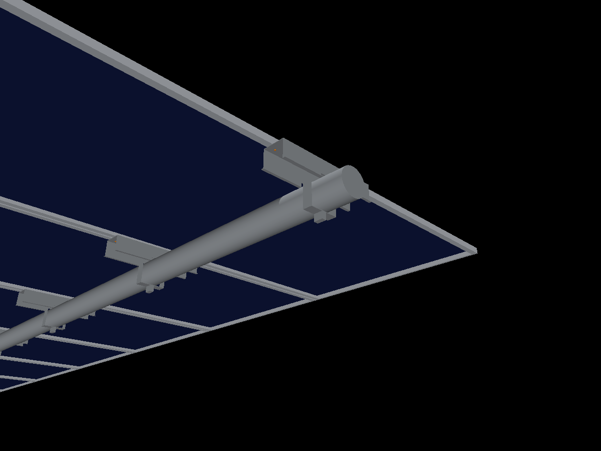
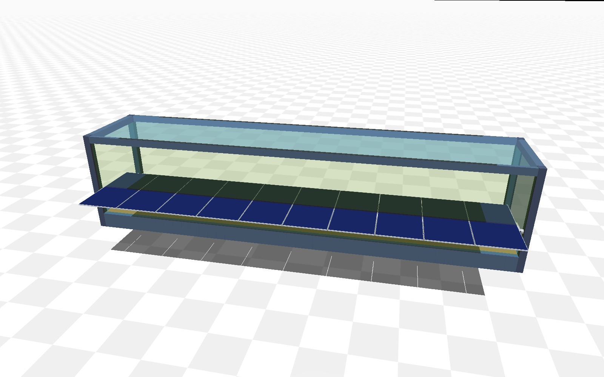

# The bay's hardware and the container

What one bay of a real single-axis tracker is made of, and what a 40 ft shipping container
is to a truck, a ship and a crane, written down so that models and code can be built from
it. The models are `models/bay.xml` and `models/container.xml`; the same figures are in
`src/bay_hardware.h` and `src/container.h`; `tests/bay_hardware_test.cc` and
`tests/container_test.cc` hold the three together. The cell (`models/cell.xml`) still uses
its old square tube and does not load either model.

**How to read the tables.** Every figure stands in a table row, and the row's last cell
says where the figure comes from:

- `published`: the figure is in a public source, cited as `[S<n>]` and listed under
  Sources. Each was read in the saved text of the source on 2026-11-24, not in a search
  engine's summary.
- `derived`: computed from figures of this document; the computation is in the row. A
  figure computed from an `ours` figure is as firm as that figure, and the row names
  what it is computed from.
- `ours`: designed in this run; the row says why this value. A person with the maker's
  drawings can replace these rows, and the last paragraph of each section says which.

A row that cites a source but ends in `ours` or `derived` uses the source as its reason,
not as its value. Lengths are in millimetres in the tables unless a unit is given, and in
metres in the header and the models.

**The bay's frame.** Positions on the bay are given in the tube's frame: the origin is on
the tube's axis at the plain (not swaged) end of the section, +Y runs along the tube to
the swaged end, +Z points up through the holes that locate the rails, and +X is across
the tube (X = Y x Z). "Along" means along Y, "across" along X, "round" a rotation about
Y, and "yaw" a rotation about Z.

**Simplifications, named once.** Holes are named sites in the model, not geometry. The
parts are boxes and cylinders: a rail's saddle is a step and its strap a square U. The
pins that fasten the modules have no mass in the model (The bay). The
section's swaged neck is a second, thinner cylinder. One kind of rail stands at all
ten places, where the reference has special rails beside a bearing and beside the
drive.

## The reference

The bay follows Nextracker's NX Horizon with one module in portrait. Three things decided
it: it is the most shipped tracker, its torque tube is round, and no other round-tube
tracker was found that is better documented.

| Figure | Value | Source, computation or reason | Basis |
|---|---|---|---|
| Trackers shipped in the world in 2024 | 111 GW | Wood Mackenzie, as reported by pv magazine [S1] | published |
| Shipped by Nextracker in 2024 | 28.5 GW, about 26% | The same report [S1] | published |
| Years Nextracker has been first | 10 in a row | The same report [S1] | published |
| Makers named after Nextracker | 4: Arctech, GameChange, PV Hardware, Array | The same report, which gives them no shares [S1] | published |
| Modules across the tube on NX Horizon | 1, in portrait | Nextracker's datasheet, as attached to a zoning petition [S2] | published |
| Modules in a row of NX Horizon | 78 to 90 | Nextracker's datasheet, as attached to a town's solar application [S3] | published |
| Typical length of a row | 85 m | Nextracker's brochure of 2017 [S4] | published |
| Shape of the torque tube: NX Horizon | round | "round torque tube" in the datasheet's list of bifacial features [S2] | published |
| Shape of the torque tube: Array DuraTrack | octagonal, 8 sides | Solar Builder on Array's clamp [S5] | published |
| Shape of the torque tube: Arctech SkyLine II | pentagonal, 5 sides | TaiyangNews on Arctech's 1P tracker [S6] | published |

No saved source states the tube shape of GameChange's or PV Hardware's trackers, so
among the five makers the report names, Nextracker's is the only tube confirmed round.
The best public description of NX Horizon's parts is its installation manual, of which
two revisions were read as copies that users had uploaded to a document site
([S7], [S8]). They are the maker's text but
not from the maker's own site, and they give procedures, not drawings: they say what
each part is, how it is located and fastened and to what torque, and almost no
dimension. Where they stop, figures come, in this order, from another maker's public
documents, from the standard or supplier a part comes from, or from a design made here.
No other maker's round-tube tracker supplied a figure in the end: the gaps were filled
from standards, fastener makers and module makers, and by design.

## Torque tube

| Figure | Value | Source, computation or reason | Basis |
|---|---|---|---|
| Outer diameter | 124 | TaiyangNews on NX Horizon; no source read gives 5 in (127 mm) [S9] | published |
| Wall thicknesses in use, manual of 2020 | 2.5, 3 and 4 | Columns of the manual's rivet table [S8] | published |
| Wall thicknesses in use, manual of 2022 | 2.2 or 2.3, 2.5 or 3, 3.5 or 4 | Columns of the same table two revisions later; the wall is chosen for each project and row [S7] | published |
| Wall the model uses | 3.0 | The middle class of both revisions; with it a section of our length weighs within the range the manual gives (below) | ours |
| Material and finish | galvanized steel, 1 welded seam | Datasheet: "Galvanized steel; other coatings available" [S2]; the tube is rolled from coil and its long edges welded [S10] | published |
| Least yield strength of round structural tube | 290 MPa (grade B), 315 MPa (grade C) | ASTM A500 as tabulated by Wikipedia; the reference's grade is not public, and this figure is used only in the handling check under Holding the tube [S11] | published |
| Mass of a standard round tube 114.3 x 4.0 | 10.9 kg/m | Table of EN 10219 circular hollow sections [S12] | published |
| Density of steel this document uses | 7,864 kg/m3 | 10.9 kg/m / (pi x (114.3 - 4.0) mm x 4.0 mm), from the row above | derived |
| Mass for each metre, 124 x 3.0 | 8.97 kg/m | 10.9 x ((124 - 3) x 3) / ((114.3 - 4) x 4): mass goes as mean diameter times wall | derived |
| Mass of a section, as the maker gives it | 67 to 105 kg | "depending on length and wall thickness" [S7] | published |
| How sections join | 1 swaged end into the next tube's plain end | Manual, task E.2 [S7]; the ends are shaped at the factory [S10] | published |
| Fasteners of a joint | 6 blind rivets, 1/2 in | Manual, task E.2 and its tool table [S7] | published |
| Length of the swaged neck | 100 | Two rings of three 1/2 in rivets, 50 apart and 25 (two diameters) from each tube's end | ours |
| Outer diameter of the neck | 118 | 124 - 2 x 3.0: the neck slides into the next tube's bore | derived |
| Length from the plain end to the neck's shoulder | 10,516 | 160 to the first rail, 9 x 1,144 to the last, 60 beyond it (see the next table) | derived |
| Length of a section as shipped | 10,616 | 10,516 + 100. No source gives a section's length; this is the bay of nine modules under The bay | derived |
| Mass of our section | 95.2 kg | 8.968 x 10.516 + 8.523 x 0.100 (the neck, 118 x 3.0) = 94.31 + 0.85 = 95.16; inside the maker's 67 to 105 kg | derived |
| Feature that locates a rail | 1 hole for each rail, facing up | "Ensure that the module rail alignment holes on the torque tubes face up"; the rail's tab goes into it [S7]. The holes are drilled at the factory [S10] | published |
| Diameter of a locating hole | 14 | Not public. A drilled round hole that takes the rail's tab (12 x 2) with the play computed under Tolerances | ours |
| Locating holes on a section | 10 | One for each rail of the bay | derived |
| Spacing of the locating holes along the tube | 1,144 | The module's width and the gap, since neighbours share a rail: 1,134 + 10 | derived |
| Position of the first locating hole | Y = 111, on top (X = 0, Z = +62) | The first rail's centre, 160, less 49: the tab is on the rail's web nearer the plain end | ours |
| Feature that fastens a rail | none on the tube: a strap goes round it | The manual gives a strap closed under the tube by one bolt and names no hole in the tube for it [S7]; that the tube has none is our reading | ours |

Where a rail cannot stand:

| Figure | Value | Source, computation or reason | Basis |
|---|---|---|---|
| Gap in the row of modules at a bearing | about 200 | "the BHA gap which spans approximately 200 mm depending on selected module width" (BHA: bearing housing assembly) [S7] | published |
| Distance of the rails beside a bearing from its handle | 35 +/- 6.3 | Manual, task E.3; these are rails of their own kind [S7] | published |
| Where a joint lies | near a bearing housing | A Nextracker patent: the tubes are joined "within a vicinity of the clam shell clamp housing member". It describes an embodiment, not the product as built [S13] | published |
| What the row of modules leaves uncovered | 3 things: bearings, piers, slew gear | Nextracker's sheet on bifacial modules [S14]; the rails either side of the slew drive are of another kind [S7] | published |
| Our section: stretch at the plain end no rail may cover | Y = 0 to 100 | The next section's neck and its rivets are inside it | ours |
| Our section: stretch at the swaged end no rail may cover | Y = 10,516 to 10,616 | The neck itself | derived |
| Our section: gap between the rows of modules of two joined sections | 230 | (10,516 - 10,451) + 165: last module's edge to the shoulder, then the next section's plain end to its first module's edge | derived |

Our gap of 230 is wider than the maker's 200 because we keep rails off the joint, and
the sources do not show how the reference fits its joint and its bearing into 200. Where
the piers and the drive stand along a row, and so which sections carry a bearing or the
drive, is in a project's construction drawings and not public; the model has neither. A
person with the maker's drawings could replace: the wall for a given site, the steel
grade and coating weight, the section's length, the neck, the rivets' pattern, and the
locating holes' diameter and positions.

## Module

The module is the 2,382 x 1,134 mm format that nine makers agreed on in July 2023 for
modules with rectangular cells. No source read gives a share of new utility-scale plants
by module outline; the evidence is that rectangular wafers are the largest group, that
they are made into this format, and that the current utility-scale sheets of three of the
largest makers all have it.

| Figure | Value | Source, computation or reason | Basis |
|---|---|---|---|
| Size agreed by nine makers | 2,382 x 1,134 | Trina's announcement of the agreement [S15] | published |
| Mounting-hole distances agreed, along the long side | 400, 790 and 1,400 | The same announcement [S15] | published |
| Share of rectangular wafers in 2025 | 48.2%, the largest group | CPIA's figures as reported by TaiyangNews [S16] | published |
| Format the rectangular (210 mm series) wafers are made into | mainly 2,382 x 1,134, with 66 or 72 cells | InfoLink [S17] | published |
| Length, width, thickness: Jinko JKM-66HL4M-BDV | 2,382 x 1,134 x 30 | Datasheet (United States) [S18] | published |
| Length, width, thickness: Canadian Solar CS6.2-66TB | 2,382 x 1,134 x 30 | Datasheet [S19] | published |
| Length, width, thickness: Trina TSM-NEG19RC.20 | 2,382 x 1,134 x 30 | Datasheet [S20] | published |
| Mass: Jinko, Canadian Solar, Trina | 32.4, 32.8 and 33.0 kg | The three datasheets [S18] [S19] [S20]. The model uses Jinko's, 32.4 kg | published |
| Glass | 2.0 on the back, and the same on the front | Jinko's datasheet [S18] | published |
| Thickness of the laminate in the model | 5 | Two sheets of 2.0 glass and about 1 for cells and encapsulant | ours |
| Mass of the laminate and of the frame in the model | 27.0 and 5.4 kg | Glass 4 mm thick at about 2,500 kg/m3 over 2.70 m2 is 27 kg; the frame is the rest of 32.4 | ours |
| Frame | anodized aluminium, 30 high | Canadian Solar's datasheet [S19] | published |
| Long side's bottom flange: Jinko | 28 wide: 19 from the outer edge to the hole's centre and 9 beyond; 1.7 thick | Read from the drawing on the datasheet's page 2, which has no text layer [S18] | published |
| Long side's bottom flange: Canadian Solar, Trina | 30 and 28.5 wide | Read from the drawings [S19] [S20]. The model uses Jinko's 28 | published |
| Short side's bottom flange: Canadian Solar, Trina | 20 and 11.6 wide | Read from the drawings [S19] [S20]. The model uses 11.6 | published |
| Width of a frame member's upright part in the model | 10 | The drawings give the flange, not the hollow part above it; 10 leaves the hole's centre 9 clear of it | ours |
| Distance between the two rows of holes, across the width: Jinko | 1,096 +/- 2 | Drawing [S18] | published |
| The same: Canadian Solar, Trina | 1,091 and 1,095 | Drawings [S19] [S20]. The model uses Jinko's 1,096; a rail fits one maker's module | published |
| Hole's centre from the long edge | 19 | (1,134 - 1,096) / 2, and the flange drawing says the same | derived |
| Holes along each long side | 6: at +/-200, +/-395 and +/-700 from the middle | The distances 400, 790 and 1,400, each +/-1, are between the two holes of a pair [S18] | published |
| Shapes and sizes of the holes | slots of 14 x 9 and of 10 x 7 | Jinko's drawing [S18] | published |
| Holes meant for trackers | 8 slots of 10 x 7 | Canadian Solar's drawing names them "Mounting Hole(tracker)" [S19] | published |
| Which holes are the 10 x 7 slots | the 4 at 400 and the 4 at 790 | Canadian Solar's manual: the holes at 400 and 790 take M6, and M6 goes with the 10 x 7 slots [S21] | published |
| Holes a tracker of the reference kind uses | the 4 at 400 (2 on each long side) | "NEXTracker uses a 400-mm span" [S22]; Canadian Solar's list of approved trackers gives the 400 holes for NX Horizon's short rail [S23] | published |
| Largest test load the maker lists for the module on those holes | +1,800 / -1,800 Pa | Jinko's manual, table 8 (maximum test loads), row "NEXTracker 1P, NT Standard Rail (400)", hole spacing 1,096; a test load, not a rating [S24] | published |
| Direction of a 10 x 7 slot's long side | along the module's long side (the bay's X) | The drawings show the slots lying along the frame; no text says so | ours |
| Least gap between neighbouring modules | 6.5 (Canadian Solar), 5 (Trina) | Installation manuals [S21] [S25] | published |
| Modules on a pallet | 36 | Jinko's datasheet [S18] | published |
| How the modules stand on the pallet | on their long edge, side by side | Read from the maker's unpacking instructions and from a sibling datasheet's pallet size (2,396 x 1,110 x 1,251 for 31 modules of 35), sources [L9] and [L10] of `docs/layout.md`; neither says it outright, and which way the glass faces was not found | ours |

A person with the module maker's frame drawing could replace the upright part's width
and the laminate's thickness and mass.

## Rail

What is public about NX Horizon's module rail is how it works; its drawing is not. The
rail below is designed here to do what the manual describes, from sheet steel and the
loads of this document.

| Figure | Value | Source, computation or reason | Basis |
|---|---|---|---|
| Rails a module rests on | 2, one under each long side | The module is fastened by its 400 holes on both long sides (Module) and each rail is levelled against "the rail that it shares a module with" [S7] | published |
| Modules a rail carries | 2: neighbours share one | "Shared mounting rails" [S4] | published |
| Rails in a bay of nine modules | 10 | 9 + 1; the two end rails carry one module each | derived |
| How its place along and round the tube is fixed | 1 tab on the rail in 1 hole on top of the tube | "Insert the module rail alignment tab into the torque tube alignment hole" [S7] | published |
| How level two rails of one module must be before they are fastened | within 1 degree of each other | Manual, task H.2: checked with a digital level, so the tab does not set this by itself [S7] | published |
| What holds it down | 1 strap under the tube | Manual, task H.2 [S7] | published |
| Material | galvanized steel | Datasheet [S3] | published |
| Height of the cells above the tube | 90 | TaiyangNews on NX Horizon [S9] | published |
| Shape of comparable rails | hat section, rolled from light-gauge sheet | Two patents, one Nextracker's; a patent is not a product drawing [S26] [S27] | published |
| Length of a comparable rail on the 400 holes | 440 | Arctech's, in Canadian Solar's list of approved trackers [S23] | published |
| Profile | hat, open side down: top 100 wide, two webs 80 deep, two feet 10 wide | The top carries the edges of two modules; the open underside lets the tool reach the pins; the webs straddle the tube; the feet stiffen the webs' edges and keep the rail within 60 of its centre line, clear of the tube's joint | ours |
| Sheet thickness | 2.0 | With the frame's 1.7 flange it gives a grip of 3.7 for the pin; stress at the module's test load is low (below) | ours |
| Length across the tube | 460 | The 400 between a side's two holes and 30 beyond each, over four pin diameters | ours |
| Height of the top face above the tube's axis | 124 (62 above the tube's top) | Puts the cells 62 + 30 - 2.5 = 89.5 above the tube, the published 90 | derived |
| How it sits on the round tube | 2 arcs of radius 62.5, cut 18 deep into the webs, each about 89 long across the tube; the webs are 96 apart | A saddle that centres the rail across the tube and stops it yawing; 0.5 of play on the radius | ours |
| Half-width of the saddle in the model | 44 | Where an arc of 62.5 resting on the tube's top meets the webs' lower edge: sqrt(62.5^2 - 44.5^2) = 43.9. The model steps the webs there | derived |
| Locating tab | 12 wide across the tube, 2 thick, 6 long, at the middle of the web nearer the plain end | A tongue of the web's own sheet, pointing down into the tube's hole | ours |
| Holes for the pins | 4 slots of 7.1 x 13, long side along the tube, at X = +/-200 and 24 either side of the rail's centre line | 7.1 is a hole both lockbolt makers allow (Fastenings); the slot crosses the frame's slot, as purlins are "stamped with slots" [S28]; 24 = 10 / 2 + 19 | ours |
| Strap | 40 wide, 2.5 thick: round the lower half of the tube and up to the webs' lower edges, where each end is rolled round a pin 8 across and 100 long that lies in notches of the two webs; its two ears, 20 across together, are closed under the tube by the bolt, 80 below the tube's axis | Sized to take the bolt's tension with a wide margin; the pins let the strap swing open to pass the tube; 80 leaves the bolt's head clear of the tube | ours |
| Mass of rail, strap, pins and bolt | 2.35 kg | Sheet 276 developed x 2.0 x 460 less the saddle cuts: 1.96; strap 348 long (199 round the tube, 2 x 44 up to the webs, 2 x 30.5 of ear) x 40 x 2.5: 0.27; two pins: 0.08; bolt, nut and washers about 0.035; steel at 7,864 kg/m3 | derived |
| Load on one rail at the module's test load | 4,862 N | 1,800 Pa x 2.382 x 1.134 m2: half of each of two modules | derived |
| Bending stress in the rail at that load | 52 MPa | Half the load at 200 from the tube's axis: 486 N m; the hat (100, 80 and 10, sheet 2.0) has a section modulus of 9.4 cm3 at its feet | derived |
| Load on one rail from the modules' weight alone | 318 N | 32.4 kg x 9.81 | derived |

In the model a rail is a body of fifteen boxes: the top, each web in three pieces that
step over the tube where the real web is cut to an arc, the feet in two pieces each,
and the strap as a square U of three boxes with a block for its two ears; the strap's
pins are not drawn. The reference has more kinds
of rail than this one: standard and heavy, wide, the rails beside a bearing and the
first rails beside the drive ([S7]). A person with the maker's
drawing could replace every `ours` row of this table.

## Fastenings

One row for each kind of fastening. A row here is marked by its least certain cell; the
two tables after it give each figure its own basis.

| Kind | Fastener | For each part | Tightening | The tool comes | Free space round the axis | Basis |
|---|---|---|---|---|---|---|
| Rail to tube (`rail`) | Strap closed by one M8 through bolt; nothing enters the tube [S7] | 1 for each rail | 17.6 N m, measured, no impact tool | Along the rail (the bay's X), under the tube, from the +X side toward -X (the side is our choice) | 12 mm radius | ours |
| Module to rail (`module`) | 1/4 in pin with a swaged collar (a lockbolt), not a threaded bolt [S7] | 4 for each module, 2 into each of its two rails | None: the collar is swaged by the tool | Along the rail's upright axis (the bay's Z), from below the rail, moving up (the direction is our reasoning) | 13 mm radius | ours |

The owner's "bolted" is met as real bays meet it: the modules are held by lockbolts,
which a tool swages and which are never torqued, and the rails by a
strap with one torqued bolt.

Rail to tube:

| Figure | Value | Source, computation or reason | Basis |
|---|---|---|---|
| Fastener | 1 M8 through bolt in the torque tube strap | Manual, task H.2 [S7] | published |
| Fasteners for each rail | 1 | "Installs with only one fastener per rail": a sheet of 2017 for First Solar's Series 4 modules on NX Horizon [S29]; the manual's task H.2 for the short rail has the one bolt and no other | published |
| Tightening torque | 17.6 N m (13 ft-lb) | Manual, task H.2 [S7] | published |
| Torque accepted at a check | within 10% | Manual [S7]; an impact gun is not allowed, "an accurate torque value must be measured" | published |
| Where the bolt lies | at the bottom of the tube, parallel to the rail within 10 degrees | Manual of 2020 [S8]; the manual of 2022 repeats the 10 degrees [S7] | published |
| Bolt | M8 x 50, hexagon head, class 8.8, its nut held in the far ear | The manual gives only "M8"; this is the common standard bolt (ISO 4014), long enough for two ears and a nut. The nut is caught by the ear's shape so that one tool on one side drives the bolt; the manual does not show how the reference holds it | ours |
| Hole in the strap's ears | 9.0 | The medium clearance hole for M8 in ISO 273, read in the identical Indian standard [S30] | published |
| Height of the bolt's axis | Z = -80 | 18 below the tube's underside: the strap, half a bolt head and room for a socket | ours |
| Side the tool comes from | +X, moving toward -X | The reference fixes only the axis; one side for all ten rails lets one tool reach them all | ours |
| Free space the tool needs | 12 mm radius round the axis, 100 mm along it out from the ear's mouth | A 13 mm socket for an M8 head is about 18 mm across; no source was read for it. The 100 is the length of socket and extension a tool must have before its body begins, so that the body stays clear of the tube's flank | ours |
| Rails beside a bearing, for comparison | 1 U-bolt with M10 nuts at 24.4 N m (manual of 2020) or 28 N m (manual of 2022) | Both print 18 ft-lb, which is 24.4 N m [S8] [S7]. The model has no such rail | published |

Module to rail:

| Figure | Value | Source, computation or reason | Basis |
|---|---|---|---|
| Fastener | 1/4 in pin and collar; a maker's part, to no public standard | "Insert 1/4-in. pins through the module frame and module rail", then "Swage collars onto the 1/4-in. pins" [S7] | published |
| Pin's diameter | 6.35 | 1/4 x 25.4 | derived |
| Fastening points a module maker asks for | at least 4, on two opposite sides | Canadian Solar's manual for bifacial modules [S23] | published |
| Fasteners for each module | 4 | The two holes of the 400 pair on each long side, each long side on its own rail | derived |
| Tightening | none (0 N m): swaged | "Vibration proof, permanent swaged fasteners. No re-torquing required" [S4] | published |
| Tools the manual lists for it | 2: A1100 (air, 90 psi) and PB2500N (battery) | Manual, table 2-2 [S7] | published |
| Nose of the battery tool for 1/4 in | 26 across and 80 long; an extended one 19 across | The tool's manual [S31] | published |
| Free space the tool needs | 13 mm radius round the axis, 80 mm along it | Half of 26, and the nose's length. The locating move needs more round each hole, below the rail and above the flange: see Locating a module before pinning | derived |
| Side the tool comes from | below the rail, moving up (+Z) | The pin's head lies on the frame's flange, where only 30 - 1.7 - 5 = 23 is free under the laminate, less than the nose's 80; the collar and the tool are below the rail's top, inside the hat | ours |
| How the pin is put in | from above, through the frame's flange and then the rail's top, after the nose has left the hole and before the tool comes | The manual's order of words, and the locating move (Locating a module before pinning). A finger of the pin tool comes up inside the frame, inboard of the rail's top, which ends 45 from the module's edge. It reaches over the flange's inner edge, 28 from the edge, to the hole, 19 from it. Only 23 is free above the flange, so the pin's shank must be under 23 long to pass under the laminate. Its length was not found | ours |
| Hole a 1/4 in lockbolt needs | 6.4 to 7.1 (Huck BobTail); 7.04 to 7.42 (Avdel 6.4 mm) | Two makers' catalogues, which differ [S32] [S33]. The manual does not name the maker; the rail's 7.1 is inside both, and the frame's slot, 7 wide, is inside the first and 0.04 under the second's least | published |
| Hole in the module | slot of 10 x 7 | The frame's tracker slot, from the Module section | derived |
| Thickness the pin clamps | 3.7 | Rail's sheet 2.0 and frame's flange 1.7 | derived |
| What module makers give for a threaded bolt in the same hole, for comparison | M6 at 6 to 9 N m (Canadian Solar), 9 to 12 (Jinko), 8 to 12 (Trina) | Installation manuals [S21] [S24] [S25]. The reference does not use one | published |

Two more connections exist and are not fastenings of a bay. The rail's tab in the
tube's hole has no fastener; the model names its two halves `bay_locate_<rail>_a` (on
the rail) and `_b` (on the tube). The joint between two sections (six rivets) belongs to
a row, not to a bay. A person with the maker's bill of materials could replace the
bolt's length and head, and the lockbolt's maker and grip.

## The bay

One bay is one tube section with its rails and its modules, as it leaves the cell.

| Figure | Value | Source, computation or reason | Basis |
|---|---|---|---|
| Modules | 9 | No source fixes the number on a section. The owner's decision of 2026-11-24, for the container (The container): ten modules make a section of 11,760, which leaves 35 at each end of the clear inside envelope of 11,830 and does not pass the other open-side container read, whose opening is 11,556; nine make 10,616, which leaves 607 at each end of 11,830 and passes 11,556 with 470 at each end | ours |
| Bays a pallet of modules fills | 4 | 36 / 9: a pallet of 36 (Module) fills four bays of nine | derived |
| Gap between modules | 10 | Above both makers' minimum (6.5 and 5) and more than twice what one module can shift along the tube under Tolerances (3.65) | ours |
| Pitch of the modules and of the rails | 1,144 | 1,134 + 10 | derived |
| Rails | 10, at Y = 160 + 1,144 k for k = 0 to 9 | 100 for the joint, then half a rail's width over its feet, 60 | derived |
| Modules' centres | Y = 732 + 1,144 m for m = 0 to 8, X = 0, Z = +139 | Midway between two rails; half the frame's 30 above the rails' top at 124 | derived |
| Fastenings, rail to tube | 10 | 1 for each rail | derived |
| Fastenings, module to rail | 36 | 4 for each module | derived |
| Fastenings in all | 46 | 10 + 36, the two kinds together | derived |
| Locating holes with their tabs | 10 | 1 for each rail | derived |
| Stretches of the tube that may be held | 11 | Under Holding the tube | derived |
| Length (along Y) | 10,616 | The tube as shipped; the modules reach from Y = 165 to 10,451 (732 + 8 x 1,144 + 567) | derived |
| Width (along X) | 2,382 | The module's length | derived |
| Height (along Z) | 249: from Z = -95 to +154 | The strap's ears end 95 below the axis; the modules' top is 124 + 30 above it | derived |
| Mass | 410.3 kg | Tube 95.16 + 10 rails x 2.35 + 9 modules x 32.4 = 95.16 + 23.50 + 291.60 | derived |
| Mass of the 36 pins and collars, which the figure above and the model leave out | about 0.4 kg | About 10 g each, our estimate: a steel pin 6.35 across and its collar; under 0.1% of the bay | ours |

`bazel run --config=opt //:print_bay -- --summary` prints the counts, the size and the
mass of this table, and without the flag one row for each of the 46 fastenings.

## Holding the tube

The tube is round, so nothing about its shape keeps it from turning. In the reference
the tube is already on its bearings when rails go on: the hole on top sets where a rail
sits round the tube, the installer levels each rail against its neighbour to within one
degree, and the strap's bolt then clamps it by friction. A cell that puts rails and
modules on a loose tube has to supply what the bearings and the installer's level
supply.

| Figure | Value | Source, computation or reason | Basis |
|---|---|---|---|
| How the reference fixes a rail round the tube | 1 tab in 1 hole, then levelled within 1 degree, then clamped | Manual, task H.2 [S7] | published |
| Moment about the axis from a module resting on one side only | 73 N m | 32.4 kg x 9.81 x 0.230 m: the whole module on one end of its rails | derived |
| Moment from a rail resting on one side only | 5.3 N m | 2.35 kg x 9.81 x 0.230 m | derived |
| Moment from nine modules all off to one side by what their holes allow | 6.3 N m | 9 x 32.4 x 9.81 x 0.0022 m | derived |
| Largest moment assembly can put on the tube | 73 N m | The first of the three; they do not add, since a module is put down once | derived |
| Moment a holder must resist | 150 N m | Twice the largest, for a module that is set down with a bump | ours |
| How far the tube may be turned before a rail's tab misses its hole | 0.86 degrees (15 mrad) | The tab's play of 0.93 mm across (Tolerances) at the tube's radius of 62 | derived |
| How far before a module's pins miss, with the rails already on | 1.02 degrees (17.7 mrad) | The pins' play of 2.20 mm across at the rail's top, 124 from the axis | derived |
| Angle a holder must keep | within 0.8 degrees of the holes facing up | Just inside the smaller of the two | ours |
| Stretches a holder may grip: the plain end | Y = 0 to 100, full circle, with its 6 rivet holes | Bare until the row is joined; the holes take a pin, which fixes the angle without friction | ours |
| Stretches a holder may grip: between rails | 9 stretches, Y = 210 + 1,144 k to 1,254 + 1,144 k for k = 0 to 8, lower half only | Each is 1,044 of bare tube between two straps; the modules are over the upper half | ours |
| Stretches a holder may grip: the neck | Y = 10,516 to 10,616, diameter 118, with its 6 rivet holes | As the plain end | ours |
| Stress in the tube if the finished bay is held at its two ends only | 156 MPa, with a sag of 0.14 m | 379 N/m (410.3 kg x 9.81 over 10.616 m) over 10.516 m: 5,241 N m on a section modulus of 33.7 cm3; sag with a modulus of 200 GPa, the usual figure for steel, not from a source | derived |
| The same held 2.44 m from each end | 33 MPa | The overhangs' moment, 379 x 2.44^2 / 2 = 1,128 N m | derived |

So anything that holds the tube must do four things. It grips only the eleven stretches
above; they are the sites `bay_hold_0` to `bay_hold_10` of the model, each a cylinder as
long as its stretch. It resists 150 N m about the axis. It keeps the locating holes
within 0.8 degrees of straight up from the first rail to the last pin. And it does not
carry a finished bay by its ends alone: 156 MPa is more than half of the weakest grade's
yield and the sag would spoil the rails' alignment. The locating holes themselves are
not for holding: each is taken by its rail's tab. This section does not design the
fixture.

## Tolerances

How far a part may be from its place for its fasteners still to go in, from the play of
each hole round what goes through it. Each figure is for that error alone, with every
other part in its place; errors that act on the same hole add up.

A module on its two rails: four pins of 6.35, each through a slot in the rail (7.1
across the tube, 13 along it) and a slot in the frame (10 across, 7 along). The four
holes are at X = +/-200 and 548 either side of the module's centre along the tube.

| Figure | Value | Source, computation or reason | Basis |
|---|---|---|---|
| Module, across the tube | +/-2.20 | (7.1 - 6.35) / 2 + (10 - 6.35) / 2 | derived |
| Module, along the tube | +/-3.65 | (13 - 6.35) / 2 + (7 - 6.35) / 2 | derived |
| Module, yaw | +/-0.23 degrees (4.0 mrad) | The holes 548 from the centre move 2.20 across; the play along would allow 3.65 / 200 = 18 mrad | derived |
| Module, yaw and offset across together | offset + 548 x yaw (rad) within 2.20 | The same hole takes both | derived |
| Module, part of the play along the tube that the module's own tolerance takes | 1.0 | The hole rows are 1,096 +/- 2 apart, so each can be 1 from its place | derived |
| Module, part of the play across the tube that the module's own tolerance takes | 0.5 | The two holes of a pair are 400 +/- 1 apart, so each can be 0.5 from its place | derived |

A rail on the tube: its tab, 12 across by 2 along, in a round hole of 14, and its saddle
on the tube.

| Figure | Value | Source, computation or reason | Basis |
|---|---|---|---|
| Rail, across the tube at the tab | +/-0.93 | sqrt(7^2 - 1^2) - 6: the tab's corners meet the hole's edge | derived |
| Rail, round the tube | +/-0.86 degrees (15 mrad) | The same motion: the saddle keeps the rail on the tube, so it can only go across by going round. 0.93 / 62 | derived |
| Rail, along the tube | +/-2.61 | sqrt(7^2 - 6^2) - 1 | derived |
| Rail, yaw | +/-0.83 degrees (14 mrad) at most | The tab can turn freely in its hole; the saddle's 0.5 of play, 0.71 on the flank, over the 49 from the centre to a web, taking the arc as centred on the tube. A rail resting on the tube's top has about half of this | derived |
| Rail, round the tube, for its modules' pins to go in | +/-1.02 degrees (17.7 mrad) | 2.20 at the rail's top, 124 from the axis; the manual's rule is 1 degree | derived |
| Rail, yaw, for its modules' pins to go in | +/-1.05 degrees (18 mrad) | 3.65 at the holes 200 from the tube's axis | derived |
| Rail, along the tube, for its modules' pins to go in | +/-3.65 | The module's own play along the tube | derived |
| Strap's bolt in its ears | +/-0.5 | (9.0 - 8) / 2. The bolt joins the strap's two ears and not the rail to a hole in the tube, so it goes in wherever the rail sits | derived |

So a rail that is in its hole and on its saddle is close enough for its modules'
pins: its own play (0.86 degrees, 2.61, 0.83 degrees) is inside what the pins allow
(1.02 degrees, 3.65, 1.05 degrees). Along the tube there is little to spare: once the
module's own 1.0 is taken, the pins allow 2.65 against the rail's 2.61.

The figures of the first table are for holes at their nominal places; with the module's
own tolerances 1.70 is left across the tube and 2.65 along it. In the model the two
sites of a fastening lie on one line along the tool's axis, a stack apart: 10 for the
strap's bolt, from the ear's hole to the tube's mid-plane, and 1.85 for a pin, between
the middles of the rail's sheet and the frame's flange. "Within the clearance" is
measured across that axis.

Beside the cell's present tolerance for a placed module (`docs/gate.md`,
`cell::PlacementTolerance`: the owner's figures, 3 in the rails' plane in any direction
and 0.15 degrees of yaw):

| Figure | The cell today | The fastening allows | Which is tighter | Basis |
|---|---|---|---|---|
| Offset across the tube | 3 | 2.20 | the fastening | derived |
| Offset along the tube | 3 | 3.65 | the cell, by 0.65 | derived |
| Yaw | 0.15 degrees | 0.23 degrees | the cell, by 0.08 degrees | derived |
| Offset across at the cell's largest yaw | 3, whatever the yaw | 0.77 = 2.20 - 548 x 2.62 mrad | the fastening | derived |

Which is tighter depends on the direction. Across the tube the fastening is tighter: a
module the gate accepts at 3 mm across cannot be pinned. In yaw and along the tube the
cell's tolerance is tighter. Taken together the fastening is the tighter one, because
yaw and offset share the same 2.20: a module at the cell's limit of yaw has 0.77 mm
left across, and 0.27 mm once the module's own hole tolerance is taken. A cell that
pins modules therefore moves each module into its holes before the pins go in, as the
next section, Locating a module before pinning, designs.

## Locating a module before pinning

This section is designed here; no source was read for any of it. It rests on the owner's
decision of 2026-11-24 that a module is laid down within the gate's tolerance (3.00 in
the rails' plane in any direction and 0.15 degrees of yaw, `cell::PlacementTolerance`)
and then moved into its holes before it is pinned. Tolerances shows why the move is
needed: the gate accepts modules whose pins would not go in. The move: a tapered nose
rises from below through the rail's slot into the frame's slot, and slides the module
until a pin can go in. `bazel run --config=opt //:print_bay -- --summary` prints every
figure of this section, and `-- --capture` prints the capture table. The figures are in
`src/bay_hardware.h`, and `tests/bay_hardware_test.cc` checks them over every placement
the gate accepts. It also shows that the check fails with a tip of 4 or a frame slot of
7.5 across the tube.

Both slots are taken as obrounds: two half circles of the slot's width joined by
straight sides. This is the cautious reading of "a slot of 10 x 7", because a rectangle
leaves a larger opening at its corners. A round thing then passes through both slots
when the slots' two centre lines are no further apart than the sum of their half widths,
7.05, less its diameter. The hole's error is how far the frame's slot is from the rail's.
It is (dx - yaw x Y, dy + yaw x X) for the hole at (X, Y) from the module's centre, plus
the hole's own tolerance of 0.50 across and 1.00 along (Tolerances).

What carries the taper, and from which side:

| Figure | Value | Source, computation or reason | Basis |
|---|---|---|---|
| What carries the taper | a hardened steel nose on the arm that sets the pins, on a mount that floats across and along the tube | The slots, not the arm, then place the nose. Whether it is a tool of its own or a part of the pin tool is for the layout to decide | ours |
| Side it enters from | below, along the hole's axis (+Z): through the rail's slot first, then the frame's | This is the side the swaging tool uses, inside the hat, where there is room. Above the flange only 23.30 is free, and the laminate covers it | ours |
| How it fits with Fastenings | the pin still goes in from above, and the swaging tool still comes from below | The nose is out of the hole before either comes | ours |
| Shape of both slots | obround | The cautious reading, as above | ours |

The nose:

| Figure | Value | Source, computation or reason | Basis |
|---|---|---|---|
| Tip | ball, 2.00 across | Small enough to find the rail's slot from below (next table) | ours |
| Full diameter | 6.60 | More than the pin's 6.35, so a hole it locates is inside the pin's play. Less than the frame slot's 7.0 | ours |
| Taper | 8.60 long, from 2.00 to 6.60 | A half angle of about 15 degrees, so that a push across lifts the frame's edge less than half the module's weight (below) | ours |
| Half angle of the taper | 14.97 degrees | atan((6.60 - 2.00) / 2 / 8.60) | derived |
| Land | 6.00 long, 6.60 across | Longer than the two sheets (2.0 and 1.7) and the over-travel together | ours |
| Length of the nose | 15.60 | Tip radius 1.00 + taper 8.60 + land 6.00 | derived |
| Over-travel ("fully in") | 1.00 | The land's upper end this far above the flange's top face | ours |
| Rise of the tip above the flange when fully in | 10.60 | 1.00 + 8.60 + 1.00 | derived |
| Free height above the flange, under the laminate | 23.30 | 30 - 1.7 - 5 from the Module section; Fastenings rounds it to 23 | derived |
| Height left between the tip and the laminate | 12.70 | 23.30 - 10.60 | derived |

How the tip finds the opening. This is the "by contact" of the owner's decision:

| Figure | Value | Source, computation or reason | Basis |
|---|---|---|---|
| Aim of the tip at the rail's slot from below | +/-2.55 across, +/-5.50 along | (7.1 - 2.0) / 2 and (13 - 2.0) / 2: the arm's whole aiming budget | derived |
| Search when the flange stops the tip | 1 loop round the inside of the rail's slot, 27.8 for the tip's centre, pressed up lightly | 2 x 5.9 + pi x 5.1 | ours |
| Clearance the tip needs | 0.50 | Over the tip's diameter, for the edges' shape and the mount's give | ours |
| Least opening the tip enters | 2.500 | 2.00 + 0.50 | derived |
| Opening left at a hole error (ex, ey) | 7.05 - sqrt(max(0, abs(ex) - 1.50)^2 + max(0, abs(ey) - 2.95)^2), at most 7.0 | The two centre lines are a segment of 13 - 7.1 = 5.9 along the tube and one of 10 - 7 = 3.0 across it | derived |
| Camera looking up through the slot, in place of the loop | not chosen | The owner asked for contact, and the loop needs nothing the tool does not already have | ours |

The frame's slot is 10 long across the tube and the rail's slot is 7.1 wide, so the
frame's slot always crosses the wall of the rail's slot. Wherever an opening of the
tip's size exists, it reaches that wall, and the tip rises into it on its way round the
loop. The tip therefore enters whenever the opening is at least 2.500.

The capture range. The three placements are the worst that the gate accepts, as
`print_bay -- --capture` prints them. In each, the module is 3.00 from its place: straight
across the tube, straight along it, or at 45 degrees. The yaw is the gate's 0.15 degrees,
with the sign that leaves the least opening, and each hole has the tolerance signs that
make it worst. A hole's error and its place once the nose is fully in are given as
across, along. The pin's play is 2.200 across and 3.650 along, with the corner rounded
at 0.700.

| Placement | Hole | Hole's error | Opening left | Tip enters | Hole once the nose is fully in, against the pin's play | Basis |
|---|---|---|---|---|---|---|
| 3.00 across, +0.15 degrees | 0 | 4.935, 0.476 | 3.615 | yes | 1.950, 0.476: inside | derived |
| 3.00 across, +0.15 degrees | 1 | 4.935, 1.524 | 3.615 | yes | 1.950, 1.524: inside | derived |
| 3.00 across, +0.15 degrees | 2 | 2.065, 0.476 | 6.485 | yes | 1.950, 0.476: inside | derived |
| 3.00 across, +0.15 degrees | 3 | 2.065, 1.524 | 6.485 | yes | 1.950, 1.524: inside | derived |
| 3.00 along, +0.15 degrees | 0 | 1.935, 3.476 | 6.367 | yes | 1.787, 3.297: inside | derived |
| 3.00 along, +0.15 degrees | 1 | 1.935, 4.524 | 5.417 | yes | 1.620, 3.384: inside | derived |
| 3.00 along, +0.15 degrees | 2 | -1.935, 3.476 | 6.367 | yes | -1.787, 3.297: inside | derived |
| 3.00 along, +0.15 degrees | 3 | -1.935, 4.524 | 5.417 | yes | -1.620, 3.384: inside | derived |
| 3.00 at 45 degrees (2.121, 2.121), +0.15 degrees | 0 | 4.056, 2.598 | 4.494 | yes | 1.950, 2.598: inside | derived |
| 3.00 at 45 degrees (2.121, 2.121), +0.15 degrees | 1 | 4.056, 3.645 | 4.401 | yes | 1.934, 3.068: inside | derived |
| 3.00 at 45 degrees (2.121, 2.121), +0.15 degrees | 2 | 1.187, 2.598 | 7.000 | yes | 1.187, 2.598: inside | derived |
| 3.00 at 45 degrees (2.121, 2.121), +0.15 degrees | 3 | 1.187, 3.645 | 6.355 | yes | 1.187, 3.400: inside | derived |
| Least opening over all the gate accepts | 0 | 4.935, 0.476, at 3.00 straight across and 0.15 degrees | 3.615 | yes | 1.950, 0.476: inside | derived |
| Largest hole errors over all the gate accepts, not together | all | 4.935 across, 4.524 along | at least 3.615 | yes | inside | derived |
| Margin of the least opening over what the tip needs | all | | 1.115 = 3.615 - 2.500 | | | derived |
| Capture range, as a hole's error | all | up to 6.050 across or 7.500 along, corner rounded at 4.550 | 2.500 at the edge | yes, up to the edge | | derived |
| What the nose leaves, against the pin's play | all | | | | within 1.950 across and 3.400 along (corner 0.450), against 2.200 and 3.650: 0.250 to spare each way | derived |
| Capture range in the gate's terms: offset at 0.15 degrees, the hole tolerance against it | all | 4.115 in any direction, against the gate's 3.00 | | | | derived |
| Capture range in the gate's terms: yaw at 3.00 of offset | all | 0.2666 degrees, against the gate's 0.15 | | | | derived |
| Whole capture | all | every placement the gate accepts, every hole, every tolerance sign | at least 3.615 | yes | inside | derived |

The capture range covers everything the gate accepts.

The capture takes each rail's slot at its nominal place. The gate's 3.00 is taken as
measured from the rails as they lie, which is what the cell senses
(`cell::PlacementTolerance` is "in the rails' plane"), so a rail's own play is not in a
hole's error. If the gate were measured from the tube's nominal frame instead, the
rail's play would add to a hole's error along the tube and the capture would not hold:

| Figure | Value | Source, computation or reason | Basis |
|---|---|---|---|
| Rail's play along the tube | 2.606 | Tolerances | derived |
| Rail's yaw, and what it moves a hole along the tube | 0.825 degrees; 2.880 at the holes 200 from the tube's axis | Tolerances; the yaw in radians times 200 | derived |
| Rail's play along the tube at a hole, in all | 5.486 | 2.606 + 2.880 | derived |
| Largest hole error along the tube, if the gate were measured from the tube's nominal frame | 10.010, more than the capture's 7.500 | 4.524 + 5.486 | derived |
| What the capture assumes | the gate's offset is measured from the rails as they lie | Measured from the tube's nominal frame, the capture would be lost along the tube, so the assumption matters | ours |

Which holes are located, and in what order:

| Figure | Value | Source, computation or reason | Basis |
|---|---|---|---|
| Holes located | all 4, each just before its own pin | A hole that was not located is never asked to take a pin | ours |
| Order | 0, 2, 3, 1 | Hole 0 first. Hole 2 is next: it is on the other rail, 1,096 along the tube from hole 0 at the same X | ours |
| At each hole | nose in (the module slides), nose out (the module stays), pin put in from above and left loose | Nothing pushes the module once the nose is out: it lies on its rails | ours |
| What keeps a located hole | its loose pin, 6.35 in both slots | Its hole cannot leave the pin's play while later holes are located | ours |
| Swaging | the four collars once all four pins are in, in the order 1, 3, 2, 0 | The way back. A swaged collar clamps the module, which could then no longer be moved | ours |

This removes both the offset and the yaw. Hole 0 brings one point of the module to its
place, across and along. Moving hole 2 across the tube turns the module about pin 0,
which removes the yaw: that lever is the longest the module has along the tube. Moving
hole 2 along the tube shifts the module, and pin 0 slides in its play. Holes 3 and 1
then differ from their neighbours only by the module's own tolerance and the turn left
over, and the nose takes that up too. Two noses in two holes, with pins in the other
two, would not do. The hole of a pair that was not located could be the nose's 1.950
out across plus the pair's 1.00, which is more than the pin's 2.200. A set of places
where all four pins fit always exists: at its nominal place every hole is within its own
tolerance (0.50, 1.00), inside the nose's 1.950 and 3.400. The test checks this.

A hole not yet located after hole 0, for the two ways a push at one rail can move the
module:

| Figure | Value | Source, computation or reason | Basis |
|---|---|---|---|
| The whole module shifts | later holes at most 4.935 across and 4.524 along; least opening 3.615; captured | Hole 0 brought to where the nose leaves it, over every placement the gate accepts and every tolerance sign | derived |
| The module turns about the middle of its other rail, then shifts along for what is left | later holes at most 4.935 across and 4.524 along; least opening 3.615; captured | The other rail's friction holds. The pivot is the module's point over that rail's middle, 572.0 from the module's centre | derived |

Neither motion puts a hole that has not been located further out than the gate's worst,
so every later hole is still captured.

How far the module slides, and the force:

| Figure | Value | Source, computation or reason | Basis |
|---|---|---|---|
| Slide at hole 0, across | up to 2.985, toward the hole's place (+X or -X) | 4.935 - 1.950 | derived |
| Slide at hole 0, along | up to 1.152 (+Y or -Y) | The hole is brought to the nearest point of what the nose leaves, whose corner is rounded at 0.450, so the slide along is more than 4.524 - 3.400 alone would give. It is never at its largest together with the slide across | derived |
| Slide at hole 0, in all | up to 2.985 | The largest over all the gate accepts | derived |
| Friction, frame on rail and nose on the slots' edges | 0.61, static | The handbook figure for aluminium on mild steel, clean and dry [S65]. Here it is applied to anodised aluminium on galvanised steel, for which no figure was read. It is taken for the nose on the edges too. It is on the cautious side for the force, and 0.158 under the figure at which the design stops working (next row): whoever measures the friction must compare it with both | ours |
| Friction above which the nose lifts the frame's edge instead of sliding the module | 0.768 | Where the lift reaches 158.9 N, half the module's weight, with the same friction on the rails and on the nose's faces; found by halving | derived |
| Weight of the module | 317.8 N | 32.4 kg x 9.81 (Module) | derived |
| Force to slide the whole module | 193.9 N | 0.61 x 317.8 | derived |
| Force to turn it about its other rail | 96.9 N | Half: half the weight is on the rail where it slides | derived |
| Lift for each newton of push | 1.048 | tan(14.97 degrees + atan 0.61): the taper lifts the frame's edge as it pushes it | derived |
| Push across that slides the whole module | 118.3 N | 193.9 / (1 + 0.61 x 1.048): the lift takes weight off the rails | derived |
| Lift at that push | 124.0 N | 118.3 x 1.048. Under the 158.9 N (half the weight) that would raise the module's edge off its rail | derived |
| Thrust along the nose's axis | 248.0 N, an upper figure | Twice the lift: the nose is wedged between the frame's slot and the rail's, and the rail's side is taken to push back as hard as the frame's. It is not a computed force. The tool makes it inside itself and bears on the rail, as the swaging tool does, so the arm carries the tool and not the thrust | derived |
| Rated thrust of the nose's tool | 300.0 N | More than 248.0 | ours |

What the module rests on while it slides:

| Figure | Value | Source, computation or reason | Basis |
|---|---|---|---|
| What carries it | the tops of its two rails (galvanised steel) under the frame's two long flanges (anodised aluminium), by its own weight | Rail and Module | ours |
| What else touches it | nothing | The module arm has let go and lifted clear before the nose enters | ours |

The free space the move needs round each hole's axis, in the same terms Fastenings uses
for the tools:

| Figure | Value | Source, computation or reason | Basis |
|---|---|---|---|
| Below the rail's top | a cylinder of radius 19.0, 80.0 long | The swaging tool's 13, plus the 5.50 the tip's centre travels along the slot, rounded up. The swaging tool's 80 of length | ours |
| What bounds it inside the hat | the web's inner face, 24.0 from the axis along the tube | 100 / 2 - 2.0 - (5 + 19): half the rail's top, its sheet, and the hole's distance from the rail's centre line | derived |
| Above the flange | a cylinder of radius 7.0, 11.0 high, of the 23.30 free | The nose narrows upward, so above the flange it stays inside the rail's slot's outline, 13 / 2 = 6.5 from the axis, rounded up to 7.0. The tip rises 10.60 | ours |
| What bounds it above the flange | the frame's upright part, 9.0 from the axis | 19 - 10 (Module) | derived |
| Anything else | nothing | | ours |

What is taken as given: that a nose which has entered both slots does pull the module
over, as the owner has decided. Whether it does on the real parts depends on the slots'
edges, the nose's finish and the mount's give, and no test of that was made on parts.
Holes 3 and 1, located after holes 0 and 2, are argued here and not computed: the
arithmetic of `print_bay` computes only the state after hole 0. The physics test below
locates all four holes in sequence, 0, 2, 3, 1, for five starts in simulation.

In simulation the move does what this section says. `tests/locate_physics_test.cc` lays
one module on two rails of the bay's model, with the slots cut as rectangles of the
slots' sizes and nominal holes, and drives four noses of the shape above up through
them in the order 0, 2, 3, 1, each on a mount that floats on springs, with no arm; a
nose that is in stays in and stands for the loose pin. The search loop is left out:
each tip starts under its opening. Friction is 0.61 on every face.

| Start | Hole 0 before, across and along | Hole 0 after | Farthest hole after | Yaw before and after | Largest force on a nose | Basis |
|---|---|---|---|---|---|---|
| In its place | 0.000, 0.000 | 0.000, 0.000 | 0.000, 0.000 | 0 to 0 degrees | 16.4 N, the drive alone | derived |
| 3.0 across, +0.15 degrees: the worst the gate accepts, nominal holes | 4.435, -0.522 | 1.941, 0.112 | 1.941, 0.283 | 0.150 to 0.025 degrees | 202.1 N | derived |
| 3.5 across, +0.15 degrees: beyond the gate, standing for the hole tolerance of 0.5 | 4.935, -0.522 | 1.948, 0.231 | 1.949, 0.231 | 0.150 to 0.000 degrees | 200.1 N | derived |
| 3.0 along, +0.15 degrees | 1.471, 2.465 | 1.434, 2.360 | 1.433, 3.390 | 0.154 to 0.148 degrees | 221.8 N | derived |
| 3.0 at 45 degrees, -0.15 degrees | 0.687, 2.647 | 0.626, 2.249 | 1.947, 2.248 | -0.150 to -0.069 degrees | 208.6 N | derived |

Every hole of every start ends inside the pin's play, no hole rises more than 0.0051 off
its rail, and the largest force the simulation showed was 221.8 N, under the 248.0 N worked out above. A
hole ends where the arithmetic leaves it: 1.941 to 1.949 across against 1.950, and 3.390
along against 3.400. The module that starts 3.0 along keeps its yaw, because its holes
are already inside 1.950 across and no nose pushes it sideways. The simulation's
contacts are stiff springs, its slots have square corners and its tips do not search,
so it shows the geometry and the forces of the design and not the behaviour of real
edges. Published figures would
replace the `ours` rows in three ways. The frame maker's slot drawing, with its
tolerances and the shape of its corners, would replace the obround reading, and with it
the capture and the place a hole is left in. The lockbolt maker's pin and its hole would
replace the pin's 6.35 and so the 0.250 to spare. A measured friction of frame on rail
would replace the 0.61 and with it every force. The nose itself, its tool's thrust and
the free space are for the tool's maker to confirm.

## The container

This section states practice as public sources give it. It is not a structural
calculation: a container that is built to suit has to be designed and tested by its
maker and approved under the Convention for Safe Containers before it travels.

The envelope and what handles it:

| Figure | Value | Source, computation or reason | Basis |
|---|---|---|---|
| Outside length and width, 40 ft | 12,192 (+0, -10) and 2,438 (+0, -5) | ISO 668, read in the free preview of its draft amendment of 2020 [S34] | published |
| Outside height | 2,591 standard (1AA), 2,896 high cube (1AAA), each +0, -5 | The same table [S34] | published |
| Usual inside, standard | 12,032 x 2,352 x 2,395; door 2,340 x 2,292 | Hapag-Lloyd [S35] | published |
| Usual inside, high cube | 12,032 x 2,350 x 2,700; door 2,340 x 2,597 | Hapag-Lloyd [S36] | published |
| Least inside the standard allows, high cube | 11.998 m long, 2.330 m wide, 2.655 m high | ISO 668 as tabulated by Wikipedia [S37] | published |
| Corner fittings | 8, one at each corner (4 on the ground, 4 at the top), about 180 x 180 x 110 | Wikipedia on twistlocks [S38]; ISO 1161 says its overall sizes are an example [S39] | published |
| Distance between the fittings' centres | 11,985 along, 2,259 across | A crane maker's table, which cites the Chinese standard; ISO 1161's own figures are drawings that were not read [S40] | published |
| Opening in a fitting | oval, 124.5 x 63.5 | Wikipedia on twistlocks [S38] | published |
| How far the top fittings stand above the roof | at least 6 | ISO 1496-1 of 1990, read in a public copy [S41] | published |
| What locks onto the fittings | twistlocks: on chassis, on decks, between stacked containers, and in the spreaders of cranes | Wikipedia on twistlocks [S38] | published |
| Lifting from above | by the 4 top fittings, the forces vertical | ISO 1496-1 [S41] | published |
| Lifting from below | by the 4 bottom fittings, slings at 30 degrees to the horizontal | ISO 1496-1 [S41] | published |
| Carrying | it can be supported on the 4 bottom fittings alone | ISO 1496-1 [S41] | published |
| Fork pockets on a 40 ft container | 0: "shall not be provided" on 1AA | ISO 1496-1 of 1990, which is older than the high cube's code 1AAA [S41] | published |
| Recess for a gooseneck chassis | 1, required on a high cube | Wikipedia on intermodal containers [S42] | published |

Masses and roads:

| Figure | Value | Source, computation or reason | Basis |
|---|---|---|---|
| Rated gross mass in the standard | 36,000 kg; 30,480 kg before 2016 | ISO 668 [S34]; Wikipedia calls the change amendment 2 of 2016 on one page [S37] and amendment 1 on another [S42] | published |
| Gross mass of containers in a fleet | 32,500 kg | Hapag-Lloyd, standard and high cube [S35] [S36] | published |
| Tare | 3,750 kg standard (the page prints 3.750), 3,900 kg high cube | Hapag-Lloyd [S35] [S36]; a lessor gives 3,700 and 3,890 [S43] | published |
| United States: gross vehicle weight on Interstates | 80,000 lb (36,287 kg); 20,000 lb on an axle, 34,000 lb on a tandem | 23 CFR 658.17 [S44] | published |
| United States: width and height | 102 in wide; no federal height, states mostly 13 ft 6 in to 14 ft | 23 CFR 658.15 [S45]; FHWA [S46] | published |
| United States: cargo advised in a 40 ft container on a standard chassis | 44,000 lb (19,960 kg); high cube 43,700 lb | An insurer's bulletin on overweight containers [S47] | published |
| Tares that bulletin assumes | container 8,400 lb (high cube 8,900), chassis 6,800 lb, tractor 18,500 lb | The same [S47] | published |
| United States: gross mass of a high-cube container at the cargo advised | 23,859 kg | 43,700 + 8,900 = 52,600 lb | derived |
| United States: what 80,000 lb leaves for the container after that tractor and chassis | 24,812 kg | 80,000 - 18,500 - 6,800 = 54,700 lb, with no margin for fuel, driver or the axles' limits | derived |
| European Union: vehicle with a 40 ft container | 40 t; 44 t in intermodal transport with a three-axle tractor | Directive 96/53/EC, consolidated [S48] | published |
| European Union: height and width | 4.00 m and 2.55 m (2.60 m for conditioned vehicles) | The same [S48] | published |
| European Union: gross mass of the container that 40 t allows | about 28,500 kg | 40,000 - 8,392 - 3,084, with the tractor and chassis of the bulletin above, which are American; no European tares were read | derived |
| Height of a chassis' deck | 1,219 | A lessor's 40 ft gooseneck chassis [S49] | published |
| Height of a high cube on that chassis | 4,115, which is 13 ft 6 in | 1,219 + 2,896: at the lowest state limit, and over the Union's 4.00 m | derived |
| Height of a container of standard height on that chassis | 3,810 | 1,219 + 2,591 | derived |
| Deck height that keeps a high cube under 4.00 m | 1,104 or less | 4,000 - 2,896 | derived |

So on the road the mass is held well under the standard's rating of 36 t: in the
United States an insurer advises cargo that brings a high cube to about 23.9 t, and the
law's 80,000 lb leaves 24.8 t at most with the tractor and chassis that bulletin
assumes. For the European Union the same tractor and chassis, which are American,
would leave about 28.5 t, so the mass is probably not the limit there; no European
tares were read. A high cube on the one chassis read stands 4.115 m high, over the
Union's 4.00 m, so it needs a lower deck there; a container of standard height is
3.81 m high on the same chassis.

Which members carry the load:

| Figure | Value | Source, computation or reason | Basis |
|---|---|---|---|
| The frame that carries the load | 4 corner posts, 2 bottom side rails, 2 top side rails, 2 bottom cross members, 1 front top rail, 1 door header | The German insurers' Container Handbook [S50]; walls and roof "are capable of bearing the least load" | published |
| Stacked | 848 kN on each of the 4 posts in the test | ISO 1496-1: 3,392 kN in all, from 192,000 kg stacked above [S41] | published |
| Lifted | twice the rated mass in the test | ISO 1496-1 [S41] | published |
| Carried | the cargo goes through the floor into the 2 bottom side rails | Container Handbook [S51] | published |
| Racked (pushed sideways at the top, as on a ship) | 150 kN across, 75 kN along, in the test | ISO 1496-1 [S41] | published |
| Top side rail of a standard container | square tube 60 x 60 x 3.0 | A maker's specification for a 40 ft container of standard height [S52] | published |
| Bottom side rail | pressed section 155 x 52 x 30 x 28 x 4.5 | The same [S52] | published |
| Floor | 28 plywood on 28 cross members 122 deep (25 of 122 x 45 x 45 x 4.0 and 3 wider) | The same [S52] | published |
| Corner post | front post pressed steel 6.0 thick; rear post a hot-rolled channel with a pressed outer part | The same [S52] | published |
| Side wall | corrugated sheet 1.6 thick, 36 deep, welded all along to rails and posts | The same [S52] | published |
| Tare of that container | 3,620 kg | The same [S52] | published |

When the side walls are taken out:

| Figure | Value | Source, computation or reason | Basis |
|---|---|---|---|
| What a side wall does | spans the 40 ft as a beam as deep as the container | An engineer's account [S53] | published |
| Share of the stiffness against racking that the walls can give | up to 95% | A study of containers with openings, citing earlier work [S54] | published |
| What a converter adds when a whole side is removed | box sections and a reinforced top rail; on 30 and 40 ft a central pillar "may" be needed, and a C section on the bottom rail is offered | A converter's own account, which gives no sizes [S55] | published |
| Open-side container sold without a central post: opening | 11,836 long | A seller's sheet for a 40 ft high cube with doors along one side; it gives a door height of 2.59 m without saying which door [S56] | published |
| The same container: mass | weight 6,200 kg; plated gross 24,000 kg | The same [S56] | published |
| Another open-side high cube: opening | 11.556 m long, 2.311 m high | A second seller [S57] | published |
| The same: bottom rail and weight | a "thicker bottom rail" of about 453, arched on some makes; weight 5,900 to 6,600 kg; 2.471 m high inside | The same, which does not say which dimension the 453 is, and adds that shipping lines do not run these in their fleets [S57] | published |
| Flat rack, 40 ft high cube: least inside length and width | 11,652 and 2,245 | Hapag-Lloyd [S58] | published |
| The same: base, tare, gross | "height bottom" 648; 5,900 kg; 55,000 kg | Hapag-Lloyd [S58]; a lessor's flat rack of standard height is 648 high with its end frames folded [S59] | published |
| A lessor's flat rack of standard height | tare 5,100 kg, gross 52,500 kg, stacked 5 high at that mass | Seaco; its frame is built with a camber of 50 [S59] | published |
| How a flat rack does without sides and roof | heavier bottom rails and corner posts than a closed container | A course text on shipping containers, adapted from a United States military handbook [S60] | published |
| Open top, standard height: opening in the roof and tare | 11,552 long; 4,050 kg | Hapag-Lloyd [S61] | published |
| Hard top, high cube: opening in the roof and tare | 11,724 long; 5,200 kg | Hapag-Lloyd [S62] | published |
| Curtain-side container, 40 ft: sides and tare | both long sides open, behind curtains, with posts and gates that hang from the roof; tare 6,310 kg | A lessor in Australia; it is 12.2 x 2.5 x 3.0 m outside, which is not the standard's envelope [S63] | published |
| A container built for one purpose and rated low | gross 15,000 kg, tare 6,100 kg; stacking tested at 6,750 kg a post | A maker's specification for a 40 ft high cube [S64] | published |

So the answer to "which beams have to stay" is, from what is sold: every container
read about here keeps its four posts with their eight fittings and its two end frames,
and a converter prefers not to touch the corner castings. Where the roof and the top
side rails stay, as on an open-side container, the bottom side rails are much deeper
(about 453 on one seller's, against 155 on another maker's standard container) and the
container weighs 5,900 to 6,600 kg against 3,620 to 3,900 kg. Where the top goes too,
as on a flat rack, the bottom rails and the end walls' posts are built heavier and the
base is 648 high. Among the sources read, no container with side doors has both long
sides open over the full length without a post; the one product with both sides open
under a roof is the curtain-side container, with posts hanging from its roof and
outside the standard's envelope. "Built to suit" here means the open-side container's
side, twice, and that is this project's assumption and not a product.

The container this project assumes, in its working state:

| Figure | Value | Source, computation or reason | Basis |
|---|---|---|---|
| Envelope everything must be inside for transport | 12,192 x 2,438 x 2,896 | The high cube's outside; a container of standard height would leave 0.3 m less to work in | ours |
| Corner posts | 4, each 181 along the container and 180 across, the full height | The footprint of a corner fitting; 181 leaves the opening below | ours |
| Bottom side rails | 2, each 150 wide and 450 deep, between the posts | The open-side container's "thicker bottom rail" of about 453, read as its depth | ours |
| Floor | its top 450 above the ground, flush with the bottom side rails; 150 thick | Flush so that nothing stands in a bay's way out; 150 is 122 of cross member and 28 of plywood | ours |
| Height of the floor above the ground on a chassis | 1,669 | 1,219 + 450 | derived |
| Top side rails | 2, each 100 wide and 200 deep, their underside 2,690 above the ground | In place of the 60 x 60 tube that needed the wall; a converter strengthens it, no source gives a size | ours |
| Roof | closed, 50 thick, its top at 2,890 | It and the top rails are what is left of the box above; 6 below the fittings' top | ours |
| Front end | closed wall, 40 thick | An end frame that keeps its panel resists racking | ours |
| Rear end | door frame, drawn as its sill and its header; the doors are open or off | The tube sections come in here, lengthwise | ours |
| Clear opening along each long side | 11,830 long and 2,240 high, from the floor up, with no post | 12,192 - 2 x 181, as the container sold with 11,836; 2,690 - 450. Both sides, where the one sold has one. The other open-side container read, with 11,556, would also let a bay of 10,616 pass | ours |
| Clear opening through the roof | 0: none | With both sides open the roof is kept. A layout that needs the roof open is a flat rack's case | ours |
| Clear inside envelope | 11,830 x 2,330 x 2,240, on the floor, centred | Between the posts; the least inside width of ISO 668, which leaves 54 each side for the doors or panels that close the sides in transport; under the top rails | ours |
| Tare | 6,600 kg | The top of the range of weights of the open-side containers sold. Those have one open side; two will weigh more, so this figure may be low | ours |
| Gross mass for transport | 23,800 kg | The mass at the cargo the insurer advises for United States roads, 23,859, rounded down; under the 24,000 the open-side container is plated for | ours |
| Mass left for the cell | 17,200 kg | 23,800 - 6,600 | derived |
| End clearance of a bay passing out through a side | 607 at each end | (11,830 - 10,616) / 2 | derived |
| Side clearance of a bay standing inside the open container | 28 at each side | (2,438 - 2,382) / 2: the modules' ends are in the planes of the open sides | derived |
| End clearance of a bay in the other open-side container's opening, for comparison | 470 at each end | (11,556 - 10,616) / 2 | derived |

A finished bay is 2,382 wide. That is 26 more at each side than the inside envelope
and 28 less at each side than the container's outside. So with the sides closed a bay
cannot be inside, and with both sides open it can stand wholly within the container's
footprint, between the posts, its modules' ends in the planes of the open sides. It
cannot leave through an end, where the door is 2,340 wide, so it leaves sideways, with
607 mm to spare at each end between the posts. A bay one module longer would have
35 mm, and that is why the bay is nine modules (The bay). A tube section, 10.62 m long
and 124 across, can go in through the end doors or through an open side. Through the
usual door opening of 2,340 the tube's axis could lie up to 1,108 from the container's
centre line (2,340 / 2 - 62). Between the posts this container assumes, 2,078 apart
(2,438 - 2 x 180), it could lie up to 977 out (2,078 / 2 - 62). The layout of
`docs/layout.md` puts the tube's axis 1,050 out, which the assumed posts do not let
through and the usual door would, by 58. That layout brings tubes in through the open
side in any case, on the cart that takes the bays out.

In `models/container.xml` the container's frame has its origin on the ground under the
middle of the container, +Y along it and +Z up; the members are boxes that collide, and
the two envelopes are the sites `container_transport_envelope` and
`container_inside_envelope`. A person with a container maker's design could replace
every `ours` row above; the rows that would change a layout most are the opening's
length, the floor's height and the tare.

## Against the cell today

What the cell's models and headers assume now, beside the reference. Nothing here is
changed by this document.

| Figure | Value in the cell today, and where | The reference | Basis |
|---|---|---|---|
| Tube's section | 130 square, a box (`models/conveyor.xml`, geom `tube`) | round, 124 across [S9], wall 3.0 | published |
| Tube's length | 11,600 (`models/conveyor.xml`, geom `tube`) | 10,616 with the neck | derived |
| Tube's mass | 237 kg, "about 20 kg/m" (`models/conveyor.xml`) | 95.2 kg, 8.97 kg/m | derived |
| Rails | 20 boxes of 2,000 x 50 x 40, geoms of the tube's body (`models/conveyor.xml`, class `conveyor_rail`) | 10 hat rails of 460 x 100 x 80, each a part of its own | ours |
| Rail's mass | 4 kg (`models/conveyor.xml`) | 2.35 kg with strap, pins and bolt | derived |
| Rails for each module | 2 of its own, 400 either side of the slot's centre, lying under the glass (`models/conveyor.xml`) | 2 shared with the neighbours [S4], under the long edges of the frame, 1,144 apart (1,134 + 10) | derived |
| Module's size | 2,300 x 1,100 x 35 (`src/pallet.h` `kModuleLength`, `kModuleWidth`, `kModuleThickness`; again in `src/conveyor.h` and as a literal in `src/suction.h`) | 2,382 x 1,134 x 30 [S18] | published |
| Module's mass | 30 kg (`src/pallet.h` `kModuleMass`, `models/pallet.xml`) | 32.4 kg [S18] | published |
| Module's make-up | one box (`models/pallet.xml`, class `module`) | a frame of four members and a laminate, as the model draws it | ours |
| Gap between modules | 20, "a guess at what the clamps between modules need" (`src/conveyor.h` `kModuleGap`) | 10, chosen under The bay | ours |
| Pitch of the slots | 1,120 (`src/conveyor.h` `kStepLength`; the literal `1.12` in `models/conveyor.xml`) | 1,144, the module's 1,134 and the gap | derived |
| Modules on a tube | 10 (`src/conveyor.h` `kSlotCount`) | 9, the owner's decision under The bay | ours |
| How a module is held | by its weight and friction of 0.5 (`models/conveyor.xml`) | 4 pins with swaged collars: the kind from the manual [S7], the count from the four holes at 400 | derived |
| Where a module's frame meets its rails | nowhere: the module overhangs its rails by 150 at each end and 125 at each side (the model's comment says 150), and lies on them by its glass (`models/conveyor.xml`) | the flanges of the two long sides lie on the rails over the rails' 460; nothing overhangs along the tube | derived |
| Height of the rails' top above the tube's axis | 105 (`models/conveyor.xml`: the tube's centre 0.105 below the frame) | 124, to put the cells 90 above the tube | derived |
| Height of the rails' top above the floor | 800 (`src/conveyor.h` `kRailTopHeight`) | not a figure of the bay: a layout chooses it. The bay's scene puts the tube's axis 1,200 up | ours |
| What keeps the tube in place | a slide joint along the tube, driven by a motor (`models/conveyor.xml`, `conveyor_slide`) | a holder on the eleven stretches that resists 150 N m (Holding the tube) | ours |
| Placement tolerance | 3 in the rails' plane, 0.15 degrees of yaw and of tilt (`src/trial_runner.h` `PlacementTolerance`) | 2.20 across, 3.65 along, 0.23 degrees, sharing one play | derived |
| Modules on a pallet | 30 (`models/pallet.xml`) | 36 [S18] | published |
| Stack pitch on the pallet | 35, one thickness (`models/pallet.xml`) | 30 if frame lies on frame, from the frame's height [S18]; the maker gives no pitch | derived |

What a change to the reference's parts would touch:

- `models/conveyor.xml`: the tube's geom (shape, length, mass), the class
  `conveyor_rail` and the replicated rail geoms, the literal pitch `1.12` and count
  `10`, the slide's range and the motor's gains (sized for the moving mass), the tube
  body's height.
- `src/conveyor.h`: `kModuleLength`, `kModuleWidth`, `kModuleThickness`, `kModuleGap`,
  `kStepLength`, `kSlotCount`, `kRailTopHeight`; `src/conveyor.cc` derives the slots
  from them.
- `src/pallet.h`: `kModuleLength`, `kModuleWidth`, `kModuleThickness`, `kModuleMass`,
  which the finders, the pick and the tests use; `models/pallet.xml`: the class
  `module`, the thirty module bodies and their offsets of 0.035, and the deck, back
  rest and stand, which were computed by hand from the module's size and the lean.
- `src/suction.h`: the literal `module_size{2.3, 1.1, 0.035}`; `models/tool.xml`: the
  plate and cups, if the frame's flanges or the pins' heads come under a cup.
- `src/cell.cc`: `kRailHalfLength` (1.0, which decides whether a module is "on the
  tube"), `kOnTubeAbove`, `kOnTubeBelow`, and the parking grid's pitches.
- `src/module_finder.h`, `src/rectangle_fit.h`, `src/held_module_finder.h`: the
  expected rectangle and the thresholds tied to a module 35 thick and 1.1 m wide.
- `src/pick_place.h` and `.cc`: the approach, lift and set-down figures that follow
  the stack's and the rails' geometry; `release_clearance`.
- `src/check_placement.cc`: the hand-copied place pose and the boxes that stand for
  the conveyor and the pallet.
- `src/trial_runner.h`: `PlacementTolerance`, if the owner changes it; `docs/gate.md`,
  `README.md` and the "Frames and units" of `AGENTS.md`, which repeat the figures.
- The scenes `models/conveyor_scene.xml`, `models/check_scene.xml` and
  `models/suction_scene.xml`, which carry stand-in modules of the old size.
- Tests with the figures as literals: `tests/conveyor_test.cc` (it reads the tube and
  the rails as boxes), `tests/cell_test.cc`, `tests/ik_test.cc`,
  `tests/collision_test.cc`.

The module's size is defined three times in C++ (`src/pallet.h`, `src/conveyor.h`,
`src/suction.h`) and the pitch is a literal in the model beside the constant in the
header; those are the places where a change goes wrong.

## Sources

Each source was fetched and read on the date given. Where the maker's or publisher's
own site refused the request, the address is the copy that was read: a web archive's,
or a public filing that attaches the document.

[S1] Global solar tracker shipments reach 111 GW in 2024. pv magazine (reporting Wood Mackenzie). <https://www.pv-magazine.com/2025/06/13/global-solar-tracker-shipments-reach-111-gw-in-2024/>. Read 2026-11-24. Taken: 2024 global shipments 111 GW; Nextracker 28.5 GW ~26% top for 10th year; Arctech, GameChange, PV Hardware, Array as next leaders.

[S2] 4690_06 Equipment Specifications (includes NX Horizon Datasheet MKT-000060-C). Nextracker Inc. datasheet filed with Kane County IL zoning petition 4690. <https://www.kanecountyil.gov/FDER/Zoning%20Petitions%20Documents/4690_06_Equipment_Specifications.pdf>. Read 2026-11-24. Taken: NX Horizon datasheet rev C: 1P, round torque tube, bearing & driveline gaps, self-aligning rails, galvanized steel, axis height 1.3-1.8 m.

[S3] NX Horizon Smart Solar Tracking System datasheet MKT-000060-B (Exhibit N, Independent Solar application). NEXTracker Inc., filed with Town of Marlborough NY. <https://townofmarlboroughny.gov/DocumentCenter/View/3387/Independent-Solar-Exhibit-N>. Read 2026-11-24. Taken: NX Horizon general/mechanical table: 1P, row size 78-90 modules, round torque tube, bearing+driveline gaps, swaged fasteners, galvanized steel, W6 posts.

[S4] NX Horizon brochure (NXHorizon120.Brochure_April2017). NEXTracker Inc., via Wayback Machine. <https://web.archive.org/web/2025/https://www.nextracker.com/wp-content/uploads/2017/12/NXHorizon120.Brochure_April2017.pdf>. Read 2026-11-24. Taken: Rails pre-align to locating holes in torque tubes; swaged fasteners; torsional limiter at each bearing; typical row 85 m, up to 90 panels; one slew gear per row.

[S5] Array Technologies debuts a single-bolt clamp to speed up its DuraTrack installs with First Solar modules. Solar Builder. <https://solarbuildermag.com/news/array-technologies-debuts-a-single-bolt-clamp-to-speed-up-its-duratrack-installs-with-first-solar-modules/>. Read 2026-11-24. Taken: Array DuraTrack HZ v3 uses octagonal torque tube/beam.

[S6] 1P Tracker For Larger Modules From Arctech. TaiyangNews. <https://taiyangnews.info/1p-tracker-for-larger-modules-from-arctech/>. Read 2026-11-24. Taken: Arctech SkyLine II uses a pentagonal torque tube.

[S7] Nextracker NX Horizon 2.4.1 with Short Rails: Installation Manual PDM-000176 Rev E (2022) - Scribd copy. Nextracker (user upload on Scribd; Wayback copy). <http://web.archive.org/web/20260128133132/https://www.scribd.com/document/933935626/PDM-000176-Horizon-2-Self-Powered-Short-Rail-IM-Rev-E>. Read 2026-11-24. Taken: short rail install: alignment tab, strap + M8 through bolt 17.6 Nm, 1/4in pins swaged, tools.

[S8] NEXTracker NX Horizon 2.4 Installation Manual Rev C (PDM-000123) - Scribd copy. Nextracker (user upload on Scribd; Wayback copy). <http://web.archive.org/web/20260329165945/https://www.scribd.com/document/759091630/NEXTracker-NX-Horizon-2-4-Installation-Manual-Rev-C>. Read 2026-11-24. Taken: module rail install, M8 through bolt at bottom of tube, 1/4in pin and collar, tube data.

[S9] Nextracker's NX Horizon And Gemini. TaiyangNews (Shravan Chunduri, 2023-05-06; from 2nd Market Survey on Solar Trackers Dec 2022). <https://taiyangnews.info/technology/nextrackers-nx-horizon-and-gemini>. Read 2026-11-24. Taken: NX Horizon round torque tube diameter 124 mm; 90 mm tube-to-cell separation; swaged fasteners.

[S10] A look inside the solar industry's newest US factory (Solar Power World visits Nextracker's Pennsylvania torque tube plant). Solar Power World. <https://www.solarpowerworldonline.com/2022/10/a-look-inside-the-solar-industrys-newest-us-factory/>. Read 2026-11-24. Taken: NX torque tubes: roll-formed and welded from coil, cut to length per model, swaged ends slide into next tube, gang-drilled holes to attach panel rails.

[S11] ASTM A500. Wikipedia. <https://en.wikipedia.org/wiki/ASTM_A500>. Read 2026-11-24. Taken: A500 grades and minimum yield for round HSS.

[S12] Table of properties for steel tubes / circular hollow sections CHS. eurocodeapplied.com. <https://eurocodeapplied.com/design/en1993/chs-design-properties>. Read 2026-11-24. Taken: CHS 114.3 and 139.7 mass per metre (nearest EN sizes either side of 127 mm; no 127 mm row in this table).

[S13] US10075125B2 Self-powered solar tracker apparatus. Google Patents (assignee Nextracker LLC). <https://patents.google.com/patent/US10075125B2/en>. Read 2026-11-24. Taken: Cylindrical HSS torque tube 1-10 inch; tubes swage-fitted and bolted; swage near clamshell bearing housing; notches along tube for module clamps/U-bolts; spherical bearing on piers.

[S14] Bifacial Module Mounting Solution sell sheet MKT-000050-B (2018). NEXTracker Inc., via Wayback Machine. <https://web.archive.org/web/2025id_/https://www.nextracker.com/wp-content/uploads/2018/06/05-25-18_NEXT_SellSheet_BifacialModule_FINAL_DIGITAL.pdf>. Read 2026-11-24. Taken: Bearing and pier gaps in the module row so panels do not cover bearings, piers or slew gear; round torque tubes; rails with center gap.

[S15] Initiative on Standardization of Rectangular Silicon Wafer Module Dimensions (nine makers). Trinasolar. <https://www.trinasolar.com/en-glb/20230707-0526/>. Read 2026-11-24. Taken: 2382x1134 standard and hole distances.

[S16] TOPCon Wafer Formats Shift Toward Larger And Rectangular Designs. TaiyangNews. <https://taiyangnews.info/technology/topcon-wafer-formats-shift-toward-larger-and-rectangular-designs>. Read 2026-11-24. Taken: CPIA wafer-format shares 2025.

[S17] Prospects for rectangular module (InfoLink). InfoLink. <https://infolink-group.com/energy-article/solar-topic-trends-prospects-for-rectangular-module>. Read 2026-11-24. Taken: 66/72-cell 2382*1134 modules; 2024 wafer share projection.

[S18] 30mm EAGLE G7B JKM615-640N-66HL4M-BDV-F1-US datasheet. JinkoSolar US. <https://jinkosolar.us/wp-content/uploads/2025/09/30mm-EAGLE-G7B-JKM615-640N-66HL4M-BDV-F1-US.pdf>. Read 2026-11-24. Taken: dual-glass 30 mm: mass, glass, pallet, drawing (page 2 transcribed).

[S19] TOPBiHiKu6 CS6.2-66TB-635|640|645|650 datasheet v1.91. CSI Solar / Canadian Solar. <https://static.csisolar.com/wp-content/uploads/2022/09/30161023/CS-Datasheet-TOPBiHiKu6_TOPCon-Gen2_CS6.2-66TB_v1.91_EN_F76S.pdf>. Read 2026-11-24. Taken: size, mass, glass, pallet, drawing (page 2 transcribed).

[S20] TSM-xxxNEG19RC.20 625-650W datasheet (version TSM_AUS_EN_2025_D). Trina Solar. <https://www-cdn.trinasolar.com/wwwstorage/sites/5/DT-M-0045-AUS-EN-K-Datasheet_Vertex_NEG19RC.20_625-650-2025_D-web.pdf>. Read 2026-11-24. Taken: size, mass, glass, frame, packaging, drawing (page 2 transcribed).

[S21] Installation manual of photovoltaic module v3.3 (July 2026). CSI Solar / Canadian Solar. <https://static.csisolar.com/wp-content/uploads/sites/2/2026/07/31124738/CS_Installation-Manual_PV-Modules_EN-v3.3-EN.pdf>. Read 2026-11-24. Taken: bolt sizes, torques, section 6.4 single-axis tracker table.

[S22] NEXT Whitepaper 092018 (White Paper: Optimizing Your Energy Yield) - Scribd copy. NEXTracker (user upload on Scribd; Wayback copy). <http://web.archive.org/web/20260330034143/https://www.scribd.com/document/471806666/NEXT-whitepaper-092018>. Read 2026-11-24. Taken: 400 mm module mounting span; swaged fasteners.

[S23] Installation Manual of Bifacial Module (EN-Rev IM/GN-BM-EN/1.6, May 2020). Canadian Solar Inc. (copy on ressupply.com). <https://ressupply.com/documents/canadian_solar/Bifacial_Module_Installation_Manual.pdf>. Read 2026-11-24. Taken: approved trackers table: NX Horizon Short Rail V2.4.9 uses 400 mm mounting holes, rail part nos 21190/21191; Arctech 440 mm rail M6 bolts; module bolting M8 17-23 Nm.

[S24] JinkoSolar Photovoltaic Modules Installation Manual A1.8 (2026.5). JinkoSolar. <https://www.jinkosolar.com/uploads/%5BFINAL%5D%20JinkoSolar%20Global%20Installation%20Manual_202605_A1.8-EN.pdf>. Read 2026-11-24. Taken: bolt torques, Table 8 tracker installation methods.

[S25] Trina Solar Vertex Series Modules User Manual. Trina Solar. <https://www-cdn.trinasolar.com/wwwstorage/sites/5/UM-M-0002-PP7-Trina-Solar-Vertex-Series-User-Manual_EN.pdf>. Read 2026-11-24. Taken: bolt sizes and torque for 7x10 and 9x14 holes; no tracker section found.

[S26] US11689150B2 Frameless solar module mounting. Google Patents (assignee Nextracker LLC). <https://patents.google.com/patent/US11689150B2/en>. Read 2026-11-24. Taken: top-hat rail with U-bolt to tube.

[S27] US12009777B2 Solar panel rail. Google Patents (assignee Kloeckner Metals Corp). <https://patents.google.com/patent/US12009777B2/en>. Read 2026-11-24. Taken: hat roll-formed light-gauge rail fixed to tube by single carriage bolt across bottom of tube; indexing tabs.

[S28] White Paper: Module Flexibility for Single Axis Trackers. GameChange Solar. <https://www.gamechangesolar.com/_files/ugd/9011e5_2c9cbf1a083b4df2a3cd53a75d29132d.pdf>. Read 2026-11-24. Taken: purlin vs clamp rails, 470 mm SpeedClamp, alignment holes in tubes.

[S29] NEXTracker Mounting Solution: First Solar Series 4 Modules (MKT-00051 Rev B). NEXTracker. <https://web.archive.org/web/2025/https://www.nextracker.com/wp-content/uploads/2017/09/NEXT_SellSheet_First-Solar-Series-4-Modules_0917-digital.pdf>. Read 2026-11-24. Taken: one fastener per rail; rails self-align on torque tubes.

[S30] IS 1821:1987 / ISO 273-1979 Fasteners - Clearance holes for bolts and screws. Bureau of Indian Standards (identical adoption of ISO 273:1979), via law.resource.org. <https://law.resource.org/pub/in/bis/S01/is.1821.1987.pdf>. Read 2026-11-24. Taken: ISO 273 clearance hole fine/medium/coarse for M5-M12 (table transcribed from page 6 image).

[S31] Stanley/Avdel PB2500N NeoBolt instruction and service manual, page 12 (placing specs, nose equipment). Stanley Engineered Fastening (Avdel), copy on ManualsLib. <https://manualslib.mx/manual/673496/Stanley-Pb2500N-Neobolt.html?page=12>. Read 2026-11-24. Taken: 1/4in NeoBolt nose equipment: standard Ø26 x 80 mm, extended Ø19 x 75/112 mm.

[S32] Huck fastening systems catalogue (EN). Boellhoff (Huck distributor). <https://web.archive.org/web/2025/https://media.boellhoff.com/files/pdf12/huck-en.pdf>. Read 2026-11-24. Taken: Huck BobTail grip, hole, strength tables for 1/4 and 5/16 in; tool list.

[S33] AVDEL carbon steel lockbolt 6.4 mm, SKU 21021-00805. Stanley Engineered Fastening catalogue (Wayback copy 2022). <http://web.archive.org/web/20220118191520/https://www.stanleyengineeredfastening.com/en-US/catalog-global/21021-00805/p>. Read 2026-11-24. Taken: 6.4 mm Avdel lockbolt hole size 7.04-7.42 mm, grip.

[S34] ISO 668:2020/DAM 1 draft amendment, Table 2 (iTeh free preview). ISO / iTeh Standards. <https://cdn.standards.iteh.ai/samples/81611/5d7c564c8da2423e80fb95fbbdfeb70f/ISO-668-2020-DAmd-1.pdf>. Read 2026-11-24. Taken: Table 2 external dims, tolerances, ratings.

[S35] 40' Standard - Hapag-Lloyd (Wayback copy). Hapag-Lloyd. <https://web.archive.org/web/2025/https://www.hapag-lloyd.com/en/services-information/cargo-fleet/container/40-standard.html>. Read 2026-11-24. Taken: inside/door dims, weights.

[S36] 40' Standard High Cube - Hapag-Lloyd (Wayback copy). Hapag-Lloyd. <https://web.archive.org/web/2025/https://www.hapag-lloyd.com/en/services-information/cargo-fleet/container/40-standard-high-cube.html>. Read 2026-11-24. Taken: inside/door dims, weights.

[S37] ISO 668 - Wikipedia. Wikipedia. <https://en.wikipedia.org/wiki/ISO_668>. Read 2026-11-24. Taken: designations, external dims, MGM history.

[S38] Twistlock - Wikipedia. Wikipedia. <https://en.wikipedia.org/wiki/Twistlock>. Read 2026-11-24. Taken: corner casting size, twistlock uses.

[S39] ISO 1161:1984 Corner fittings - Specification (iTeh free preview). ISO / iTeh Standards. <https://cdn.standards.iteh.ai/samples/5732/47ab26d2905e4de791ec1ae065f22a11/ISO-1161-1984.pdf>. Read 2026-11-24. Taken: design loads; drawings are not in the text layer.

[S40] Shipping Container Dimensions, Types and Corner Casting Guide (KSCRANE). KS Crane Group. <https://www.kscranegroup.com/posts/shipping-container-dimensions-types-and-corner-casting-guide/>. Read 2026-11-24. Taken: S and P centre distances citing GB/T 1413-2023.

[S41] ISO 1496-1:1990 Series 1 freight containers - Specification and testing - Part 1 (copy on law.resource.org). ISO (public.resource.org copy). <https://law.resource.org/pub/us/cfr/ibr/004/iso.1496-1.1990.pdf>. Read 2026-11-24. Taken: corner fitting protrusion, stacking, lifting, racking, fork pockets, gooseneck tunnel annex E.

[S42] Intermodal container - Wikipedia. Wikipedia. <https://en.wikipedia.org/wiki/Intermodal_container>. Read 2026-11-24. Taken: gooseneck tunnel, forklift pocket remarks.

[S43] Specifications for general cargo containers. Textainer Group. <https://textainer.com/download_file/view/95/229>. Read 2026-11-24. Taken: lessor spec table 40ft std and HC.

[S44] 23 CFR 658.17 Weight (LII). Cornell LII / eCFR. <https://www.law.cornell.edu/cfr/text/23/658.17>. Read 2026-11-24. Taken: federal weight limits.

[S45] 23 CFR 658.15 Width (LII). Cornell LII / eCFR. <https://www.law.cornell.edu/cfr/text/23/658.15>. Read 2026-11-24. Taken: 102 in width.

[S46] Truck Size and Weight FAQ. FHWA Office of Operations. <https://ops.fhwa.dot.gov/FREIGHT/sw/faqs/qa.cfm>. Read 2026-11-24. Taken: no federal height limit, 13'6 to 14'.

[S47] Overweight container guide. UK P&I Club. <https://www.ukpandi.com/news-and-resources/news/article/bulletins/2021/overweight-container-guide/>. Read 2026-11-24. Taken: US road cargo limits, tare weights of container, chassis, tractor.

[S48] Council Directive 96/53/EC consolidated version 2019-08-14 / Directive (EU) 2015/719. EUR-Lex (via Wayback Machine). <https://web.archive.org/web/2025/https://eur-lex.europa.eu/legal-content/EN/TXT/HTML/?uri=CELEX:01996L0053-20190814>. Read 2026-11-24. Taken: EU max widths, height, gross weights incl 44 t intermodal.

[S49] 40ft Gooseneck chassis (lease sheet). Triton International. <https://www.tritoncontainer.com/media/f3mfznog/new-triton-lease-40ft-gooseneck-chassis.pdf>. Read 2026-11-24. Taken: chassis deck height, tare.

[S50] GDV Container Handbook 3.1 Container design. GDV (containerhandbuch.de). <https://containerhandbuch.de/chb_e/stra/stra_03_01_00.html>. Read 2026-11-24. Taken: load-carrying frame definition.

[S51] GDV TIS container load page (belast). GDV (tis-gdv.de). <https://www.tis-gdv.de/tis_e/containe/belast/belast-htm/>. Read 2026-11-24. Taken: floor load-carrying members.

[S52] Shipped.com 40'x8'x8'6" (40DV) ISO container technical specification. Shipped.com (group standard). <https://shipped.com/tech/40DV_ISO_shipping_container_techincal_drawings_specifications_SHIPPED.pdf>. Read 2026-11-24. Taken: member sizes: rails, cross members, posts, panels, floor.

[S53] Shipping Container Engineering. Structures Workshop blog. <https://www.structuresworkshop.com/blog/62>. Read 2026-11-24. Taken: walls as deep beam web.

[S54] Lateral stiffness evaluation of residential ISO container with openings. Jurnal Teknologi (UTM). <https://journals.utm.my/jurnalteknologi/article/download/22270/8677/90236>. Read 2026-11-24. Taken: wall openings reduce stiffness; 95% claim.

[S55] Shipping Container Side Removal & Reinforcement. Budget Shipping Containers (UK). <https://www.budgetshippingcontainers.co.uk/sales/shipping-container-side-removal-reinforcement/>. Read 2026-11-24. Taken: side removal practice.

[S56] 40ft hi cube full side access container data sheet. Portable Space Ltd (UK). <https://www.portablespace.co.uk/wp-content/uploads/product-data-sheets/40ft-hi-cube-full-side-access-container.pdf>. Read 2026-11-24. Taken: 11,836 mm opening, no centre post, 6,200 kg, 24,000 kg gross.

[S57] 40ft High Cube Side Opening Shipping Containers (One Trip / New). Budget Shipping Containers (UK). <https://www.budgetshippingcontainers.co.uk/sales/40ft-high-cube-side-opening-shipping-containers-new-one-trip/>. Read 2026-11-24. Taken: side opening size, weight.

[S58] 40' Flatrack High Cube / 40' Platform. Hapag-Lloyd (Wayback). <https://web.archive.org/web/2025/https://www.hapag-lloyd.com/en/products/fleet/container/40-flatrack-high-cube.html>. Read 2026-11-24. Taken: dimensions and weights.

[S59] 40ft Standard Flatrack. Seaco Global. <https://seacoglobal.com/?p=918>. Read 2026-11-24. Taken: flat rack dimensions, weights, stacking, camber.

[S60] Shipping Containers D06-006 (adapted from MIL-HDBK-138B). CED Engineering. <https://www.cedengineering.com/userfiles/D06-006%20-%20Shipping%20Containers%20-%20US.pdf>. Read 2026-11-24. Taken: member definitions; open-top and flatrack descriptions.

[S61] 40' Open Top. Hapag-Lloyd (Wayback). <https://web.archive.org/web/2025/https://www.hapag-lloyd.com/en/services-information/cargo-fleet/container/40-open-top.html>. Read 2026-11-24. Taken: roof opening, tare.

[S62] 40' Hardtop High Cube. Hapag-Lloyd (Wayback). <https://web.archive.org/web/2025/https://www.hapag-lloyd.com/pt/services-information/cargo-fleet/container/40-hardtop-high-cube.html>. Read 2026-11-24. Taken: roof opening, tare.

[S63] 40ft Curtain Side Container. SCF Australia. <https://scf.com.au/products-services/intermodal-containers/curtain-side/40ft-curtain-side>. Read 2026-11-24. Taken: tare.

[S64] Technical specifications for purpose-built containers (Giants). Giants (filed with City of Mercer Island permit). <https://permitbulletin.mercerisland.gov/public/2307-086/SUB2/giants%20typical%20technical%20specifications%20for%20purpose-built%20containers.pdf>. Read 2026-11-24. Taken: purpose-built container ratings and reduced racking/stacking tests.

[S65] Friction - Coefficients for Common Materials and Surfaces. The Engineering ToolBox. <https://www.engineeringtoolbox.com/friction-coefficients-d_778.html>. Read 2026-11-24. Taken: aluminum on mild steel, clean and dry: static 0.61, kinetic (sliding) 0.47.
