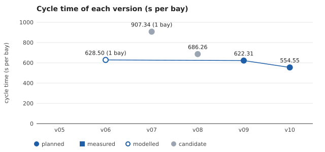
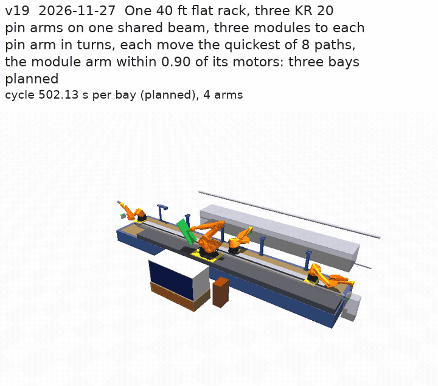
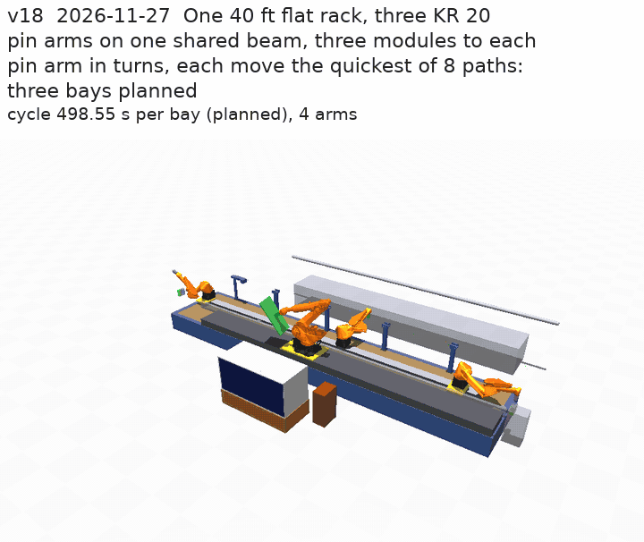
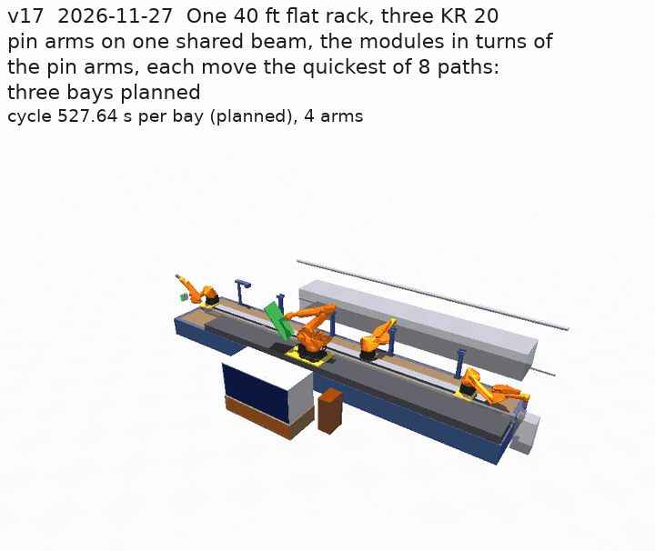
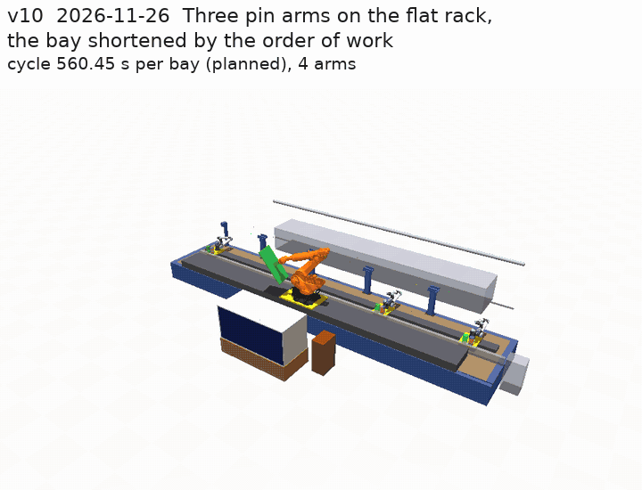
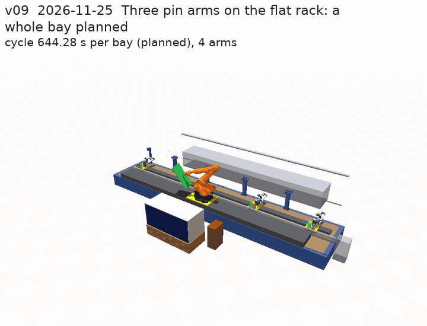
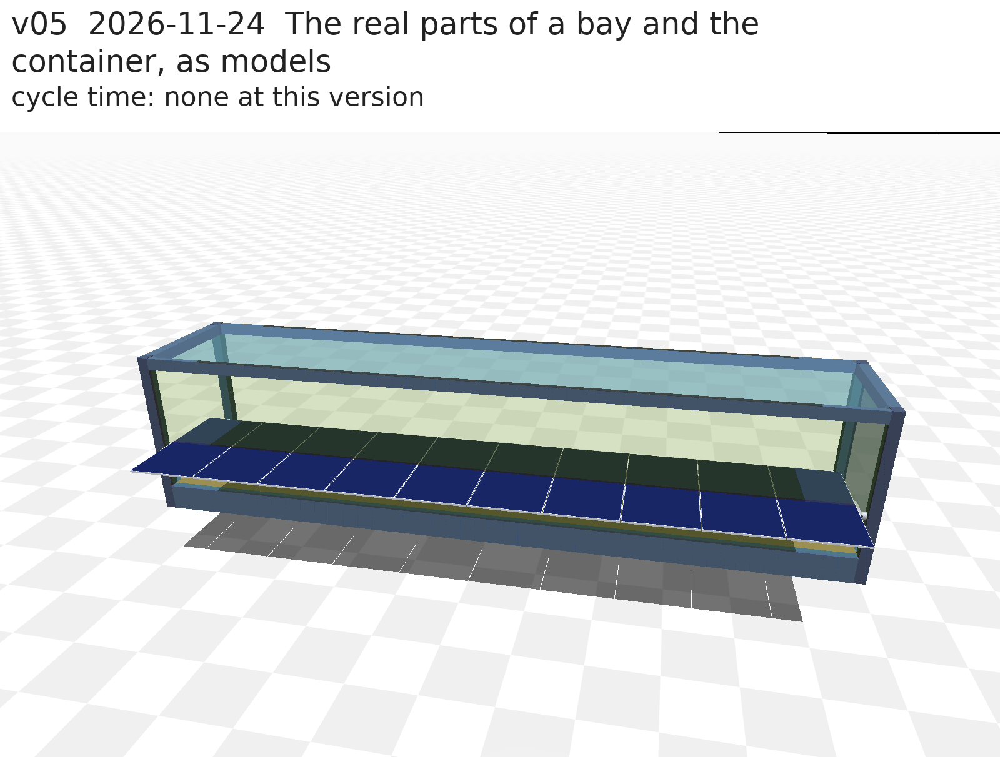

# One 40 ft base: the cell on the real parts

The cell is rebuilt on the real parts of a tracker bay, a round torque tube, rails, modules and their fastenings, on one 40 ft base. In run 011 the base is a container with both long sides open; it later becomes a flat rack. The work is kinematic: layouts are written as data and checked by a program for transport, reach, clearance, load, the ways in and out, and time. The figures are planned or come from a time model, and no controller or cycle runs in physics yet.

**Limits.** The base may carry 13,608 kg in transit (30,000 lb), and the arms, tracks, tools and bay have to fit within it. Times come from a time model, not from a run in physics.

## Where it stands

The chosen version is v24, "One 40 ft flat rack, three KR 20 pin arms on one shared beam, three modules to each pin arm in turns, each move the quickest of 8 paths, the module arm within 0.90 of its motors, the bay out once it is clear, the next tube in over it from an infeed unit, ten rails at once in a magazine on the gripper, filled while the tube comes in and while the bay before is finished, the pallet 0.23 m along its port zone: three bays planned".

| Rank | Measure | Value | Unit | Better | How known | Basis |
|---|---|---|---|---|---|---|
| P0 | cycle_s | 387.23 | s per bay | lower | planned | the committed plan's 3 bays back to back: (end of bay 2's bay_out - start of bay 0's tube_in) / 3; kinematic, on assumed speeds and process times |
| not ranked | one_bay_s | 408.03 | s | - | planned | bay 0 of the committed plan alone, from the start of its tube_in to the end of its bay_out |
| not ranked | interval_s | 375.08 | s | - | planned | from the end of bay 1's bay_out to the end of bay 2's |
| P0 | failures_per_bay | 0.373 | - | lower | modelled | count of operations by kind x rates of scores/rates.json; 100% of it on rates of basis ours |
| P0 | physics_share | 0.0573 | - | higher | measured | physics/flat_rack_3_kr20_pin_arms_shared_ordered_fast_retreat_ma_split_paths_torque_clear_out_infeed_rail_mag_early_next_fill_pallet_near.json: steps 141, 142 of module 8 carried out in physics, 23.391905 s of one bay's 408.028661 s counted |
| P1 | part_count | 39 | - | lower | counted | pieces of equipment by the rule of docs/scorecard.md |
| P1 | arms | 4 | arms | lower | counted | arms of the layout |
| P1 | driven_axes | 39 | - | lower | counted | arm joints, tracks, driven tools and grips by the rule of docs/scorecard.md |
| P1 | placement_mm | none | mm | lower | none | nothing is held or sensed in this cell; the stand-in cell's figure is another cell's |
| P2 | mass_in_transit_kg | 4144.2 | kg | lower | counted | the transport row's parts less infed parts (owner's definition) |
| P2 | input_tolerance | none | mm | higher | none | nothing is sensed in this cell, so no error of the infed parts is measured or corrected |
| P2 | plan_s | none | s | lower | none | the committed plan does not hold the time plan_layout took |

| Gate | Figure | Limit | Result |
|---|---|---|---|
| check_rows_failed | 0 rows | <= 0 rows | pass |
| least_clearance_m | 0.016 m | >= 0.015 m | pass |
| mass_in_transit_kg | 4144.2 kg | <= 13608.0 kg | pass |

The measures and gates are defined in [the scorecard](../scorecard.md).

## Progress

| Version | Date | Title | Cycle time | One bay | Arms | Part count | Mass in transit | Cycle time is |
|---|---|---|---|---|---|---|---|---|
| v05 | 2026-11-24 | The real parts of a bay and the container, as models | none | none | none | none | none | none |
| v06 | 2026-11-25 | A bay of nine modules and a checked layout in a 40 ft container | 628.50 s per bay (one bay) | 628.50 s | 2 | none | 3227.3 kg | modelled |
| v07 | 2026-11-25 | One pin arm on the flat rack (candidate) | 907.34 s per bay (one bay) | 907.34 s | 2 | none | none | planned |
| v08 | 2026-11-25 | Two pin arms on the flat rack (candidate) | 686.26 s per bay | 700.08 s | 3 | 31 | 3376.9 kg | planned |
| v09 | 2026-11-25 | Three pin arms on the flat rack: a whole bay planned | 622.31 s per bay | 644.28 s | 4 | 39 | 3426.3 kg | planned |
| v10 | 2026-11-26 | Three pin arms on the flat rack, the bay shortened by the order of work | 554.55 s per bay | 560.45 s | 4 | 39 | 3426.3 kg | planned |
| v15 | 2026-11-27 | One 40 ft flat rack, three KR 20 pin arms on one shared beam, all KUKA: three bays planned (candidate) | 612.40 s per bay | 626.32 s | 4 | 37 | 4132.2 kg | planned |
| v16 | 2026-11-27 | One 40 ft flat rack, three KR 20 pin arms on one shared beam, faster retreats: three bays planned | 572.56 s per bay | 574.73 s | 4 | 37 | 4132.2 kg | planned |
| v17 | 2026-11-27 | One 40 ft flat rack, three KR 20 pin arms on one shared beam, the modules in turns of the pin arms, each move the quickest of 8 paths: three bays planned | 527.64 s per bay | 529.20 s | 4 | 37 | 4132.2 kg | planned |
| v18 | 2026-11-27 | One 40 ft flat rack, three KR 20 pin arms on one shared beam, three modules to each pin arm in turns, each move the quickest of 8 paths: three bays planned | 498.55 s per bay | 499.54 s | 4 | 37 | 4132.2 kg | planned |
| v19 | 2026-11-27 | One 40 ft flat rack, three KR 20 pin arms on one shared beam, three modules to each pin arm in turns, each move the quickest of 8 paths, the module arm within 0.90 of its motors: three bays planned | 502.13 s per bay | 502.55 s | 4 | 37 | 4132.2 kg | planned |
| v20 | 2026-11-27 | One 40 ft flat rack, three KR 20 pin arms on one shared beam, three modules to each pin arm in turns, each move the quickest of 8 paths, the module arm within 0.90 of its motors, the bay out once it is clear: three bays planned | 496.16 s per bay | 496.59 s | 4 | 37 | 4132.2 kg | planned |
| v21 | 2026-11-27 | One 40 ft flat rack, three KR 20 pin arms on one shared beam, three modules to each pin arm in turns, each move the quickest of 8 paths, the module arm within 0.90 of its motors, the bay out once it is clear, the next tube in over it from an infeed unit: three bays planned | 470.68 s per bay | 496.59 s | 4 | 38 | 4132.2 kg | planned |
| v22 | 2026-11-28 | One 40 ft flat rack, three KR 20 pin arms on one shared beam, three modules to each pin arm in turns, each move the quickest of 8 paths, the module arm within 0.90 of its motors, the bay out once it is clear, the next tube in over it from an infeed unit, ten rails at once in a magazine on the gripper: three bays planned | 418.31 s per bay | 442.03 s | 4 | 39 | 4144.2 kg | planned |
| v23 | 2026-11-28 | One 40 ft flat rack, three KR 20 pin arms on one shared beam, three modules to each pin arm in turns, each move the quickest of 8 paths, the module arm within 0.90 of its motors, the bay out once it is clear, the next tube in over it from an infeed unit, ten rails at once in a magazine on the gripper, filled while the tube comes in and while the bay before is finished: three bays planned | 397.86 s per bay | 417.06 s | 4 | 39 | 4144.2 kg | planned |
| v24 | 2026-11-28 | One 40 ft flat rack, three KR 20 pin arms on one shared beam, three modules to each pin arm in turns, each move the quickest of 8 paths, the module arm within 0.90 of its motors, the bay out once it is clear, the next tube in over it from an infeed unit, ten rails at once in a magazine on the gripper, filled while the tube comes in and while the bay before is finished, the pallet 0.23 m along its port zone: three bays planned | 387.23 s per bay | 408.03 s | 4 | 39 | 4144.2 kg | planned |

The cycle time of a version with a plan is the average bay of three bays planned back to back, (end of bay 2's bay out − start of bay 0's tube in) / 3; "One bay" is its bay 0 alone, from tube in to bay out. A version without a plan has the time of one bay, marked so ([the scorecard](../scorecard.md)).

A filled circle is a cycle time that is planned, a square one that is measured, a hollow circle one that is modelled; a lighter marker is a candidate that was not chosen. A value marked "1 bay" is one bay's; the others are the average of three bays back to back.

## v24 One 40 ft flat rack, three KR 20 pin arms on one shared beam, three modules to each pin arm in turns, each move the quickest of 8 paths, the module arm within 0.90 of its motors, the bay out once it is clear, the next tube in over it from an infeed unit, ten rails at once in a magazine on the gripper, filled while the tube comes in and while the bay before is finished, the pallet 0.23 m along its port zone: three bays planned

2026-11-28, chosen, commit the commit that added v24: `git log --format=%h -S '"id": "v24"' -- versions/versions.json | tail -1`

**What changed.** v23's cell and layout with the pallet moved +0.23 m in Y inside the modules port zone (which allows 0.239 m), its take stop unchanged, and no part added (run 066). Three bays are planned whole from the default seed 1, 351 of 351 moves, 27 of the module arm's moves slowed (14.98 s), none over 0.90, verified and committed; 945 of 945 checker rows pass: 408.03 s for one bay and a cycle time of 387.23 s over three (bay ends 408.03 / 786.59 / 1161.68 s, interval 375.08 s).

**Why.** Weighed against v23: 10.63 s a bay quicker (387.23 s against 397.86 s), 9.03 s quicker for one bay (408.03 s against 417.06 s) and 2.99 s on the interval (375.08 s against 378.07 s), at no extra part (39 against 39). Most of the 10.63 s is the planner's draw, not the pallet move. The cell runs one committed plan, and this plan, from the default seed 1, is the quickest of seeds 1-3 of this layout, all of which verify: planned from seeds 2 and 3 the same layout gives 395.89 s and 396.11 s, so the layout's mean over seeds 1-3 is 393.08 s, against v23's 396.33 s over the same seeds (run 066's table below). The layout is worth about 3 s a bay on the mean; the rest is a plan choice, and the plan is a real, verified one. Registered as a candidate weighed against v23 and made the chosen version in the same run (run 068): in physics v24's record take (module 8, module_take 8, plan steps 141 and 142, the take before the plan's hardest carry; v23's was module 1) keeps every module arm joint below its limit with the magazine's 12 kg on the gripper (joints 1-6 on the take 0.970 0.852 0.260 0.065 0.369 0.274, on the set 0.810 0.660 0.519 0.195 0.326 0.146; v23 0.968 on the take, 0.865 at most on the set); v23 is superseded with its numbers kept.

Run 066's seed table, three bays planned whole, cycle_s in s per bay, every plan verified (945 of 945 checker rows):

| Layout | seed 1 | seed 2 | seed 3 | seed 4 | mean of seeds 1-3 |
|---|---:|---:|---:|---:|---:|
| v23 `..._rail_mag_early_next_fill` | 397.86 (committed) | 398.50 | 392.64 | 399.37 | 396.33 |
| v24 `..._rail_mag_early_next_fill_pallet_near` | 387.23 (committed) | 395.89 | 396.11 | not planned | 393.08 |

| Rank | Measure | Value | Unit | Better | How known | Basis |
|---|---|---|---|---|---|---|
| P0 | cycle_s | 387.23 | s per bay | lower | planned | the committed plan's 3 bays back to back: (end of bay 2's bay_out - start of bay 0's tube_in) / 3; kinematic, on assumed speeds and process times |
| not ranked | one_bay_s | 408.03 | s | - | planned | bay 0 of the committed plan alone, from the start of its tube_in to the end of its bay_out |
| not ranked | interval_s | 375.08 | s | - | planned | from the end of bay 1's bay_out to the end of bay 2's |
| P0 | failures_per_bay | 0.373 | - | lower | modelled | count of operations by kind x rates of scores/rates.json; 100% of it on rates of basis ours |
| P0 | physics_share | 0.0573 | - | higher | measured | physics/flat_rack_3_kr20_pin_arms_shared_ordered_fast_retreat_ma_split_paths_torque_clear_out_infeed_rail_mag_early_next_fill_pallet_near.json: steps 141, 142 of module 8 carried out in physics, 23.391905 s of one bay's 408.028661 s counted |
| P1 | part_count | 39 | - | lower | counted | pieces of equipment by the rule of docs/scorecard.md |
| P1 | arms | 4 | arms | lower | counted | arms of the layout |
| P1 | driven_axes | 39 | - | lower | counted | arm joints, tracks, driven tools and grips by the rule of docs/scorecard.md |
| P1 | placement_mm | none | mm | lower | none | nothing is held or sensed in this cell; the stand-in cell's figure is another cell's |
| P2 | mass_in_transit_kg | 4144.2 | kg | lower | counted | the transport row's parts less infed parts (owner's definition) |
| P2 | input_tolerance | none | mm | higher | none | nothing is sensed in this cell, so no error of the infed parts is measured or corrected |
| P2 | plan_s | none | s | lower | none | the committed plan does not hold the time plan_layout took |

| Gate | Figure | Limit | Result |
|---|---|---|---|
| check_rows_failed | 0 rows | <= 0 rows | pass |
| least_clearance_m | 0.016 m | >= 0.015 m | pass |
| mass_in_transit_kg | 4144.2 kg | <= 13608.0 kg | pass |

The measures and gates are defined in [the scorecard](../scorecard.md).

**Against v23.**

Each figure as the two versions' own sources report it; the conditions of a run may differ between them (see each figure's source).

| Measure | Before (v23) | Now (v24) | Difference |
|---|---|---|---|
| arms | 4 arms | 4 arms | 0 arms |
| cycle_s | 397.86 s per bay | 387.23 s per bay | -10.63 s per bay |
| driven_axes | 39 | 39 | 0 |
| failures_per_bay | 0.373 | 0.373 | 0 |
| input_tolerance | none | none | not comparable: not known |
| interval_s | 378.07 s | 375.08 s | -2.98 s |
| mass_in_transit_kg | 4144.2 kg | 4144.2 kg | 0.0 kg |
| one_bay_s | 417.06 s | 408.03 s | -9.03 s |
| part_count | 39 | 39 | 0 |
| physics_share | 0.0552 | 0.0573 | +0.00211 |
| placement_mm | none | none | not comparable: not known |
| plan_s | none | none | not comparable: not known |

**Files.** [layout](../../layouts/flat_rack_3_kr20_pin_arms_shared_ordered_fast_retreat_ma_split_paths_torque_clear_out_infeed_rail_mag_early_next_fill_pallet_near.json), [plan](../../plans/flat_rack_3_kr20_pin_arms_shared_ordered_fast_retreat_ma_split_paths_torque_clear_out_infeed_rail_mag_early_next_fill_pallet_near.json), [scorecard](../../scores/flat_rack_3_kr20_pin_arms_shared_ordered_fast_retreat_ma_split_paths_torque_clear_out_infeed_rail_mag_early_next_fill_pallet_near.json)

## v23 One 40 ft flat rack, three KR 20 pin arms on one shared beam, three modules to each pin arm in turns, each move the quickest of 8 paths, the module arm within 0.90 of its motors, the bay out once it is clear, the next tube in over it from an infeed unit, ten rails at once in a magazine on the gripper, filled while the tube comes in and while the bay before is finished: three bays planned

2026-11-28, superseded, commit the commit that added v23: `git log --format=%h -S '"id": "v23"' -- versions/versions.json | tail -1`

**What changed.** v22's cell and layout with two schedule fields and no part added: first_bay_early (run 059) lets bay 0's module arm fill its rail magazine while the first tube comes in, and next_bay_fill (run 061) lets it fill bay b+1's magazine as soon as it has set bay b's last module, while bay b's pin arms still pin and swage and bay b goes out. Three bays are planned whole (budgets 5000,40000,160000,640000), 351 of 351 moves, 30 of the module arm's 90 slowed, none over 0.90, verified and committed; 945 of 945 checker rows pass: 417.06 s for one bay and a cycle time of 397.86 s over three (bay ends 417.06 / 815.51 / 1193.58 s, interval 378.07 s).

**Why.** Weighed against v22: 20.45 s a bay quicker (397.86 s against 418.31 s) and 24.97 s quicker for one bay (417.06 s against 442.03 s) by filling the rail magazine while the tube comes in and while the bay before is finished, at no extra part (39 against 39); the verifier holds the module arm apart from the tube coming in, the bay going out and bay b's arms. Registered as a candidate weighed against v22 and made the chosen version in the same run (run 063): in physics v23's record take (module 1, module_take 3, plan steps 71 and 72, the same take and set as v22's, 24.98 s earlier) keeps every module arm joint below its limit with the magazine's 12 kg on the gripper (joint 1 0.968 on the take, 0.865 at most on the set); v22 is superseded with its numbers kept. Superseded by v24 (run 068): v24 moves the pallet 0.23 m along its port zone and its plan is the quickest verified plan of several seeds (seeds 1-3 of its layout give 387.23 / 395.89 / 396.11 s, all verified), 10.63 s a bay quicker (387.23 s against 397.86 s) at no extra part (39 against 39); on the mean of seeds 1-3 the layout is 393.08 s against v23's 396.33 s.

| Rank | Measure | Value | Unit | Better | How known | Basis |
|---|---|---|---|---|---|---|
| P0 | cycle_s | 397.86 | s per bay | lower | planned | the committed plan's 3 bays back to back: (end of bay 2's bay_out - start of bay 0's tube_in) / 3; kinematic, on assumed speeds and process times |
| not ranked | one_bay_s | 417.06 | s | - | planned | bay 0 of the committed plan alone, from the start of its tube_in to the end of its bay_out |
| not ranked | interval_s | 378.07 | s | - | planned | from the end of bay 1's bay_out to the end of bay 2's |
| P0 | failures_per_bay | 0.373 | - | lower | modelled | count of operations by kind x rates of scores/rates.json; 100% of it on rates of basis ours |
| P0 | physics_share | 0.0552 | - | higher | measured | physics/flat_rack_3_kr20_pin_arms_shared_ordered_fast_retreat_ma_split_paths_torque_clear_out_infeed_rail_mag_early_next_fill.json: steps 71, 72 of module 1 carried out in physics, 23.030565 s of one bay's 417.058577 s counted |
| P1 | part_count | 39 | - | lower | counted | pieces of equipment by the rule of docs/scorecard.md |
| P1 | arms | 4 | arms | lower | counted | arms of the layout |
| P1 | driven_axes | 39 | - | lower | counted | arm joints, tracks, driven tools and grips by the rule of docs/scorecard.md |
| P1 | placement_mm | none | mm | lower | none | nothing is held or sensed in this cell; the stand-in cell's figure is another cell's |
| P2 | mass_in_transit_kg | 4144.2 | kg | lower | counted | the transport row's parts less infed parts (owner's definition) |
| P2 | input_tolerance | none | mm | higher | none | nothing is sensed in this cell, so no error of the infed parts is measured or corrected |
| P2 | plan_s | none | s | lower | none | the committed plan does not hold the time plan_layout took |

| Gate | Figure | Limit | Result |
|---|---|---|---|
| check_rows_failed | 0 rows | <= 0 rows | pass |
| least_clearance_m | 0.016 m | >= 0.015 m | pass |
| mass_in_transit_kg | 4144.2 kg | <= 13608.0 kg | pass |

The measures and gates are defined in [the scorecard](../scorecard.md).

**Against v22.**

Each figure as the two versions' own sources report it; the conditions of a run may differ between them (see each figure's source).

| Measure | Before (v22) | Now (v23) | Difference |
|---|---|---|---|
| arms | 4 arms | 4 arms | 0 arms |
| cycle_s | 418.31 s per bay | 397.86 s per bay | -20.45 s per bay |
| driven_axes | 39 | 39 | 0 |
| failures_per_bay | 0.373 | 0.373 | 0 |
| input_tolerance | none | none | not comparable: not known |
| interval_s | 396.30 s | 378.07 s | -18.23 s |
| mass_in_transit_kg | 4144.2 kg | 4144.2 kg | 0.0 kg |
| one_bay_s | 442.03 s | 417.06 s | -24.98 s |
| part_count | 39 | 39 | 0 |
| physics_share | 0.0521 | 0.0552 | +0.00312 |
| placement_mm | none | none | not comparable: not known |
| plan_s | none | none | not comparable: not known |

**Candidates it was chosen over.**

| Version | Cycle time | One bay | Arms | Part count | Mass in transit | Failures per bay | Cycle time is | Recording | Layout | Commit | Status |
|---|---|---|---|---|---|---|---|---|---|---|---|
| v23 (this version) | 397.86 s per bay | 417.06 s | 4 | 39 | 4144.2 kg | 0.373 | planned | [v23.gif](../evolution/v23.gif) | [flat_rack_3_kr20_pin_arms_shared_ordered_fast_retreat_ma_split_paths_torque_clear_out_infeed_rail_mag_early_next_fill.json](../../layouts/flat_rack_3_kr20_pin_arms_shared_ordered_fast_retreat_ma_split_paths_torque_clear_out_infeed_rail_mag_early_next_fill.json) | the commit that added v23: `git log --format=%h -S '"id": "v23"' -- versions/versions.json \| tail -1` | superseded |
| v24 | 387.23 s per bay | 408.03 s | 4 | 39 | 4144.2 kg | 0.373 | planned | [v24.gif](../evolution/v24.gif) | [flat_rack_3_kr20_pin_arms_shared_ordered_fast_retreat_ma_split_paths_torque_clear_out_infeed_rail_mag_early_next_fill_pallet_near.json](../../layouts/flat_rack_3_kr20_pin_arms_shared_ordered_fast_retreat_ma_split_paths_torque_clear_out_infeed_rail_mag_early_next_fill_pallet_near.json) | the commit that added v24: `git log --format=%h -S '"id": "v24"' -- versions/versions.json \| tail -1` | chosen |

**Files.** [layout](../../layouts/flat_rack_3_kr20_pin_arms_shared_ordered_fast_retreat_ma_split_paths_torque_clear_out_infeed_rail_mag_early_next_fill.json), [plan](../../plans/flat_rack_3_kr20_pin_arms_shared_ordered_fast_retreat_ma_split_paths_torque_clear_out_infeed_rail_mag_early_next_fill.json), [scorecard](../../scores/flat_rack_3_kr20_pin_arms_shared_ordered_fast_retreat_ma_split_paths_torque_clear_out_infeed_rail_mag_early_next_fill.json)

## v22 One 40 ft flat rack, three KR 20 pin arms on one shared beam, three modules to each pin arm in turns, each move the quickest of 8 paths, the module arm within 0.90 of its motors, the bay out once it is clear, the next tube in over it from an infeed unit, ten rails at once in a magazine on the gripper: three bays planned

2026-11-28, superseded, commit the commit that added v22: `git log --format=%h -S '"id": "v22"' -- versions/versions.json | tail -1`

**What changed.** v21's cell and layout with one part added and nothing else: a rail magazine (item rail_magazine, 12 kg and two 0.5 x 0.5 x 0.15 m boxes on the module arm's combined gripper, basis ours; run 056), so the module arm takes all ten rails of a bay at one take and sets them one after another along its track with no trip back to the rail rack. The tool load is 48 kg + a module's 32.4 kg = 80.4 kg of the arm's 210 kg; 945 of 945 checker rows pass. Three bays are planned whole (budgets 5000,40000,160000,640000), 351 of 351 moves, 30 of the module arm's 90 slowed (20.08 s of motion added), verified and committed: 442.03 s for one bay and a cycle time of 418.31 s over three (bay ends 442.03 / 858.63 / 1254.92 s, interval 396.30 s); the ways still overlap 38.41 s at each boundary.

**Why.** Weighed against v21: 52.37 s a bay quicker (418.31 s against 470.68 s) by taking the ten rails in one take instead of ten round trips, at the price of one part (39 against 38); torque_demand over the three bays finds no module arm move over 0.90 of a motor's limit. The magazine's indexing drive and how the rail rack fills it are not modelled (docs/rail-magazine.md). Registered as a candidate weighed against v21 and made the chosen version in the same run (run 057): in physics v22's record take (module 1, module_take 3, plan steps 71 and 72) keeps every module arm joint below its limit with the magazine's 12 kg on the gripper (joint 1 0.968 on the take, 0.865 at most on the set); v21 is superseded with its numbers kept. Superseded by v23 (run 063): v23 fills the magazine while the tube comes in and while the bay before is finished, and is 20.45 s a bay quicker (397.86 s against 418.31 s) at no extra part (39 against 39).

| Rank | Measure | Value | Unit | Better | How known | Basis |
|---|---|---|---|---|---|---|
| P0 | cycle_s | 418.31 | s per bay | lower | planned | the committed plan's 3 bays back to back: (end of bay 2's bay_out - start of bay 0's tube_in) / 3; kinematic, on assumed speeds and process times |
| not ranked | one_bay_s | 442.03 | s | - | planned | bay 0 of the committed plan alone, from the start of its tube_in to the end of its bay_out |
| not ranked | interval_s | 396.30 | s | - | planned | from the end of bay 1's bay_out to the end of bay 2's |
| P0 | failures_per_bay | 0.373 | - | lower | modelled | count of operations by kind x rates of scores/rates.json; 100% of it on rates of basis ours |
| P0 | physics_share | 0.0521 | - | higher | measured | physics/flat_rack_3_kr20_pin_arms_shared_ordered_fast_retreat_ma_split_paths_torque_clear_out_infeed_rail_mag.json: steps 71, 72 of module 1 carried out in physics, 23.030565 s of one bay's 442.034753 s counted |
| P1 | part_count | 39 | - | lower | counted | pieces of equipment by the rule of docs/scorecard.md |
| P1 | arms | 4 | arms | lower | counted | arms of the layout |
| P1 | driven_axes | 39 | - | lower | counted | arm joints, tracks, driven tools and grips by the rule of docs/scorecard.md |
| P1 | placement_mm | none | mm | lower | none | nothing is held or sensed in this cell; the stand-in cell's figure is another cell's |
| P2 | mass_in_transit_kg | 4144.2 | kg | lower | counted | the transport row's parts less infed parts (owner's definition) |
| P2 | input_tolerance | none | mm | higher | none | nothing is sensed in this cell, so no error of the infed parts is measured or corrected |
| P2 | plan_s | none | s | lower | none | the committed plan does not hold the time plan_layout took |

| Gate | Figure | Limit | Result |
|---|---|---|---|
| check_rows_failed | 0 rows | <= 0 rows | pass |
| least_clearance_m | 0.016 m | >= 0.015 m | pass |
| mass_in_transit_kg | 4144.2 kg | <= 13608.0 kg | pass |

The measures and gates are defined in [the scorecard](../scorecard.md).

**Against v21.**

Each figure as the two versions' own sources report it; the conditions of a run may differ between them (see each figure's source).

| Measure | Before (v21) | Now (v22) | Difference |
|---|---|---|---|
| arms | 4 arms | 4 arms | 0 arms |
| cycle_s | 470.68 s per bay | 418.31 s per bay | -52.37 s per bay |
| driven_axes | 39 | 39 | 0 |
| failures_per_bay | 0.383 | 0.373 | -0.0099 |
| input_tolerance | none | none | not comparable: not known |
| interval_s | 451.90 s | 396.30 s | -55.60 s |
| mass_in_transit_kg | 4132.2 kg | 4144.2 kg | +12.0 kg |
| one_bay_s | 496.59 s | 442.03 s | -54.56 s |
| part_count | 38 | 39 | +1 |
| physics_share | 0.0417 | 0.0521 | +0.0104 |
| placement_mm | none | none | not comparable: not known |
| plan_s | none | none | not comparable: not known |

**Candidates it was chosen over.**

| Version | Cycle time | One bay | Arms | Part count | Mass in transit | Failures per bay | Cycle time is | Recording | Layout | Commit | Status |
|---|---|---|---|---|---|---|---|---|---|---|---|
| v22 (this version) | 418.31 s per bay | 442.03 s | 4 | 39 | 4144.2 kg | 0.373 | planned | [v22.gif](../evolution/v22.gif) | [flat_rack_3_kr20_pin_arms_shared_ordered_fast_retreat_ma_split_paths_torque_clear_out_infeed_rail_mag.json](../../layouts/flat_rack_3_kr20_pin_arms_shared_ordered_fast_retreat_ma_split_paths_torque_clear_out_infeed_rail_mag.json) | the commit that added v22: `git log --format=%h -S '"id": "v22"' -- versions/versions.json \| tail -1` | superseded |
| v23 | 397.86 s per bay | 417.06 s | 4 | 39 | 4144.2 kg | 0.373 | planned | [v23.gif](../evolution/v23.gif) | [flat_rack_3_kr20_pin_arms_shared_ordered_fast_retreat_ma_split_paths_torque_clear_out_infeed_rail_mag_early_next_fill.json](../../layouts/flat_rack_3_kr20_pin_arms_shared_ordered_fast_retreat_ma_split_paths_torque_clear_out_infeed_rail_mag_early_next_fill.json) | the commit that added v23: `git log --format=%h -S '"id": "v23"' -- versions/versions.json \| tail -1` | superseded |

**Files.** [layout](../../layouts/flat_rack_3_kr20_pin_arms_shared_ordered_fast_retreat_ma_split_paths_torque_clear_out_infeed_rail_mag.json), [plan](../../plans/flat_rack_3_kr20_pin_arms_shared_ordered_fast_retreat_ma_split_paths_torque_clear_out_infeed_rail_mag.json), [scorecard](../../scores/flat_rack_3_kr20_pin_arms_shared_ordered_fast_retreat_ma_split_paths_torque_clear_out_infeed_rail_mag.json)

## v21 One 40 ft flat rack, three KR 20 pin arms on one shared beam, three modules to each pin arm in turns, each move the quickest of 8 paths, the module arm within 0.90 of its motors, the bay out once it is clear, the next tube in over it from an infeed unit: three bays planned

2026-11-27, superseded, commit the commit that added v21: `git log --format=%h -S '"id": "v21"' -- versions/versions.json | tail -1`

**What changed.** v20's cell and layout with one part added and nothing else: an infeed unit (item infeed_unit, a 1.2 x 10.0 x 1.8 m bed, 800 kg, basis ours) at a tubes_in port and zone of its own beyond the transfer cart at -X (run 053), so the next tube comes in 0.45 m above its place over the bay going out (5.10 m in 40 s) and is lowered into the saddles, and the cart only takes bays out. Bay b+1's tube_in starts once the holder is empty, so the two ways overlap 38.41 s at each boundary. Three bays are planned whole, 378 of 378 moves, 26 of them slowed (14.30 s of motion added), verified and committed: 496.59 s for one bay and a cycle time of 470.68 s over three (boundaries 496.59 / 463.54 / 451.90 s); the incoming tube passes 0.1140 m above the outgoing bay's lifted modules.

**Why.** Weighed against v20: 25.48 s a bay quicker (470.68 s against 496.16 s) by overlapping the next tube's way with the bay going out, at the price of one part (38 against 37); the paths, the order of work and the slowed moves are v20's, and torque_demand over the three bays finds no module arm move over 0.90 of a motor's limit. The infeed unit's carriage is not modelled (docs/infeed-unit.md). Registered as a candidate weighed against v20 and made the chosen version in the same run (run 054): in physics v21's record take (module 5, the same take and set as v20's, at the same times) keeps every module arm joint below its limit (joint 1 0.973 on the take, 0.597 at most on the set); v20 is superseded with its numbers kept. Superseded by v22 (run 057): v22 carries the ten rails of a bay in a magazine on the module arm's gripper and sets them with no trip back, and is 52.37 s a bay quicker (418.31 s against 470.68 s) at the price of one part (39 against 38).

| Rank | Measure | Value | Unit | Better | How known | Basis |
|---|---|---|---|---|---|---|
| P0 | cycle_s | 470.68 | s per bay | lower | planned | the committed plan's 3 bays back to back: (end of bay 2's bay_out - start of bay 0's tube_in) / 3; kinematic, on assumed speeds and process times |
| not ranked | one_bay_s | 496.59 | s | - | planned | bay 0 of the committed plan alone, from the start of its tube_in to the end of its bay_out |
| not ranked | interval_s | 451.90 | s | - | planned | from the end of bay 1's bay_out to the end of bay 2's |
| P0 | failures_per_bay | 0.383 | - | lower | modelled | count of operations by kind x rates of scores/rates.json; 100% of it on rates of basis ours |
| P0 | physics_share | 0.0417 | - | higher | measured | physics/flat_rack_3_kr20_pin_arms_shared_ordered_fast_retreat_ma_split_paths_torque_clear_out_infeed.json: steps 136, 137 of module 5 carried out in physics, 20.727562 s of one bay's 496.589754 s counted |
| P1 | part_count | 38 | - | lower | counted | pieces of equipment by the rule of docs/scorecard.md |
| P1 | arms | 4 | arms | lower | counted | arms of the layout |
| P1 | driven_axes | 39 | - | lower | counted | arm joints, tracks, driven tools and grips by the rule of docs/scorecard.md |
| P1 | placement_mm | none | mm | lower | none | nothing is held or sensed in this cell; the stand-in cell's figure is another cell's |
| P2 | mass_in_transit_kg | 4132.2 | kg | lower | counted | the transport row's parts less infed parts (owner's definition) |
| P2 | input_tolerance | none | mm | higher | none | nothing is sensed in this cell, so no error of the infed parts is measured or corrected |
| P2 | plan_s | none | s | lower | none | the committed plan does not hold the time plan_layout took |

| Gate | Figure | Limit | Result |
|---|---|---|---|
| check_rows_failed | 0 rows | <= 0 rows | pass |
| least_clearance_m | 0.016 m | >= 0.015 m | pass |
| mass_in_transit_kg | 4132.2 kg | <= 13608.0 kg | pass |

The measures and gates are defined in [the scorecard](../scorecard.md).

**Against v20.**

Each figure as the two versions' own sources report it; the conditions of a run may differ between them (see each figure's source).

| Measure | Before (v20) | Now (v21) | Difference |
|---|---|---|---|
| arms | 4 arms | 4 arms | 0 arms |
| cycle_s | 496.16 s per bay | 470.68 s per bay | -25.48 s per bay |
| driven_axes | 39 | 39 | 0 |
| failures_per_bay | 0.383 | 0.383 | 0 |
| input_tolerance | none | none | not comparable: not known |
| interval_s | 490.08 s | 451.90 s | -38.18 s |
| mass_in_transit_kg | 4132.2 kg | 4132.2 kg | 0.0 kg |
| one_bay_s | 496.59 s | 496.59 s | 0.00 s |
| part_count | 37 | 38 | +1 |
| physics_share | 0.0417 | 0.0417 | 0 |
| placement_mm | none | none | not comparable: not known |
| plan_s | none | none | not comparable: not known |

**Candidates it was chosen over.**

| Version | Cycle time | One bay | Arms | Part count | Mass in transit | Failures per bay | Cycle time is | Recording | Layout | Commit | Status |
|---|---|---|---|---|---|---|---|---|---|---|---|
| v21 (this version) | 470.68 s per bay | 496.59 s | 4 | 38 | 4132.2 kg | 0.383 | planned | [v21.gif](../evolution/v21.gif) | [flat_rack_3_kr20_pin_arms_shared_ordered_fast_retreat_ma_split_paths_torque_clear_out_infeed.json](../../layouts/flat_rack_3_kr20_pin_arms_shared_ordered_fast_retreat_ma_split_paths_torque_clear_out_infeed.json) | the commit that added v21: `git log --format=%h -S '"id": "v21"' -- versions/versions.json \| tail -1` | superseded |
| v22 | 418.31 s per bay | 442.03 s | 4 | 39 | 4144.2 kg | 0.373 | planned | [v22.gif](../evolution/v22.gif) | [flat_rack_3_kr20_pin_arms_shared_ordered_fast_retreat_ma_split_paths_torque_clear_out_infeed_rail_mag.json](../../layouts/flat_rack_3_kr20_pin_arms_shared_ordered_fast_retreat_ma_split_paths_torque_clear_out_infeed_rail_mag.json) | the commit that added v22: `git log --format=%h -S '"id": "v22"' -- versions/versions.json \| tail -1` | superseded |

**Files.** [layout](../../layouts/flat_rack_3_kr20_pin_arms_shared_ordered_fast_retreat_ma_split_paths_torque_clear_out_infeed.json), [plan](../../plans/flat_rack_3_kr20_pin_arms_shared_ordered_fast_retreat_ma_split_paths_torque_clear_out_infeed.json), [scorecard](../../scores/flat_rack_3_kr20_pin_arms_shared_ordered_fast_retreat_ma_split_paths_torque_clear_out_infeed.json)

## v20 One 40 ft flat rack, three KR 20 pin arms on one shared beam, three modules to each pin arm in turns, each move the quickest of 8 paths, the module arm within 0.90 of its motors, the bay out once it is clear: three bays planned

2026-11-27, superseded, commit the commit that added v20: `git log --format=%h -S '"id": "v20"' -- versions/versions.json | tail -1`

**What changed.** v19's cell and layout with one change and nothing else: bay_out_when_clear (run 050), so a bay goes out once its release has ended and no arm comes within the clearance of it on its way, not when every arm is free; pin arm C's last tool change runs while the bay goes out. Three bays are planned whole, 378 of 378 moves, 26 of them slowed (14.30 s of motion added), verified and committed: 496.59 s for one bay (496.59 / 501.82 / 490.08 s) and a cycle time of 496.16 s over three; each bay out starts at its release's end, and no arm comes nearer the bay going out than 0.2115 m.

**Why.** Weighed against v19: 5.96 s a bay quicker (496.16 s against 502.13 s) by the bay out alone; the paths, the order of work and the slowed moves are v19's, and torque_demand over the three bays finds no module arm move over 0.90 of a motor's limit. Registered as a candidate weighed against v19 and made the chosen version in the same run (run 052): in physics v20's record take (module 5, the same take and set as v19's) keeps every module arm joint below its limit (joint 1 0.973 on the take, 0.597 at most on the set); v19 is superseded with its numbers kept. Superseded by v21 (run 054): v21 overlaps the next tube's way with the bay going out, from an infeed unit of its own, and is 25.48 s a bay quicker (470.68 s against 496.16 s) at the price of one part (38 against 37), with v20's paths, order of work and slowed moves.

| Rank | Measure | Value | Unit | Better | How known | Basis |
|---|---|---|---|---|---|---|
| P0 | cycle_s | 496.16 | s per bay | lower | planned | the committed plan's 3 bays back to back: (end of bay 2's bay_out - start of bay 0's tube_in) / 3; kinematic, on assumed speeds and process times |
| not ranked | one_bay_s | 496.59 | s | - | planned | bay 0 of the committed plan alone, from the start of its tube_in to the end of its bay_out |
| not ranked | interval_s | 490.08 | s | - | planned | from the end of bay 1's bay_out to the end of bay 2's |
| P0 | failures_per_bay | 0.383 | - | lower | modelled | count of operations by kind x rates of scores/rates.json; 100% of it on rates of basis ours |
| P0 | physics_share | 0.0417 | - | higher | measured | physics/flat_rack_3_kr20_pin_arms_shared_ordered_fast_retreat_ma_split_paths_torque_clear_out.json: steps 136, 137 of module 5 carried out in physics, 20.727562 s of one bay's 496.589754 s counted |
| P1 | part_count | 37 | - | lower | counted | pieces of equipment by the rule of docs/scorecard.md |
| P1 | arms | 4 | arms | lower | counted | arms of the layout |
| P1 | driven_axes | 39 | - | lower | counted | arm joints, tracks, driven tools and grips by the rule of docs/scorecard.md |
| P1 | placement_mm | none | mm | lower | none | nothing is held or sensed in this cell; the stand-in cell's figure is another cell's |
| P2 | mass_in_transit_kg | 4132.2 | kg | lower | counted | the transport row's parts less infed parts (owner's definition) |
| P2 | input_tolerance | none | mm | higher | none | nothing is sensed in this cell, so no error of the infed parts is measured or corrected |
| P2 | plan_s | none | s | lower | none | the committed plan does not hold the time plan_layout took |

| Gate | Figure | Limit | Result |
|---|---|---|---|
| check_rows_failed | 0 rows | <= 0 rows | pass |
| least_clearance_m | 0.016 m | >= 0.015 m | pass |
| mass_in_transit_kg | 4132.2 kg | <= 13608.0 kg | pass |

The measures and gates are defined in [the scorecard](../scorecard.md).

**Against v19.**

Each figure as the two versions' own sources report it; the conditions of a run may differ between them (see each figure's source).

| Measure | Before (v19) | Now (v20) | Difference |
|---|---|---|---|
| arms | 4 arms | 4 arms | 0 arms |
| cycle_s | 502.13 s per bay | 496.16 s per bay | -5.96 s per bay |
| driven_axes | 39 | 39 | 0 |
| failures_per_bay | 0.383 | 0.383 | 0 |
| input_tolerance | none | none | not comparable: not known |
| interval_s | 496.04 s | 490.08 s | -5.96 s |
| mass_in_transit_kg | 4132.2 kg | 4132.2 kg | 0.0 kg |
| one_bay_s | 502.55 s | 496.59 s | -5.96 s |
| part_count | 37 | 37 | 0 |
| physics_share | 0.0412 | 0.0417 | +0.000495 |
| placement_mm | none | none | not comparable: not known |
| plan_s | none | none | not comparable: not known |

**Candidates it was chosen over.**

| Version | Cycle time | One bay | Arms | Part count | Mass in transit | Failures per bay | Cycle time is | Recording | Layout | Commit | Status |
|---|---|---|---|---|---|---|---|---|---|---|---|
| v20 (this version) | 496.16 s per bay | 496.59 s | 4 | 37 | 4132.2 kg | 0.383 | planned | [v20.gif](../evolution/v20.gif) | [flat_rack_3_kr20_pin_arms_shared_ordered_fast_retreat_ma_split_paths_torque_clear_out.json](../../layouts/flat_rack_3_kr20_pin_arms_shared_ordered_fast_retreat_ma_split_paths_torque_clear_out.json) | the commit that added v20: `git log --format=%h -S '"id": "v20"' -- versions/versions.json \| tail -1` | superseded |
| v21 | 470.68 s per bay | 496.59 s | 4 | 38 | 4132.2 kg | 0.383 | planned | [v21.gif](../evolution/v21.gif) | [flat_rack_3_kr20_pin_arms_shared_ordered_fast_retreat_ma_split_paths_torque_clear_out_infeed.json](../../layouts/flat_rack_3_kr20_pin_arms_shared_ordered_fast_retreat_ma_split_paths_torque_clear_out_infeed.json) | the commit that added v21: `git log --format=%h -S '"id": "v21"' -- versions/versions.json \| tail -1` | superseded |

**Files.** [layout](../../layouts/flat_rack_3_kr20_pin_arms_shared_ordered_fast_retreat_ma_split_paths_torque_clear_out.json), [plan](../../plans/flat_rack_3_kr20_pin_arms_shared_ordered_fast_retreat_ma_split_paths_torque_clear_out.json), [scorecard](../../scores/flat_rack_3_kr20_pin_arms_shared_ordered_fast_retreat_ma_split_paths_torque_clear_out.json)

## v19 One 40 ft flat rack, three KR 20 pin arms on one shared beam, three modules to each pin arm in turns, each move the quickest of 8 paths, the module arm within 0.90 of its motors: three bays planned

2026-11-27, superseded, commit the commit that added v19: `git log --format=%h -S '"id": "v19"' -- versions/versions.json | tail -1`

**What changed.** v18's cell and layout with one change and nothing else: torque_limit_scale 0.90 (runs 045 and 047), so each module arm move that inverse dynamics finds needing more than 0.90 of a motor's limit is played slower by uniform time scaling until it holds, and the bay is scheduled in the order and at the starts of its unslowed schedule. Three bays are planned whole, 378 of 378 moves, 26 of them slowed (14.30 s of motion added), verified and committed: 502.55 s for one bay (502.55 / 507.79 / 496.04 s) and a cycle time of 502.13 s over three.

**Why.** v18's cycle time of 498.55 s is one its module arm cannot follow: inverse dynamics asks up to 1.25 of joint 1's torque limit and physics saturates joint 1 at 1.000. v19 is v18 timed so that no module arm move needs more than 0.90 of a motor's limit, at 3.58 s a bay more (502.13 s against 498.55 s). Registered as a candidate weighed against v18 and made the chosen version in the same run (run 048): a cycle time the arm cannot follow is not an honest P0 figure, and in physics v19's record take keeps every module arm joint below its limit (joint 1 0.973 on the take, 0.420 on the set); v18 is superseded with its numbers kept. Superseded by v20 (run 052): v20 is v19 with bay_out_when_clear and is quicker by the bay out alone, 496.16 s against 502.13 s (-5.96 s a bay), with v19's paths, order of work and slowed moves.

| Rank | Measure | Value | Unit | Better | How known | Basis |
|---|---|---|---|---|---|---|
| P0 | cycle_s | 502.13 | s per bay | lower | planned | the committed plan's 3 bays back to back: (end of bay 2's bay_out - start of bay 0's tube_in) / 3; kinematic, on assumed speeds and process times |
| not ranked | one_bay_s | 502.55 | s | - | planned | bay 0 of the committed plan alone, from the start of its tube_in to the end of its bay_out |
| not ranked | interval_s | 496.04 | s | - | planned | from the end of bay 1's bay_out to the end of bay 2's |
| P0 | failures_per_bay | 0.383 | - | lower | modelled | count of operations by kind x rates of scores/rates.json; 100% of it on rates of basis ours |
| P0 | physics_share | 0.0412 | - | higher | measured | physics/flat_rack_3_kr20_pin_arms_shared_ordered_fast_retreat_ma_split_paths_torque.json: steps 136, 137 of module 5 carried out in physics, 20.727562 s of one bay's 502.553095 s counted |
| P1 | part_count | 37 | - | lower | counted | pieces of equipment by the rule of docs/scorecard.md |
| P1 | arms | 4 | arms | lower | counted | arms of the layout |
| P1 | driven_axes | 39 | - | lower | counted | arm joints, tracks, driven tools and grips by the rule of docs/scorecard.md |
| P1 | placement_mm | none | mm | lower | none | nothing is held or sensed in this cell; the stand-in cell's figure is another cell's |
| P2 | mass_in_transit_kg | 4132.2 | kg | lower | counted | the transport row's parts less infed parts (owner's definition) |
| P2 | input_tolerance | none | mm | higher | none | nothing is sensed in this cell, so no error of the infed parts is measured or corrected |
| P2 | plan_s | none | s | lower | none | the committed plan does not hold the time plan_layout took |

| Gate | Figure | Limit | Result |
|---|---|---|---|
| check_rows_failed | 0 rows | <= 0 rows | pass |
| least_clearance_m | 0.016 m | >= 0.015 m | pass |
| mass_in_transit_kg | 4132.2 kg | <= 13608.0 kg | pass |

The measures and gates are defined in [the scorecard](../scorecard.md).

**Against v18.**

Each figure as the two versions' own sources report it; the conditions of a run may differ between them (see each figure's source).

| Measure | Before (v18) | Now (v19) | Difference |
|---|---|---|---|
| arms | 4 arms | 4 arms | 0 arms |
| cycle_s | 498.55 s per bay | 502.13 s per bay | +3.57 s per bay |
| driven_axes | 39 | 39 | 0 |
| failures_per_bay | 0.383 | 0.383 | 0 |
| input_tolerance | none | none | not comparable: not known |
| interval_s | 493.59 s | 496.04 s | +2.45 s |
| mass_in_transit_kg | 4132.2 kg | 4132.2 kg | 0.0 kg |
| one_bay_s | 499.54 s | 502.55 s | +3.01 s |
| part_count | 37 | 37 | 0 |
| physics_share | 0.0404 | 0.0412 | +0.000798 |
| placement_mm | none | none | not comparable: not known |
| plan_s | none | none | not comparable: not known |

**Candidates it was chosen over.**

| Version | Cycle time | One bay | Arms | Part count | Mass in transit | Failures per bay | Cycle time is | Recording | Layout | Commit | Status |
|---|---|---|---|---|---|---|---|---|---|---|---|
| v19 (this version) | 502.13 s per bay | 502.55 s | 4 | 37 | 4132.2 kg | 0.383 | planned | [v19.gif](../evolution/v19.gif) | [flat_rack_3_kr20_pin_arms_shared_ordered_fast_retreat_ma_split_paths_torque.json](../../layouts/flat_rack_3_kr20_pin_arms_shared_ordered_fast_retreat_ma_split_paths_torque.json) | the commit that added v19: `git log --format=%h -S '"id": "v19"' -- versions/versions.json \| tail -1` | superseded |
| v20 | 496.16 s per bay | 496.59 s | 4 | 37 | 4132.2 kg | 0.383 | planned | [v20.gif](../evolution/v20.gif) | [flat_rack_3_kr20_pin_arms_shared_ordered_fast_retreat_ma_split_paths_torque_clear_out.json](../../layouts/flat_rack_3_kr20_pin_arms_shared_ordered_fast_retreat_ma_split_paths_torque_clear_out.json) | the commit that added v20: `git log --format=%h -S '"id": "v20"' -- versions/versions.json \| tail -1` | superseded |

**Files.** [layout](../../layouts/flat_rack_3_kr20_pin_arms_shared_ordered_fast_retreat_ma_split_paths_torque.json), [plan](../../plans/flat_rack_3_kr20_pin_arms_shared_ordered_fast_retreat_ma_split_paths_torque.json), [scorecard](../../scores/flat_rack_3_kr20_pin_arms_shared_ordered_fast_retreat_ma_split_paths_torque.json)

## v18 One 40 ft flat rack, three KR 20 pin arms on one shared beam, three modules to each pin arm in turns, each move the quickest of 8 paths: three bays planned

2026-11-27, superseded, commit the commit that added v18: `git log --format=%h -S '"id": "v18"' -- versions/versions.json | tail -1`

**What changed.** v17's cell (all KUKA, three KR 20 pin arms on one shared beam) with run 044's split and order in place of run 041's: module 3 moved from pin arm A to B and module 6 from B to C, three modules to each pin arm, order.modules 0, 3, 6, 1, 4, 7, 2, 5, 8, and B's wait/stow track 0.6; path_tries 8 as in v17 (each move searched from 8 seeds and the quickest timed path kept). Three bays are planned whole, 378 of 378 moves, verified and committed: 499.54 s for one bay (499.54 / 502.53 / 493.59 s) and a cycle time of 498.55 s over three.

**Why.** It is the measured step after v17 in the all-KUKA 40 ft cell: 498.55 s against v17's 527.64 s (-29.09 s). Registered as a candidate weighed against v17 and made the chosen version in the same run (run 046): the chosen cell is the best all-KUKA cell (the owner's rule), and v17 is superseded with its numbers kept. It was superseded on 2026-11-27 (run 048) by v19, the same layout timed within its motors: v18's moves exceed the motors (inverse dynamics asks up to 1.249 of joint 1's torque limit, 18 of its 117 module arm moves over 1.0, and physics saturates joint 1 at 1.000 on its record take), so its 498.55 s is not a cycle time the arm can follow; its numbers are kept.

| Rank | Measure | Value | Unit | Better | How known | Basis |
|---|---|---|---|---|---|---|
| P0 | cycle_s | 498.55 | s per bay | lower | planned | the committed plan's 3 bays back to back: (end of bay 2's bay_out - start of bay 0's tube_in) / 3; kinematic, on assumed speeds and process times |
| not ranked | one_bay_s | 499.54 | s | - | planned | bay 0 of the committed plan alone, from the start of its tube_in to the end of its bay_out |
| not ranked | interval_s | 493.59 | s | - | planned | from the end of bay 1's bay_out to the end of bay 2's |
| P0 | failures_per_bay | 0.383 | - | lower | modelled | count of operations by kind x rates of scores/rates.json; 100% of it on rates of basis ours |
| P0 | physics_share | 0.0404 | - | higher | measured | physics/flat_rack_3_kr20_pin_arms_shared_ordered_fast_retreat_ma_split_paths.json: steps 136, 137 of module 5 carried out in physics, 20.205074 s of one bay's 499.542691 s counted |
| P1 | part_count | 37 | - | lower | counted | pieces of equipment by the rule of docs/scorecard.md |
| P1 | arms | 4 | arms | lower | counted | arms of the layout |
| P1 | driven_axes | 39 | - | lower | counted | arm joints, tracks, driven tools and grips by the rule of docs/scorecard.md |
| P1 | placement_mm | none | mm | lower | none | nothing is held or sensed in this cell; the stand-in cell's figure is another cell's |
| P2 | mass_in_transit_kg | 4132.2 | kg | lower | counted | the transport row's parts less infed parts (owner's definition) |
| P2 | input_tolerance | none | mm | higher | none | nothing is sensed in this cell, so no error of the infed parts is measured or corrected |
| P2 | plan_s | none | s | lower | none | the committed plan does not hold the time plan_layout took |

| Gate | Figure | Limit | Result |
|---|---|---|---|
| check_rows_failed | 0 rows | <= 0 rows | pass |
| least_clearance_m | 0.016 m | >= 0.015 m | pass |
| mass_in_transit_kg | 4132.2 kg | <= 13608.0 kg | pass |

The measures and gates are defined in [the scorecard](../scorecard.md).

**Against v17.**

Each figure as the two versions' own sources report it; the conditions of a run may differ between them (see each figure's source).

| Measure | Before (v17) | Now (v18) | Difference |
|---|---|---|---|
| arms | 4 arms | 4 arms | 0 arms |
| cycle_s | 527.64 s per bay | 498.55 s per bay | -29.09 s per bay |
| driven_axes | 39 | 39 | 0 |
| failures_per_bay | 0.383 | 0.383 | 0 |
| input_tolerance | none | none | not comparable: not known |
| interval_s | 523.92 s | 493.59 s | -30.33 s |
| mass_in_transit_kg | 4132.2 kg | 4132.2 kg | 0.0 kg |
| one_bay_s | 529.20 s | 499.54 s | -29.65 s |
| part_count | 37 | 37 | 0 |
| physics_share | 0.0392 | 0.0404 | +0.00128 |
| placement_mm | none | none | not comparable: not known |
| plan_s | none | none | not comparable: not known |

**Candidates it was chosen over.**

| Version | Cycle time | One bay | Arms | Part count | Mass in transit | Failures per bay | Cycle time is | Recording | Layout | Commit | Status |
|---|---|---|---|---|---|---|---|---|---|---|---|
| v18 (this version) | 498.55 s per bay | 499.54 s | 4 | 37 | 4132.2 kg | 0.383 | planned | [v18.gif](../evolution/v18.gif) | [flat_rack_3_kr20_pin_arms_shared_ordered_fast_retreat_ma_split_paths.json](../../layouts/flat_rack_3_kr20_pin_arms_shared_ordered_fast_retreat_ma_split_paths.json) | the commit that added v18: `git log --format=%h -S '"id": "v18"' -- versions/versions.json \| tail -1` | superseded |
| v19 | 502.13 s per bay | 502.55 s | 4 | 37 | 4132.2 kg | 0.383 | planned | [v19.gif](../evolution/v19.gif) | [flat_rack_3_kr20_pin_arms_shared_ordered_fast_retreat_ma_split_paths_torque.json](../../layouts/flat_rack_3_kr20_pin_arms_shared_ordered_fast_retreat_ma_split_paths_torque.json) | the commit that added v19: `git log --format=%h -S '"id": "v19"' -- versions/versions.json \| tail -1` | superseded |

**Files.** [layout](../../layouts/flat_rack_3_kr20_pin_arms_shared_ordered_fast_retreat_ma_split_paths.json), [plan](../../plans/flat_rack_3_kr20_pin_arms_shared_ordered_fast_retreat_ma_split_paths.json), [scorecard](../../scores/flat_rack_3_kr20_pin_arms_shared_ordered_fast_retreat_ma_split_paths.json)

## v17 One 40 ft flat rack, three KR 20 pin arms on one shared beam, the modules in turns of the pin arms, each move the quickest of 8 paths: three bays planned

2026-11-27, superseded, commit the commit that added v17: `git log --format=%h -S '"id": "v17"' -- versions/versions.json | tail -1`

**What changed.** v16's cell with two changes and nothing else: run 041's module order (order.modules 0, 4, 7, 1, 5, 8, 2, 6, 3, the modules set in turns of pin arms A, B and C) and run 042's path_tries 8 (each move searched from 8 seeds and the quickest timed path kept). Three bays are planned whole, 378 of 378 moves, verified and committed: 529.20 s for one bay (529.20 / 529.80 / 523.92 s) and a cycle time of 527.64 s over three.

**Why.** It is the measured step after v16 in the all-KUKA 40 ft cell: 527.64 s against v16's 572.56 s (-44.92 s), and 26.91 s below v10's 554.55 s. Registered as a candidate weighed against v16 and made the chosen version in the same run (run 043): the chosen cell is the best all-KUKA cell (the owner's rule), and v16 is superseded with its numbers kept. It was superseded on 2026-11-27 (run 046) by v18, 29.09 s quicker on the same cell, with its numbers kept.

| Rank | Measure | Value | Unit | Better | How known | Basis |
|---|---|---|---|---|---|---|
| P0 | cycle_s | 527.64 | s per bay | lower | planned | the committed plan's 3 bays back to back: (end of bay 2's bay_out - start of bay 0's tube_in) / 3; kinematic, on assumed speeds and process times |
| not ranked | one_bay_s | 529.20 | s | - | planned | bay 0 of the committed plan alone, from the start of its tube_in to the end of its bay_out |
| not ranked | interval_s | 523.92 | s | - | planned | from the end of bay 1's bay_out to the end of bay 2's |
| P0 | failures_per_bay | 0.383 | - | lower | modelled | count of operations by kind x rates of scores/rates.json; 100% of it on rates of basis ours |
| P0 | physics_share | 0.0392 | - | higher | measured | physics/flat_rack_3_kr20_pin_arms_shared_ordered_fast_retreat_ma_paths.json: steps 136, 137 of module 6 carried out in physics, 20.725585 s of one bay's 529.197537 s counted |
| P1 | part_count | 37 | - | lower | counted | pieces of equipment by the rule of docs/scorecard.md |
| P1 | arms | 4 | arms | lower | counted | arms of the layout |
| P1 | driven_axes | 39 | - | lower | counted | arm joints, tracks, driven tools and grips by the rule of docs/scorecard.md |
| P1 | placement_mm | none | mm | lower | none | nothing is held or sensed in this cell; the stand-in cell's figure is another cell's |
| P2 | mass_in_transit_kg | 4132.2 | kg | lower | counted | the transport row's parts less infed parts (owner's definition) |
| P2 | input_tolerance | none | mm | higher | none | nothing is sensed in this cell, so no error of the infed parts is measured or corrected |
| P2 | plan_s | none | s | lower | none | the committed plan does not hold the time plan_layout took |

| Gate | Figure | Limit | Result |
|---|---|---|---|
| check_rows_failed | 0 rows | <= 0 rows | pass |
| least_clearance_m | 0.016 m | >= 0.015 m | pass |
| mass_in_transit_kg | 4132.2 kg | <= 13608.0 kg | pass |

The measures and gates are defined in [the scorecard](../scorecard.md).

**Against v16.**

Each figure as the two versions' own sources report it; the conditions of a run may differ between them (see each figure's source).

| Measure | Before (v16) | Now (v17) | Difference |
|---|---|---|---|
| arms | 4 arms | 4 arms | 0 arms |
| cycle_s | 572.56 s per bay | 527.64 s per bay | -44.92 s per bay |
| driven_axes | 39 | 39 | 0 |
| failures_per_bay | 0.383 | 0.383 | 0 |
| input_tolerance | none | none | not comparable: not known |
| interval_s | 564.63 s | 523.92 s | -40.71 s |
| mass_in_transit_kg | 4132.2 kg | 4132.2 kg | 0.0 kg |
| one_bay_s | 574.73 s | 529.20 s | -45.53 s |
| part_count | 37 | 37 | 0 |
| physics_share | 0.0322 | 0.0392 | +0.00694 |
| placement_mm | none | none | not comparable: not known |
| plan_s | none | none | not comparable: not known |

**Candidates it was chosen over.**

| Version | Cycle time | One bay | Arms | Part count | Mass in transit | Failures per bay | Cycle time is | Recording | Layout | Commit | Status |
|---|---|---|---|---|---|---|---|---|---|---|---|
| v17 (this version) | 527.64 s per bay | 529.20 s | 4 | 37 | 4132.2 kg | 0.383 | planned | [v17.gif](../evolution/v17.gif) | [flat_rack_3_kr20_pin_arms_shared_ordered_fast_retreat_ma_paths.json](../../layouts/flat_rack_3_kr20_pin_arms_shared_ordered_fast_retreat_ma_paths.json) | the commit that added v17: `git log --format=%h -S '"id": "v17"' -- versions/versions.json \| tail -1` | superseded |
| v18 | 498.55 s per bay | 499.54 s | 4 | 37 | 4132.2 kg | 0.383 | planned | [v18.gif](../evolution/v18.gif) | [flat_rack_3_kr20_pin_arms_shared_ordered_fast_retreat_ma_split_paths.json](../../layouts/flat_rack_3_kr20_pin_arms_shared_ordered_fast_retreat_ma_split_paths.json) | the commit that added v18: `git log --format=%h -S '"id": "v18"' -- versions/versions.json \| tail -1` | superseded |

**Files.** [layout](../../layouts/flat_rack_3_kr20_pin_arms_shared_ordered_fast_retreat_ma_paths.json), [plan](../../plans/flat_rack_3_kr20_pin_arms_shared_ordered_fast_retreat_ma_paths.json), [scorecard](../../scores/flat_rack_3_kr20_pin_arms_shared_ordered_fast_retreat_ma_paths.json)

## v16 One 40 ft flat rack, three KR 20 pin arms on one shared beam, faster retreats: three bays planned

2026-11-27, superseded, commit the commit that added v16: `git log --format=%h -S '"id": "v16"' -- versions/versions.json | tail -1`

**What changed.** v15's cell with retreat_legs (run 036): a leg that leaves contact into free air (a retreat) runs at up to 0.5 m/s and 3.0 m/s^2 of the working point; approaches keep 0.25 m/s and 1.0 m/s^2. Three bays are planned whole, 378 of 378 moves, verified and committed: 574.73 s for one bay and a cycle time of 572.56 s over three.

**Why.** It is the measured step after v15 in the all-KUKA 40 ft cell: 572.56 s against v15's 612.40 s. It was registered as a candidate against v15, 18.01 s above v10's 554.55 s. It became the chosen version on 2026-11-27 (run 040) because the owner decided on 2026-11-26 that every arm of every cell is KUKA, and v10's three pin arms are UR10e; v10 is superseded with its numbers kept. It was superseded on 2026-11-27 (run 043) by v17, 44.92 s quicker on the same cell, with its numbers kept.

| Rank | Measure | Value | Unit | Better | How known | Basis |
|---|---|---|---|---|---|---|
| P0 | cycle_s | 572.56 | s per bay | lower | planned | the committed plan's 3 bays back to back: (end of bay 2's bay_out - start of bay 0's tube_in) / 3; kinematic, on assumed speeds and process times |
| not ranked | one_bay_s | 574.73 | s | - | planned | bay 0 of the committed plan alone, from the start of its tube_in to the end of its bay_out |
| not ranked | interval_s | 564.63 | s | - | planned | from the end of bay 1's bay_out to the end of bay 2's |
| P0 | failures_per_bay | 0.383 | - | lower | modelled | count of operations by kind x rates of scores/rates.json; 100% of it on rates of basis ours |
| P0 | physics_share | 0.0322 | - | higher | measured | physics/flat_rack_3_kr20_pin_arms_shared_ordered_fast_retreat.json: steps 77, 78 of module 3 carried out in physics, 18.522716 s of one bay's 574.729769 s counted |
| P1 | part_count | 37 | - | lower | counted | pieces of equipment by the rule of docs/scorecard.md |
| P1 | arms | 4 | arms | lower | counted | arms of the layout |
| P1 | driven_axes | 39 | - | lower | counted | arm joints, tracks, driven tools and grips by the rule of docs/scorecard.md |
| P1 | placement_mm | none | mm | lower | none | nothing is held or sensed in this cell; the stand-in cell's figure is another cell's |
| P2 | mass_in_transit_kg | 4132.2 | kg | lower | counted | the transport row's parts less infed parts (owner's definition) |
| P2 | input_tolerance | none | mm | higher | none | nothing is sensed in this cell, so no error of the infed parts is measured or corrected |
| P2 | plan_s | none | s | lower | none | the committed plan does not hold the time plan_layout took |

| Gate | Figure | Limit | Result |
|---|---|---|---|
| check_rows_failed | 0 rows | <= 0 rows | pass |
| least_clearance_m | 0.016 m | >= 0.015 m | pass |
| mass_in_transit_kg | 4132.2 kg | <= 13608.0 kg | pass |

The measures and gates are defined in [the scorecard](../scorecard.md).

**Against v10.**

Each figure as the two versions' own sources report it; the conditions of a run may differ between them (see each figure's source).

| Measure | Before (v10) | Now (v16) | Difference |
|---|---|---|---|
| arms | 4 arms | 4 arms | 0 arms |
| cycle_s | 554.55 s per bay | 572.56 s per bay | +18.01 s per bay |
| driven_axes | 40 | 39 | -1 |
| failures_per_bay | 0.385 | 0.383 | -0.0022 |
| input_tolerance | none | none | not comparable: not known |
| interval_s | 554.49 s | 564.63 s | +10.14 s |
| mass_in_transit_kg | 3426.3 kg | 4132.2 kg | +705.9 kg |
| one_bay_s | 560.45 s | 574.73 s | +14.28 s |
| part_count | 39 | 37 | -2 |
| physics_share | 0.0394 | 0.0322 | -0.00715 |
| placement_mm | none | none | not comparable: not known |
| plan_s | none | none | not comparable: not known |

**Candidates it was chosen over.**

| Version | Cycle time | One bay | Arms | Part count | Mass in transit | Failures per bay | Cycle time is | Recording | Layout | Commit | Status |
|---|---|---|---|---|---|---|---|---|---|---|---|
| v16 (this version) | 572.56 s per bay | 574.73 s | 4 | 37 | 4132.2 kg | 0.383 | planned | [v16.gif](../evolution/v16.gif) | [flat_rack_3_kr20_pin_arms_shared_ordered_fast_retreat.json](../../layouts/flat_rack_3_kr20_pin_arms_shared_ordered_fast_retreat.json) | the commit that added v16: `git log --format=%h -S '"id": "v16"' -- versions/versions.json \| tail -1` | superseded |
| v17 | 527.64 s per bay | 529.20 s | 4 | 37 | 4132.2 kg | 0.383 | planned | [v17.gif](../evolution/v17.gif) | [flat_rack_3_kr20_pin_arms_shared_ordered_fast_retreat_ma_paths.json](../../layouts/flat_rack_3_kr20_pin_arms_shared_ordered_fast_retreat_ma_paths.json) | the commit that added v17: `git log --format=%h -S '"id": "v17"' -- versions/versions.json \| tail -1` | superseded |

**Files.** [layout](../../layouts/flat_rack_3_kr20_pin_arms_shared_ordered_fast_retreat.json), [plan](../../plans/flat_rack_3_kr20_pin_arms_shared_ordered_fast_retreat.json), [scorecard](../../scores/flat_rack_3_kr20_pin_arms_shared_ordered_fast_retreat.json)

## v10 Three pin arms on the flat rack, the bay shortened by the order of work

This recording shows the module arm's take and set of one module of v10 in physics (`physics/flat_rack_3_pin_arms_ordered.json`, `//:run_physics`).

2026-11-26, superseded, commit the commit that added v10: `git log --format=%h -S '"id": "v10"' -- versions/versions.json | tail -1`

**What changed.** The same cell as v09, with no new part, arm or tool and no changed time, speed or margin: only the order of work changed. The modules are set in the order 0, 1, 4, 2, 5, 7, 6, 3, 8, so that the three pin arms' modules come in turn. A module is taken as soon as the strap bolts of its own two rails are driven, not after the last bolt. A pin arm changes to its pin tool and takes its magazine as soon as its bolts are done, not when its first module is set. The planned bay is 560.45 s, down from 644.28 s.

**Why.** The cycle time of a bay is the first measure. Of 23 orders planned in full (tools/order/search.py), this one gave the shortest bay that the verifier passes. Every other measure of the scorecard is unchanged: 0.3849 failures per bay, 39 parts, 4 arms, 40 driven axes, 3,426.3 kg in transit. The least clearance over the schedule is 0.0180 m against 0.015 m.

| Rank | Measure | Value | Unit | Better | How known | Basis |
|---|---|---|---|---|---|---|
| P0 | cycle_s | 554.55 | s per bay | lower | planned | the committed plan's 3 bays back to back: (end of bay 2's bay_out - start of bay 0's tube_in) / 3; kinematic, on assumed speeds and process times |
| not ranked | one_bay_s | 560.45 | s | - | planned | bay 0 of the committed plan alone, from the start of its tube_in to the end of its bay_out |
| not ranked | interval_s | 554.49 | s | - | planned | from the end of bay 1's bay_out to the end of bay 2's |
| P0 | failures_per_bay | 0.385 | - | lower | modelled | count of operations by kind x rates of scores/rates.json; 100% of it on rates of basis ours |
| P0 | physics_share | 0.0394 | - | higher | measured | physics/flat_rack_3_pin_arms_ordered.json: steps 63, 64 of module 4 carried out in physics, 22.068854 s of one bay's 560.452329 s counted |
| P1 | part_count | 39 | - | lower | counted | pieces of equipment by the rule of docs/scorecard.md |
| P1 | arms | 4 | arms | lower | counted | arms of the layout |
| P1 | driven_axes | 40 | - | lower | counted | arm joints, tracks, driven tools and grips by the rule of docs/scorecard.md |
| P1 | placement_mm | none | mm | lower | none | nothing is held or sensed in this cell; the stand-in cell's figure is another cell's |
| P2 | mass_in_transit_kg | 3426.3 | kg | lower | counted | the transport row's parts less infed parts (owner's definition) |
| P2 | input_tolerance | none | mm | higher | none | nothing is sensed in this cell, so no error of the infed parts is measured or corrected |
| P2 | plan_s | none | s | lower | none | the committed plan does not hold the time plan_layout took |

| Gate | Figure | Limit | Result |
|---|---|---|---|
| check_rows_failed | 0 rows | <= 0 rows | pass |
| least_clearance_m | 0.018 m | >= 0.015 m | pass |
| mass_in_transit_kg | 3426.3 kg | <= 13608.0 kg | pass |

The measures and gates are defined in [the scorecard](../scorecard.md).

**Against v09.**

Each figure as the two versions' own sources report it; the conditions of a run may differ between them (see each figure's source).

| Measure | Before (v09) | Now (v10) | Difference |
|---|---|---|---|
| arms | 4 arms | 4 arms | 0 arms |
| cycle_s | 622.31 s per bay | 554.55 s per bay | -67.77 s per bay |
| driven_axes | 40 | 40 | 0 |
| failures_per_bay | 0.385 | 0.385 | 0 |
| input_tolerance | none | none | not comparable: not known |
| interval_s | 604.29 s | 554.49 s | -49.80 s |
| mass_in_transit_kg | 3426.3 kg | 3426.3 kg | 0.0 kg |
| one_bay_s | 644.28 s | 560.45 s | -83.83 s |
| part_count | 39 | 39 | 0 |
| physics_share | 0 | 0.0394 | +0.0394 (counted → measured) |
| placement_mm | none | none | not comparable: not known |
| plan_s | none | none | not comparable: not known |

**Candidates it was chosen over.**

| Version | Cycle time | One bay | Arms | Part count | Mass in transit | Failures per bay | Cycle time is | Recording | Layout | Commit | Status |
|---|---|---|---|---|---|---|---|---|---|---|---|
| v10 (this version) | 554.55 s per bay | 560.45 s | 4 | 39 | 3426.3 kg | 0.385 | planned | [v10.gif](../evolution/v10.gif) | [flat_rack_3_pin_arms_ordered.json](../../layouts/flat_rack_3_pin_arms_ordered.json) | the commit that added v10: `git log --format=%h -S '"id": "v10"' -- versions/versions.json \| tail -1` | superseded |
| v15 | 612.40 s per bay | 626.32 s | 4 | 37 | 4132.2 kg | 0.383 | planned | [v15.gif](../evolution/v15.gif) | [flat_rack_3_kr20_pin_arms_shared_ordered.json](../../layouts/flat_rack_3_kr20_pin_arms_shared_ordered.json) | the commit that added v15: `git log --format=%h -S '"id": "v15"' -- versions/versions.json \| tail -1` | candidate |

**Files.** [layout](../../layouts/flat_rack_3_pin_arms_ordered.json), [plan](../../plans/flat_rack_3_pin_arms_ordered.json), [scorecard](../../scores/flat_rack_3_pin_arms_ordered.json)

## v09 Three pin arms on the flat rack: a whole bay planned

2026-11-25, superseded, commit [940a01b](https://github.com/org-004/solar-bay-assembly/commit/940a01b)

**What changed.** The cell stands on the base of a 40 ft flat rack: one KUKA KR 210 on a track sets the ten rails and nine modules, and three UR10e on tracks below the bay drive the strap bolts and locate, pin and swage the modules. Every move of every arm for one bay is planned free of collision, the four arms are scheduled on one clock, and the plan is verified and committed.

**Why.** The owner allowed the first cell to stand on a flat rack with up to three pin arms. Of one, two and three pin arms, three gave the shortest planned bay, 644.28 s against 700.08 s and 907.34 s, with the same tightest clearance at a pose.

| Rank | Measure | Value | Unit | Better | How known | Basis |
|---|---|---|---|---|---|---|
| P0 | cycle_s | 622.31 | s per bay | lower | planned | the committed plan's 3 bays back to back: (end of bay 2's bay_out - start of bay 0's tube_in) / 3; kinematic, on assumed speeds and process times |
| not ranked | one_bay_s | 644.28 | s | - | planned | bay 0 of the committed plan alone, from the start of its tube_in to the end of its bay_out |
| not ranked | interval_s | 604.29 | s | - | planned | from the end of bay 1's bay_out to the end of bay 2's |
| P0 | failures_per_bay | 0.385 | - | lower | modelled | count of operations by kind x rates of scores/rates.json; 100% of it on rates of basis ours |
| P0 | physics_share | 0 | - | higher | counted | no committed, repeatable run in physics of this layout's arms and parts |
| P1 | part_count | 39 | - | lower | counted | pieces of equipment by the rule of docs/scorecard.md |
| P1 | arms | 4 | arms | lower | counted | arms of the layout |
| P1 | driven_axes | 40 | - | lower | counted | arm joints, tracks, driven tools and grips by the rule of docs/scorecard.md |
| P1 | placement_mm | none | mm | lower | none | nothing is held or sensed in this cell; the stand-in cell's figure is another cell's |
| P2 | mass_in_transit_kg | 3426.3 | kg | lower | counted | the transport row's parts less infed parts (owner's definition) |
| P2 | input_tolerance | none | mm | higher | none | nothing is sensed in this cell, so no error of the infed parts is measured or corrected |
| P2 | plan_s | none | s | lower | none | the committed plan does not hold the time plan_layout took |

| Gate | Figure | Limit | Result |
|---|---|---|---|
| check_rows_failed | 0 rows | <= 0 rows | pass |
| least_clearance_m | 0.018 m | >= 0.015 m | pass |
| mass_in_transit_kg | 3426.3 kg | <= 13608.0 kg | pass |

The measures and gates are defined in [the scorecard](../scorecard.md).

**Against v06.**

Each figure as the two versions' own sources report it; the conditions of a run may differ between them (see each figure's source).

| Measure | Before (v06) | Now (v09) | Difference |
|---|---|---|---|
| arms | 2 arms | 4 arms | +2 arms |
| cycle_s | 628.50 s per bay | 622.31 s per bay | not comparable: one bay against the average of three (modelled → planned) |
| mass_in_transit_kg | 3227.3 kg | 3426.3 kg | +199.0 kg |

**Candidates it was chosen over.**

| Version | Cycle time | One bay | Arms | Part count | Mass in transit | Failures per bay | Cycle time is | Recording | Layout | Commit | Status |
|---|---|---|---|---|---|---|---|---|---|---|---|
| v09 (this version) | 622.31 s per bay | 644.28 s | 4 | 39 | 3426.3 kg | 0.385 | planned | [v09.gif](../evolution/v09.gif) | [flat_rack_3_pin_arms.json](../../layouts/flat_rack_3_pin_arms.json) | [940a01b](https://github.com/org-004/solar-bay-assembly/commit/940a01b) | superseded |
| v07 | 907.34 s per bay (one bay) | 907.34 s | 2 | none | none | none | planned | [v07.png](../evolution/v07.png) | [flat_rack_1_pin_arm.json](../../layouts/flat_rack_1_pin_arm.json) | [940a01b](https://github.com/org-004/solar-bay-assembly/commit/940a01b) | candidate |
| v08 | 686.26 s per bay | 700.08 s | 3 | 31 | 3376.9 kg | 0.382 | planned | [v08.gif](../evolution/v08.gif) | [flat_rack_2_pin_arms.json](../../layouts/flat_rack_2_pin_arms.json) | [940a01b](https://github.com/org-004/solar-bay-assembly/commit/940a01b) | candidate |

**Files.** [layout](../../layouts/flat_rack_3_pin_arms.json), [plan](../../plans/flat_rack_3_pin_arms.json), [scorecard](../../scores/flat_rack_3_pin_arms.json)

## v06 A bay of nine modules and a checked layout in a 40 ft container

2026-11-25, superseded, commit [68a1199](https://github.com/org-004/solar-bay-assembly/commit/68a1199)

**What changed.** A bay becomes nine modules and ten rails, so the section is 10.616 m long with 46 fastenings. A layout is one JSON file, and a program checks it for transport, reach, clearance, load, the ways in and out, and time. Five layouts are compared in docs/layout.md and below_rails_by_module_arm is chosen: a KUKA KR 210 on a track sets rails and modules, and a UR10e on a floor track bolts, locates and pins.

**Why.** The container could not take a bay of ten modules with room to work, and the cell needed a layout whose reach, clearance and load were checked before anything was built.

| Figure | Value | Unit | How known | Source |
|---|---|---|---|---|
| cycle_s | 628.50 | s per bay | modelled | docs/layout.md at 68a1199, comparison table, Time for a bay, below_rails_by_module_arm, from the time model whose process times are marked ours; `bazel run --config=opt //:check_layout -- below_rails_by_module_arm` |
| arms | 2 | arms | counted | docs/layout.md at 68a1199, comparison table, Arms: one KUKA KR 210 R2700-2 and one UR10e, both on floor tracks |
| bay_mass_kg | 410.3 | kg | derived | docs/bay-hardware.md at 68a1199, The bay: tube 95.16 + 10 rails x 2.35 + 9 modules x 32.4 (derived); `bazel run --config=opt //:print_bay -- --summary` |
| mass_in_transit_kg | 3227.3 | kg | counted | docs/layout.md at 68a1199, comparison table, Mass that travels inside, of 17,200 kg: arms 1110, tracks 1850, tools 47.0, holder 220; `bazel run --config=opt //:check_layout -- below_rails_by_module_arm`. No stocks travelled inside at that commit, so the whole row is mass in transit by the owner's definition |
| reach_rows_passed | 186 | of 186 | counted | docs/layout.md at 68a1199, comparison table, reach; kinematic check, not a physics run: `bazel run --config=opt //:check_layout -- below_rails_by_module_arm --summary` |
| clearance_rows_passed | 270 | of 270 | counted | docs/layout.md at 68a1199, comparison table, clearance, tightest 0.0003 m; `bazel run --config=opt //:check_layout -- below_rails_by_module_arm --summary` |

**Against v05.**

Each figure as the two versions' own sources report it; the conditions of a run may differ between them (see each figure's source).

| Measure | Before (v05) | Now (v06) | Difference |
|---|---|---|---|
| bay_mass_kg | 455.3 kg | 410.3 kg | -45.0 kg |

## v05 The real parts of a bay and the container, as models

2026-11-24, superseded, commit [1213319](https://github.com/org-004/solar-bay-assembly/commit/1213319)

**What changed.** The real parts of one bay of a single-axis tracker, after Nextracker's NX Horizon, are written down in docs/bay-hardware.md and built as models: a round torque tube with 11 rails, 10 modules and 51 fastening points. A 40 ft container with both long sides open is modelled with the figures that decide whether a bay fits and passes out. The cell itself does not change and still uses its old square tube.

**Why.** The stand-in cell used a square tube and ten slots, so the next step needed the real parts of a bay and a container to work in, with each figure marked published, derived or ours.

| Figure | Value | Unit | How known | Source |
|---|---|---|---|---|
| modules_per_bay | 10 | modules | assumed | docs/bay-hardware.md at 1213319, The bay (marked ours): 10 modules, the largest whose bay is no longer than 11.8 m |
| bay_mass_kg | 455.3 | kg | derived | docs/bay-hardware.md at 1213319, The bay (derived: tube 105.42 + 11 rails x 2.35 + 10 modules x 32.4): `bazel run --config=opt //:print_bay -- --summary` |
| bay_length_mm | 11760 | mm | derived | docs/bay-hardware.md at 1213319, The bay: tube as shipped, 11,760 mm (derived) |
| fastenings | 51 | points | counted | docs/bay-hardware.md at 1213319, The bay: 11 rail to tube plus 40 module to rail, named sites in models/bay.xml; `bazel run --config=opt //:print_bay -- --summary` |
| container_gross_kg | 23800.0 | kg | assumed | docs/bay-hardware.md at 1213319, The container this project assumes: gross mass for transport 23,800 kg, tare 6,600 kg (both marked ours) |
| mass_left_for_cell_kg | 17200.0 | kg | derived | docs/bay-hardware.md at 1213319, The container this project assumes: 23,800 - 6,600 (derived) |

First version of this direction.

[Back to the README](../../README.md)
