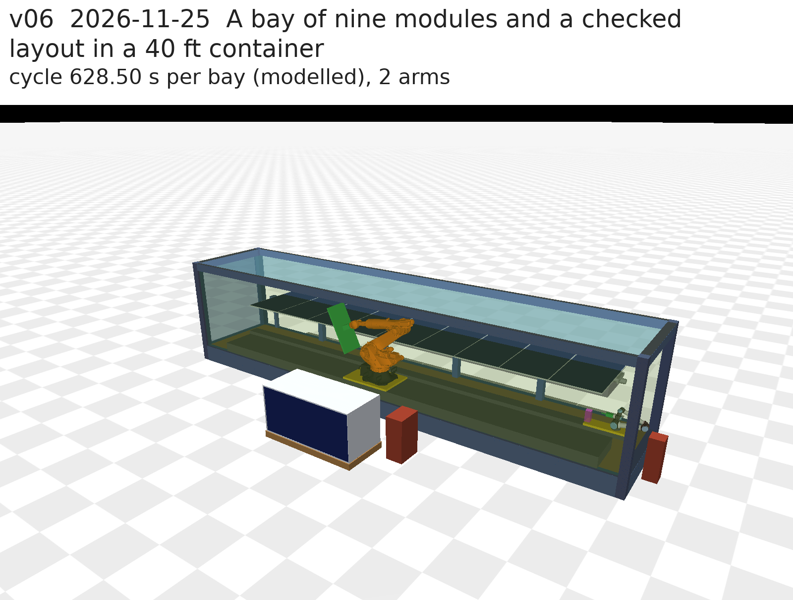

# One 40 ft base: the cell on the real parts

The cell is rebuilt on the real parts of a tracker bay, a round torque tube, rails, modules and their fastenings, on one 40 ft base. In run 011 the base is a container with both long sides open; it later becomes a flat rack. The work is kinematic: layouts are written as data and checked by a program for transport, reach, clearance, load, the ways in and out, and time. The figures are planned or come from a time model, and no controller or cycle runs in physics yet.

**Limits.** The base may carry 13,608 kg in transit (30,000 lb), and the arms, tracks, tools and bay have to fit within it. Times come from a time model, not from a run in physics.

## Where it stands

The chosen version is v10, "Three pin arms on the flat rack, the bay shortened by the order of work".

| Rank | Measure | Value | Unit | Better | How known | Basis |
|---|---|---|---|---|---|---|
| P0 | cycle_s | 554.55 | s per bay | lower | planned | the committed plan's 3 bays back to back: (end of bay 2's bay_out - start of bay 0's tube_in) / 3; kinematic, on assumed speeds and process times |
| not ranked | one_bay_s | 560.45 | s | - | planned | bay 0 of the committed plan alone, from the start of its tube_in to the end of its bay_out |
| not ranked | interval_s | 554.49 | s | - | planned | from the end of bay 1's bay_out to the end of bay 2's |
| P0 | failures_per_bay | 0.385 | - | lower | modelled | count of operations by kind x rates of scores/rates.json; 100% of it on rates of basis ours |
| P0 | physics_share | 0.0394 | - | higher | measured | physics/flat_rack_3_pin_arms_ordered.json: steps 63, 64 of module 4 carried out in physics, 22.068854 s of one bay's 560.452329 s counted |
| P1 | part_count | 39 | - | lower | counted | pieces of equipment by the rule of docs/scorecard.md |
| P1 | arms | 4 | arms | lower | counted | arms of the layout |
| P1 | driven_axes | 40 | - | lower | counted | arm joints, tracks, driven tools and grips by the rule of docs/scorecard.md |
| P1 | placement_mm | none | mm | lower | none | nothing is held or sensed in this cell; the stand-in cell's figure is another cell's |
| P2 | mass_in_transit_kg | 3426.3 | kg | lower | counted | the transport row's parts less infed parts (owner's definition) |
| P2 | input_tolerance | none | mm | higher | none | nothing is sensed in this cell, so no error of the infed parts is measured or corrected |
| P2 | plan_s | none | s | lower | none | the committed plan does not hold the time plan_layout took |

| Gate | Figure | Limit | Result |
|---|---|---|---|
| check_rows_failed | 0 rows | <= 0 rows | pass |
| least_clearance_m | 0.018 m | >= 0.015 m | pass |
| mass_in_transit_kg | 3426.3 kg | <= 13608.0 kg | pass |

The measures and gates are defined in [the scorecard](../scorecard.md).

## Progress

| Version | Date | Title | Cycle time | One bay | Arms | Part count | Mass in transit | Cycle time is |
|---|---|---|---|---|---|---|---|---|
| v05 | 2026-11-24 | The real parts of a bay and the container, as models | none | none | none | none | none | none |
| v06 | 2026-11-25 | A bay of nine modules and a checked layout in a 40 ft container | 628.50 s per bay (one bay) | 628.50 s | 2 | none | 3227.3 kg | modelled |
| v07 | 2026-11-25 | One pin arm on the flat rack (candidate) | 907.34 s per bay (one bay) | 907.34 s | 2 | none | none | planned |
| v08 | 2026-11-25 | Two pin arms on the flat rack (candidate) | 686.26 s per bay | 700.08 s | 3 | 31 | 3376.9 kg | planned |
| v09 | 2026-11-25 | Three pin arms on the flat rack: a whole bay planned | 622.31 s per bay | 644.28 s | 4 | 39 | 3426.3 kg | planned |
| v10 | 2026-11-26 | Three pin arms on the flat rack, the bay shortened by the order of work | 554.55 s per bay | 560.45 s | 4 | 39 | 3426.3 kg | planned |
| v15 | 2026-11-27 | One 40 ft flat rack, three KR 20 pin arms on one shared beam, all KUKA: three bays planned (candidate) | 612.40 s per bay | 626.32 s | 4 | 37 | 4132.2 kg | planned |
| v16 | 2026-11-27 | One 40 ft flat rack, three KR 20 pin arms on one shared beam, faster retreats: three bays planned (candidate) | 572.56 s per bay | 574.73 s | 4 | 37 | 4132.2 kg | planned |

The cycle time of a version with a plan is the average bay of three bays planned back to back, (end of bay 2's bay out − start of bay 0's tube in) / 3; "One bay" is its bay 0 alone, from tube in to bay out. A version without a plan has the time of one bay, marked so ([the scorecard](../scorecard.md)).

A filled circle is a cycle time that is planned, a square one that is measured, a hollow circle one that is modelled; a lighter marker is a candidate that was not chosen. A value marked "1 bay" is one bay's; the others are the average of three bays back to back.

## v10 Three pin arms on the flat rack, the bay shortened by the order of work

This recording shows the module arm's take and set of one module of v10 in physics (`physics/flat_rack_3_pin_arms_ordered.json`, `//:run_physics`).

2026-11-26, chosen, commit the commit that added v10: `git log --format=%h -S '"id": "v10"' -- versions/versions.json | tail -1`

**What changed.** The same cell as v09, with no new part, arm or tool and no changed time, speed or margin: only the order of work changed. The modules are set in the order 0, 1, 4, 2, 5, 7, 6, 3, 8, so that the three pin arms' modules come in turn. A module is taken as soon as the strap bolts of its own two rails are driven, not after the last bolt. A pin arm changes to its pin tool and takes its magazine as soon as its bolts are done, not when its first module is set. The planned bay is 560.45 s, down from 644.28 s.

**Why.** The cycle time of a bay is the first measure. Of 23 orders planned in full (tools/order/search.py), this one gave the shortest bay that the verifier passes. Every other measure of the scorecard is unchanged: 0.3849 failures per bay, 39 parts, 4 arms, 40 driven axes, 3,426.3 kg in transit. The least clearance over the schedule is 0.0180 m against 0.015 m.

| Rank | Measure | Value | Unit | Better | How known | Basis |
|---|---|---|---|---|---|---|
| P0 | cycle_s | 554.55 | s per bay | lower | planned | the committed plan's 3 bays back to back: (end of bay 2's bay_out - start of bay 0's tube_in) / 3; kinematic, on assumed speeds and process times |
| not ranked | one_bay_s | 560.45 | s | - | planned | bay 0 of the committed plan alone, from the start of its tube_in to the end of its bay_out |
| not ranked | interval_s | 554.49 | s | - | planned | from the end of bay 1's bay_out to the end of bay 2's |
| P0 | failures_per_bay | 0.385 | - | lower | modelled | count of operations by kind x rates of scores/rates.json; 100% of it on rates of basis ours |
| P0 | physics_share | 0.0394 | - | higher | measured | physics/flat_rack_3_pin_arms_ordered.json: steps 63, 64 of module 4 carried out in physics, 22.068854 s of one bay's 560.452329 s counted |
| P1 | part_count | 39 | - | lower | counted | pieces of equipment by the rule of docs/scorecard.md |
| P1 | arms | 4 | arms | lower | counted | arms of the layout |
| P1 | driven_axes | 40 | - | lower | counted | arm joints, tracks, driven tools and grips by the rule of docs/scorecard.md |
| P1 | placement_mm | none | mm | lower | none | nothing is held or sensed in this cell; the stand-in cell's figure is another cell's |
| P2 | mass_in_transit_kg | 3426.3 | kg | lower | counted | the transport row's parts less infed parts (owner's definition) |
| P2 | input_tolerance | none | mm | higher | none | nothing is sensed in this cell, so no error of the infed parts is measured or corrected |
| P2 | plan_s | none | s | lower | none | the committed plan does not hold the time plan_layout took |

| Gate | Figure | Limit | Result |
|---|---|---|---|
| check_rows_failed | 0 rows | <= 0 rows | pass |
| least_clearance_m | 0.018 m | >= 0.015 m | pass |
| mass_in_transit_kg | 3426.3 kg | <= 13608.0 kg | pass |

The measures and gates are defined in [the scorecard](../scorecard.md).

**Against v09.**

Each figure as the two versions' own sources report it; the conditions of a run may differ between them (see each figure's source).

| Measure | Before (v09) | Now (v10) | Difference |
|---|---|---|---|
| arms | 4 arms | 4 arms | 0 arms |
| cycle_s | 622.31 s per bay | 554.55 s per bay | -67.77 s per bay |
| driven_axes | 40 | 40 | 0 |
| failures_per_bay | 0.385 | 0.385 | 0 |
| input_tolerance | none | none | not comparable: not known |
| interval_s | 604.29 s | 554.49 s | -49.80 s |
| mass_in_transit_kg | 3426.3 kg | 3426.3 kg | 0.0 kg |
| one_bay_s | 644.28 s | 560.45 s | -83.83 s |
| part_count | 39 | 39 | 0 |
| physics_share | 0 | 0.0394 | +0.0394 (counted → measured) |
| placement_mm | none | none | not comparable: not known |
| plan_s | none | none | not comparable: not known |

**Candidates it was chosen over.**

| Version | Cycle time | One bay | Arms | Part count | Mass in transit | Failures per bay | Cycle time is | Recording | Layout | Commit | Status |
|---|---|---|---|---|---|---|---|---|---|---|---|
| v10 (this version) | 554.55 s per bay | 560.45 s | 4 | 39 | 3426.3 kg | 0.385 | planned | [v10.gif](../evolution/v10.gif) | [flat_rack_3_pin_arms_ordered.json](../../layouts/flat_rack_3_pin_arms_ordered.json) | the commit that added v10: `git log --format=%h -S '"id": "v10"' -- versions/versions.json \| tail -1` | chosen |
| v15 | 612.40 s per bay | 626.32 s | 4 | 37 | 4132.2 kg | 0.383 | planned | [v15.gif](../evolution/v15.gif) | [flat_rack_3_kr20_pin_arms_shared_ordered.json](../../layouts/flat_rack_3_kr20_pin_arms_shared_ordered.json) | the commit that added v15: `git log --format=%h -S '"id": "v15"' -- versions/versions.json \| tail -1` | candidate |

**Files.** [layout](../../layouts/flat_rack_3_pin_arms_ordered.json), [plan](../../plans/flat_rack_3_pin_arms_ordered.json), [scorecard](../../scores/flat_rack_3_pin_arms_ordered.json)

## v09 Three pin arms on the flat rack: a whole bay planned

2026-11-25, superseded, commit [940a01b](https://github.com/org-004/solar-bay-assembly/commit/940a01b)

**What changed.** The cell stands on the base of a 40 ft flat rack: one KUKA KR 210 on a track sets the ten rails and nine modules, and three UR10e on tracks below the bay drive the strap bolts and locate, pin and swage the modules. Every move of every arm for one bay is planned free of collision, the four arms are scheduled on one clock, and the plan is verified and committed.

**Why.** The owner allowed the first cell to stand on a flat rack with up to three pin arms. Of one, two and three pin arms, three gave the shortest planned bay, 644.28 s against 700.08 s and 907.34 s, with the same tightest clearance at a pose.

| Rank | Measure | Value | Unit | Better | How known | Basis |
|---|---|---|---|---|---|---|
| P0 | cycle_s | 622.31 | s per bay | lower | planned | the committed plan's 3 bays back to back: (end of bay 2's bay_out - start of bay 0's tube_in) / 3; kinematic, on assumed speeds and process times |
| not ranked | one_bay_s | 644.28 | s | - | planned | bay 0 of the committed plan alone, from the start of its tube_in to the end of its bay_out |
| not ranked | interval_s | 604.29 | s | - | planned | from the end of bay 1's bay_out to the end of bay 2's |
| P0 | failures_per_bay | 0.385 | - | lower | modelled | count of operations by kind x rates of scores/rates.json; 100% of it on rates of basis ours |
| P0 | physics_share | 0 | - | higher | counted | no committed, repeatable run in physics of this layout's arms and parts |
| P1 | part_count | 39 | - | lower | counted | pieces of equipment by the rule of docs/scorecard.md |
| P1 | arms | 4 | arms | lower | counted | arms of the layout |
| P1 | driven_axes | 40 | - | lower | counted | arm joints, tracks, driven tools and grips by the rule of docs/scorecard.md |
| P1 | placement_mm | none | mm | lower | none | nothing is held or sensed in this cell; the stand-in cell's figure is another cell's |
| P2 | mass_in_transit_kg | 3426.3 | kg | lower | counted | the transport row's parts less infed parts (owner's definition) |
| P2 | input_tolerance | none | mm | higher | none | nothing is sensed in this cell, so no error of the infed parts is measured or corrected |
| P2 | plan_s | none | s | lower | none | the committed plan does not hold the time plan_layout took |

| Gate | Figure | Limit | Result |
|---|---|---|---|
| check_rows_failed | 0 rows | <= 0 rows | pass |
| least_clearance_m | 0.018 m | >= 0.015 m | pass |
| mass_in_transit_kg | 3426.3 kg | <= 13608.0 kg | pass |

The measures and gates are defined in [the scorecard](../scorecard.md).

**Against v06.**

Each figure as the two versions' own sources report it; the conditions of a run may differ between them (see each figure's source).

| Measure | Before (v06) | Now (v09) | Difference |
|---|---|---|---|
| arms | 2 arms | 4 arms | +2 arms |
| cycle_s | 628.50 s per bay | 622.31 s per bay | not comparable: one bay against the average of three (modelled → planned) |
| mass_in_transit_kg | 3227.3 kg | 3426.3 kg | +199.0 kg |

**Candidates it was chosen over.**

| Version | Cycle time | One bay | Arms | Part count | Mass in transit | Failures per bay | Cycle time is | Recording | Layout | Commit | Status |
|---|---|---|---|---|---|---|---|---|---|---|---|
| v09 (this version) | 622.31 s per bay | 644.28 s | 4 | 39 | 3426.3 kg | 0.385 | planned | [v09.gif](../evolution/v09.gif) | [flat_rack_3_pin_arms.json](../../layouts/flat_rack_3_pin_arms.json) | [940a01b](https://github.com/org-004/solar-bay-assembly/commit/940a01b) | superseded |
| v07 | 907.34 s per bay (one bay) | 907.34 s | 2 | none | none | none | planned | [v07.png](../evolution/v07.png) | [flat_rack_1_pin_arm.json](../../layouts/flat_rack_1_pin_arm.json) | [940a01b](https://github.com/org-004/solar-bay-assembly/commit/940a01b) | candidate |
| v08 | 686.26 s per bay | 700.08 s | 3 | 31 | 3376.9 kg | 0.382 | planned | [v08.gif](../evolution/v08.gif) | [flat_rack_2_pin_arms.json](../../layouts/flat_rack_2_pin_arms.json) | [940a01b](https://github.com/org-004/solar-bay-assembly/commit/940a01b) | candidate |

**Files.** [layout](../../layouts/flat_rack_3_pin_arms.json), [plan](../../plans/flat_rack_3_pin_arms.json), [scorecard](../../scores/flat_rack_3_pin_arms.json)

## v06 A bay of nine modules and a checked layout in a 40 ft container

2026-11-25, superseded, commit [68a1199](https://github.com/org-004/solar-bay-assembly/commit/68a1199)

**What changed.** A bay becomes nine modules and ten rails, so the section is 10.616 m long with 46 fastenings. A layout is one JSON file, and a program checks it for transport, reach, clearance, load, the ways in and out, and time. Five layouts are compared in docs/layout.md and below_rails_by_module_arm is chosen: a KUKA KR 210 on a track sets rails and modules, and a UR10e on a floor track bolts, locates and pins.

**Why.** The container could not take a bay of ten modules with room to work, and the cell needed a layout whose reach, clearance and load were checked before anything was built.

| Figure | Value | Unit | How known | Source |
|---|---|---|---|---|
| cycle_s | 628.50 | s per bay | modelled | docs/layout.md at 68a1199, comparison table, Time for a bay, below_rails_by_module_arm, from the time model whose process times are marked ours; `bazel run --config=opt //:check_layout -- below_rails_by_module_arm` |
| arms | 2 | arms | counted | docs/layout.md at 68a1199, comparison table, Arms: one KUKA KR 210 R2700-2 and one UR10e, both on floor tracks |
| bay_mass_kg | 410.3 | kg | derived | docs/bay-hardware.md at 68a1199, The bay: tube 95.16 + 10 rails x 2.35 + 9 modules x 32.4 (derived); `bazel run --config=opt //:print_bay -- --summary` |
| mass_in_transit_kg | 3227.3 | kg | counted | docs/layout.md at 68a1199, comparison table, Mass that travels inside, of 17,200 kg: arms 1110, tracks 1850, tools 47.0, holder 220; `bazel run --config=opt //:check_layout -- below_rails_by_module_arm`. No stocks travelled inside at that commit, so the whole row is mass in transit by the owner's definition |
| reach_rows_passed | 186 | of 186 | counted | docs/layout.md at 68a1199, comparison table, reach; kinematic check, not a physics run: `bazel run --config=opt //:check_layout -- below_rails_by_module_arm --summary` |
| clearance_rows_passed | 270 | of 270 | counted | docs/layout.md at 68a1199, comparison table, clearance, tightest 0.0003 m; `bazel run --config=opt //:check_layout -- below_rails_by_module_arm --summary` |

**Against v05.**

Each figure as the two versions' own sources report it; the conditions of a run may differ between them (see each figure's source).

| Measure | Before (v05) | Now (v06) | Difference |
|---|---|---|---|
| bay_mass_kg | 455.3 kg | 410.3 kg | -45.0 kg |

## v05 The real parts of a bay and the container, as models

2026-11-24, superseded, commit [1213319](https://github.com/org-004/solar-bay-assembly/commit/1213319)

**What changed.** The real parts of one bay of a single-axis tracker, after Nextracker's NX Horizon, are written down in docs/bay-hardware.md and built as models: a round torque tube with 11 rails, 10 modules and 51 fastening points. A 40 ft container with both long sides open is modelled with the figures that decide whether a bay fits and passes out. The cell itself does not change and still uses its old square tube.

**Why.** The stand-in cell used a square tube and ten slots, so the next step needed the real parts of a bay and a container to work in, with each figure marked published, derived or ours.

| Figure | Value | Unit | How known | Source |
|---|---|---|---|---|
| modules_per_bay | 10 | modules | assumed | docs/bay-hardware.md at 1213319, The bay (marked ours): 10 modules, the largest whose bay is no longer than 11.8 m |
| bay_mass_kg | 455.3 | kg | derived | docs/bay-hardware.md at 1213319, The bay (derived: tube 105.42 + 11 rails x 2.35 + 10 modules x 32.4): `bazel run --config=opt //:print_bay -- --summary` |
| bay_length_mm | 11760 | mm | derived | docs/bay-hardware.md at 1213319, The bay: tube as shipped, 11,760 mm (derived) |
| fastenings | 51 | points | counted | docs/bay-hardware.md at 1213319, The bay: 11 rail to tube plus 40 module to rail, named sites in models/bay.xml; `bazel run --config=opt //:print_bay -- --summary` |
| container_gross_kg | 23800.0 | kg | assumed | docs/bay-hardware.md at 1213319, The container this project assumes: gross mass for transport 23,800 kg, tare 6,600 kg (both marked ours) |
| mass_left_for_cell_kg | 17200.0 | kg | derived | docs/bay-hardware.md at 1213319, The container this project assumes: 23,800 - 6,600 (derived) |

First version of this direction.

[Back to the README](../../README.md)
