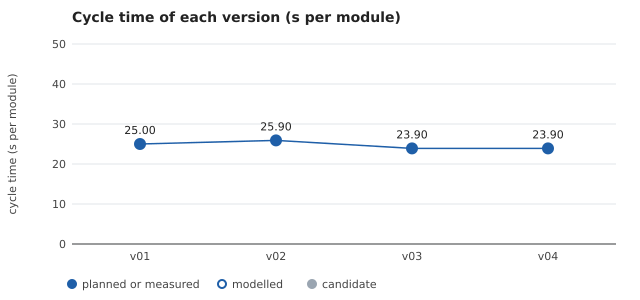
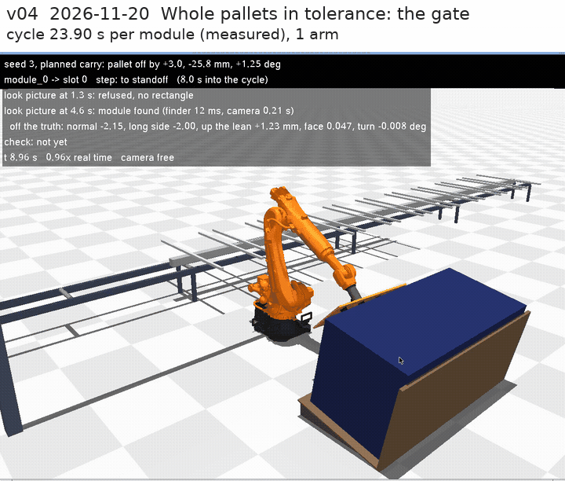
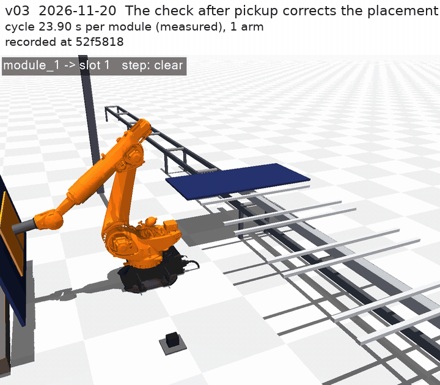
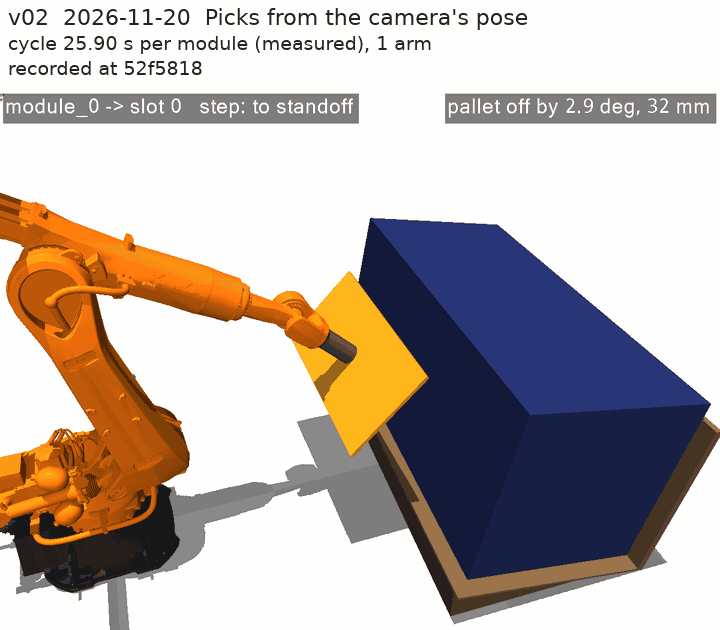
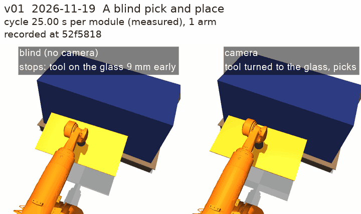

# A stand-in cell: one KUKA arm picking modules in physics

One KUKA KR 210 arm with a suction tool picks solar modules from a tilted pallet and sets them on a torque tube that a conveyor steps along, all in MuJoCo physics. Perception, motion planning and control are written in C++ for it. A depth camera finds the front module, a planned carry takes it to the other side, and a second camera checks how the module sits on the tool and corrects the placement. A gate in the tests runs whole pallets with randomized offsets and fails if a module lands out of tolerance. Its figures are measured in simulation runs.

**Limits.** It is another cell: ten slots of a square tube, not the real parts of a bay. The simulation is kinder than a real cell: the grip never slips, the module is rigid, and the motor and camera noise figures are estimates.

## Where it stands

No version is chosen; the newest version that is not a candidate is v04, "Whole pallets in tolerance: the gate".

| Figure | Value | Unit | How known | Source |
|---|---|---|---|---|
| arms | 1 | arms | counted | README.md at dd03149, Status, The cell: a KUKA KR 210 R2700-2 with a suction tool |
| modules_in_tolerance | 240 | of 240 | measured | README.md at dd03149, The gate: all 240 in tolerance; docs/gate.md at dd03149 (measured at 69b9087 plus this stage): `bazel test --config=opt //:gate_test` |
| placement_mm | 1.95 | mm | measured | README.md at dd03149, The gate: worst 1.95 mm; docs/gate.md at dd03149, worst position in the rails' plane (seed 4, module 6); `bazel test --config=opt //:gate_test` |
| placement_deg | 0.059 | deg | measured | README.md at dd03149, The gate: worst 0.059 degrees; `bazel test --config=opt //:gate_test` |
| gate_tolerance_mm | 3 | mm (and 0.15 deg) | planned | docs/gate.md at dd03149, The tolerance: an assumption chosen by the project owner, not a tracker maker's figure |
| cycle_s | 23.90 | s per module | measured | README.md at dd03149, Planning: a cycle 23.9 s with the planned carry, without the check (the check costs 0.6 s more per README at 69b9087 commit message); `bazel run --config=opt //:run_cell -- --pretty --trials 20 --carry planned` |

## Progress

| Version | Date | Title | Cycle time | Arms | Part count | Mass in transit | Cycle time is |
|---|---|---|---|---|---|---|---|
| v01 | 2026-11-19 | A blind pick and place | 25.00 s per module | 1 | none | none | measured |
| v02 | 2026-11-20 | Picks from the camera's pose | 25.90 s per module | 1 | none | none | measured |
| v03 | 2026-11-20 | The check after pickup corrects the placement | 23.90 s per module | 1 | none | none | measured |
| v04 | 2026-11-20 | Whole pallets in tolerance: the gate | 23.90 s per module | 1 | none | none | measured |

A filled marker is a cycle time that is planned or measured, a hollow marker one that is modelled; a lighter marker is a candidate that was not chosen.

## v04 Whole pallets in tolerance: the gate

2026-11-20, superseded, commit [dd03149](https://github.com/org-004/solar-bay-assembly/commit/dd03149)

**What changed.** A test, the gate, runs eight whole pallets of 30 modules with the planned carry and the check, with noisy pictures and both cameras' calibrations off by 1 mm and 0.05 degrees. It fails if any module is not placed or lands more than 3 mm or 0.15 degrees from its slot, and it saves every failure with the command that reruns it.

**Why.** Single trials had shown the cycle worked, but nothing stopped a later change from breaking it, so whole pallets in tolerance became a condition of the tests.

| Figure | Value | Unit | How known | Source |
|---|---|---|---|---|
| arms | 1 | arms | counted | README.md at dd03149, Status, The cell: a KUKA KR 210 R2700-2 with a suction tool |
| modules_in_tolerance | 240 | of 240 | measured | README.md at dd03149, The gate: all 240 in tolerance; docs/gate.md at dd03149 (measured at 69b9087 plus this stage): `bazel test --config=opt //:gate_test` |
| placement_mm | 1.95 | mm | measured | README.md at dd03149, The gate: worst 1.95 mm; docs/gate.md at dd03149, worst position in the rails' plane (seed 4, module 6); `bazel test --config=opt //:gate_test` |
| placement_deg | 0.059 | deg | measured | README.md at dd03149, The gate: worst 0.059 degrees; `bazel test --config=opt //:gate_test` |
| gate_tolerance_mm | 3 | mm (and 0.15 deg) | planned | docs/gate.md at dd03149, The tolerance: an assumption chosen by the project owner, not a tracker maker's figure |
| cycle_s | 23.90 | s per module | measured | README.md at dd03149, Planning: a cycle 23.9 s with the planned carry, without the check (the check costs 0.6 s more per README at 69b9087 commit message); `bazel run --config=opt //:run_cell -- --pretty --trials 20 --carry planned` |

**Against v03.**

| Measure | Before (v03) | Now (v04) | Difference |
|---|---|---|---|
| arms | 1 arms | 1 arms | 0 arms |
| cycle_s | 23.90 s per module | 23.90 s per module | 0.00 s per module |
| placement_mm | 0.28 mm | 1.95 mm | +1.67 mm |

## v03 The check after pickup corrects the placement

2026-11-20, superseded, commit [69b9087](https://github.com/org-004/solar-bay-assembly/commit/69b9087)

**What changed.** With `--check` the planned carry passes over a second depth camera looking up. The arm holds still, the camera finds the module's underside, and the set-down is corrected so that the module, not the tool, lands on the slot. The carry is planned and the cycle can use it with `--carry planned`.

**Why.** A camera calibration that is off is frozen in at the grip and goes straight into the placement, and the script cannot see that error.

| Figure | Value | Unit | How known | Source |
|---|---|---|---|---|
| arms | 1 | arms | counted | README.md at 69b9087, Status, The cell: a KUKA KR 210 R2700-2 with a suction tool |
| cycle_s | 23.90 | s per module | measured | README.md at 69b9087, Planning: over a whole pallet a cycle takes 23.9 s with the planned carry, against 25.9 s hand-chosen; `bazel run --config=opt //:run_cell -- --pretty --trials 20 --carry planned`. This is without the check |
| check_cost_s | 0.60 | s per module | measured | Commit message of 69b9087 (the README at that commit does not yet say the cycle uses the check): the check costs 0.6 s a cycle more; `--check` |
| placement_mm | 0.28 | mm | measured | Commit message of 69b9087: pallet camera's calibration off by 1 mm and 0.05 degrees, 20 pallets, worst placement 0.28 mm with the check; `--check --calibration 1,0.05` |
| placement_mm_without_check | 4 | mm | measured | Commit message of 69b9087: the same 20 pallets, worst placement 4.00 mm without the check; README.md at 69b9087, Status, gives 2.7 mm along and 4.0 mm across: `bazel run --config=opt //:run_cell -- --pretty --trials 20 --calibration 1,0.05` |
| input_tolerance | 30 | mm (and 3 deg) | measured | README.md at 69b9087, Status: pallets set down up to 30 mm and 3 degrees off, 20 of 20 modules placed; `bazel run --config=opt //:run_cell -- --pretty --trials 20` |

**Against v02.**

| Measure | Before (v02) | Now (v03) | Difference |
|---|---|---|---|
| arms | 1 arms | 1 arms | 0 arms |
| cycle_s | 25.90 s per module | 23.90 s per module | -2.00 s per module |
| input_tolerance | 30 mm (and 3 deg) | 30 mm (and 3 deg) | 0 mm (and 3 deg) |
| placement_mm | 0.6 mm | 0.28 mm | -0.32 mm |

## v02 Picks from the camera's pose

2026-11-20, superseded, commit [a2f4e85](https://github.com/org-004/solar-bay-assembly/commit/a2f4e85)

**What changed.** One depth picture per pick gives the front module's pose, and the pick is built from it. The module finder fits the glass plane and the module's outline in the picture, with a noise model on the depth image.

**Why.** The blind script failed on every pallet set down 30 mm and 3 degrees off, so the pick had to follow where the module really is.

| Figure | Value | Unit | How known | Source |
|---|---|---|---|---|
| arms | 1 | arms | counted | README.md at a2f4e85, Status, The cell: a KUKA KR 210 R2700-2 with a suction tool |
| cycle_s | 25.90 | s per module | measured | README.md at a2f4e85, Status: a whole pallet of 30 placed onto three tubes, 25.9 s a cycle on average (the README also says about 25 s); `bazel run --config=opt //:run_cell -- --pretty --trials 20` |
| placement_mm | 0.6 | mm | measured | README.md at a2f4e85, Status: over 20 pallets, worst 0.13 mm along the tube and 0.60 mm across it; `bazel run --config=opt //:run_cell -- --pretty --trials 20` |
| placement_deg | 0.012 | deg | measured | README.md at a2f4e85, Status: over 20 pallets, worst 0.012 degrees; `bazel run --config=opt //:run_cell -- --pretty --trials 20` |
| input_tolerance | 30 | mm (and 3 deg) | measured | README.md at a2f4e85, Status: pallets set down up to 30 mm and 3 degrees off, with noisy pictures; `bazel run --config=opt //:run_cell -- --pretty --trials 20` |
| modules_placed | 20 | of 20 | measured | README.md at a2f4e85, Status: 20 of 20 modules placed; `bazel run --config=opt //:run_cell -- --pretty --trials 20` |

**Against v01.**

| Measure | Before (v01) | Now (v02) | Difference |
|---|---|---|---|
| arms | 1 arms | 1 arms | 0 arms |
| cycle_s | 25.00 s per module | 25.90 s per module | +0.90 s per module |
| placement_mm | 0.1 mm | 0.6 mm | +0.5 mm |

## v01 A blind pick and place

2026-11-19, superseded, commit [83970cc](https://github.com/org-004/solar-bay-assembly/commit/83970cc)

**What changed.** The first cell: a KUKA KR 210 arm with a suction tool, a tilted pallet of 30 modules, a conveyor with a torque tube, and one depth camera. The cycle runs from a script that assumes the pallet is exactly where the drawing says.

**Why.** To have a whole cycle running in physics, scored by placement error and cycle time, before any perception was added.

| Figure | Value | Unit | How known | Source |
|---|---|---|---|---|
| arms | 1 | arms | counted | README.md at 83970cc, Status, The cell: a KUKA KR 210 R2700-2 with a suction tool |
| cycle_s | 25.00 | s per module | measured | README.md at 83970cc, Status, The cycle: "a cycle takes about 25 simulated seconds"; `bazel run //:run_cell -- --pretty --nominal --modules 2` |
| placement_mm | 0.1 | mm | measured | README.md at 83970cc, Status: with the pallet exactly where the script assumes, a module lands within 0.1 mm of its slot, for all 30 modules; `bazel run //:run_cell -- --pretty --nominal --modules 2` |
| placed_at_5mm_0.3deg | 8 | of 10 trials | measured | README.md at 83970cc, Status: with the pallet set down 5 mm and 0.3 degrees off, 8 of 10 trials placed; run_cell flags `--trials`, `--xy`, `--yaw` |
| placed_at_30mm_3deg | 0 | of 10 trials | measured | README.md at 83970cc, Status: with the pallet up to 30 mm and 3 degrees off, none of 10 trials placed a module; run_cell flags `--trials`, `--xy`, `--yaw` |

First version of this direction.

[Back to the README](../../README.md)
