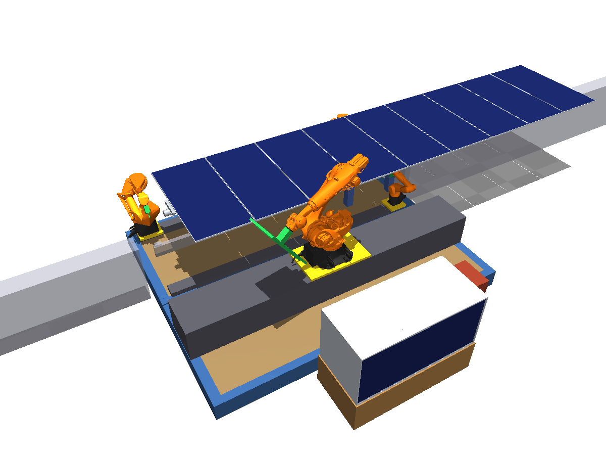
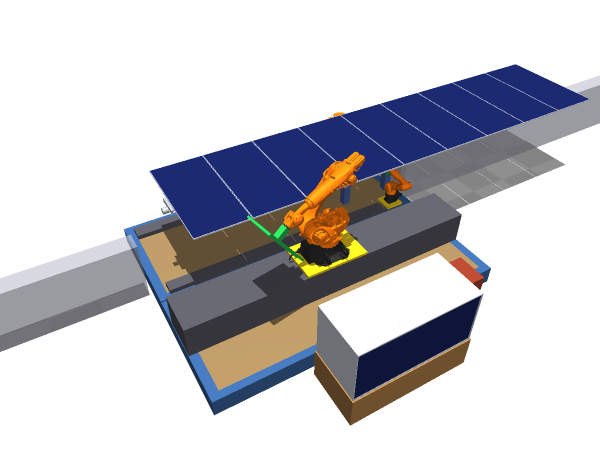
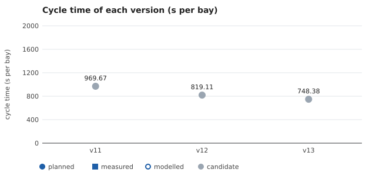

# Two 20 ft flat racks side by side

Two 20 ft flat racks stand side by side on their long sides, about 25 mm apart. Each has its own transport limit of 13,608 kg (30,000 lb) and is structurally separate, but the two work as one cell and arms may reach across the gap. The torque tube is worked in sections, because a tube of 30 ft or more does not fit whole. Units at the infeed and the outfeed stage the tube. The cell of this direction is described and checked in [docs/two-flat-racks-cell.md](../two-flat-racks-cell.md): two layouts, `two_flat_racks_2_pin_arms` and `two_flat_racks_1_pin_arm`, each worked in three stages and passing every row of the checker.

**Limits.** Each rack carries at most 13,608 kg (30,000 lb) in transit, so the mass of the cell has to be split between them. The tube is worked in three stages; its two transfers in a bay take 30 s each, a figure of the layout, not the model of a move. Times come from a time model, not from a run in physics.

## Where it stands

Only candidates exist: no version of this direction is chosen or settled.

## Progress

| Version | Date | Title | Cycle time | One bay | Arms | Part count | Mass in transit | Cycle time is |
|---|---|---|---|---|---|---|---|---|
| v11 | 2026-11-27 | Two 20 ft flat racks, two pin arms: three bays planned (candidate) | 969.67 s per bay | 1003.47 s | 4 | 25 | 3727.0 kg | planned |

The cycle time of a version with a plan is the average bay of three bays planned back to back, (end of bay 2's bay out − start of bay 0's tube in) / 3; "One bay" is its bay 0 alone, from tube in to bay out. A version without a plan has the time of one bay, marked so ([the scorecard](../scorecard.md)).

A filled circle is a cycle time that is planned, a square one that is measured, a hollow circle one that is modelled; a lighter marker is a candidate that was not chosen. A value marked "1 bay" is one bay's; the others are the average of three bays back to back.

[Back to the README](../../README.md)
