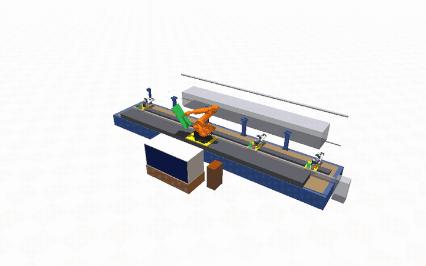
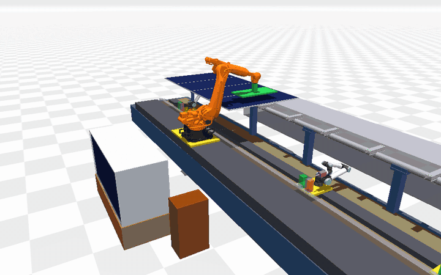
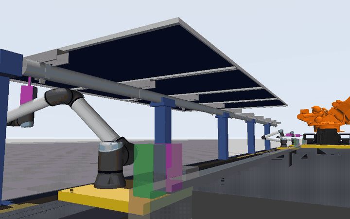

# The cell on a flat rack, built as planned motion

This is the design of the robot cell that builds bays (one round tube, ten rails, nine
modules: `docs/bay-hardware.md`) on the base of a 40 ft flat rack. Its layout here is
`flat_rack_3_pin_arms` (chosen until run 018; since then the chosen layout is the same cell
with a shorter order of work, `flat_rack_3_pin_arms_ordered`, in
[`docs/flat-rack-order.md`](flat-rack-order.md)): one KUKA KR 210 R2700-2 sets the rails and the modules, and
three Universal Robots UR10e below the bay drive the strap bolts and locate, pin and
swage the modules. The cell is designed, not built, and kinematic: arms, tools, parts
and envelopes are checked at poses and along planned motion. Since run 019 one module's
cycle of the chosen plan, the module arm's take and set of module 4, is also run in
physics: [`docs/flat-rack-physics.md`](flat-rack-physics.md). Since run 021 every plan
holds three bays back to back, and the scorecard's `cycle_s` is their average bay:
[`docs/three-bays.md`](three-bays.md); the tables below are of one bay unless they say
otherwise. Every result below is printed by these commands:

- `bazel run --config=opt //:check_layout -- <name>` (`--list`, `--summary`, `--steps`,
  `--checks <kinds>`): every row of every check as CSV
  (`check,item,arm,tool,figure,unit,limit,result,detail`), then the time model, the
  margins and each arm's posture as `#` lines.
- `bazel run --config=opt //:plan_layout -- <name> [--bays N] [--summary|--margins|--out PATH]`:
  three bays back to back unless `--bays` says otherwise (`src/layout_bays.h`); one row
  per planned move, then the phases, each arm's share, every wait, the costliest moves
  and the planning time; `--margins` the tightest margins of the committed plan
  (`plans/<name>.json`).
- `bazel run --config=opt //:viewer_layout -- <name> --play`: the committed plan played
  back (needs a display).

**How to read the tables.** As in `docs/bay-hardware.md` and `docs/layout.md`, a row
that states a figure ends in its basis: `published` (in a source of
`docs/bay-hardware.md`), `derived` (computed from figures named in the row, or printed
by one of the programs above on the layout's figures) or `ours` (designed in this work).
Every position, envelope, process time and timing figure of the layout is `ours`; every
program result is `derived`, and it is as firm as the `ours` figures it rests on. The
frame is the flat rack's (`src/flat_rack.h`): the origin on the ground under the middle
of the base, +Y along it, +X across, +Z up; the deck is 0.648 m above the ground.
Lengths are metres, angles degrees, masses kilograms, times seconds.

## What is allowed

The owner set these limits on 2026-11-24 for the first cell. The base is a flat rack
with no sides, posts or roof; its end frames are dropped or taken off while it works,
and it travels on a semi-trailer. The arms that take and set modules are a KUKA KR 210
R2700-2 or a smaller KUKA arm. There is no limit on the number of arms, as long as the
cell works and the stowed cell keeps to the weight limit and the stow envelope. On
2026-11-26 the owner added that every arm is to be KUKA; the checker holds that to a
limit only on a layout whose base is `two_flat_racks`, and this layout is on a single
flat rack. The pallet is the maker's: 36 modules standing on their long edge. Feeders and
take-away are separate units that stand against the cell at ports. The engineer sets
the margins and reports the tightest. The work is kinematic only.

The checker prints these limits as `allowed` rows; the chosen layout passes them all.

| Row | Figure | Limit | Detail | Basis |
|---|---|---|---|---|
| module arm module_arm | 210 kg | 210 | KUKA KR 210 R2700-2 (KR QUANTEC), reach 2.701 m | derived |
| maker module_arm | 1 | none on this base | KUKA KR 210 R2700-2 (KR QUANTEC); no limit on this base | derived |
| maker pin_arm_a, pin_arm_b, pin_arm_c | 0 | none on this base | Universal Robots UR10e; a later spec replaces the UR10e pin arms | derived |
| pallet 0 | 36 modules | 36 | stands on its long edge | derived |

## The base

The base is the flat rack of `docs/bay-hardware.md` ("The container", table "The flat
rack this project assumes"): 12,192 x 2,438 mm outside, the deck 648 mm above the
ground, a transport envelope of 12.192 x 2.438 x 2.896 m from the ground and 17,900 kg
left for the cell. Its figures live in `src/flat_rack.h` and `models/flat_rack.xml`.

### Transport rows of the chosen layout

Stowed, every arm stands at its stow track value, which is its wait track value.

| Row | Figure | Limit | Detail | Basis |
|---|---|---|---|---|
| stowed x | 0.0180 m | 0 | worst `module_arm_arm_base_visual`, inside +/-1.219 | derived |
| stowed y | 0.0060 m | 0 | worst `item_pin_lane_lane`, inside +/-6.096 | derived |
| stowed top | 0.2744 m | 0 | worst `module_arm_arm_link_3_visual`, under 2.896 | derived |
| stowed bottom | 0.0000 m | 0 | worst `holder_end_column`, above 0.648 | derived |
| stow track module_arm | 4.6000 m | 0 | stow track 0.000 on the track's -4.600..4.600 | derived |
| stow track pin_arm_a | 0.1000 m | 0 | stow track -5.200 on the track's -5.300..-0.872 | derived |
| stow track pin_arm_b | 0.3600 m | 0 | stow track 2.200 on the track's -0.272..2.560 | derived |
| stow track pin_arm_c | 0.3000 m | 0 | stow track 5.000 on the track's 3.160..5.300 | derived |
| on the deck: holder, four beams, pin lane | 0 boxes off | 0 | all 18, 1, 1, 1, 1 and 4 boxes stand on the deck | derived |
| on the deck: the stocks of pins | 0 boxes | 0 | no box (the nests belong to the lane) | derived |
| on the deck: each arm on its beam | 0.0000 m | 0.001 | carriage on the beam's top and within its length at both ends, base on the carriage | derived |
| mass | 3429.3 kg | 17900 | arms 1177, tracks 1852, tools 69.0, holder 220, items inside 108, stocks inside 3 | derived |

## The layout

### Where everything stands

All positions are the layout file's (`layouts/flat_rack_3_pin_arms.json`).

| Thing | Where | Basis |
|---|---|---|
| Tube | axis at x = -1.08, z = 1.598 (0.95 above the deck), plain end at y = -5.308 | ours |
| Holder | run 011's four stands at bay_hold_2, 4, 6, 8 and an end unit, on the deck; stand 2's column 0.16 x 0.16 x 0.845 at (-1.08, -3.432), saddle 0.22 x 0.30 x 0.04 centred at z = 1.513; end column 0.10 x 0.10 at (-1.14, -5.43), end head 0.20 x 0.14 x 0.15 | ours |
| Module arm | KR 210 R2700-2, base at (0.77, 0, 0.948), yaw 90, on a floor track -4.6..4.6 (1.5 m/s, 1.5 m/s2); beam 0.86 x 10.6 x 0.25 | ours |
| Pin arm A | UR10e, base at x = -0.38, z = 0.798 (0.15 above the deck), track -5.3..-0.872, beam 0.30 x 5.178 x 0.10 | ours |
| Pin arm B | as A, track -0.272..2.56, beam 0.30 x 3.432 x 0.10 | ours |
| Pin arm C | as A, track 3.16..5.3, beam 0.30 x 2.89 x 0.10 | ours |
| Pin arms' carriages | 0.59 x 0.50 x 0.05, track 1.5 m/s, 2.0 m/s2 | ours |
| Module arm's tool | combined gripper, 36.0 kg: suction cups for a module and a clamp for a rail; never changed | ours |
| Pin arms' tools | nutrunner 3.0 kg and pin tool (nose, finger, swager) 8.0 kg, waiting on the carriage 0.36 m toward +X of the arm's axis and 0.09 m either side; the nutrunner first; a tool change takes 8.00 s | ours |
| Pallet 0 | at (2.92, 0, 0), yaw -90, on a dock whose deck is 0.50 above the ground; 36 modules on their long edge, 0.03 m pitch | ours |
| Rail rack | presents a rail at (2.37, 1.75, 1.278); body 0.60 x 0.40 x 1.078 standing on the ground | ours |
| Pin lane | 0.10 wide and 0.25 high at x = 0.17 from y = -5.55 to 6.09; nests at y = -5.2, 2.2 and 5.0, magazines taken at z = 0.998 | ours |
| Transfer cart (not carried) | envelope 1.2 x 9.0 x 1.0 centred at (-3.6, 0, 0.5); 800 kg | ours |
| Pin feeder (not carried) | envelope 0.4 x 0.5 x 1.0 centred at (0.17, 6.4, 0.5); 60 kg | ours |
| Wait poses | module arm joints (170, -130, 150, 0, 15, 0) at track 0; pin arms (180, -170, 150, 20, 90, 0) at tracks -5.2, 2.2 and 5.0 | ours |
| Tube in and bay out | along (-2.9, 0, 0.12), (0, 0, 0.12), (0, 0, 0) and back, 40 s each | ours |

### The division of work

The module arm takes and sets every rail and every module. The pin arms share the rest,
each on its own stretch of the floor rail so that two pin arms never share a place:

| Arm | Strap bolts | Modules (holes) | Pin magazine | Basis |
|---|---|---|---|---|
| pin_arm_a | 0-4 | 0-3 (holes 0-15) | nest 0, at y = -5.2 | ours |
| pin_arm_b | 5-7 | 4-6 (holes 16-27) | nest 1, at y = 2.2 | ours |
| pin_arm_c | 8-9 | 7-8 (holes 28-35) | nest 2, at y = 5.0 | ours |

### How many pin arms (R12)

Three layouts differ only in the number of pin arms; two arms share the modules 0-4 and
5-8, and one arm does everything. Each passes every row of `check_layout` and plans
whole.

| | `flat_rack_1_pin_arm` | `flat_rack_2_pin_arms` | `flat_rack_3_pin_arms` | Basis |
|---|---|---|---|---|
| Arms | 2 | 3 | 4 | ours |
| Bay by the time model | 633.13 s | 470.63 s | 416.32 s | derived |
| One bay planned | 907.34 s | 700.08 s | 644.28 s | derived |
| Planned over the model | 1.433 | 1.488 | 1.548 | derived (ratio) |
| Tightest clearance at a pose, not near by design (`clearance` row) | 0.0187 m, `locate 0/3` | 0.0187 m, `locate 0/3` | 0.0187 m, `locate 0/3` | derived |
| Least `approach` row | 0.0187 m, `locate 0/3 approach` | 0.0187 m, `locate 0/3 approach` | 0.0187 m, `locate 0/3 approach` | derived |
| Least clearance over the schedule | 0.0179 m | 0.0179 m | 0.0181 m | derived |
| Least clearance arm to arm | 0.0196 m | 0.0250 m | 0.0187 m | derived |
| Waits (count, total arm-seconds) | 16, 702.17 s | 20, 950.79 s | 25, 1401.20 s | derived |
| Rows passed (all) | 911 of 911 | 931 of 931 | 951 of 951 | derived |

The tightest pose is the same in all three: the pin tool's nose against the flange of
the next module (`locate 0/3`: module 1's flange beside hole 0/3; several `locate`,
`pin` and `swage` rows and their legs tie at 0.0187 m). The `clearance` rows other than
these exclude the `tool in free space` rows, which are under Margins. Rows passed by
kind (`--summary`, one, two and three pin arms; derived): transport 18, 22, 26; hold 8
each; load 3, 5, 7; reach 189, 193, 197; clearance 273, 280, 287; ways 2 each; time 3,
4, 5; allowed 5 each; port 42 each; approach 368, 370, 372. None fails.

Three pin arms were taken forward to be planned because they are the shortest by the
time model, the tightest pose clearance is the same in all three, and the planned times
(R24, below) confirm the order. R17's rule, applied to one bay: the shortest planned bay is
three arms', 644.28 s. The two-arm layout is within 10% of it (700.08 / 644.28 = 1.087), but
its least clearance over the schedule, 0.0179 m, is not larger than 0.0181 m; the
one-arm layout is 1.408 times as long. So `flat_rack_3_pin_arms` is the one layout
marked `chosen` by `--list`. (Since run 018 which layout is chosen is read from
`versions/versions.json`, the newest version with status `chosen`, not from a field of the
layout file; `docs/scorecard.md`, "Versions and pages".)

## The ports

A separate unit stands against the cell only at a port. The frame of each port is
measured from the centre of the bottom corner fitting at the -X, -Y corner, which is at
(-1.1295, -5.9925) in the layout's frame at the deck's height 0.648 (the fittings are
2.259 m apart across and 11.985 m along). The frame's x axis points into the zone.

| Port | Crosses | Frame from the fitting: across, along (m) | Frame's x axis turned | Zone (layout's frame): x, y, z (m) | Presented as | Per bay | Unit at the port | Basis |
|---|---|---|---|---|---|---|---|---|
| tubes_in | bare tubes | -0.090, 5.992 (the -X edge, middle) | 180 | -5.500..-1.250, -5.700..5.700, 0.00..2.40 (shared with bays_out) | level and parallel to Y, locating holes straight up, plain end toward -Y, the axis 0.12 m above its place in the holder | 1 | the transfer cart, which lowers the tube into the open saddles | frame derived, the rest ours |
| bays_out | finished bays | -0.090, 5.992 | 180 | the same box as tubes_in | taken as it lies in the holder: level, modules up | 1 | the same cart: its forks lift the bay 0.12 m under four free stretches of the tube and carry it out | frame derived, the rest ours |
| modules | modules | 2.349, 5.992 (the +X edge, middle) | 0 | 1.260..4.460, -1.450..1.450, 0.00..2.40 | upright on the long edge, glass toward the cell, nearest first; pallet deck 0.50 m above the ground | 9 | a pallet dock holding one maker's pallet of 36, exchanged when empty | frame derived, the rest ours |
| rails | rails with strap and bolt | 2.349, 7.742 (the +X edge) | 0 | 1.260..3.160, 1.485..2.035, 0.00..2.40 | one rail, top up, long side along X, its top 1.278 m above the ground | 10 | a rail rack presenting one rail at a time | frame derived, the rest ours |
| pin_magazines | magazines of 36 pins and collars | 1.299, 12.088 (the +Y edge) | 90 | -0.230..0.570, 6.096..6.996, 0.00..2.40 | upright on the lane's outer end, 0.25 m above the deck, 6 mm inside the base's +Y edge | 3 | a feeder standing against the +Y end | frame derived, the rest ours |

The `port` rows check that each frame lies on the base's outline at the deck's height,
faces its zone and hands over what crosses it, and that zones stay off the base and
apart (but the shared tube and bay zone). They also check that every pallet, stock and
outside item, and the tube and bay at the outer ends of their ways, lie inside exactly
one zone that names them while the stowed cell is in none; all 42 pass, the narrowest
being the stowed lane 0.0060 m clear of the pin_magazines zone (derived).

The limits: the cart and the feeder are envelopes that hand over at the base's edge.
Their forks and hand are not designed, drawn, swept or checked.

## Coming to a work point and leaving it

Every kind of work has an approach and a retreat by rule, held in the layout's file. An
approach starts at the approach pose and goes straight to the work pose; a retreat goes
straight from the work pose to the retreat pose. A direction in the tool's frame is taken
as the tool is at the work pose (the tool's z axis points out of the flange).

| Kind | Approach: frame, direction, distance | Retreat: frame, direction, distance | Why | Basis |
|---|---|---|---|---|
| rail_take | world (0, 0, 1), 0.150 m | world (0, 0, 1), 0.250 m | down onto the rail's top in the rack; the rail is lifted straight up out of it | ours |
| rail_set | world (0, 0, 1), 0.200 m | world (0, 0, 1), 0.150 m | the rail is lowered straight over the tube until its tab is in its hole; the gripper leaves straight up | ours |
| strap_bolt | tool (0, 0, -1), 0.100 m | tool (0, 0, -1), 0.100 m | along the bolt's axis: the socket comes onto the head from +X and draws back the same way | ours |
| module_take | tool (0, 0, -1), 0.150 m | world (-0.7071, 0, 0.7071), 0.400 m | onto the glass along the tool's axis; the module is drawn out of the pack toward the cell and up at 45 degrees, clear of the deck and the module behind it | ours |
| module_set | world (0, 0, 1), 0.150 m | world (0, 0, 1), 0.150 m | lowered flat onto its two rails beside its neighbour; the gripper leaves straight up | ours |
| locate | tool (0, 0, -1), 0.120 m | tool (0, 0, -1), 0.120 m | along the hole's axis from below: the nose rises into the rail's hat and comes down out of it | ours |
| pin | tool (0, 0, -1), 0.120 m | tool (0, 0, -1), 0.120 m | as locate | ours |
| swage | tool (0, 0, -1), 0.120 m | tool (0, 0, -1), 0.120 m | as locate | ours |
| pins_take | world (0, 0, 1), 0.150 m | world (0, 0, 1), 0.150 m | down onto the magazine in its nest and straight up with it | ours |

The turn of a module from upright to flat is not a leg: it is part of the planned move
from a take's retreat pose to a set's approach pose.

### How the approach rows check them

For every work point the checker writes two `approach` rows, one per leg, limit
`clearance_m`. Each leg is walked from the work pose in equal steps of at most 5 mm,
each sample solved from the one before; every sample must be reached inside the joint
margin, and a joint that turns more than 10 degrees between samples has jumped to
another branch and fails the row. The pairs that touch or are near by design at that
work point (the held part on what it is set on, the tool on the part it takes or has
let go, the nose against its own hole's rail and module) may close to zero but never
below; every other pair keeps `clearance_m`. The first sample is the work pose itself,
measured in the leg's own scene; at the far pose every pair must be `clearance_m`
apart. All 36 takes from the pallet are walked. The chosen layout passes all 372.

| Kind | Rows | Least figure | The pair and where | Basis |
|---|---|---|---|---|
| rail_take | 20 | 0.1200 m | the module arm's carriage to nest 1, at the work pose (`rail_take 0 approach`) | derived |
| rail_set | 20 | 0.0630 m | the gripper's cups to the tube, at the work pose (`rail_set 0 approach`) | derived |
| strap_bolt | 20 | 0.0500 m | pin arm A's carriage to pin arm B's beam (`strap_bolt 4 approach`) | derived |
| module_take | 72 | 0.0299 m | the held module's flange to pallet module 2 (`module_take 0 retreat`); least joint margin 8.6 deg at arm_joint_3 | derived |
| module_set | 18 | 0.0346 m | the held module's frame to the arm's own link 2, at the approach pose (`module_set 5 approach`) | derived |
| locate | 72 | 0.0187 m | the nose to module 1's flange (`locate 0/3 approach`) | derived |
| pin | 72 | 0.0187 m | as locate (`pin 0/3 approach`) | derived |
| swage | 72 | 0.0187 m | as locate (`swage 0/3 approach`) | derived |
| pins_take | 6 | 0.0500 m | the nose to nest 0 (`pins_take 0 approach`) | derived |

### The rail's strap

A rail whose strap is closed cannot be lowered over the tube: the first `rail_set`
approach rows failed at -72 mm, the strap's ears through the tube (while designing, not
printed at this commit). `docs/bay-hardware.md` says the strap swings open on its pins,
so on the flat rack a held rail is drawn with its strap open, two flat pieces level
under the rail; rails on the tube keep it closed. What closes the strap under the tube
before its bolt is driven is not designed. The five container layouts keep run 011's
closed strap, so their rows are those of `68a1199`.

### One posture per arm and the tool-change pose

A UR10e joint may turn a whole turn either way, so one pose has several sets of joint
values. The checker's first poses lay on different branches and windings, and 28 of 127
moves could not be planned (not printed at this commit). Each arm now keeps one
posture: each point is solved nearest the previous pose first, whole turns removed. The
`# posture` lines give the largest change between consecutive poses: 2.17 s for the
module arm, 2.00 s for pin arms A and B, 0.90 s for C (derived).

A pin arm changes tools at one pose that rides with its carriage: the flange 0.32 m
(ours) above its waiting tools, pointing down. `reach,tools` gives 208.9 deg of joint
margin with the flange at (-0.020, y, 1.378); `clearance,tools` gives 0.0600 m, the
carriage to the lane, with all rails and modules on (derived). The strokes onto the
tool holders are inside the 8.00 s of a tool change and are not planned.

## The bay as planned motion

### The method and its limits

`//:plan_layout` starts from the checker's poses: each work pose and the samples of its
two legs. Each move from a retreat, wait or tool-change pose to the next approach pose
is planned alone with RRT-Connect and 200 shortening tries, at an edge resolution of
0.010 m, within budgets of 5,000, 40,000 and 160,000 iterations, against the bay as it
will be by the end of the move, everything that stands, and the other arms at their
wait poses. It plans at `clearance_m` plus a pad of 0.003 m. Legs are straight lines at
0.25 m/s and 1.0 m/s2.

The arms are then put on one clock, each doing its steps in the bay's order: a bolt
waits for its rail, a hole for its module and the hole before it, the first module for
the last bolt; a pin arm parks after its last bolt and changes tools and takes its
magazine just in time. Every 0.05 s each arm, with its carriage, tools and held part,
is held `clearance_m` from every other arm and from the bay as it is; where two would
come too near, the one scheduled later waits. `//:plan_replay_test` verifies the
committed plan without planning.

Its limits:

- Decoupled: no move is planned with another arm moving, and there is no evasive move;
  an arm in another's way for good would leave the schedule "blocked" (not here).
- Every move was found as a free straight line (55, budget 0 in the rows) or within
  5,000 iterations (75) (derived).
- The schedule is sampled every 0.05 s. An independent reviewer sampled at 0.005 s and
  measured 0.0179 m where the plan gives 0.0181 m; no committed program reproduces it.
- A trajectory blends its corners up to 0.002 rad off the checked joint-space lines.
- During tube in and bay out every arm is at its wait pose; the sweeps of tube and bay
  are the `ways` rows. The cart's forks and the feeder's reach are not swept.
- Timing is ours: full speed in 0.30 s, jerk rise 0.10 s, settle 0.30 s per move, and
  the layout's process times.
- Seeds are fixed (seed 1); the plan repeats byte for byte on one machine for any number
  of threads, but another platform's standard library may find other paths.

### Time by phase

| Phase | Planned | By the time model | Planned over model | Basis |
|---|---|---|---|---|
| Tube in | 40.00 s | 40.00 s | 1.000 | derived |
| Clamp | 5.00 s | 5.00 s | 1.000 | derived |
| Rails | 180.42 s | 127.39 s | 1.416 | derived |
| Modules | 365.10 s | 198.93 s | 1.835 | derived |
| End (release and bay out) | 53.77 s | 45.00 s | 1.195 | derived |
| **One bay** | **644.28 s** | **416.32 s** | 1.548 | derived |

One bay takes 644.28 s planned and 416.32 s by the time model. Three bays back to back
average 622.31 s a bay (`cycle_s`, `bazel run --config=opt //:score_layout -- --all`;
[`docs/three-bays.md`](three-bays.md)). The model is low against
planned motion, and lowest in the module phase.

### Each arm's share of the bay

Percent of one planned bay, 644.28 s (derived, ratio).

| Arm | Working | Moving | Waiting | Basis |
|---|---|---|---|---|
| module_arm | 188.19 s (29.2%) | 197.65 s (30.7%) | 258.45 s (40.1%) | derived |
| pin_arm_a | 235.16 s (36.5%) | 115.01 s (17.9%) | 294.12 s (45.7%) | derived |
| pin_arm_b | 176.18 s (27.3%) | 76.20 s (11.8%) | 391.90 s (60.8%) | derived |
| pin_arm_c | 124.75 s (19.4%) | 62.79 s (9.7%) | 456.74 s (70.9%) | derived |

### The five moves that were hardest to find

All five are the module arm carrying a module from its take's retreat pose, upright as
it stood on the pallet, to its set's approach pose, flat over the rails. The turn from
upright to flat sweeps a 32.4 kg panel past the tube, the modules already set and the
arm's own link 2, inside the narrow corridor between the pallet and the bay, so most
random samples of the search collide and the path needs many waypoints.

| Step | Move | Queries | Waypoints | Planned | Model | Ratio | Basis |
|---|---|---|---|---|---|---|---|
| 92 | module_take 4 retreat to module_set 4 approach | 194516 | 8 | 6.06 s | 2.55 s | 2.38 | derived |
| 136 | module_take 7 retreat to module_set 7 approach | 85580 | 7 | 7.07 s | 3.59 s | 1.97 | derived |
| 50 | module_take 1 retreat to module_set 1 approach | 57155 | 6 | 6.87 s | 3.59 s | 1.91 | derived |
| 64 | module_take 2 retreat to module_set 2 approach | 51517 | 9 | 7.64 s | 2.83 s | 2.70 | derived |
| 78 | module_take 3 retreat to module_set 3 approach | 41138 | 7 | 5.56 s | 2.55 s | 2.18 | derived |

Each was found with the first budget of 5,000 iterations.

### Every wait

25 waits, 1401.20 arm-seconds in all (derived).

| Arm | Step | From | Seconds | Reason | Basis |
|---|---|---|---|---|---|
| module_arm | 2 | 0.00 s | 45.00 | for the tube to come in and be clamped | derived |
| module_arm | 15 | 157.05 s | 0.75 | for pin_arm_b to pass: the gripper's plate to pin_arm_b's wrist 2 at 158.05 s | derived |
| module_arm | 33 | 216.91 s | 8.52 | for step 32 (bolt rail 9) by pin_arm_c | derived |
| module_arm | 107 | 344.71 s | 19.00 | for pin_arm_b to pass: the gripper's plate to pin_arm_b's wrist 2 at 364.81 s | derived |
| module_arm | 166 | 459.10 s | 185.18 | bay out | derived |
| pin_arm_a | 2 | 0.00 s | 45.00 | for the tube to come in and be clamped | derived |
| pin_arm_a | 23 | 45.00 s | 19.24 | for step 4 (set rail 0) by module_arm | derived |
| pin_arm_a | 24 | 73.19 s | 13.14 | for step 6 (set rail 1) by module_arm | derived |
| pin_arm_a | 25 | 95.80 s | 11.30 | for step 8 (set rail 2) by module_arm | derived |
| pin_arm_a | 26 | 117.11 s | 7.77 | for step 10 (set rail 3) by module_arm | derived |
| pin_arm_a | 27 | 134.34 s | 6.79 | for step 12 (set rail 4) by module_arm | derived |
| pin_arm_a | 35 | 155.77 s | 95.02 | for step 34 (set module 0) by module_arm, just in time for its step 37 (locate 0/0) | derived |
| pin_arm_a | 166 | 548.43 s | 95.86 | bay out | derived |
| pin_arm_b | 2 | 0.00 s | 45.00 | for the tube to come in and be clamped | derived |
| pin_arm_b | 28 | 45.00 s | 111.10 | for step 14 (set rail 5) by module_arm | derived |
| pin_arm_b | 29 | 166.71 s | 4.37 | for step 16 (set rail 6) by module_arm | derived |
| pin_arm_b | 30 | 180.83 s | 4.44 | for step 18 (set rail 7) by module_arm | derived |
| pin_arm_b | 93 | 196.36 s | 147.40 | for step 92 (set module 4) by module_arm, just in time for its step 95 (locate 4/0) | derived |
| pin_arm_b | 166 | 564.69 s | 79.59 | bay out | derived |
| pin_arm_c | 2 | 0.00 s | 45.00 | for the tube to come in and be clamped | derived |
| pin_arm_c | 31 | 45.00 s | 155.16 | for step 20 (set rail 8) by module_arm | derived |
| pin_arm_c | 32 | 209.52 s | 6.44 | for step 22 (set rail 9) by module_arm | derived |
| pin_arm_c | 137 | 226.83 s | 201.39 | for step 136 (set module 7) by module_arm, just in time for its step 139 (locate 7/0) | derived |
| pin_arm_c | 150 | 505.64 s | 8.75 | for pin_arm_b to pass: pin_arm_c's wrist 1 to pin_arm_b's pin tool body at 520.64 s | derived |
| pin_arm_c | 166 | 604.28 s | 40.00 | bay out | derived |

A wait "bay out" lasts until the bay has left: the arm has ended its last step and
stands at its wait pose. Pin arm C, which starts its holes only when module 7 is set,
ends last and holds the bay; the module arm waits 185.18 s at the end.

### How long planning takes

On the development machine (6 cores, aarch64), planning one bay of the chosen layout:

| Threads | Planning | Collision queries | Moves found | Basis |
|---|---|---|---|---|
| 3 | 30.7 s | 1479698 | 130 of 130 | derived |
| 1 | 58.4 s | 1479698 | 130 of 130 | derived |

The two runs print the same plan; only the time differs (58.4 / 30.7 = 1.90). The
schedule's check over the plan, as `--margins` reports, made 308391 collision queries
(derived).

### Planned over the model, per arm

The median of the `ratio` column (a move's planned seconds over the time model's) of
each arm's moves, computed with a Python script (`statistics.median`) over
`plan_layout`'s rows:

| Arm | Moves | Median ratio | Least | Largest | Basis |
|---|---|---|---|---|---|
| module_arm | 39 | 1.20 | 0.86 | 2.70 | derived |
| pin_arm_a | 39 | 1.64 | 0.93 | 4.78 | derived |
| pin_arm_b | 30 | 1.10 | 0.91 | 3.36 | derived |
| pin_arm_c | 22 | 1.44 | 1.03 | 5.05 | derived |

Over all 130 moves the median is 1.255. The bay's ratio, 1.548, is larger than that
because the time model does not time the legs and never holds one arm back for another.

## Margins

### The values used and why

- `clearance_m` 0.015 m (ours), half again over the floor of 0.010 m. The tightest pose
  that is not near by design, the pin tool's nose beside the next module's flange, has
  0.0187 m, so 0.020 m would not pass.
- `joint_margin_deg` 5 (ours), the floor. The module arm's least joint margin is
  8.64 deg (below).
- `plan_pad_m` 0.003 m (ours): moves are planned at 0.018 m, so that what is verified at
  0.015 m along the schedule has room.

The tables below are `bazel run --config=opt //:plan_layout -- flat_rack_3_pin_arms
--margins` (plan sha256 `41247743a71c...`), least clearance over the schedule 0.0181 m,
arm to arm 0.0187 m. Every figure is derived.

### The twenty least distances over the schedule

Between things not near by design, limit 0.015 m.

| Rank | Distance | Between | And | Step | Time |
|---|---|---|---|---|---|
| 1 | 0.0181 m | pin_arm_b wrist 2 | holder stand 6 saddle | 115 | 455.90 s |
| 2 | 0.0181 m | pin_arm_b pin tool nose | tube | 133 | 538.60 s |
| 3 | 0.0181 m | pin_arm_a forearm | holder stand 4 column | 27 | 142.50 s |
| 4 | 0.0182 m | pin_arm_c wrist 2 | holder stand 8 column | 145 | 479.40 s |
| 5 | 0.0182 m | pin_arm_a wrist 2 | holder stand 2 column | 60 | 375.75 s |
| 6 | 0.0182 m | pin_arm_a nutrunner socket | holder stand 2 saddle | 25 | 108.40 s |
| 7 | 0.0183 m | pin_arm_a pin tool body | tube | 61 | 382.60 s |
| 8 | 0.0183 m | pin_arm_c wrist 2 | module 7 laminate | 150 | 519.90 s |
| 9 | 0.0183 m | pin_arm_a forearm | holder stand 2 column | 35 | 153.85 s |
| 10 | 0.0183 m | pin_arm_b nutrunner socket | holder stand 6 saddle | 29 | 172.15 s |
| 11 | 0.0183 m | pin_arm_c wrist 2 | holder stand 8 saddle | 148 | 492.55 s |
| 12 | 0.0184 m | pin_arm_a pin tool nose | tube | 69 | 423.60 s |
| 13 | 0.0184 m | module_arm gripper cups | pallet module 0 frame | 3 | 47.30 s |
| 14 | 0.0184 m | pin_arm_c pin tool body | tube neck | 163 | 578.25 s |
| 15 | 0.0184 m | pin_arm_a upper arm | holder stand 4 column | 27 | 142.20 s |
| 16 | 0.0186 m | module_arm held module laminate | pallet module 7 frame | 122 | 395.80 s |
| 17 | 0.0186 m | pin_arm_b wrist 2 | holder stand 6 column | 111 | 434.55 s |
| 18 | 0.0187 m | pin_arm_b pin tool nose | rail 7 strap | 127 | 511.85 s |
| 19 | 0.0187 m | pin_arm_a wrist 1 | holder stand 4 column | 85 | 495.10 s |
| 20 | 0.0187 m | pin_arm_a pin tool nose | module 0 flange | 57 | 365.15 s |

### The arm pairs

| Rank | Distance | Arms | Between | Step | Time |
|---|---|---|---|---|---|
| 1 | 0.0187 m | module_arm, pin_arm_b | the held module's flange and pin_arm_b's nose | 108 | 380.25 s |
| 2 | 0.0208 m | module_arm, pin_arm_a | the held module's laminate and pin_arm_a's wrist 2 | 50 | 272.75 s |
| 3 | 0.0282 m | module_arm, pin_arm_c | the gripper's plate and pin_arm_c's wrist 2 | 21 | 201.85 s |
| 4 | 0.1838 m | pin_arm_b, pin_arm_c | pin_arm_b's forearm and pin_arm_c's wrist 1 | 129 | 520.70 s |
| 5 | 0.7219 m | pin_arm_a, pin_arm_b | pin_arm_a's upper arm and pin_arm_b's carriage | 83 | 485.05 s |
| 6 | 1.0000 m | pin_arm_a, pin_arm_c | nothing within a metre | - | - |

### The five least joint margins

All five are the module arm's; limit 5 deg.

| Rank | Margin | Joint | Step | Time |
|---|---|---|---|---|
| 1 | 8.64 deg | arm_joint_3 | 34 (set module 0) | 237.90 s |
| 2 | 10.00 deg | arm_joint_2 | 2 (at its wait pose) | 0.00 s |
| 3 | 13.93 deg | arm_joint_5 | 33 (take module 0) | 232.25 s |
| 4 | 15.00 deg | arm_joint_1 | 2 (at its wait pose) | 0.00 s |
| 5 | 80.00 deg | arm_joint_6 | 63 (take module 2) | 283.55 s |

### The tools in their free spaces

The tool's last box against the free space of its fastening (`docs/bay-hardware.md`);
limit 0. Each row is printed for all three pin arms, with the same figure.

| Ranks | Tool | Margin | Free space | Tool reaches |
|---|---|---|---|---|
| 1-3 | nutrunner (strap bolt) | 0.0007 m | radius 0.012 over 0.100 m behind the working point | socket 0.0113 from the axis |
| 4-6 | pin tool (pin) | 0.0017 m | radius 0.013 over 0.080 m | nose 0.0113 from the axis |
| 7-9 | pin tool (swage) | 0.0017 m | radius 0.013 over 0.080 m | nose 0.0113 from the axis |
| 10-12 | pin tool (locate) | 0.0077 m | radius 0.019 over 0.080 m | nose 0.0113 from the axis |

### The loads

| Arm and tool | Load | Rated | Centre of mass: along, across the flange | Detail |
|---|---|---|---|---|
| each pin arm, pin tool | 8.5 kg | 12.5 kg | 0.090 m, 0.000 m (none stated) | tool 8.00 + a pin magazine 0.50 (ours) |
| module_arm, combined gripper | 68.4 kg | 210.0 kg | 0.276 m (rated to 0.310), 0.000 m (rated to 0.355) | tool 36.00 + a module 32.40 |
| each pin arm, nutrunner | 3.0 kg | 12.5 kg | 0.077 m, 0.000 m (none stated) | tool 3.00 |

The KR 210's datasheet gives no numeric load centre; its payload diagram was read by
eye (the 210 kg curve flat at 355 mm across out to 310 mm along), and the row holds the
load's centre inside that.

### The ways

| Way | Least distance | Limit | Between | Samples |
|---|---|---|---|---|
| tube in | 0.0430 m | 0.015 | the tube and holder stand 4's column, at its place in the saddles | 122, at most 0.025 m apart |
| bay out | 0.0430 m | 0.015 | the same | 122, at most 0.025 m apart |

### The transport rows

The 26 transport rows of `--margins` at that commit are those of The base: stowed x 0.0180, y 0.0060,
top 0.2744, bottom 0.0000; stow tracks 4.6000, 0.1000, 0.3600, 0.3000; 13 rows of
things standing on the deck, all 0; mass 3429.3 of 17900 kg; and four rows without a limit, which the owner's rule of
2026-11-26 removed from the checker (22 transport rows remain).

### The ten tightest, and what would widen each

These sentences are the engineer's judgement, not results of a program.

1. **Nutrunner in its free space, 0.0007 m.** A thin-walled socket over its last 0.100 m
   would gain a few millimetres, at the cost of a special socket; the free space is the
   bay's and is not changed.
2. **Pin tool at pin and swage, 0.0017 m.** The nose is a 16 mm square box whose corners
   reach 0.0113 m from the axis; modelled as the round part it would be, 16 mm across,
   it would reach 0.008 m (0.0033 m more), at the cost of a cylinder in the envelope.
3. **Stowed y, 0.0060 m (the pin lane).** A lane end that folds in for transport would
   widen it and bring the lane inside raised end frames; it costs a hinge and a stroke
   at stowing, since the feeder's port must stay on the base's edge.
4. **Pin arm B's wrist to stand 6's saddle, 0.0181 m (step 115, locate 5/1).** A
   narrower saddle, or the stand moved along the tube away from that hole, would widen
   it; the stands grip only on free stretches, so the hold rows must pass again.
5. **Pin arm B's nose to the tube, 0.0181 m (step 133, swage 6/2).** The hole lies next
   to the tube, which is the bay's; only a slimmer nose widens it, at the cost of a
   weaker nose.
6. **Pin arm A's forearm to stand 4's column, 0.0181 m (step 27, bolt rail 4).** A
   slimmer column, or the pin arms' line moved a few centimetres toward +X, would widen
   it; the first costs the holder's stiffness, the second reach under the tube and part
   of the 0.0600 m between each carriage and the lane.
7. **Held module to pin arm B's nose, 0.0187 m (step 108, set module 5).** A larger
   planning pad would keep pin arm B farther off; it costs seconds of waiting.
8. **Module arm's joint 3, 8.64 deg (step 34, carrying module 0).** A shorter or steeper
   retreat from the pallet, or the dock nearer the cell, would widen it; the first costs
   clearance to the module behind (0.0299 m), the second the 0.0350 m between the zones
   of modules and rails. The pallet's pitch is the maker's.
9. **Stowed x, 0.0180 m (the module arm's base).** The track moved toward -X would widen
   it, but the tube and holder would have to follow to keep 1.85 m, and they already
   stand outside a closing container's width.
10. **The tube's way, 0.0430 m.** A thicker saddle on a lower column would widen it at no
   cost that matters; it is already almost three times the limit.

## Decisions

1. **The tube at x = -1.08, its axis 1.598 m above the ground (0.95 m above the deck).**
   Run 011's height above the floor, which its small arm needed from below. Compared
   with the tube 0.2 m and 0.4 m higher in a probe on a roofless container: the module
   arm's set-down margin fell from 62.0 to 26.2 mm at +0.4 m (a probe while designing,
   not printed at this commit).
2. **One KR 210 on a floor track at x = 0.77, 1.85 m from the tube, its base 0.30 m above
   the deck, setting every rail and module from straight opposite.** Run 011 had to
   stand one pitch ahead under the roof. Probes with run 011's checker on a roofless
   container: at 1.75 m every `module_set` failed at -14.2 mm (the held module against
   the arm's own link 2, not the roof); at 1.80 m 25.6 mm; at 1.85 m and beyond 62.0 mm,
   limited by the held module against the tube (probes, not printed at this commit). At
   x = 0.77 the 0.862 m base is as far out as it fits (`stowed x` 0.0180 m); the tube
   went 0.03 m toward -X to make the 1.85 m. A base 0.40 m above the deck was compared:
   the stowed top was higher than the owner then wanted and joint 2's margin at the
   pallet fell to 6.8 deg (a probe).
3. **No smaller module arm, no second module arm.** Without a roof the KR 210's bulk
   does not bind, the load row uses 68.4 of 210 kg, and a new model would buy no margin.
   A second module arm would be the one pair of arms on a shared track, and the planned
   times show the pin arms hold the bay: the module arm works and moves 188.19 + 197.65
   = 385.84 of one bay's 644.28 s.
4. **Three UR10e pin arms below the bay** on one floor rail at x = -0.38 (0.70 m from the
   tube, run 011's distance), 0.15 m above the deck, each on its own stretch so that two
   never share a place. The modules are divided 4/3/2 because an arm can start only
   when its first module is set; by the time model 3/3/3 gave 444.0 s and 4/3/2 438.2 s
   at that stage of the design (not printed at this commit).
5. **Three pin arms taken forward** on the figures of The layout (R12, R17).
6. **Each pin arm's tools wait on its carriage, 0.36 m from the arm's axis on the +X
   side; the carriage plate is 0.59 x 0.50 m.** Compared with 0.27 m first: the
   tool-change pose had the upper arm 14 mm into its own waiting tools (while designing).
7. **Pin magazines come by a lane on the deck** from a feeder at the +Y end to a nest
   beside each pin arm, because the middle pin arm cannot reach either end past its
   neighbours and the +X side is behind the module arm's track. Compared: stands outside
   both ends as in run 011 (they serve only the end arms), and a stand outside the -X
   side (in the cart's zone, and a reach under the tube). Pin arm B's nest, first at
   y = 0.5, put the arm over the lane in the module arm's way; it moved to 2.2. The
   lane's end ran out to the base's +Y edge.
8. **The pallet outside +X on a dock whose deck is 0.50 m above the ground.** 0.348 m
   gave run 011's height above the floor and 11.2 deg at joint 2 for the last modules
   (not printed at this commit); 0.50 m gives the joint margins of Margins. The rail
   rack stands beside it, its body 0.20 m below the presented rail. One pallet place;
   a second, for changing pallets without stopping, was not written.
9. **Tubes in and bays out over the -X side on one transfer cart, two ports sharing one
   zone.** The holder is run 011's: four stands at bay_hold_2, 4, 6 and 8 and an end
   unit, on the deck.
10. **Wait poses.** The module arm folds along its track at y = 0 with joint 1 at 170 deg
   (180 was exactly at the joint margin); the pin arms fold toward the tube (pan 180
   deg) under the bay. Compared with the pin arms folded along the rail (pan 90): 16 mm
   from their own waiting tools, and the planner could not leave that pose (step 23 not
   found at 160,000 iterations).
11. **The order of work is run 011's**: rails from the plain end, each bolt after its
   rail; modules in the same order; holes located and pinned 0, 2, 3, 1 and swaged 1, 3,
   2, 0; with the schedule's three rules (parking, others at wait, just in time). A
   better order is visible but was not tried: pin arm C starts only when module 7 is set
   and ends last while the module arm waits 185.18 s; setting modules from the far end
   first, or giving C its modules earlier, would shorten the bay. Run 018 did that:
   [`docs/flat-rack-order.md`](flat-rack-order.md) gives the new order's tables, which
   change bought how many seconds, and the bound. `flat_rack_3_pin_arms_ordered` (v10,
   now the chosen layout) plans one bay of 560.45 s with nothing else changed (three bays
   back to back: 554.55 s a bay, [`docs/three-bays.md`](three-bays.md)).
12. **Margins and envelopes changed under R25** (before, after):
    - `clearance_m` 0.010 to 0.015 m for the three flat rack layouts (0.020 would not
      pass: 0.0187 m); `joint_margin_deg` stays 5.
    - The pin tool's nose box 18 to 16 mm square: its fit at pin and swage from 0.0003 m
      (run 011's layouts' `tool in free space pin`) to 0.0017 m.
    - The module arm's beam and carriage 0.90 to 0.86 m wide, to stand inside the
      transport width at x = 0.77.
    - The holder's end unit 30 mm farther from the tube's plain end and its head 0.19 to
      0.15 m high: the tube's way from 0.0220 m (run 011's `ways`) to 0.0430 m, and
      `rail_set 0` from 0.0300 m (run 011's) to 0.0630 m.
    - The pin arms' carriage 0.3 x 0.9 m with the tools behind the arm, to 0.59 x
      0.50 m with the tools beside it.
    - The rail rack's body top 0.08 to 0.20 m below the presented rail's top.
    - `plan_pad_m` 0.003 m, new.
    - Not changed: the bay's parts, the free spaces of the fastenings, the locating move,
      the datasheets' figures.
13. **R24 delivered.** The two-pin-arm layout is planned and scheduled whole
    (`plans/flat_rack_2_pin_arms.json`); the one-arm layout plans whole too, but its plan
    is not committed. Their planned times confirm R12's choice.
14. **R30 dropped** for the budget: the locating pose with the nose fully in, and the
    pin tool's finger as a shape with a free space of its own, are not posed or checked.
15. **`flat_rack_3_pin_arms` is the one layout marked `chosen`** (`--list`). Run 011's
    five container layouts are kept; with `--checks
    transport,hold,reach,clearance,load,ways,time` they exit as at `68a1199` (`above` 1,
    the others 0). Without the flag all five exit 1: each fails all 7 `port` and all 9
    `approach` rows (no ports, no approach rules), and `above` 105 of 270 `clearance`
    rows as before. No work was spent on making them pass.

## What was not considered

- Physics, sensing and controllers; the base's structure under the cell, and wind. (Run
  019 runs one module's cycle of the module arm in physics, on its servos and without
  sensing: [`docs/flat-rack-physics.md`](flat-rack-physics.md).)
- The strap's closing under the tube, and the tool holders' strokes at a tool change.
- The transfer cart's forks and the pin feeder as mechanisms: they are envelopes.
- Changing an empty pallet, refilling the rail rack and the lane; a second pallet place.
- Cables, energy chains and cabinets (no envelope, no mass); people, guarding, access.
- A second module arm or a smaller one; an order of work that starts modules before the
  last bolt or sets them from both ends; R30. (Run 018 starts modules before the last
  bolt: [`docs/flat-rack-order.md`](flat-rack-order.md).)
- Limits of the method that are not checks: moves planned one arm at a time with the
  others at wait and no evasive move; the schedule sampled every 0.05 s; trajectories
  blended up to 0.002 rad off the checked lines; timing figures ours; other paths on
  another platform from the same seeds.

## Pictures and recordings

The three recordings play the committed plan of `flat_rack_3_pin_arms` in the viewer.
Each was made, from the repository's root with an Xvfb on `:7` and `V` set to a
directory on the disk, by the command under it. The first, middle and last frames of
each were looked at: no part hangs in the air, no arm is inside another body, nothing is
black or cut off.

`tools/video/play_gif.sh flat_rack_3_pin_arms docs/bay_planned.gif 960x600 16 0 644.28 64 --lookat 0,0,0.9 --distance 16 --azimuth 215 --elevation -30`
(16 times real time, 40.3 s, 896,631 bytes).

`tools/video/play_gif.sh flat_rack_3_pin_arms docs/module_planned.gif 960x600 2 323.7 344.71 64 --lookat 0.7,0,1.3 --distance 8 --azimuth 240 --elevation -22`
(2 times real time, 10.6 s, 512,196 bytes).

`tools/video/play_gif.sh flat_rack_3_pin_arms docs/pins_planned.gif 960x600 4 332.33 400.92 64 --lookat -0.9,-3.43,1.45 --distance 3.4 --azimuth 120 --elevation 6`
(4 times real time, 17.2 s, 949,225 bytes).

A picture of any instant of the plan (here 322.14 s) is made with:

`tools/video/shot_viewer.sh //:viewer_layout "$TMPDIR/t.png" 1600x1000 flat_rack_3_pin_arms --play --from-time 322.14 --no-overlay --quit-at 0`

While on their ways the tube and the bay hang over the cart's envelope, because the
cart's forks are not drawn.
