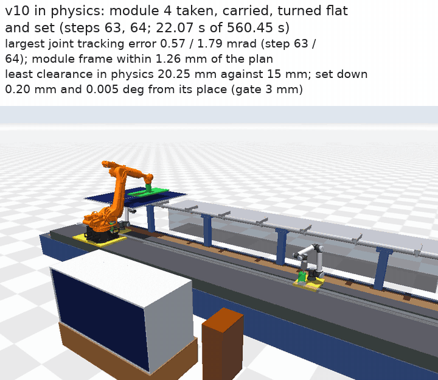

# The flat rack cell's first step in physics: one module carried and set

Until run 019 every figure of the flat rack cell was kinematic. The committed plan
(`plans/flat_rack_3_pin_arms_ordered.json`, [`flat-rack-cell.md`](flat-rack-cell.md),
[`flat-rack-order.md`](flat-rack-order.md)) says where every arm is at every instant,
and the verifier checks it for clearance, but nothing had driven it. This page is about
the first run in physics. In it the module arm, on its position servos and with its real
payload, follows the plan through one module's whole cycle in MuJoCo 4.0.0:
1. it takes module 4 from the pallet;
2. it carries it and turns it from upright to flat past the tube;
3. it sets it on its two rails and lets it go.

The run is measured as the checker measures. Its committed record,
`physics/flat_rack_3_pin_arms_ordered.json`, is what the scorecard's `physics_share`
counts ([`scorecard.md`](scorecard.md)).

Every figure below is printed by one of these commands, at the commit that added this
page:

- `bazel run --config=opt //:run_physics` prints the chosen layout and the take before
  its hardest carry (module 4). `-- --json` prints the record, and
  `-- flat_rack_3_pin_arms_ordered --write` writes it. Two runs print the same, byte
  for byte.
- `bazel run --config=opt //:run_physics -- flat_rack_3_pin_arms_ordered --take K` runs
  module_take K instead. It is used for the table of all nine cycles below.
- `bazel run --config=opt //:score_layout -- flat_rack_3_pin_arms_ordered` prints the
  scorecard.
- `bazel run --config=opt //:viewer_layout -- flat_rack_3_pin_arms_ordered --physics`
  shows the run in the viewer, and needs a display. `tools/video/physics_gif.sh` records
  it. The recording is below.

As in the other documents, a figure is `derived` when one of these programs printed it,
and `ours` when it is a choice made here.

## The method

**The model.** It comes from the same builder as the checker's (`src/layout_model.h`,
"Physics"). With `LayoutState::physics_arm` empty the builder's text is what it always
was, so every check, plan and scorecard figure is unchanged.
`tests/layout_model_test.cc`, `Physics.*`, holds that the physics state adds only three
things:

- **The module arm's servos.** It keeps the six position servos of `models/arm.xml`, with
  the gains, damping ratio and torque limits found there, and the joints keep that
  file's armature and damping. The links keep the vendor's masses and inertias
  (published, from KUKA's URDF).
- **A track servo.** The arm's track gets a position servo of our own choosing:
  - gain 7.7e6 N/m;
  - damping 2.45e5 N s/m;
  - force limit 6 kN.

  The argument for these figures is in `src/layout_model.h`. The moving mass is about
  1,950 kg, which gives a natural frequency of 10 Hz and critical damping, and the force
  limit is twice what the planned 1.5 m/s² needs.
- **A free module.** Pallet module 2 in the order of taking is module 4 of the bay
  (order 0, 1, 4, ...). It becomes a free body of 32.4 kg, with the same nine geoms as
  every module. Two welds come with it, with the stand-in cell's suction settings
  (`models/suction.xml`):
  - `pallet_hold` keeps it on its pallet until the grip;
  - `suction` takes it at the grip.

The combined gripper weighs the layout's 36 kg (ours), shared over its three boxes by
volume.

**The run.** It is in `src/physics_run.h`.

1. **Hold.** The arm holds the take's first pose for 1 s while the plan's clock is
   stopped. This hold is not counted.
2. **The two steps.** The arm then runs plan steps 63 (take module 4) and 64 (set
   module 4) end to end, from 268.264885 s to 290.333739 s of the plan. That is
   22.068854 s of the plan's time.
   - **Following.** `ArmFollower` (`src/arm_follower.h`) follows the plan's own angles
     as a `TimedPath`. The angles come from `PlanPlayer`, which the verifier and the
     viewer also play. Speeds and accelerations are central differences over 1 ms.
     The follower uses lag compensation and model feedforward, including the track's
     planned acceleration.
   - **The track.** The track's servo gets the force that the mass matrix gives for the
     planned accelerations of all seven axes.
   - **The grip.** At the end of the take's work segment, `pallet_hold` is switched off
     and `Suction::Grip` binds the module where it is.
   - **The release.** At the end of the set's work segment, `Suction::Release` lets it
     go. The tool tip was 0.0955 mm from the glass at the grip (derived).
3. **Settle.** The arm holds the set's retreat pose for 2 s. The module's pose is then
   taken.

**Physics settings.**
- **Timestep:** 0.5 ms.
- **Contacts:** only the carried module touches anything, and only rails 4 and 5, the
  two it is set on. The contact settings are those of
  `tests/locate_physics_test.cc`, scaled to this timestep:
  - solref of four timesteps;
  - solimp 0.95, 0.99, 0.0005;
  - elliptic cones;
  - friction 0.61.

  Nothing else is given contacts. What the plan keeps 15 mm apart is measured, not left
  to collide.
- **The other three arms** stand where the plan has them at each instant. They are
  kinematic: their joints are written every step, at rest.

**The figures.** Joint tracking errors are measured every step. The other figures are
sampled every 0.01 s of plan time, five times as often as the verifier samples.

- **Joint tracking error:** measured minus planned, the largest over the six joints, in
  mrad. The track's error is given in mm.
- **Frame error:** the Cartesian error against the plan, in mm and degrees.
  - While the module is held, this is the module's frame against the held module in the
    checker's model at the planned configuration.
  - Otherwise it is the error of the tool's working point.
  - A module is the same shape turned half round about its normal: each geom of side
    `a` has a twin on side `b`, and the four holes are symmetric about the centre. The
    plan takes some modules from the pallet that way round, so the smaller of the two
    errors is the figure.
- **Least clearance in physics:** this uses the verifier's own function,
  `InstantDistances` (`src/layout_plan.h`), on the checker's model, where capsules are
  measured as the cylinders that cover them.
  - The module arm is put at its measured joints and track.
  - The module's geoms, held or set, are moved to where the physics has the module.
  - The same function over the plan's own world, at the same instants, gives the plan's
    figure beside it.

  The two agree to 0.02 mm wherever the arm follows closely, which checks the
  measurement itself.
- **Set-down:** the module's pose on its rails after release and settling, against its
  designed place in the bay. The rails are fixed where the bay puts them, so this is the
  gate's reading "from the rails as they lie" ([`bay-hardware.md`](bay-hardware.md),
  "Tolerances").

## What the run carried out (R3)

Module 4, steps 63 and 64. All figures are derived.

| Step | Segment | From s | To s | Joint error mrad | Track error mm | Frame error mm | Frame error deg | Least clearance in physics m | The plan's m | Pair in physics |
|---|---|---|---|---|---|---|---|---|---|---|
| 63 | move | 268.265 | 275.574 | 0.0764 | 0.0119 | 0.0720 | 0.0051 | 0.020254 | 0.020250 | gripper plate to rail 4's top |
| 63 | approach | 275.574 | 276.522 | 0.0054 | 0.0000 | 0.0045 | 0.0001 | 0.031023 | 0.031028 | gripper cups to pallet module 3 |
| 63 | work | 276.522 | 278.522 | 0.0054 | 0.0000 | 0.0045 | 0.0001 | 0.030995 | 0.031000 | gripper cups to pallet module 3 |
| 63 | retreat (held) | 278.522 | 280.922 | 0.5722 | 0.0000 | 0.6021 | 0.0420 | 0.029787 | 0.030001 | held module to pallet module 4 |
| 64 | move (held) | 280.922 | 285.436 | 1.7876 | 0.0419 | 1.2649 | 0.1163 | 0.027430 | 0.027247 | held module to pallet module 3 |
| 64 | approach (held) | 285.436 | 286.385 | 0.2201 | 0.0186 | 0.3589 | 0.0109 | 0.034679 | 0.034709 | held module to the arm's link 2 |
| 64 | work (held) | 286.385 | 289.385 | 0.2242 | 0.0191 | 0.2271 | 0.0107 | 0.062000 | 0.061961 | held module to the tube |
| 64 | retreat | 289.385 | 290.334 | 0.2242 | 0.0104 | 0.0786 | 0.0112 | 0.064079 | 0.064111 | the arm's link 2 to module 4 |

Notes on the table:
- **Pairs.** The names in the last column are shortened. The full geom names are in the
  program's output.
- **The plan's least clearance.** It is 0.0202 m for these two steps. The plan's least
  over the whole schedule is 0.0180 m, elsewhere.
- **Peak torque over its limit**, joints 1 to 6 and then the track:
  - step 63: 0.975, 0.633, 0.167, 0.117, 0.268, 0.292, 0.717;
  - step 64: 0.928, 0.893, 0.710, 0.505, 0.493, 0.404, 0.509.

**Set-down** (derived):

| Figure | Value | Gate |
|---|---|---|
| Offset in the rails' plane | 0.1989 mm (across 0.0417, along -0.1945) | 3 mm |
| Yaw about the rails' normal | 0.0052 deg | 0.15 deg |
| Height | -0.0001 mm | not part of the gate |

**The rule** (`docs/scorecard.md`, `physics_share`): a step counts when its least
clearance in physics is at least the layout's `clearance_m`, 0.015 m, and the module
ends within the gate.

Both steps count, so 22.068854 s of one bay's 560.452329 s (`one_bay_s`) is carried out in physics:
**`physics_share` 0.039377** (derived). Before this run it was 0.

## The tightest margins of the run

| Margin | Figure | Limit | Left |
|---|---|---|---|
| Joint 1's peak torque, step 63 (the take's move, empty gripper, track at 1.5 m/s²) | 0.975 of 7,290 N m | 1.0 | 2.5% |
| Joint 1's peak torque, step 64 | 0.928 | 1.0 | 7.2% |
| Least clearance in physics, step 63 | 0.020254 m | 0.015 m | 5.25 mm |
| Least clearance in physics, step 64 | 0.027430 m | 0.015 m | 12.4 mm |
| Largest joint tracking error, step 64's carry | 1.7876 mrad | none set | |
| Largest module frame error, step 64's carry | 1.2649 mm, 0.1163 deg | none set | |
| Set-down offset | 0.1989 mm | 3 mm | 2.80 mm |
| Set-down yaw | 0.0052 deg | 0.15 deg | 0.145 deg |

**Joint 1's torque is the figure nearest its limit.** It reaches the limit in seven of
the other eight cycles (below). Ways to widen it:
- a slower track acceleration while the arm is extended;
- a plan whose timing knows the payload and the motors' torque, not only the
  datasheet's joint speeds.

**Physics changes the clearance by less than its 0.2 mm.** In this cycle physics took at
most 0.2 mm off the plan's clearance (0.0003 m on the take's retreat). The 3 mm between
the plan's own least and the limit is not at risk here.

## All nine module cycles in physics (not counted)

The record holds module 4 only, as the spec asked, and only it counts towards
`physics_share`. The same program runs any other take. All nine were run with
`--take 0` to `--take 8` at the same commit, to learn for the next step. All figures are
derived.

| Take | Module | Steps | Joint error, take / set, mrad | Frame error, take / set, mm | Least clearance in physics, take / set, m | Peak joint 1 torque, take / set | Set-down mm, deg | Counts by the rule |
|---|---|---|---|---|---|---|---|---|
| 0 | 0 | 33, 34 | 305.80 / 1.61 | 445.4 / 0.74 | **-0.030905** / 0.018782 | **1.000** / 0.374 | 0.167, 0.006 | 33 no, 34 yes |
| 1 | 1 | 49, 50 | 0.57 / 0.82 | 0.59 / 1.20 | 0.021130 / 0.018942 | 0.919 / 0.620 | 0.171, 0.006 | both |
| 2 | 4 | 63, 64 | 0.57 / 1.79 | 0.60 / 1.26 | 0.020254 / 0.027430 | 0.975 / 0.928 | 0.199, 0.005 | both (the record) |
| 3 | 2 | 79, 80 | 7.27 / 4.88 | 12.53 / 11.67 | 0.017794 / 0.017733 | **1.000** / **1.000** | 0.204, 0.005 | both |
| 4 | 5 | 93, 94 | 0.57 / 10.69 | 0.62 / 25.64 | 0.018991 / 0.018592 | 0.471 / **1.000** | 0.206, 0.000 | both |
| 5 | 7 | 107, 108 | 2.10 / 4.41 | 4.04 / 1.24 | 0.018538 / 0.021562 | **1.000** / 0.978 | 0.218, 0.000 | both |
| 6 | 6 | 123, 124 | 0.90 / 0.61 | 1.50 / 0.79 | 0.018847 / 0.018726 | **1.000** / 0.290 | 0.288, 0.003 | both |
| 7 | 3 | 137, 138 | 0.57 / 20.02 | 0.66 / 47.77 | 0.018521 / 0.020366 | 0.556 / **1.000** | 0.242, 0.006 | both |
| 8 | 8 | 151, 152 | 0.57 / 2.75 | 0.69 / 1.05 | 0.023689 / 0.018498 | **1.000** / **1.000** | 0.264, 0.002 | both |

**What the table says.**
- **Seventeen of the eighteen steps would count.** Counting all of them would carry about
  0.39 of the bay's time in physics. That is not claimed: those runs are not committed
  records, and the record format holds one cycle.
- **Joint 1 reaches its torque limit in seven of the nine cycles**: takes 0, 3, 4, 5, 6,
  7 and 8. The track reaches its own limit in take 0 (1.000), and 0.975 of it in take
  8.
- **Where joint 1 saturates, the arm falls behind the plan.** By up to 20 mrad and 48 mm
  in take 7's carry.
- **In take 0 the arm fell 0.31 rad behind on the move to the pallet.** The gripper's
  cups went 31 mm into module 0 on its pallet: that is the clearance of -0.030905 m.
- **The plan's 3 mm of margin hid every other shortfall.** Every other step still kept
  more than 15 mm, but only because of that margin. Take 3's set came within 0.0177 m,
  0.9 mm less than the plan's 0.0186 m.

**What would make take 0 pass.** Its demand is 1.21 times joint 1's limit at the planned
accelerations (an inverse-dynamics estimate made while planning run 019, not a committed
program). Playing that move about 1.1 times slower (the square root of 1.21) would bring
the demand within the limit. That is about 0.7 s more on a 7.1 s move. This is estimated
and was not run.

## What is still not in physics

- **The other three arms.** The pin arms are kinematic: written into the model every
  step, with no contacts and no servos.
- **The rails.** No rail is carried in physics, and the rails are fixed where the bay
  puts them.
- **The other modules.** Except in the table above (which is not counted), no other
  module is carried. The modules already set are drawn, as far as the builder's count
  allows, and touch nothing.
- **The pallet.** A weld stands in for the pallet and the module's neighbours until the
  grip. The pallet's own stability, and the neighbour that leans, are not simulated.
- **Suction.** It is a weld, as in the stand-in cell. Cups, vacuum and their compliance
  are not modelled.
- **The fastenings.** The strap bolts, the locating move, the pins, the swaging and the
  tube's clamp are not in physics. The locating nose has its own physics test
  (`tests/locate_physics_test.cc`), without an arm.
- **Sensing.** There is no sensing and no correction from what is sensed. The arm
  follows the plan blind, and the module's pose is read from the simulation.
  `placement_mm` therefore stays `none`: by `docs/scorecard.md`, "What would make it
  measured", it needs the cell to hold *and sense* the modules. The set-down above is
  the true pose in simulation without sensing, so it is a first figure of the
  placement's own error, not a placement error the cell could know.

## The next step

The spec of run 019 calls this run the first of seven steps that run 012's report
listed. That report is not in this repository and was not available to run 019. The
spec names some of the later steps:
- the pin arms, bolts, locating move and pins in physics;
- the rails' straps;
- the tube's clamp;
- the ports' units;
- as step 5, all four arms following the whole schedule at once.

What this run learned for those steps:

1. **The plan's timing is not torque-feasible for the module arm everywhere.** The
   planner times moves from the datasheet's joint speeds and accelerations, with the
   track at 1.5 m/s². It does not know the payload or the motors' torques. Seven of
   nine cycles drive joint 1 into its limit, and one runs the gripper into the pallet.
   - Before more of the schedule is run in physics, the plan's timing should check
     torque, for example with an inverse-dynamics bound per move (`mj_inverse` along the
     timed path), and slow the moves that exceed it. Each slower move must show in
     `cycle_s`.
   - The cheapest first fix is the track's acceleration while the arm is reaching
     forward, where the coupling into joint 1 is largest.
2. **The plan's 3 mm of margin is what kept the saturated carries clear.** The
   difference from the plan was at most 0.9 mm wherever the arm did not saturate, and
   0.2 mm in the recorded cycle. For an arm that saturates it can be several
   centimetres. A pad of 3 mm is enough only for an arm that follows.
3. **The machinery is reusable.** For the next arm, a pin arm, the UR10e needs servos:
   the builder allows only the KUKA today, because Menagerie's actuators are not the
   follower's position servos. Two things carry over as they are:
   - the `TimedPath` following;
   - measuring through `InstantDistances` with the geoms moved to the physics poses.
4. **The weld holds a 32.4 kg module during the carry.** The settings are the stand-in
   cell's. The set-down was 0.17 to 0.29 mm in all nine cycles, about a tenth of the
   gate's 3 mm. The locating nose's capture range (`bay-hardware.md`) starts from the
   gate's 3 mm, so a module laid down this way is well inside it.
