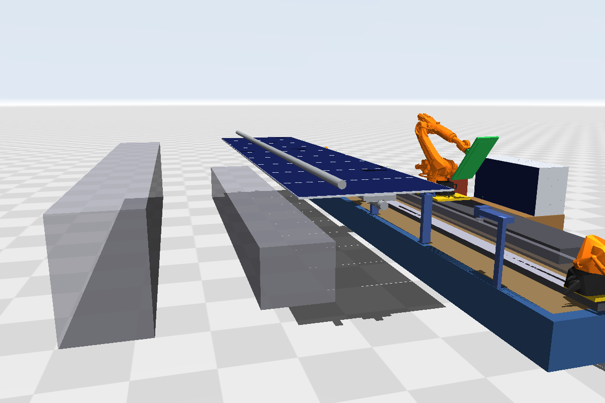

# The infeed unit (v21, runs 053 and 054)

v21 (`..._torque_clear_out_infeed`) is v20 with one part more, an infeed unit that brings each
tube in over the bay going out: the ways overlap 38.41 s at each boundary and `cycle_s` falls from
496.16 s to 470.68 s. Only the unit's bed is modelled; this page says what the rest is assumed to be.

The first boundary at 478 s. Left: the infeed unit's bed; middle: the transfer cart; the bay
going out (lifted 0.12 m) with bay 1's tube above its modules. The viewer draws one way at a
time, so the tube is put in from its own frame at the same point of its way (bay 0's `tube_in` at
19.82 s, the same camera); every position is the committed plan's.

**What it is assumed to be.** Item `infeed_unit`, `basis: ours`: a bed of 1.2 × 10.0 × 1.8 m,
800 kg, outside the −X side beyond the transfer cart (x −7.10 to −5.55), at a `tubes_in` port
and zone of its own. It holds one bare tube at the height of its way. The cart now only takes
bays out. It costs one part (`part_count` 38 against 37).

**Its carriage.** Everything below the tube on its way is the bay going out, so the tube is held
from above: a carriage runs out from the bed on an overhead beam and hangs clamps that close on the
bare tube. It carries the tube 4.65 m along +X at 0.45 m above its place, then lowers it into the
open saddles (5.10 m in 40 s, 0.128 m/s). The clamps open and rise, and the carriage returns
over −X, above the arms' reach. Work on the new tube waits for the 5 s clamp, the time assumed
for the clamps to clear; the return is not timed.

**The envelope not modelled.** Only the tube is moved and checked. The carriage, its clamps and
the beam reaching about 5 m from the bed are in neither the model, the checker nor the plan's
times (nor are the cart's forks). An arm reaching above the tube early in a bay could meet them
unseen.

**The checker's figures for the way** (`plan_layout --margins`, against 0.015 m):

| Figure | Value |
|---|---|
| incoming tube to the outgoing bay's rails and modules (`tube_bay`, both boundaries) | 0.1140 m |
| tube to `holder_stand_4_column`, at its place in the saddles (`ways`, tube in) | 0.0430 m |
| arms off their wait poses to the incoming tube (`tube_arms`) | none within 1.0 m |
| overlap at each boundary | 38.41 s |

**The way not kept.** Run 053 also tried an axial way, the tube sliding in along its axis over
the +Y end as on the two-rack cell. It passes the checker, but 11.22 m at 0.144 m/s takes 78 s:
11 s a boundary worse than the shared cart, so it was not kept.
