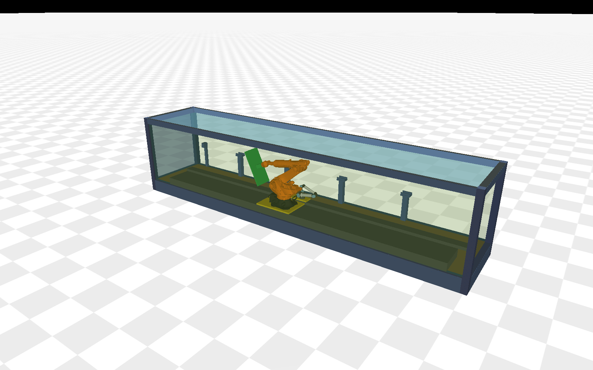

# The layout of the cell that builds bays

**Notice.** Since run 012 the chosen layout is on the flat rack: `flat_rack_3_pin_arms`,
described in [`docs/flat-rack-cell.md`](flat-rack-cell.md), and since run 018 the same cell
with a shorter order of work, `flat_rack_3_pin_arms_ordered`
([`docs/flat-rack-order.md`](flat-rack-order.md)). This document stands as the
record of the closed container (run 011). Its five layouts are kept and load in the new
form of the file; their rows of the seven old kinds are what this document gives
(`bazel run --config=opt //:check_layout -- <name> --checks
transport,hold,reach,clearance,load,ways,time`, which exits 1 for `above` and 0 for the
others, as at `68a1199`). The new kinds are not made to pass: all five fail every `port`
row (7 of 7) and every `approach` row (9 of 9), while their `allowed` rows pass.
`//:print_layout_moves` no longer exists: its seven moves are superseded by
`//:plan_layout`, which plans every move of a bay.

This is the design of a new robot cell that builds bays: one round tube, ten rails and
nine modules (`docs/bay-hardware.md`), inside a 40 ft container whose long sides are open
while it works. The cell is designed, not running. Nothing here was built or tested on
hardware, and no path of an arm was planned except where a section says so: the
checks are made at poses.

Five layouts were written as data (`layouts/*.json`, in the form of `src/layout.h`),
checked by one program (`src/layout_check.h`) and compared, and one was chosen in run 011. Every
figure of a layout is in its file; every result below is printed by these commands:

- `bazel run --config=opt //:check_layout -- --list`: the five names (with the flat
  rack's three since run 012), which is chosen, and each title.
- `bazel run --config=opt //:check_layout -- <name>`: every row of every check as CSV
  (`check,item,arm,tool,figure,unit,limit,result,detail`), then the bay's time and the
  time model as `#` lines; it exits 0 only when every row passes.
- `bazel run --config=opt //:check_layout -- <name> --summary`: one line per kind of
  check.
- `bazel run --config=opt //:check_layout -- <name> --steps`: every step of one bay.
- `bazel run --config=opt //:viewer_layout -- <name> --state finished|bare|stowed`, or
  `--at <kind>:<index>` for an arm at one work point (needs a display).

**How to read the tables.** As in `docs/bay-hardware.md`, a row that states a figure ends
in its basis: `published` (in a source of the Sources section, `[L<n>]` here, or `[S<n>]`
of `docs/bay-hardware.md`), `derived` (computed from figures named in the row), or `ours`
(designed in this work; the row or the layout file says why). Nothing designed here is
`published`. A figure printed by `check_layout` is a result of the checker on the
layout's figures; it is as firm as the `ours` figures it rests on, and its row says
`derived`. Positions are in metres in the container's frame (`models/container.xml`):
the origin on the ground under the container's centre, +Y toward the rear doors, +Z up,
+X across. The container's floor is 0.45 m above the ground. Masses are in kilograms,
times in seconds.

## The constraints

These are the owner's standing decisions and the brief, as read for this work.

- The tube is round. It must be kept from turning, with its locating holes in line,
  while parts go on.
- Modules are pinned to rails; rails are fastened to the tube by a strap and its bolt.
- Rails are put on the tube by whatever gives the shortest cycle.
- Arms may change tools.
- No fixed tooling that relies on tight tolerances: the cell corrects itself from what it
  senses. A module is laid down within the gate's tolerance and then located before it
  is pinned (`docs/bay-hardware.md`, Locating a module before pinning).
- The container is part of the cell and may be built to suit, as long as a truck, a ship
  and a crane can treat it as a standard container, its weight included. Its sides may
  come off while it works.
- Conveyors and the stock of parts stand outside it.
- Where the small arms stand (below, beside or above the tube) is open. Every arm must
  stay clear of the bay as it is built and of the arm that places the modules.
- A bay is nine modules; a pallet holds 36.
- Arms are real or labelled: an arm's description is public under a licence that allows
  this use, fetched and pinned by hash, and its payload, reach and joint ranges come
  from its maker's datasheet. A tool, a holder, a pallet or a stock has its size and mass
  from a source, or is designed here and labelled `ours`.
- A layout is checked at poses, not along paths. Mechanisms are envelopes, masses, where
  they grip and what they resist, not parts.

From `docs/bay-hardware.md`, the limits the layouts are held to:

| Limit | Value | Where it comes from | Basis |
|---|---|---|---|
| Where a holder may grip the tube | the eleven stretches `bay_hold_0` to `bay_hold_10` only: the two ends full circle, the nine stretches between rails on the lower half | Holding the tube | ours |
| Moment a holder must resist about the tube's axis | 150 N m | Holding the tube | ours |
| Angle a holder must keep | within 0.8 degrees of the holes facing up | Holding the tube | ours |
| A finished bay held at its two ends alone | not allowed: 156 MPa, sag 0.14 m | Holding the tube | derived |
| Clear inside envelope of the container | 11,830 x 2,330 x 2,240 mm, on a floor 450 mm above the ground | The container | ours |
| Mass left for the cell | 17,200 kg | The container | derived |
| Points, tool directions and free spaces of every fastening and of the locating move | as in the document | Fastenings; Locating a module before pinning | ours |

## What had to be possible at all

Before any layout was written, the lead engineer probed the arrangement in MuJoCo with
the two real arm models. These findings fixed the common geometry of all five layouts.
They are probes, not results of `check_layout`; where the checker later printed a figure
for the same thing, the checker's figure is given.

- **The module arm's base must be raised.** With the KUKA KR 210 R2700-2 standing on the
  container's floor, its link 2 hits the edge of the module it holds over the tube.
  Raised 0.30 m on a track, it clears.
- **The module arm must stand one pitch ahead.** Standing straight opposite the module it
  sets, the KR 210's link 3 hits the roof (underside at z = 2.84) or its link 2 the
  neighbouring module. Standing one pitch (1.144 m) along the tube, opposite the next
  slot, which is still empty, it clears. So modules are set in order from the front wall
  toward the rear doors, the arm always one pitch ahead, and the last module is set from
  one pitch behind. In the layout chosen in run 011 that last set-down is the tightest of the nine
  set-downs: 0.0477 m from the arm's link 2 to module 7's frame (`check_layout` row
  `module_set 8`). The module arm has tighter rows elsewhere: `rail_set 0` and 34 of
  the 36 `module_take` rows, at 0.0300 m.
- **Nine modules need a track.** From one stand the KR 210 covers three modules; nine
  need a track, or three such arms.
- **Where the tube lies, and the door.** The tube's axis has to be 1.75 m from the module
  arm's axis. With the arm's base inside the inside envelope (x up to 0.70), the tube's
  axis lies at x = -1.05, 1.05 m from the centre line. `docs/bay-hardware.md` (The
  container) gives what an end door lets through: between the corner posts as this
  project's container assumes them (180 mm across each, `ours`; 2,078 mm apart) a tube's
  axis could lie up to 0.977 m from the centre line; through a usual container door
  opening of 2,340 mm, up to 1.108 m. The tube at 1.05 m would therefore not pass the
  posts as assumed here, and would pass a usual door opening, by 58 mm. The layouts bring
  tubes in through the -X side (Decision 2); with a usual door opening, the rear doors
  would also do, and a later spec can reopen this.
- **The tube's height.** With the axis at z = 1.25 the small arm below could not reach the
  +X pins clear of the floor. At z = 1.40 (0.95 above the floor) everything from below
  was reached with about 0.1 m to spare in the probe, and the module arm still cleared the
  roof at its set-down poses.
- **The small arm's place below.** A UR10e on a floor track 0.70 m from the tube's line
  reached both pins of a rail from below, the strap bolt along -X and a rail set down from
  above, with its carriage opposite the rail.
- **Stowing.** Both arms fold inside the inside envelope. In every layout the checker
  finds the highest stowed point, the module arm's link 3, 0.2664 m under the envelope's
  top at 2.690.

## The layouts

All five share the tube's place (axis at x = -1.05, z = 1.40, plain end at y = -5.308),
the holder, the module arm (a KUKA KR 210 R2700-2 on a floor track at x = 0.70, base 0.75
above the ground), the pallet outside the +X side, the pin stand outside the rear doors
and the transfer cart outside the -X side. They differ in where the one small arm, a
Universal Robots UR10e, stands, and in who puts the rails on. Each picture below shows a
candidate's small arm at `rail_set:4`, rail 4 being set; the command that made each is
in the table of pictures under The layout chosen in run 011.

**`below`.** The small arm stands on a floor track at x = -0.35, base 0.60 above the
ground, under the bay's inner half, between the holder's stands and the module arm's
track. It sets the rails with a rail gripper, drives the strap bolts with a nutrunner,
and locates, pins and swages every hole from below with a pin tool, changing tools. It
sets all ten rails and then drives all ten bolts. Rails come from a rack outside the rear
doors. The module arm carries only a module gripper.

**`below_each_rail`.** The geometry of `below`, unchanged; only the order differs. The
small arm sets a rail, changes to the nutrunner, drives that rail's bolt and changes
back, ten times, so every rail is clamped before the next is touched, at the price of
twenty tool changes. Its picture is `below`'s.

**`below_rails_by_module_arm`** (chosen in run 011). The geometry of `below`, with the rails put on
by the module arm. Its gripper carries a clamp for a rail between its suction cups, so it
needs no tool change. It takes each rail from a rack outside the +X side beside the
pallet and sets it down from one pitch along the tube, while the small arm, which starts
with the nutrunner, drives the strap bolts one rail behind and then goes on to the pins
as in `below`. The module arm's track is longer than in the other four (travel -4.1 to
4.7 m in place of -3.6 to 4.7 m). Its pictures are in The layout chosen in run 011; the first is
the whole cell.

**`beside`.** The small arm stands upright on a raised beam beside the tube on its +X
side, under the overhang of the modules: the beam is centred at x = -0.45, its top at
z = 0.95, carried by five posts 0.12 m square on the container's floor. The arm's base is
1.00 above the ground, 0.40 below the tube's axis, so it works from the side: rails from
above, bolts along -X, and the pins from below with the tool pointing up, as in `below`. Its work and tools are those of `below`.

**`above`.** The small arm hangs upside down (base roll 180 degrees) from a carriage on a
beam under the roof at x = -0.55, base 2.20 above the ground, running along the
container above the bay. It sets the rails from above and drives the bolts, and is given
the locating, the pins and the swaging too. The checker finds a pose for every such
point, but only with the arm passing through the modules that lie on the rails, and its
beam is where the module arm's upper arm has to be, so the layout fails the clearance
check (What makes `above` fail). Its tools and work are otherwise those of `below`.

## The comparison

Each check's cell gives rows passed of rows; where a check fails, its worst row as
`check_layout -- <name> --summary` prints it. All figures are from the result of
`check_layout -- <name>` for each layout. The `time` rows have no limit: they pass when
every step has a pose, so the bay's time is compared here, not judged by the checker.

The times rest on the time model printed in Building one bay, whose process times are
ours. Where two arms share a phase, the model works them side by side by a fixed rule:
the following arm (the bolting arm in the rail phase, the pin arm in the module phase)
starts rail or module k when the leading arm has finished k and it has itself finished
k-1, so the phase is the largest over k of the leading arm's steps on 0..k plus the
following arm's steps on k to the last. The rule assumes that the two arms can work at
the same time without waiting for each other except at that hand-over, that each arm's
moves take what the model says, and that the following arm can stand where it works
while the leading arm works one rail or one module ahead. None of this is checked: each
pose is checked with the other arm at its wait pose.

| | `above` | `below` | `below_each_rail` | `below_rails_by_module_arm` | `beside` |
|---|---|---|---|---|---|
| Chosen (`--list`) | - | - | - | marked chosen at `68a1199`; no longer | - |
| Small arm stands | above, hanging from a roof track | below, on a floor track | below, on a floor track | below, on a floor track | beside, on a raised beam |
| Rails set by | small arm | small arm | small arm | module arm | small arm |
| Rail order | all rails, then all bolts | all rails, then all bolts | each rail, then its bolt | module arm sets, small arm bolts one rail behind | all rails, then all bolts |
| transport | 7 of 7 | 7 of 7 | 7 of 7 | 7 of 7 | 7 of 7 |
| hold | 8 of 8 | 8 of 8 | 8 of 8 | 8 of 8 | 8 of 8 |
| load | 4 of 4 | 4 of 4 | 4 of 4 | 3 of 3 | 4 of 4 |
| reach | 186 of 186 | 186 of 186 | 186 of 186 | 186 of 186 | 186 of 186 |
| clearance | **165 of 270; worst `module_set 8` -0.2100 m** | 270 of 270 | 270 of 270 | 270 of 270 | 270 of 270 |
| ways | 2 of 2 | 2 of 2 | 2 of 2 | 2 of 2 | 2 of 2 |
| time | 3 of 3 | 3 of 3 | 3 of 3 | 3 of 3 | 3 of 3 |
| Exit code of `check_layout -- <name>` | 1 | 0 | 0 | 0 | 0 |
| Clearance's worst row (`--summary`) | `module_set 8` -0.2100 m (fails) | `tool in free space pin pin_tool` 0.0003 m | `tool in free space pin pin_tool` 0.0003 m | `tool in free space pin pin_tool` 0.0003 m | `tool in free space pin pin_tool` 0.0003 m |
| Tightest pose of an arm (least distance, limit 0.010 m) | 9 `module_set` rows at -0.2100 m (fail) | 48 `locate`, `pin` and `swage` rows at 0.0184 m (e.g. `locate 0/3`) | as `below` | as `below` | `rail_take 0` to `rail_take 9` at 0.0121 m: the held rail against the small arm's own forearm |
| Time for a bay | 832.2 s | 738.9 s | 874.1 s | 628.5 s | 747.3 s |
| Its phases | tube in 40.0 + clamp 5.0 + rails 240.4 (setting 148.3, bolting 92.1, one arm) + modules 501.8 (module arm 106.6, pin arm 491.4) + end 45.0 | tube in 40.0 + clamp 5.0 + rails 236.3 (setting 144.1, bolting 92.2, one arm) + modules 412.6 (module arm 106.6, pin arm 402.2) + end 45.0 | tube in 40.0 + clamp 5.0 + rails 371.6 (setting 216.1, bolting 155.5, one arm) + modules 412.6 (module arm 106.6, pin arm 402.2) + end 45.0 | tube in 40.0 + clamp 5.0 + rails 123.2 (setting 115.4, bolting 84.4) + modules 415.3 (module arm 108.8, pin arm 402.7) + end 45.0 | tube in 40.0 + clamp 5.0 + rails 237.9 (setting 145.7, bolting 92.2, one arm) + modules 419.4 (module arm 106.6, pin arm 409.0) + end 45.0 |
| Arms | 2: one KUKA KR 210 R2700-2 on a floor track; one UR10e on a roof track, upside down | 2: one KR 210 on a floor track; one UR10e on a floor track | 2: as `below` | 2: as `below` | 2: one KR 210 on a floor track; one UR10e on a raised beam |
| Tools | module gripper; rail gripper, nutrunner, pin tool | module gripper; rail gripper, nutrunner, pin tool | as `below` | combined gripper (modules and rails); nutrunner, pin tool | as `below` |
| Mass that travels inside, of 17,200 kg | 3,223.3 kg: arms 1110, tracks 1850, tools 43.0, holder 220, items 0 | 3,223.3 kg: the same | 3,223.3 kg: the same | 3,227.3 kg: arms 1110, tracks 1850, tools 47.0, holder 220, items 0 | 3,348.3 kg: arms 1110, tracks 1900, tools 43.0, holder 220, items 75 (the beam's posts) |
| What it asks of the container | both long sides and the rear doors open while it works, roof and floor kept; the small arm's beam hangs under the roof (the file says nothing is added and does not say how the beam is carried) | both long sides and the rear doors open, roof and floor kept; nothing added | as `below` | as `below` | as `below`, and five posts on the floor carry the small arm's beam |
| What it leaves outside | pallet (+X side); rail rack and pin stand (rear doors); transfer cart (-X side) | the same as `above` | the same as `above` | pallet and rail rack (+X side); pin stand (rear doors); transfer cart (-X side) | the same as `above` |

### Three ways of putting the rails on, by time

The three ways were written on the same geometry, `below`'s, and timed by the same model.
The figures are each layout's `time,bay` and `time,busy` rows.

| Way | Layout | Bay | Rail phase | Small arm busy | Module arm busy | Basis |
|---|---|---|---|---|---|---|
| The small arm sets all ten rails, then drives all ten bolts | `below` | 738.9 s | 236.3 s (setting 144.1, bolting 92.2, one arm) | 648.4 s | 110.2 s | derived |
| The small arm sets and bolts each rail in turn, two tool changes a rail | `below_each_rail` | 874.1 s | 371.6 s (setting 216.1, bolting 155.5, one arm) | 783.7 s | 110.2 s | derived |
| The module arm sets the rails; the small arm bolts one rail behind | `below_rails_by_module_arm` | 628.5 s | 123.2 s (setting 115.4, bolting 84.4) | 497.1 s | 227.8 s | derived |

Setting each rail and bolting it at once is the slowest: the tool changes cost more than
the moves they save. The module arm setting the rails is the fastest, because its gripper
needs no change and the two arms work side by side; the price is a more complicated
gripper (see The layout chosen in run 011). In all three the module phase is held by the pin arm
(402.2 s of it in `below` and `below_each_rail`, 402.7 s in the layout chosen in run 011), not by
the module arm.

### What makes `above` fail

`check_layout -- above` exits 1. Every failing row is a clearance row: 105 of its 270.
Transport, hold, load, reach, ways and time all pass, reach included: the checker found
poses that reach every pin from the hanging arm, but they do not clear.

| Kind of point | Failing rows | Worst figure | What meets what | Basis |
|---|---|---|---|---|
| `module_set` | 9 of 9 | -0.2100 m | the module arm's link 3 against the small arm's roof beam, at every set-down | derived |
| `locate` | 32 of 36 | -0.0013 m | 16 rows: the small arm's upper arm against the laminate of a module; 16 rows: its forearm against the tube, at -0.0001 m | derived |
| `pin` | 32 of 36 | -0.0013 m | the same two pairs, 16 rows each | derived |
| `swage` | 32 of 36 | -0.0013 m | the same two pairs, 16 rows each | derived |

The four holes of each kind that pass are holes 0/0, 0/1, 8/2 and 8/3, at the two ends of
the bay. The pin failures are small, but a negative figure means the two bodies overlap.
The module arm's failure is not small: the roof beam the small arm runs on is where the
module arm's elbow has to be at every set-down, so a roof track for the small arm cannot
stand above this module arm's work.

### Why `beside` was not chosen, though it passes

`beside` passes every check. With the same way of putting rails on as `below` it takes
747.3 s for a bay against `below`'s 738.9 s: its pin arm needs 409.0 s in the module
phase against 402.2 s. Its tightest pose is `rail_take 0` to `rail_take 9` at 0.0121 m
(the held rail against its own forearm), against `below`'s 0.0184 m; its pin poses clear
by 0.0173 m against 0.0184 m. It needs five
posts and a raised beam inside the container (items 75 kg against 0, tracks 1900 kg
against 1850), where `below`'s track lies on the floor. Nothing it offers is better than
`below`'s on any row of the comparison table. The way of putting rails on that the layout chosen in run 011 uses was written only on
`below`'s geometry; `beside` with the module arm setting the rails was not checked.

## The layout chosen in run 011

`below_rails_by_module_arm`: the small arm below the bay on a floor track, and the module
arm putting the rails on as well as the modules. It was chosen because it passes every
check (exit code 0) and has the shortest time for a bay of the five, 628.5 s, by the rule
that rails go on by whatever gives the shortest cycle; and because its geometry, shared
with `below`, needs nothing added to the container.

### Where everything stands

All positions are the layout file's (`layouts/below_rails_by_module_arm.json`), in
metres.

| What | Where and how large | Reason | Basis |
|---|---|---|---|
| Tube | axis at x = -1.05, z = 1.40; plain end at y = -5.308, the bay centred along the container | What had to be possible at all | ours |
| Holder: four stands | at y = -3.432, -1.144, 1.144, 3.432 (`bay_hold_2`, 4, 6, 8); each a column 0.16 x 0.16 x 0.845 and a saddle 0.22 x 0.30 x 0.04 with two cheeks, gripping 0.30 m of a 1.044 m stretch from below | Only the allowed stretches; the saddles open upward | ours |
| Holder: end unit | column 0.10 x 0.10 x 0.855 and head 0.20 x 0.14 x 0.19 at y = -5.4, its pin in the plain end's rivet holes (`bay_hold_0`) | Fixes the angle without friction | ours |
| Holder: what it is built for | 150 N m about the axis, holes within 0.8 degrees of straight up, 220 kg, clamp 5.0 s, release 5.0 s | `docs/bay-hardware.md`, Holding the tube | ours |
| Module arm | KUKA KR 210 R2700-2, base at x = 0.70, z = 0.75 (0.30 above the floor), yaw 90 degrees | What had to be possible at all | ours |
| Module arm's track | along Y, travel -4.1 to 4.7; beam 0.9 x 10.6 x 0.25 centred at (0.7, 0.2, 0.575); carriage 1.3 x 0.9 x 0.05; 1.5 m/s, 1.5 m/s2; beam and carriage 1,600 kg | An envelope of a floor-mounted linear unit of the KL 4000 kind [L5]; its carriage height and mass were not found | ours |
| Module arm's stops | modules 0 to 8 at y = -3.432, -2.288, -1.144, 0.0, 1.144, 2.288, 3.432, 4.576, 3.432; rails 0 to 9 at -4.004, -2.86, -1.716, -0.572, 0.572, 1.716, 2.86, 4.004, 2.86, 4.004; pallet at 0.0; rail rack at 1.75 | One pitch ahead of each module, the last from one pitch behind | ours |
| Small arm | Universal Robots UR10e, base at x = -0.35, z = 0.60, upright | What had to be possible at all | ours |
| Small arm's track | along Y, travel -5.3 to 5.4; beam 0.3 x 11.4 x 0.1 centred at (-0.35, 0.05, 0.5); carriage 0.3 x 0.9 x 0.05; 1.5 m/s, 2.0 m/s2; 250 kg | An envelope of a belt-driven floor axis | ours |
| Small arm's stops | the pin stand at y = 5.4; for bolts and pins the checker stands it opposite the point | | ours |
| Pallet | the maker's, 36 modules standing on their long edge, glass toward the container; centre of its footprint at (2.85, 0, 0) on the ground outside the +X side, yaw -90 degrees; deck 0.15 high; pitch 0.03 | 36 to a pallet is the maker's [S18]; standing on the long edge is read from the maker's unpacking manual [L9] and a sibling datasheet's pallet size [L10]; the glass's direction, deck and pitch are ours | ours |
| Rail rack | outside the +X side beside the pallet: box 0.6 x 0.4 x 1.0 at (2.3, 1.75, 0.5), pick point (2.3, 1.75, 1.08), top up, long side along X; holds 40 rails; 150 kg | Within the module arm's reach from one stop | ours |
| Pin stand | outside the rear doors: box 0.3 x 0.3 x 0.95 at (0.15, 6.32, 0.475), pick point (0.15, 6.25, 1.0); holds 10 magazines of 36 pins and collars; 40 kg | One take a bay, from the track's rear end | ours |
| Transfer cart | outside the -X side: envelope 1.2 x 9.0 x 0.8 centred at (-3.6, 0, 0.4); 800 kg | Brings a tube in and takes a bay out | ours |

### The arms

Both descriptions are fetched file by file at a pinned commit, each file checked against
its SHA-256 in `MODULE.bazel`; the checker takes payload, ranges and speeds from
`src/arm_catalog.h`, which holds the datasheets' figures below, never from the model
files.

| Figure | KUKA KR 210 R2700-2 | Universal Robots UR10e | Basis |
|---|---|---|---|
| Datasheet | KR 210 R2700-2 data sheet, 0000-325-858 V11.1 [L1] | UR10e Technical specification [L2] | published |
| Rated payload | 210 kg (275 kg maximum, only with the centre of mass at 0 mm and a matched supplementary load) | 12.5 kg | published |
| Reach | 2,701 mm | 1,300 mm | published |
| Mass | approx. 1,077 kg | 33.3 kg, cable included | published |
| Joint ranges | A1 +/-185, A2 -140 to -5, A3 -120 to 168, A4 +/-350, A5 +/-125, A6 +/-350 degrees | +/-360 degrees on all six | published |
| Greatest joint speeds | A1 120, A2 115, A3 112, A4 179, A5 172, A6 220 degrees/s, with rated payload | 120, 120, 180, 180, 180, 180 degrees/s | published |
| Pose repeatability | +/-0.05 mm | +/-0.05 mm | published |
| Description and licence | `kroshu/kuka_robot_descriptions` at `d2fa4377b77b7370cdcf6e52b430fc514a0eef19` (`kuka_kr210_r2700_2`), Apache License 2.0 [L3]; the model is `models/arm.xml`, converted by hand from the vendor's URDF at that commit | `google-deepmind/mujoco_menagerie` at `370c43965323c0944b433b202aac5058b5f907a9` (`menagerie_ur10e`), three-clause BSD [L4] | published |
| Margin the checker keeps inside each joint's range | 5 degrees | 5 degrees | ours |

The KUKA datasheet was read in a third party's copy of KUKA's document, because KUKA's
own download address returned only its download page; it could not be compared with
KUKA's own file. An older version of the same sheet (V7.1, 2019) gives the same figures
but a maximum payload of 270 kg. The sheet names the family KR QUANTEC-2, where the
catalogue's name still says KR QUANTEC. The UR10e's licence file does not print the
name "BSD-3-Clause"; it is identified from its text. Only each repository's `LICENSE`
was read, not every mesh file.

### Smaller KUKA arms

The owner wants every arm in the cell to be a KUKA. The pin and bolt arms are UR10e
today, so `src/arm_catalog.h` now also holds two smaller KUKA arms, to replace them in a
later layout. Nothing in a layout uses them yet. Three KUKA arms and the UR10e were
compared:

| Figure | KUKA KR 10 R1100-2 | KUKA KR 16 R1610-2 | KUKA KR 20 R1810-2 | UR10e (today) | Basis |
|---|---|---|---|---|---|
| Family | KR AGILUS-2 | KR CYBERTECH-2 | KR CYBERTECH-2 | | published |
| Rated payload | 5 kg (11.1 kg maximum, at reduced load centres) | 16 kg (20 kg maximum) | 20 kg (23.9 kg maximum) | 12.5 kg | published |
| Payload centre of the rated payload (Lz, Lxy) | 260 mm, 180 mm | about 155 to 175 mm, about 120 mm | 155 mm, 120 mm | none stated | read from the diagram by eye |
| Reach | 1,101 mm | 1,612 mm | 1,813 mm | 1,300 mm | published |
| Mass | approx. 55 kg | approx. 255 kg as printed | approx. 255 kg | 33.3 kg | published |
| Axis 1 range | +/-170 degrees | +/-185 degrees | +/-185 degrees | +/-360 degrees | published |
| Source | 0000-290-003 V17.1 (03.12.2019) [L11] | 0000-321-015 V6.1 (18.04.2019) [L13] | 0000-321-012 V13.1 (10.04.2020) [L12] | [L2] | |

Added: the KR 10 R1100-2 and the KR 20 R1810-2, as `kr10_r1100_2` and `kr20_r1810_2`.
The KR 10 is the one close to the UR10e's size (reach 1.10 m against 1.30 m, 55 kg
against 33 kg). Its rated payload is 5 kg, less than the pin tool with its magazine (8.5 kg),
so it suits the bolts (the nutrunner is 3 kg) and not the pins. The KR 20 has the longer reach
(1.81 m) and a rated payload of 20 kg, more than twice the pin tool's 8.5 kg, so it is
the one that suits the pins. The KR 16 R1610-2 was compared and not added: it has the same
family, mass and axis ranges as the KR 20 and a payload of 16 kg, so it would be a
second arm of the same kind with less margin and 0.2 m less reach. Its sheet prints
the same mass as the KR 20's, approx. 255 kg.

How they are built is the KR 210's way. The files are added to the same
`kuka_kr210_r2700_2` call in `MODULE.bazel` (the outside dependencies of
`docs/architecture/baseline.txt` do not grow), at the same pinned commit,
`d2fa4377b77b7370cdcf6e52b430fc514a0eef19` of `kroshu/kuka_robot_descriptions`, Apache
License 2.0 [L3]. The models are `models/kr10_r1100_2.xml` and `models/kr20_r1810_2.xml`,
converted by hand from `kuka_agilus_support` and `kuka_cybertech_support`; each opens
with what was copied and what is ours. Three things differ from `models/arm.xml`.
Only the vendor's collision meshes are used, for contact and for drawing: the KR 20's
visual meshes are Collada, which MuJoCo does not read, and the KR 10's visual `link_4.stl`
has vertices up to 10.8 m from the link. There are no motors, damping or armature, because
a layout only sets joint angles. And the KR 20's description has no usable inertia for
its base, link 1, link 5 and link 6 (the wrist's mass is in link 4), so link 1 and the
wrist links carry figures of ours, named in the file. The URDF's joint ranges equal the
datasheets' on both arms, so the catalog takes them from the datasheets, as it does for
the KR 210. `tests/layout_model_test.cc` (`SmallKukaArms`) checks that each model builds
into a layout, that its flange follows a chain computed from the URDF's joint origins at
three poses, and that the catalog's ranges are inside the model's.

The load check was run on a scratch copy of `flat_rack_2_pin_arms` (not kept) with
`pin_arm_a` and `pin_arm_b` set to each new arm in turn, with the same base positions
and nothing else changed: `check_layout <name> --checks load,reach,clearance`.

| Row | Original (UR10e) | KR 10 R1100-2 | KR 20 R1810-2 |
|---|---|---|---|
| load, nutrunner (3 kg), each arm | pass | pass (centre 0.077 m, rated to 0.260) | pass (rated to 0.155) |
| load, pin tool (8.5 kg with the magazine), each arm | pass | fail, 8.5 kg against the rated 5 kg | pass (centre 0.090 m, rated to 0.155 and 0.120 across) |
| reach rows failing (of 193) | 0 | 2: the two wait poses, joint 1 is 10 degrees outside its range (the wait pose is the UR10e's 180 degrees against a range of +/-170) | 84: 28 each of locate, pin and swage (20 of `pin_arm_a`, 8 of `pin_arm_b`), up to 32 mm short of their points |
| clearance rows failing (of 280) | 0 | 2: the nutrunner arms, link 2 against a module frame (-0.076 m and -0.0003 m, against 0.015 m) | 116, of them 108 of the pin tool and 4 of the module arm; the worst is -0.206 m, the module arm's link 2 against `pin_arm_b`'s link 3 |

The load rows pass for both tools on the KR 20 and not for the pin tool on the KR 10.
The KR 10's diagram does carry 9 and 10 kg at load centres up to about Lxy 110 mm,
the curves ending on the axis at Lz of about 130 and 110 mm; the pin tool's centre
(0.090 m along the axis, nothing across) appears by eye to lie inside them, so the
datasheet may allow the pin tool; the catalog holds one
curve for each arm, the rated payload's, and the checker follows it. Whether the KR 10
may carry the pin tool is for the owner, to be checked with KUKA.Load as the sheet
says. The reach and clearance rows are information for the next step, not a result: the
base positions, the wait poses and the stops of the layout were designed for the UR10e
and were not changed. The KR 10's two reach rows are the wait pose, which was chosen for
the UR10e's range; the KR 20's 84 are a shortfall at the pins with the arm where the
UR10e stood, and whether a lower or closer base or other stops remove it is for the
next step.
Figures read by eye from the payload diagrams are good to about 10 mm; the KR 10's
diagram labels its top tick 200 where the ticks put 175 mm, and the catalog uses 180
mm. The KR 10's speeds are not in its datasheet (they are in the KR AGILUS-2
specification, which could not be read, as the copy found is encrypted); they are as a
reseller prints them [L14] and equal the URDF's velocity limits.

### Tools, load and what they rest on

| Tool | What it does | Mass, length (flange to working point), envelope | Basis |
|---|---|---|---|
| Combined gripper (module arm) | Holds a module by its glass with suction cups, or a rail by its top with a clamp between the cups that draws back behind them | 36.0 kg; 0.30 m; plate 1.2 x 0.6 x 0.04, cups 1.0 x 0.44 x 0.02 | ours |
| Nutrunner (small arm) | Drives the strap's M8 bolt to 17.6 N m and measures the torque | 3.0 kg; 0.25 m; body 0.07 x 0.07 x 0.145, socket and extension 0.016 x 0.016 x 0.105, which fits the bolt's free space of 12 mm radius over 100 mm (`docs/bay-hardware.md`, Fastenings) | ours |
| Pin tool (small arm) | Carries the locating nose, the finger that puts the pin in from above, and the swaging nose, on the hole's axis from below | 8.0 kg; 0.25 m; body 0.09 x 0.09 x 0.155, nose 0.018 x 0.018 x 0.095 | ours |
| Pin magazine | 36 pins and their collars | 0.5 kg | ours |
| Tool change, small arm | | 8.0 s | ours |

What was found for real tools of these kinds, and why the envelopes are still ours:

| Figure | Value | Source | Basis |
|---|---|---|---|
| A vacuum gripper for a 2,382 x 1,134 mm module with its size, own mass and rated load | not found; the nearest maker's glass lifter read, a hand-guided one, is rated 600 kg and weighs 66 to 86 kg | [L8] | published |
| A torque-controlled cordless nutrunner whose range holds 17.6 N m: Atlas Copco Tensor ITB-A31-30-10-HMI-H | 7 to 30 N m; 1.8 kg, 2.3 kg with battery; 455.5 mm long; transducer shut-off | [L7] | published |
| Battery lockbolt tool for 1/4 in pins: Avdel PB2500N NeoBolt | 1.8 kg without battery, 2.15 or 2.40 kg with; 295 or 327 mm long; 240 or 260 mm high; stroke 25 mm | [L6], read from a table whose text layer is scrambled, so the pairing of labels and values is a reading | published |
| Cycle time of the lockbolt tool | not found | [L6] | |
| Linear unit of the module arm's kind: KUKA KL 4000 | payload 4,000 kg; 1.89 m/s; travel up to 30.4 m; repeatability +/-0.02 mm | [L5] | published |
| The linear unit's carriage height and mass per metre | not found | [L5] | |

The nutrunner and the pin tool of the layout are envelopes on the flange: how a
nutrunner of [L7] or a lockbolt tool of [L6] would be mounted, and with what reaction
arm, was not designed, so their masses here are not those tools' masses. The pin tool's
8.0 kg is the heaviest thing the small arm carries.

The `load` rows of `check_layout -- below_rails_by_module_arm`:

| Arm and tool | Carries | Against rated payload | Basis |
|---|---|---|---|
| Module arm, combined gripper | 68.4 kg: tool 36.00 + a module 32.40 | 210 kg | derived |
| Small arm, nutrunner | 3.0 kg: tool 3.00, nothing held | 12.5 kg | derived |
| Small arm, pin tool | 8.5 kg: tool 8.00 + a pin magazine 0.50 | 12.5 kg | derived |

### Transport, reach and the tightest clearances

| Row | Figure | Limit | What limits it | Basis |
|---|---|---|---|---|
| `transport,stowed x` | 0.0050 m inside | +/-1.165 | holder stand 2's saddle | derived |
| `transport,stowed y` | 0.1650 m inside | +/-5.915 | the small arm's beam | derived |
| `transport,stowed top` | 0.2664 m under | 2.690 | the module arm's link 3 | derived |
| `transport,stowed bottom` | 0.0000 m above | 0.450 | the end unit's column, standing on the floor | derived |
| `transport,stow track module_arm` and `small_arm` | 4.1000 m and 5.3000 m inside the track's range | 0 | stow track 0.000 on -4.100..4.700 and on -5.300..5.400 | derived |
| `transport,mass` | 3,227.3 kg: arms 1110, tracks 1850, tools 47.0, holder 220, items inside 0 | 17,200 kg | | derived |
| `reach,wait track small_arm` (the reach summary's worst) | 0.0000 m inside the track's range | 0 | wait track 5.400, the end of -5.300..5.400 | derived |
| Least joint margin, `reach,module_take 35` | 11.1764 degrees | 5 | the module arm's joint 2, at the last module of the pallet | derived |
| The layout's tightest clearance row, `tool in free space pin pin_tool` (the summary's worst), and the same for `swage` | 0.0003 m | 0 | free radius 0.013 over the 0.080 behind the working point; the pin tool's nose reaches 0.0127 from the axis | derived |
| `tool in free space strap_bolt nutrunner` | 0.0007 m | 0 | free radius 0.012 over 0.100; the socket reaches 0.0113 from the axis | derived |
| `tool in free space locate pin_tool` | 0.0063 m | 0 | free radius 0.019 over 0.080; the nose reaches 0.0127 | derived |
| Tightest free space, `free space locate 0/2` and others | 0.0102 m | more than 0 | the locating move's space below the hole against a neighbouring module's flange or frame | derived |
| Small arm's tightest pose: 48 `locate`, `pin` and `swage` rows at holes 1 and 3, e.g. `locate 0/3` | 0.0184 m | 0.010 | the pin tool's nose against a neighbouring module's flange or frame | derived |
| Module arm's tightest pose: `rail_set 0` | 0.0300 m | 0.010 | the gripper's cups against the end unit's head | derived |
| Module arm, `module_take 0` and 33 other takes | 0.0300 m | 0.010 | the held module against a pallet module's frame | derived |
| Tightest of the module set-downs, `module_set 8` | 0.0477 m | 0.010 | its link 2 against module 7's frame | derived |
| `strap_bolt 0` | 0.0555 m | 0.010 | the nutrunner's body against rail 0's strap | derived |
| `ways,tube in` and `ways,bay out` | 0.0220 m | 0.010 | the tube against the end unit's head, 122 samples at most 0.025 m apart | derived |

### The pictures and the commands that made them

Seven pictures: the four of the layout chosen in run 011 (`layout_cell.png`, `layout_rail.png`,
`layout_pin.png`, `layout_stowed.png`) and the three candidates' (`layout_below.png`,
`layout_above.png`, `layout_beside.png`). Each was made with
`tools/video/shot_viewer.sh`, which runs the viewer and saves one frame:

| Picture | Command (after `tools/video/shot_viewer.sh //:viewer_layout docs/img/<file> 1600x1000`) |
|---|---|
| `layout_cell.png` | `below_rails_by_module_arm --state finished --lookat 0,0,1.2 --distance 15 --azimuth 215 --elevation -22 --no-overlay --quit-at 0` |
| `layout_rail.png` | `below_rails_by_module_arm --at rail_set:4 --lookat -0.8,-0.2,1.55 --distance 4.2 --azimuth 140 --elevation -12 --no-overlay --quit-at 0` |
| `layout_pin.png` | `below_rails_by_module_arm --at pin:9 --lookat -0.9,-2.9,1.25 --distance 3.2 --azimuth 125 --elevation 4 --no-overlay --quit-at 0` |
| `layout_stowed.png` | `below_rails_by_module_arm --state stowed --lookat 0,0,1.2 --distance 15 --azimuth 215 --elevation -22 --no-overlay --quit-at 0` |
| `layout_below.png` | `below --at rail_set:4 --lookat -0.7,-0.6,1.3 --distance 4.0 --azimuth 140 --elevation -10 --no-overlay --quit-at 0` |
| `layout_above.png` | `above --at rail_set:4 --lookat -0.7,-0.6,1.7 --distance 4.5 --azimuth 140 --elevation -6 --no-overlay --quit-at 0` |
| `layout_beside.png` | `beside --at rail_set:4 --lookat -0.7,-0.6,1.3 --distance 4.0 --azimuth 140 --elevation -10 --no-overlay --quit-at 0` |

### How the tube is held and when it is let go

The cart lowers a bare tube into the four open saddles; the holder then closes (step 2,
5.0 s): the saddles grip the tube's lower half on 0.30 m of each of the stretches
`bay_hold_2`, 4, 6 and 8, and the end unit's pin goes into the plain end's rivet holes
(`bay_hold_0`), which fixes the angle without friction. The holder is built, by design,
for 150 N m about the axis and to keep the holes within 0.8 degrees of straight up; the
`hold` rows check that these figures of the layout meet the document's and that the
grips are on allowed stretches, not that a real holder achieves them. It holds the tube
through every rail, bolt, module and pin, and lets go only after the last collar is
swaged (step 161, 5.0 s). By the lead engineer's notes, the four stands, 2.29 m apart,
leave overhangs of 1.88 m at the ends; the document's row for a bay held 2.44 m from each end gives 33 MPa, against
156 MPa for a bay held by its ends alone.

### How a tube comes in and a bay leaves

A bare tube comes in on the transfer cart from outside the -X side, 0.12 m above its
place, and is lowered into the saddles (40.0 s). A finished bay is lifted 0.12 m out of
the saddles by the same cart's forks under four free stretches of the tube and carried
out through the -X side (40.0 s). Nothing slides along the tube past the straps. The two
times are ours. The checker sweeps the tube in and the bay out against everything else
with each arm at its wait pose; the nearest pass is 0.0220 m, the tube against the end
unit's head. The bay sticks out of the -X side while it is built, which the open side
allows.

### What travels inside and what stands outside

Inside, for transport: both arms, both tracks, the combined gripper, the nutrunner and
the pin tool, and the holder, 3,227.3 kg of the 17,200 kg left for the cell. Outside,
while the cell works: the pallet and the rail rack beside the +X side, the pin stand
outside the rear doors, and the transfer cart beside the -X side. The rear doors are
open only for the pin stand. In transport the small arm stands at track 0 with no tool
on its flange; its two tools wait on its carriage.

## Building one bay, step by step

The order. The tube comes in and is clamped. The module arm takes rail 0 from the rack
and sets it, then rail 1, and so on to rail 9; the small arm, which starts with the
nutrunner, drives the strap bolts one rail behind. Then the module arm takes each module
from the pallet and sets it, from module 0 at the front wall to module 8 at the rear
doors; the small arm changes once to the pin tool, takes a magazine of pins, and works
one module behind: for each module it locates and pins the holes in the order 0, 2, 3, 1,
then swages their collars in the order 1, 3, 2, 0. The module arm needs no tool change.
After the last collar the holder lets go, the bay goes out, the arms go back to their wait
poses, and the small arm changes back to the nutrunner for the next bay.

The table lists every step in order, each arm's steps as that arm does them; the two
arms' steps overlap in time as the time model says, so the bay's time is not the sum of
the column. The `time,bay` row gives the phases: tube in 40.0 + clamp 5.0 + rails 123.2
(setting 115.4, bolting 84.4) + modules 415.3 (module arm 108.8, pin arm 402.7) + end 45.0,
a bay in 628.5 s. Every process time (2 to 6 s a step) and the move model are ours.

The time model, as `check_layout` prints it in its `#` lines:

> A move of an arm from one pose to the next: 1.5 x the largest over its six joints of
> |change| / (the datasheet's greatest speed of that joint), the factor for speeding up
> and slowing down; its carriage moves at the same time and takes distance / speed +
> speed / acceleration of the track; the longer of the two counts, then 0.3 s to settle.
> A move with no change takes nothing. Moves go straight from the pose at one point to
> the pose at the next: approaches, retreats and the paths between are not modelled or
> checked.
>
> A working step is its move from the arm's last pose and the layout's process time for
> the kind. A tool change takes the arm's tool_change_s; the move to where the tools
> wait is not counted. Every arm starts the bay at its wait pose with its first tool.
>
> The bay: tube in + clamp + the rail phase + the module phase + the end. In the rail
> phase, when one arm sets the rails and another drives the strap bolts, the bolting arm
> works one rail behind: it starts rail k when the setting arm has finished rail k and
> it has finished rail k-1, so the phase is the largest over k of (the setting arm's
> steps on rails 0..k + the bolting arm's steps on rails k..9), each rail's take counted
> with the arm that takes; when one arm does both, the plain sum in the layout's
> rail_order. In the module phase the module arm and the pin arm work side by side the
> same way, the pin arm one module behind: the largest over m of (the module arm's steps
> on modules 0..m + the pin arm's steps on modules m..8), the magazine taken with the
> first module's; if one arm does both, the plain sum. An arm's steps include its tool
> changes. The time has no limit: its row passes when every step has a pose. The end:
> release + bay out, or the longest of the arms' moves back to their wait poses and
> first tools if that is longer.

The steps, from `check_layout -- below_rails_by_module_arm --steps` (times in seconds;
`from` and `to` are work points, poses or places; every time is derived from the
layout's `ours` process times and the move model):

| Step | What | Arm | Tool | Part | From | To | Time (s) |
|---|---|---|---|---|---|---|---|
| 1 | tube in |  |  | tube | outside | holder | 40.00 |
| 2 | clamp |  |  | tube |  | holder | 5.00 |
| 3 | take rail 0 | `module_arm` | `combined_gripper` | rail 0 | wait | rail_take 0 | 4.47 |
| 4 | set rail 0 | `module_arm` | `combined_gripper` | rail 0 | rail_take 0 | rail_set 0 | 8.14 |
| 5 | take rail 1 | `module_arm` | `combined_gripper` | rail 1 | rail_set 0 | rail_take 1 | 7.14 |
| 6 | set rail 1 | `module_arm` | `combined_gripper` | rail 1 | rail_take 1 | rail_set 1 | 7.37 |
| 7 | take rail 2 | `module_arm` | `combined_gripper` | rail 2 | rail_set 1 | rail_take 2 | 6.37 |
| 8 | set rail 2 | `module_arm` | `combined_gripper` | rail 2 | rail_take 2 | rail_set 2 | 6.61 |
| 9 | take rail 3 | `module_arm` | `combined_gripper` | rail 3 | rail_set 2 | rail_take 3 | 5.61 |
| 10 | set rail 3 | `module_arm` | `combined_gripper` | rail 3 | rail_take 3 | rail_set 3 | 5.96 |
| 11 | take rail 4 | `module_arm` | `combined_gripper` | rail 4 | rail_set 3 | rail_take 4 | 4.96 |
| 12 | set rail 4 | `module_arm` | `combined_gripper` | rail 4 | rail_take 4 | rail_set 4 | 5.96 |
| 13 | take rail 5 | `module_arm` | `combined_gripper` | rail 5 | rail_set 4 | rail_take 5 | 4.96 |
| 14 | set rail 5 | `module_arm` | `combined_gripper` | rail 5 | rail_take 5 | rail_set 5 | 5.96 |
| 15 | take rail 6 | `module_arm` | `combined_gripper` | rail 6 | rail_set 5 | rail_take 6 | 4.96 |
| 16 | set rail 6 | `module_arm` | `combined_gripper` | rail 6 | rail_take 6 | rail_set 6 | 5.96 |
| 17 | take rail 7 | `module_arm` | `combined_gripper` | rail 7 | rail_set 6 | rail_take 7 | 4.96 |
| 18 | set rail 7 | `module_arm` | `combined_gripper` | rail 7 | rail_take 7 | rail_set 7 | 5.96 |
| 19 | take rail 8 | `module_arm` | `combined_gripper` | rail 8 | rail_set 7 | rail_take 8 | 4.96 |
| 20 | set rail 8 | `module_arm` | `combined_gripper` | rail 8 | rail_take 8 | rail_set 8 | 5.14 |
| 21 | take rail 9 | `module_arm` | `combined_gripper` | rail 9 | rail_set 8 | rail_take 9 | 4.14 |
| 22 | set rail 9 | `module_arm` | `combined_gripper` | rail 9 | rail_take 9 | rail_set 9 | 5.80 |
| 23 | bolt rail 0 | `small_arm` | `nutrunner` | strap bolt 0 | wait | strap_bolt 0 | 14.08 |
| 24 | bolt rail 1 | `small_arm` | `nutrunner` | strap bolt 1 | strap_bolt 0 | strap_bolt 1 | 7.81 |
| 25 | bolt rail 2 | `small_arm` | `nutrunner` | strap bolt 2 | strap_bolt 1 | strap_bolt 2 | 7.81 |
| 26 | bolt rail 3 | `small_arm` | `nutrunner` | strap bolt 3 | strap_bolt 2 | strap_bolt 3 | 7.81 |
| 27 | bolt rail 4 | `small_arm` | `nutrunner` | strap bolt 4 | strap_bolt 3 | strap_bolt 4 | 7.81 |
| 28 | bolt rail 5 | `small_arm` | `nutrunner` | strap bolt 5 | strap_bolt 4 | strap_bolt 5 | 7.81 |
| 29 | bolt rail 6 | `small_arm` | `nutrunner` | strap bolt 6 | strap_bolt 5 | strap_bolt 6 | 7.81 |
| 30 | bolt rail 7 | `small_arm` | `nutrunner` | strap bolt 7 | strap_bolt 6 | strap_bolt 7 | 7.81 |
| 31 | bolt rail 8 | `small_arm` | `nutrunner` | strap bolt 8 | strap_bolt 7 | strap_bolt 8 | 7.81 |
| 32 | bolt rail 9 | `small_arm` | `nutrunner` | strap bolt 9 | strap_bolt 8 | strap_bolt 9 | 7.81 |
| 33 | take module 0 | `module_arm` | `combined_gripper` | pallet module 0 | rail_set 9 | module_take 0 | 5.97 |
| 34 | set module 0 | `module_arm` | `combined_gripper` | module 0 | module_take 0 | module_set 0 | 6.59 |
| 35 | tool change | `small_arm` | `pin_tool` |  | nutrunner | pin_tool | 8.00 |
| 36 | take a pin magazine | `small_arm` | `pin_tool` | pin magazine | strap_bolt 9 | pins_take 0 | 6.09 |
| 37 | locate 0/0 | `small_arm` | `pin_tool` | module 0 hole 0 | pins_take 0 | locate 0/0 | 11.07 |
| 38 | pin 0/0 | `small_arm` | `pin_tool` | pin 0/0 | locate 0/0 | pin 0/0 | 2.00 |
| 39 | locate 0/2 | `small_arm` | `pin_tool` | module 0 hole 2 | pin 0/0 | locate 0/2 | 4.78 |
| 40 | pin 0/2 | `small_arm` | `pin_tool` | pin 0/2 | locate 0/2 | pin 0/2 | 2.00 |
| 41 | locate 0/3 | `small_arm` | `pin_tool` | module 0 hole 3 | pin 0/2 | locate 0/3 | 3.78 |
| 42 | pin 0/3 | `small_arm` | `pin_tool` | pin 0/3 | locate 0/3 | pin 0/3 | 2.00 |
| 43 | locate 0/1 | `small_arm` | `pin_tool` | module 0 hole 1 | pin 0/3 | locate 0/1 | 4.78 |
| 44 | pin 0/1 | `small_arm` | `pin_tool` | pin 0/1 | locate 0/1 | pin 0/1 | 2.00 |
| 45 | swage 0/1 | `small_arm` | `pin_tool` | collar 0/1 | pin 0/1 | swage 0/1 | 3.00 |
| 46 | swage 0/3 | `small_arm` | `pin_tool` | collar 0/3 | swage 0/1 | swage 0/3 | 4.78 |
| 47 | swage 0/2 | `small_arm` | `pin_tool` | collar 0/2 | swage 0/3 | swage 0/2 | 3.78 |
| 48 | swage 0/0 | `small_arm` | `pin_tool` | collar 0/0 | swage 0/2 | swage 0/0 | 4.78 |
| 49 | take module 1 | `module_arm` | `combined_gripper` | pallet module 1 | module_set 0 | module_take 1 | 5.59 |
| 50 | set module 1 | `module_arm` | `combined_gripper` | module 1 | module_take 1 | module_set 1 | 6.32 |
| 51 | locate 1/0 | `small_arm` | `pin_tool` | module 1 hole 0 | swage 0/0 | locate 1/0 | 4.81 |
| 52 | pin 1/0 | `small_arm` | `pin_tool` | pin 1/0 | locate 1/0 | pin 1/0 | 2.00 |
| 53 | locate 1/2 | `small_arm` | `pin_tool` | module 1 hole 2 | pin 1/0 | locate 1/2 | 4.78 |
| 54 | pin 1/2 | `small_arm` | `pin_tool` | pin 1/2 | locate 1/2 | pin 1/2 | 2.00 |
| 55 | locate 1/3 | `small_arm` | `pin_tool` | module 1 hole 3 | pin 1/2 | locate 1/3 | 3.78 |
| 56 | pin 1/3 | `small_arm` | `pin_tool` | pin 1/3 | locate 1/3 | pin 1/3 | 2.00 |
| 57 | locate 1/1 | `small_arm` | `pin_tool` | module 1 hole 1 | pin 1/3 | locate 1/1 | 4.78 |
| 58 | pin 1/1 | `small_arm` | `pin_tool` | pin 1/1 | locate 1/1 | pin 1/1 | 2.00 |
| 59 | swage 1/1 | `small_arm` | `pin_tool` | collar 1/1 | pin 1/1 | swage 1/1 | 3.00 |
| 60 | swage 1/3 | `small_arm` | `pin_tool` | collar 1/3 | swage 1/1 | swage 1/3 | 4.78 |
| 61 | swage 1/2 | `small_arm` | `pin_tool` | collar 1/2 | swage 1/3 | swage 1/2 | 3.78 |
| 62 | swage 1/0 | `small_arm` | `pin_tool` | collar 1/0 | swage 1/2 | swage 1/0 | 4.78 |
| 63 | take module 2 | `module_arm` | `combined_gripper` | pallet module 2 | module_set 1 | module_take 2 | 5.32 |
| 64 | set module 2 | `module_arm` | `combined_gripper` | module 2 | module_take 2 | module_set 2 | 6.32 |
| 65 | locate 2/0 | `small_arm` | `pin_tool` | module 2 hole 0 | swage 1/0 | locate 2/0 | 4.81 |
| 66 | pin 2/0 | `small_arm` | `pin_tool` | pin 2/0 | locate 2/0 | pin 2/0 | 2.00 |
| 67 | locate 2/2 | `small_arm` | `pin_tool` | module 2 hole 2 | pin 2/0 | locate 2/2 | 4.78 |
| 68 | pin 2/2 | `small_arm` | `pin_tool` | pin 2/2 | locate 2/2 | pin 2/2 | 2.00 |
| 69 | locate 2/3 | `small_arm` | `pin_tool` | module 2 hole 3 | pin 2/2 | locate 2/3 | 3.78 |
| 70 | pin 2/3 | `small_arm` | `pin_tool` | pin 2/3 | locate 2/3 | pin 2/3 | 2.00 |
| 71 | locate 2/1 | `small_arm` | `pin_tool` | module 2 hole 1 | pin 2/3 | locate 2/1 | 4.78 |
| 72 | pin 2/1 | `small_arm` | `pin_tool` | pin 2/1 | locate 2/1 | pin 2/1 | 2.00 |
| 73 | swage 2/1 | `small_arm` | `pin_tool` | collar 2/1 | pin 2/1 | swage 2/1 | 3.00 |
| 74 | swage 2/3 | `small_arm` | `pin_tool` | collar 2/3 | swage 2/1 | swage 2/3 | 4.78 |
| 75 | swage 2/2 | `small_arm` | `pin_tool` | collar 2/2 | swage 2/3 | swage 2/2 | 3.78 |
| 76 | swage 2/0 | `small_arm` | `pin_tool` | collar 2/0 | swage 2/2 | swage 2/0 | 4.78 |
| 77 | take module 3 | `module_arm` | `combined_gripper` | pallet module 3 | module_set 2 | module_take 3 | 5.32 |
| 78 | set module 3 | `module_arm` | `combined_gripper` | module 3 | module_take 3 | module_set 3 | 6.32 |
| 79 | locate 3/0 | `small_arm` | `pin_tool` | module 3 hole 0 | swage 2/0 | locate 3/0 | 4.81 |
| 80 | pin 3/0 | `small_arm` | `pin_tool` | pin 3/0 | locate 3/0 | pin 3/0 | 2.00 |
| 81 | locate 3/2 | `small_arm` | `pin_tool` | module 3 hole 2 | pin 3/0 | locate 3/2 | 4.78 |
| 82 | pin 3/2 | `small_arm` | `pin_tool` | pin 3/2 | locate 3/2 | pin 3/2 | 2.00 |
| 83 | locate 3/3 | `small_arm` | `pin_tool` | module 3 hole 3 | pin 3/2 | locate 3/3 | 3.78 |
| 84 | pin 3/3 | `small_arm` | `pin_tool` | pin 3/3 | locate 3/3 | pin 3/3 | 2.00 |
| 85 | locate 3/1 | `small_arm` | `pin_tool` | module 3 hole 1 | pin 3/3 | locate 3/1 | 4.78 |
| 86 | pin 3/1 | `small_arm` | `pin_tool` | pin 3/1 | locate 3/1 | pin 3/1 | 2.00 |
| 87 | swage 3/1 | `small_arm` | `pin_tool` | collar 3/1 | pin 3/1 | swage 3/1 | 3.00 |
| 88 | swage 3/3 | `small_arm` | `pin_tool` | collar 3/3 | swage 3/1 | swage 3/3 | 4.78 |
| 89 | swage 3/2 | `small_arm` | `pin_tool` | collar 3/2 | swage 3/3 | swage 3/2 | 3.78 |
| 90 | swage 3/0 | `small_arm` | `pin_tool` | collar 3/0 | swage 3/2 | swage 3/0 | 4.78 |
| 91 | take module 4 | `module_arm` | `combined_gripper` | pallet module 4 | module_set 3 | module_take 4 | 5.32 |
| 92 | set module 4 | `module_arm` | `combined_gripper` | module 4 | module_take 4 | module_set 4 | 6.32 |
| 93 | locate 4/0 | `small_arm` | `pin_tool` | module 4 hole 0 | swage 3/0 | locate 4/0 | 4.81 |
| 94 | pin 4/0 | `small_arm` | `pin_tool` | pin 4/0 | locate 4/0 | pin 4/0 | 2.00 |
| 95 | locate 4/2 | `small_arm` | `pin_tool` | module 4 hole 2 | pin 4/0 | locate 4/2 | 4.78 |
| 96 | pin 4/2 | `small_arm` | `pin_tool` | pin 4/2 | locate 4/2 | pin 4/2 | 2.00 |
| 97 | locate 4/3 | `small_arm` | `pin_tool` | module 4 hole 3 | pin 4/2 | locate 4/3 | 3.78 |
| 98 | pin 4/3 | `small_arm` | `pin_tool` | pin 4/3 | locate 4/3 | pin 4/3 | 2.00 |
| 99 | locate 4/1 | `small_arm` | `pin_tool` | module 4 hole 1 | pin 4/3 | locate 4/1 | 4.78 |
| 100 | pin 4/1 | `small_arm` | `pin_tool` | pin 4/1 | locate 4/1 | pin 4/1 | 2.00 |
| 101 | swage 4/1 | `small_arm` | `pin_tool` | collar 4/1 | pin 4/1 | swage 4/1 | 3.00 |
| 102 | swage 4/3 | `small_arm` | `pin_tool` | collar 4/3 | swage 4/1 | swage 4/3 | 4.78 |
| 103 | swage 4/2 | `small_arm` | `pin_tool` | collar 4/2 | swage 4/3 | swage 4/2 | 3.78 |
| 104 | swage 4/0 | `small_arm` | `pin_tool` | collar 4/0 | swage 4/2 | swage 4/0 | 4.78 |
| 105 | take module 5 | `module_arm` | `combined_gripper` | pallet module 5 | module_set 4 | module_take 5 | 5.32 |
| 106 | set module 5 | `module_arm` | `combined_gripper` | module 5 | module_take 5 | module_set 5 | 6.32 |
| 107 | locate 5/0 | `small_arm` | `pin_tool` | module 5 hole 0 | swage 4/0 | locate 5/0 | 4.81 |
| 108 | pin 5/0 | `small_arm` | `pin_tool` | pin 5/0 | locate 5/0 | pin 5/0 | 2.00 |
| 109 | locate 5/2 | `small_arm` | `pin_tool` | module 5 hole 2 | pin 5/0 | locate 5/2 | 4.78 |
| 110 | pin 5/2 | `small_arm` | `pin_tool` | pin 5/2 | locate 5/2 | pin 5/2 | 2.00 |
| 111 | locate 5/3 | `small_arm` | `pin_tool` | module 5 hole 3 | pin 5/2 | locate 5/3 | 3.78 |
| 112 | pin 5/3 | `small_arm` | `pin_tool` | pin 5/3 | locate 5/3 | pin 5/3 | 2.00 |
| 113 | locate 5/1 | `small_arm` | `pin_tool` | module 5 hole 1 | pin 5/3 | locate 5/1 | 4.78 |
| 114 | pin 5/1 | `small_arm` | `pin_tool` | pin 5/1 | locate 5/1 | pin 5/1 | 2.00 |
| 115 | swage 5/1 | `small_arm` | `pin_tool` | collar 5/1 | pin 5/1 | swage 5/1 | 3.00 |
| 116 | swage 5/3 | `small_arm` | `pin_tool` | collar 5/3 | swage 5/1 | swage 5/3 | 4.78 |
| 117 | swage 5/2 | `small_arm` | `pin_tool` | collar 5/2 | swage 5/3 | swage 5/2 | 3.78 |
| 118 | swage 5/0 | `small_arm` | `pin_tool` | collar 5/0 | swage 5/2 | swage 5/0 | 4.78 |
| 119 | take module 6 | `module_arm` | `combined_gripper` | pallet module 6 | module_set 5 | module_take 6 | 5.32 |
| 120 | set module 6 | `module_arm` | `combined_gripper` | module 6 | module_take 6 | module_set 6 | 6.59 |
| 121 | locate 6/0 | `small_arm` | `pin_tool` | module 6 hole 0 | swage 5/0 | locate 6/0 | 4.81 |
| 122 | pin 6/0 | `small_arm` | `pin_tool` | pin 6/0 | locate 6/0 | pin 6/0 | 2.00 |
| 123 | locate 6/2 | `small_arm` | `pin_tool` | module 6 hole 2 | pin 6/0 | locate 6/2 | 4.78 |
| 124 | pin 6/2 | `small_arm` | `pin_tool` | pin 6/2 | locate 6/2 | pin 6/2 | 2.00 |
| 125 | locate 6/3 | `small_arm` | `pin_tool` | module 6 hole 3 | pin 6/2 | locate 6/3 | 3.78 |
| 126 | pin 6/3 | `small_arm` | `pin_tool` | pin 6/3 | locate 6/3 | pin 6/3 | 2.00 |
| 127 | locate 6/1 | `small_arm` | `pin_tool` | module 6 hole 1 | pin 6/3 | locate 6/1 | 4.78 |
| 128 | pin 6/1 | `small_arm` | `pin_tool` | pin 6/1 | locate 6/1 | pin 6/1 | 2.00 |
| 129 | swage 6/1 | `small_arm` | `pin_tool` | collar 6/1 | pin 6/1 | swage 6/1 | 3.00 |
| 130 | swage 6/3 | `small_arm` | `pin_tool` | collar 6/3 | swage 6/1 | swage 6/3 | 4.78 |
| 131 | swage 6/2 | `small_arm` | `pin_tool` | collar 6/2 | swage 6/3 | swage 6/2 | 3.78 |
| 132 | swage 6/0 | `small_arm` | `pin_tool` | collar 6/0 | swage 6/2 | swage 6/0 | 4.78 |
| 133 | take module 7 | `module_arm` | `combined_gripper` | pallet module 7 | module_set 6 | module_take 7 | 5.59 |
| 134 | set module 7 | `module_arm` | `combined_gripper` | module 7 | module_take 7 | module_set 7 | 7.35 |
| 135 | locate 7/0 | `small_arm` | `pin_tool` | module 7 hole 0 | swage 6/0 | locate 7/0 | 4.81 |
| 136 | pin 7/0 | `small_arm` | `pin_tool` | pin 7/0 | locate 7/0 | pin 7/0 | 2.00 |
| 137 | locate 7/2 | `small_arm` | `pin_tool` | module 7 hole 2 | pin 7/0 | locate 7/2 | 4.78 |
| 138 | pin 7/2 | `small_arm` | `pin_tool` | pin 7/2 | locate 7/2 | pin 7/2 | 2.00 |
| 139 | locate 7/3 | `small_arm` | `pin_tool` | module 7 hole 3 | pin 7/2 | locate 7/3 | 3.78 |
| 140 | pin 7/3 | `small_arm` | `pin_tool` | pin 7/3 | locate 7/3 | pin 7/3 | 2.00 |
| 141 | locate 7/1 | `small_arm` | `pin_tool` | module 7 hole 1 | pin 7/3 | locate 7/1 | 4.78 |
| 142 | pin 7/1 | `small_arm` | `pin_tool` | pin 7/1 | locate 7/1 | pin 7/1 | 2.00 |
| 143 | swage 7/1 | `small_arm` | `pin_tool` | collar 7/1 | pin 7/1 | swage 7/1 | 3.00 |
| 144 | swage 7/3 | `small_arm` | `pin_tool` | collar 7/3 | swage 7/1 | swage 7/3 | 4.78 |
| 145 | swage 7/2 | `small_arm` | `pin_tool` | collar 7/2 | swage 7/3 | swage 7/2 | 3.78 |
| 146 | swage 7/0 | `small_arm` | `pin_tool` | collar 7/0 | swage 7/2 | swage 7/0 | 4.78 |
| 147 | take module 8 | `module_arm` | `combined_gripper` | pallet module 8 | module_set 7 | module_take 8 | 6.35 |
| 148 | set module 8 | `module_arm` | `combined_gripper` | module 8 | module_take 8 | module_set 8 | 6.59 |
| 149 | locate 8/0 | `small_arm` | `pin_tool` | module 8 hole 0 | swage 7/0 | locate 8/0 | 4.81 |
| 150 | pin 8/0 | `small_arm` | `pin_tool` | pin 8/0 | locate 8/0 | pin 8/0 | 2.00 |
| 151 | locate 8/2 | `small_arm` | `pin_tool` | module 8 hole 2 | pin 8/0 | locate 8/2 | 4.78 |
| 152 | pin 8/2 | `small_arm` | `pin_tool` | pin 8/2 | locate 8/2 | pin 8/2 | 2.00 |
| 153 | locate 8/3 | `small_arm` | `pin_tool` | module 8 hole 3 | pin 8/2 | locate 8/3 | 3.78 |
| 154 | pin 8/3 | `small_arm` | `pin_tool` | pin 8/3 | locate 8/3 | pin 8/3 | 2.00 |
| 155 | locate 8/1 | `small_arm` | `pin_tool` | module 8 hole 1 | pin 8/3 | locate 8/1 | 4.78 |
| 156 | pin 8/1 | `small_arm` | `pin_tool` | pin 8/1 | locate 8/1 | pin 8/1 | 2.00 |
| 157 | swage 8/1 | `small_arm` | `pin_tool` | collar 8/1 | pin 8/1 | swage 8/1 | 3.00 |
| 158 | swage 8/3 | `small_arm` | `pin_tool` | collar 8/3 | swage 8/1 | swage 8/3 | 4.78 |
| 159 | swage 8/2 | `small_arm` | `pin_tool` | collar 8/2 | swage 8/3 | swage 8/2 | 3.78 |
| 160 | swage 8/0 | `small_arm` | `pin_tool` | collar 8/0 | swage 8/2 | swage 8/0 | 4.78 |
| 161 | release |  |  | bay | holder |  | 5.00 |
| 162 | bay out |  |  | bay | holder | outside | 40.00 |
| 163 | back to wait | `module_arm` | `combined_gripper` |  | module_set 8 | wait | 3.59 |
| 164 | back to wait | `small_arm` | `pin_tool` |  | swage 8/0 | wait | 1.96 |
| 165 | tool change | `small_arm` | `nutrunner` |  | pin_tool | nutrunner | 8.00 |

The program's last line: `# bay time 628.5 s`.

## The time model against the planner

The time model moves each arm on a straight line in joint space and adds a factor for
speeding up and slowing down; it checks nothing between poses. To see how far that is
from a real move, seven moves of the layout chosen in run 011 were planned with the repository's
planner: RRT-Connect and path shortening of `src/rrt.h`, timed by `src/path_timing.h`.
The command is `bazel run --config=opt //:print_layout_moves -- below_rails_by_module_arm
--iterations 40000`; it runs with a fixed seed (1) and prints the same rows every run.
With the program's default budget of 5000 iterations six of the seven moves are planned
and the last module's take-to-set is not; with 40000 all seven are, and the six common
rows are the same in both runs. The table is generated from the two runs' CSVs; its
waypoints, planned times and ratios are the 40000-iteration run's.

| Move | Arm | Time model | Straight line free | 5000 iterations | 40000 iterations | Waypoints | Planned | Planned / model | Basis |
|---|---|---|---|---|---|---|---|---|---|
| take module 0 to set module 0 | `module_arm` | 3.59 s | no | found | found | 9 | 8.93 s | 2.488 | derived |
| take module 4 to set module 4 | `module_arm` | 3.32 s | no | found | found | 12 | 11.57 s | 3.488 | derived |
| take module 8 to set module 8 | `module_arm` | 3.59 s | no | not found | found | 10 | 10.79 s | 3.007 | derived |
| set module 3 to take module 4, empty | `module_arm` | 3.32 s | no | found | found | 11 | 7.23 s | 2.180 | derived |
| take rail 5 to set rail 5 | `module_arm` | 2.96 s | no | found | found | 8 | 5.79 s | 1.953 | derived |
| pin at hole 0 to locate hole 2, module 0 | `small_arm` | 1.78 s | no | found | found | 5 | 3.38 s | 1.896 | derived |
| strap bolt 3 to strap bolt 4 | `small_arm` | 1.81 s | no | found | found | 4 | 3.14 s | 1.731 | derived |

Over the seven moves of the 40000-iteration run the planned time is 1.731 to 3.488
times the model's, 2.180 at the median (over the six moves of the 5000-iteration run,
1.731 to 3.488, median 2.067). How the planner was run:

- "Free" is its own test: at least 0.010 m between the moving set (links, carriage, tool
  on the flange, held part) and everything else there, in the bay as built at the start
  of the move, the other arm at its wait pose.
- An end pose that is not free by that test (a held module on its rails, a nose under its
  rail) is backed off 50 to 100 mm along the tool's -z, else straight up, else half and
  half. Only for the rail's take-to-set was that not enough; there the pairs that touch
  by design (the held rail against its rack and against the tube) are left out along the
  whole move.
- Timing figures that are ours: each joint reaches its datasheet speed in 0.3 s, and jerk
  builds the acceleration in 0.1 s; the track's speed and acceleration are the layout's.
  Both times include the model's 0.3 s to settle.
- RRT-Connect, seed 1, edge resolution 0.01 m (weighted), 200 shortening tries.

What it shows. The time model is optimistic for every move checked. Applied to the
arms' moving time, this would lengthen the bay; the process times and the ways in and
out are not affected. So the bay times of the comparison are lower figures, and since
the same model was applied to every layout, their order is firmer than their seconds.
No straight joint-space line between two poses was free, so the model's straight move
holds for none of them. Taking a module and setting it down is furthest from the model:
on the straight line the module starts to turn from upright to flat at once and swings
into the pallet's deck or the next module, where a real move first draws it out of the
pack. The empty return cuts into the module just set down; the pin tool has to come
down out of the rail's hat before it goes to the next hole; the nutrunner passes a
holder's saddle. The last module's take-to-set, which ends at the tightest of the
module set-downs (`module_set 8`, 0.0477 m), was not found in 5000 iterations and was found in 40000: a path exists
by the planner's test, but it is the hardest move of the bay to plan.

Its limits: the state is the bay at the start of each move; the short back-off segments
are timed but not checked; the held part is not checked against the arm's own links;
edges are checked every 0.01 m of weighted motion, so 0.010 m is not a strict guarantee
between the checked points. Seven moves of 165 steps were planned; the others are not.

## The form for two racks and for stages

Since run 020 a layout may stand on two 20 ft flat racks and may work the tube in stages.
The form is in the opening comment of `src/layout.h` ("Two racks", "Stages"); the cell
that uses it, its results and its comparison are in
[`docs/two-flat-racks-cell.md`](two-flat-racks-cell.md).

- **Frame and base.** `"two_flat_racks"` stands in place of `"flat_rack"`. The origin is
  on the ground under the middle of the pair at the nominal gap (25 mm), +Y along the
  racks, +X across; rack "a" is on -X, rack "b" on +X, both centred on y = 0. The state
  holds `gap_m`, `gap_lo_m` and `gap_hi_m` (0 to 50 mm) and `misalign_m` (25 mm).
- **The rack field.** Every arm, the holder, and every stock and item that travels has
  `rack`, "a" or "b". It is required on this base and refused on the others. A thing
  stands on one rack only and travels on it; arms may reach across the gap.
- **Staging.** `staging` (optional, on either flat-rack base) has `why`, `transfer_s` and
  `stages`. A stage names the tube's offset along +Y (`tube_offset_m`), its rails and
  modules, the holder's grips, the stretch that fixes the angle and what pins it
  (`angle_pin_hold`, `angle_pin_by`: "holder" or "item:<name>"), and `held_by` in words.
  The rules: every rail and every module is in exactly one stage; a strap bolt goes with
  its rail, a hole with its module, a take with the part it takes; a module's two rails
  are set at its stage or an earlier one. Without `staging` there is one stage as before.
- **New rows.** Every row of the kinds that depend on the tube's place is made once for each
  stage and its item starts with "stage <name>: " (for example `reach,stage 2:
  module_set 3`). The `hold` rows are the grips, that they are not only the ends, the
  angle pin's stretch, the moment and the angle, and, for each grip and the angle pin,
  that a holder or unit box is at the piece (`stage 1: grip bay_hold_4 in the holder`).
  The `ways` rows have the transfers between stages (`stage 1 to 2`) beside the tube in
  and the bay out. The `transport` rows are made for each rack (`rack a mass`, `rack a
  envelope`, `rack a above the deck`, the same for b) and `nothing spans the gap`. The
  `time` rows give a figure for each stage and for the bay with the transfers.
- **The `gap` kind.** Eight rows for two racks only: reach, clearance, approach and ways
  again with rack "b" and what stands on it moved to the ends of the tolerance (gap 0 and
  50 mm, rack b 25 mm either way, and the corners), each row the least figure of its
  variant against the clearance margin, with what changed against the nominal gap in its
  detail.
- **`allowed`.** There is no limit on the number of arms, as long as the cell works and
  the stowed cell keeps to the weight limit and the stow envelope. A row `maker <arm>`
  is made for each arm (1 if KUKA, 0 if not). It has a limit of 1 on every layout of
  every base (every arm is KUKA, the owner, 2026-11-26), except the nine layouts that had
  a UR10e at `9d6efb2` (the five closed-container layouts and the four `flat_rack_*` UR10e
  layouts, v10 among them), listed by name in `src/layout_rows.cc` (`MakerUnlimited`):
  on those it has no limit and always passes, until a later spec replaces them. A new
  layout is never added to the list.

## Decisions

Every decision the brief left open, with its reason.

1. **The tube's place: x = -1.05, z = 1.40, centred along the container.** The
   feasibility findings above. The bay then sticks out of the -X side while it is built,
   which the open side allows.
2. **Tubes in and bays out through the -X side, on one transfer cart** (an outside
   conveyor in the owner's sense). Two reasons. First, the end door as this project's
   container is assumed to be (corner posts 180 mm across, `ours`, leaving 2,078 mm):
   between those posts a tube's axis could lie at most 0.977 m from the centre line, and
   the layouts put it at 1.05 m (What had to be possible at all). Through a usual
   container door opening of 2,340 mm it could lie up to 1.108 m out, so the tube at
   1.05 m would pass, by 58 mm; this reason rests on the assumed posts, and a later spec
   can reopen it. Second, one device serves both ways: the cart lowers a tube into open
   saddles and lifts a bay out of them, and a bay can only leave through a side
   (`docs/bay-hardware.md`, The container), so nothing has to slide along the tube past
   the straps.
3. **The module arm is the KUKA KR 210 R2700-2.** Its description is already in the
   repository; its payload of 210 kg against the 68.4 kg it carries. A smaller arm was not
   modelled (it needs a new model file) and is the first thing to try next, because the
   KR 210's bulk is what makes the cell tight under the roof.
4. **A track under the module arm, raised 0.30 m above the floor, at x = 0.70, travel
   -4.1 to 4.7.** Reach (three modules from one stand) and the raised base (above).
5. **One small arm, a UR10e, changing tools, rather than several.** The simpler cell; it
   is the largest arm with a public model in MuJoCo Menagerie; its payload of 12.5 kg
   carries the heaviest tool (pin tool 8.0 kg and magazine 0.5 kg). The time table shows
   the price: the pin arm holds the module phase, 402.7 s of the bay's 628.5 s. A second
   pin arm following the first on the same track is the obvious next candidate; the
   layout form cannot yet split one kind of work between two arms, so it was not
   checked.
6. **The small arm stands below**, on a floor track at x = -0.35 under the bay's inner
   half, between the holder's stands and the module arm's track. Against `beside` (passes
   every check, 747.3 s against `below`'s 738.9 s with the same rail method, five posts
   and a beam) and `above` (fails clearance, see The comparison).
7. **The module arm puts the rails on, and the small arm bolts one rail behind.** The
   owner's rule: the shortest cycle. Of the three ways compared by the same time model it
   is the fastest: a bay in 628.5 s with a rail phase of 123.2 s, against 738.9 s and
   236.3 s when the small arm sets all rails and then bolts them (`below`), and 874.1 s
   and 371.6 s when it sets and bolts each rail in turn (`below_each_rail`). The
   combined gripper is a more complicated tool than two simple ones; that is the
   price.
8. **Strap bolts come with their rails**, each held in its strap's +X ear with its nut in
   the other. `docs/bay-hardware.md` already counts the bolt in the rail's 2.35 kg; one
   part to handle in place of two; no bolt feeder.
9. **Pins come as a magazine of 36 with their collars**, taken once a bay from a stand
   outside the rear doors. One take in place of 36.
10. **The pallet is the maker's own**: modules standing on their long edge, glass toward
    the container, 2.85 m out from the centre line on the +X side, opposite the module
    arm's stop 0. The module arm takes each by its glass with the tool level and turns it
    flat on the way. The real parts as shipped, over a re-stacked pallet. That the
    modules stand on their long edge is read from the maker's unpacking manual [L9] and a
    sibling datasheet's pallet size [L10]; which way the glass faces is ours. One pallet
    place, the arm travelling to it; three places (one opposite each third of the bay)
    would save track travel and were not checked.
11. **The holder: four stands with saddles under the tube's lower half at `bay_hold_2`,
    4, 6 and 8, and an end unit at the plain end whose pin in the rivet holes fixes the
    angle.** It closes when the tube is lowered in and lets go after the last collar is
    swaged. Only the allowed stretches are gripped; four supports leave short overhangs
    (How the tube is held); the saddles open upward so the cart can lift the bay out. Its
    envelope, 220 kg and 150 N m are ours.
12. **Nothing is added to the container**: both long sides and the rear doors open while
    it works, roof and floor kept. The rear doors are open only for the pin stand.
13. **The order of work**: rails from the plain end (front wall) to the neck; modules in
    the same order; each module located and pinned by the small arm one module behind
    the module arm; the four collars swaged after all four pins are in
    (`docs/bay-hardware.md`, Locating a module before pinning).
14. **The checker's margins**: 5 degrees inside each joint's datasheet range; 0.010 m of
    clearance; the free spaces of the fastenings and of the locating move empty, and
    each fastening tool within its free space; ways sampled every 0.025 m. Stated
    figures, not tuned to the result; the tightest rows are
    named in the tables above.
15. **Process times (2 to 6 s each) and the move model are ours** and are the least
    certain figures of the comparison. They are the same for every layout, so the order
    of the layouts is firmer than the seconds.

## What was not considered

- **Paths between poses.** Only poses are checked, as the brief scopes it. The turn of a
  module from upright to flat, the approach over the rails and the small arm's way out
  from under the tube are not shown to be free, except for the seven moves of The time model against the
  planner, found by the planner's own test.
- **The two arms at work at the same time.** The two arms are never checked at poses
  they hold at the same time: each pose is checked against the other arm at its wait
  pose, not where the schedule has it. That the two arms can work side by side without
  meeting is assumed by the time model, not checked.
- **Approach and retreat.** The checker checks the pose at a work point only; how a tool
  comes to it and leaves it (a rail lowered over the tube, a nose raised into its hole,
  a module lifted off the pallet) is not checked.
- **The locating pose.** The `locate` rows use the pin's pose: the tool's working point
  5 mm below the rail's site. The nose fully in, its tip 10.6 mm above the flange's top
  face (`docs/bay-hardware.md`, Locating a module before pinning), is not posed or
  checked.
- **The pin tool's finger.** The finger that puts the pin in from above, reaching over
  the flange, has no box in the tool's envelope and no free-space probe of its own; only
  the nose and the body are checked.
- **A limit on the time.** The `time` rows have no limit; they pass when every step has a
  pose. No layout fails for being slow.
- A smaller module arm, a gantry, or two or three module arms without a track.
- **A tube that steps through fixed stations** (all work at one place, the tube moving):
  with the stations at one end the bare tube starts 10.6 m outside the container, and
  whatever carries it must pass the straps, which the allowed stretches forbid for
  anything that grips. Described here, not checked.
- A second small arm for the pins; a magazine of rails on the small arm's carriage; the
  module arm's way of setting rails on `beside`'s geometry.
- Cables, energy chains, air and vacuum supply, controllers' cabinets: no envelope and
  no mass.
- Cameras and sensing: where they stand and what they see.
- The transfer cart, the rail rack and the pin stand as designs; changing an empty
  pallet; refilling the stocks.
- Floor loading and the container's structure with both sides open; wind on a module in
  the arm outdoors.
- Guarding and access for people.

## Sources

Each source was fetched and read on the date given. Where the maker's own site refused
the request, the address is the copy that was read. Three ([L5], [L7], [L8]) were read
only through a web-fetching tool that returns a model's summary of the page, not the
page's text; their figures are quoted as that summary gave them. Sources `[S<n>]` are
those of `docs/bay-hardware.md`.

[L1] KR 210 R2700-2 data sheet, 0000-325-858 V11.1 (26.05.2022). KUKA Deutschland GmbH, copy hosted at teswel.ru (KUKA's own download URL returned only the Download Center page). <https://teswel.ru/upload/iblock/25d/hi001104md7ig2a0ea13s3ke45u9ovd4.pdf>. Read 2026-11-24. Taken: rated payload, reach, weight, repeatability, A1-A6 ranges and speeds with rated payload.

[L2] UR10e Technical specification (updated November 2026). Universal Robots A/S. <https://www.universal-robots.com/manuals/latest/en/datasheets/ur10e/>. Read 2026-11-24. Taken: payload 12.5 kg, reach 1300 mm, weight 33.3 kg, repeatability, joint ranges and speeds.

[L3] LICENSE of kroshu/kuka_robot_descriptions at commit d2fa4377b77b7370cdcf6e52b430fc514a0eef19. KUKA Hungaria Kft. <https://raw.githubusercontent.com/kroshu/kuka_robot_descriptions/d2fa4377b77b7370cdcf6e52b430fc514a0eef19/LICENSE>. Read 2026-11-24. Taken: Apache License, Version 2.0 ("Copyright 2025 KUKA Hungaria Kft."), which allows use and redistribution with notice retention; SHA-256 b246743db2810348d271c24bbfb2824bb37543bc97ddbe52216e40a30c9e9f05, as pinned in `MODULE.bazel` (`kuka_kr210_r2700_2`).

[L4] universal_robots_ur10e/LICENSE of google-deepmind/mujoco_menagerie at commit 370c43965323c0944b433b202aac5058b5f907a9. ROS Industrial Consortium. <https://raw.githubusercontent.com/google-deepmind/mujoco_menagerie/370c43965323c0944b433b202aac5058b5f907a9/universal_robots_ur10e/LICENSE>. Read 2026-11-24. Taken: three-clause BSD text ("Copyright 2018 ROS Industrial Consortium"), which allows use and redistribution under its three conditions; SHA-256 5ec71ccf66c8d03261448f2441a586765b97f2248c860a1ae19689fb1c45cee6, as pinned in `MODULE.bazel` (`menagerie_ur10e`).

[L5] Data and variants for KL 4000 linear unit. KUKA. <https://www.kuka.com/en-de/products/robot-systems/robot-periphery/linear-units/kl-4000>. Read 2026-11-24 (summary of the page). Taken: payload 4,000 kg, velocity 1.89 m/s, travel up to 30.4 m, repeatability.

[L6] Stanley/Avdel PB2500N NeoBolt instruction and service manual, page 11 (technical specifications). Stanley Engineered Fastening (Avdel), copy on ManualsLib. <https://manualslib.mx/manual/673496/Stanley-Pb2500N-Neobolt.html?page=11>. Read 2026-11-24. Taken: weight without battery 1.8 kg, with battery 2.15 / 2.40 kg, length 295 / 327 mm, height 240 / 260 mm, stroke 25 mm.

[L7] Angle Cordless Nutrunner Tensor ITB-A31-30-10-HMI-H, product page. Atlas Copco Industrial Technique. <https://atlascopco.com/th-th/itba/products/assembly-solutions/electric-assembly-tools/cordless-assembly-tools/itb-a31-30-10-hmi-h-sku8436003135>. Read 2026-11-24 (summary of the page). Taken: torque range 7-30 Nm, weight 1.8 kg (2.3 kg with battery), length 455.5 mm, transducer shut-off.

[L8] VacuMaster Glass 600 product page. Schmalz. <https://www.schmalz.com/en/vacuum-lifters-and-crane-systems/vacuum-lifting-device-vacumaster/vacumaster-glass/vacumaster-glass-600-350267>. Read 2026-11-24 (summary of the page). Taken: 600 kg rated load, own weight 66-86 kg, plate Ø 300 mm, 75 kg per plate.

[L9] JinkoSolar Handling, Storage and Unpacking Instructions guide (v3, 2023). JinkoSolar (copy on siblik.com). <https://www.siblik.com/fileadmin/mam/medias/docus/168/Handling-Storage-and-Unpacking-Instructions-guide-v1%20231020.pdf>. Read 2026-11-24. Taken: unpacking steps (modules lean against a support, long side to the support), forks from the short side.

[L10] JKM610-635N-66HL4M-(V)-F2-EN datasheet (May 2024). JinkoSolar. <https://www.jinkosolar.com/uploads/JKM610-635N-66HL4M-(V)-F2-EN.pdf>. Read 2026-11-24. Taken: pallet dimensions 2396×1110×1251 mm for 31 modules of 35 mm.

[L11] KR 10 R1100-2 data sheet, 0000-290-003 V17.1 (03.12.2019). KUKA Deutschland GmbH, copy hosted at hci.rwth-aachen.de. <https://hci.rwth-aachen.de/files/200311-KUKA-KR-10-R1100-2-Industrial-Robot-Specs-0000290003_EN.pdf>. Read 2026-11-26. Taken: maximum payload 11.1 kg, rated payload 5 kg, reach 1,101 mm, weight approx. 55 kg, motion ranges, the payload diagram. An older version, V10.1 (06.05.2019), gives a maximum of 10.9 kg and 56.5 kg.

[L12] KR 20 R1810-2 data sheet, 0000-321-012 V13.1 (10.04.2020). KUKA Deutschland GmbH, copy hosted at quicktimeonline.com. <https://www.quicktimeonline.com/assets/images/pdf/KUKA/KR%2020%20R1810-2.pdf>. Read 2026-11-26. Taken: maximum payload 23.9 kg, rated payload 20 kg, reach 1,813 mm, weight approx. 255 kg, motion ranges, speeds with rated payload, the payload diagram.

[L13] KR 16 R1610-2 data sheet, 0000-321-015 V6.1 (18.04.2019). KUKA Deutschland GmbH, copy hosted at robotbutikken.dk. <https://www.robotbutikken.dk/wp-content/uploads/KR_16_R1610-2-Datasheet.pdf>. Read 2026-11-26. Taken: maximum payload 20 kg, rated payload 16 kg, reach 1,612 mm, weight approx. 255 kg, motion ranges, the payload diagram (read by eye).

[L14] KUKA AGILUS KR10 R1100-2 axis data, a reseller's page (eurobots.net). <https://www.eurobots.net/kuka-agilus-kr10-r1100-2-krc4-krc5-en.html>. Read 2026-11-26 (summary of the page). Taken: speeds with rated payload A1 to A6 300, 225, 330, 360, 360, 433 degrees/s, as the URDF's limits have them.

What could not be found: KUKA's own copy of the KR 210 datasheet; the KL 4000's carriage
height and mass per metre; a robot vacuum gripper's size, own mass and rated load for a
module of this size; the lockbolt tool's cycle time; the maker's rating of the nutrunner
for M8, and a reaction arm's mass; the pallet's size and gross weight for the 30 mm
module of [S18], and in which direction the modules' glass faces on it. The manual [L9]
does not say "upright" or "vertical"; that the modules stand on their long edge is a
reading of its unpacking steps, supported by [L10]'s pallet size for a sibling module.
