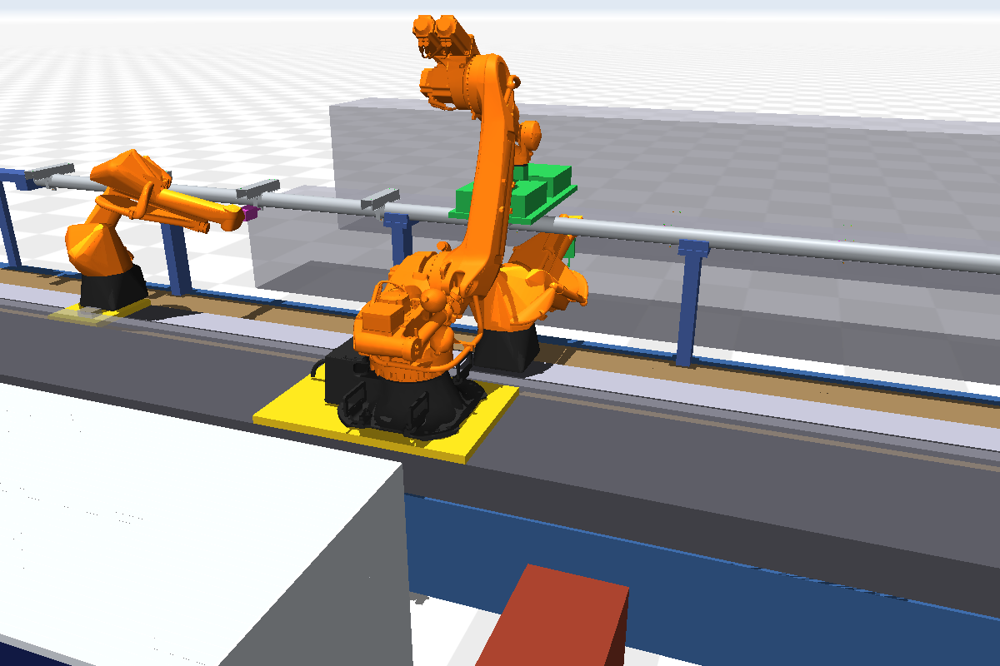

# The rail magazine (v22, runs 056 and 057)

v22 (`..._clear_out_infeed_rail_mag`) is v21 with one part more, a magazine on the module arm's
combined gripper that holds the ten rails of a bay. The arm takes all ten at one take and sets
them one after another along its track, with no trip back to the rail rack: `cycle_s` falls from
470.68 s to 418.31 s. Only the magazine's envelope and mass are modelled; this page says what the
rest is assumed to be.

Bay 0 at 103.4 s, during `set rail 4` (steps 4 to 13 set rails 0 to 9 from 70.0 s to 140.7 s);
every position is the committed plan's.

**What it is assumed to be.** Item `rail_magazine`, `basis: ours`: two racks behind the gripper's
plate, one each side of the standoff, five rails side by side in each, drawn as two boxes of
0.5 × 0.5 × 0.15 m; 12 kg empty, 23.5 kg of rails when full. The tool load is 48 kg + a
module's 32.4 kg = 80.4 kg of the arm's 210 kg. It costs one part (`part_count` 39 against 38).

**What the model does not back.** The indexing drive that moves the next rail into the clamp
after each set, and how the rail rack fills the magazine at the take (the plan allows 2 s a
rail): neither is designed or simulated.

**The checker's figures.** 945 of 945 rows pass. The magazine's least clearance is 0.0186 m, to
module 6's flange (`magazine_pos_x` to `bay_module_6_flange_short_b`, 0.018578 m in the plan and
0.018580 m in physics, against 0.015 m), in step 71's move. Stowed for transport, its box stays
0.2656 m under the 2.896 m height.
