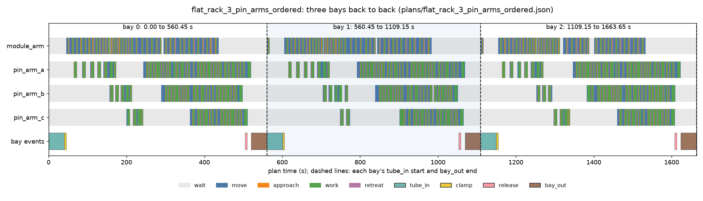

# Three bays back to back

The cell builds bays one after another, so a plan of one bay says too little about its
cycle: the next tube cannot come in before the finished bay is out, and the arms cannot
start the next bay before the tube is clamped. Since run 021 every committed plan holds
three bays planned back to back on one clock, verified as a whole, and the scorecard's
`cycle_s` is their average bay. This page gives the rules, the figures, where the time
between bays goes and what would shorten it.

The code is `src/layout_bays.h` (the rules between bays and the joining of the bays'
plans), `src/layout_plan.h` (its opening comment states the same rules for the planner
and the verifier) and `//:plan_layout -- <name> [--bays N] [--no-early-steps]`, three
bays by default.

## The rules

**Numbering.** With N steps in one bay (the checker's steps, 173 for the chosen layout),
step n of bay b has the number n + bN in the plan's segments, events and steps; events,
steps and phases carry their `bay` (`StepNumberInBay`, `BayOfStep`, `StepOfBay`). Each bay
is planned alone from t = 0 and then put on the joint clock (`JoinBays`); bay 0 is
planned exactly as a plan of one bay was.

**Parts.** Bay b takes pallet points 9b to 9b+8 in the layout's order of modules
(`PointIndexInBay`, `StepsOfBays`): the modules come from the one pallet of 36, of which
three bays use 27, with no exchange. The rails come from the stock's 40 at its one pick
pose, 10 a bay, 30 used, with no refill. The pin magazines are refilled for each bay
through the port `item:pin_feeder`, so every bay takes its magazines at bay 0's
`pins_take` points. A move of bay b is planned in bay 0's bay at the same step with 9b
fewer modules on the pallet (`BuiltInBay`).

**The holder is empty** when the finished bay has been lifted out of the saddles: at the
end of the first leg of the layout's `bay_out.path` (`HolderEmptyAt`). Bay b+1's
`tube_in` never starts before it.

**A shared zone or unit.** Where the ports that hand over `way:tube_in` and `way:bay_out`
share their zone or unit (one names the other in `shares_zone_with`, or both hand over
the same item; `WaysShareZone`), bay b+1's `tube_in` starts at or after bay b's `bay_out`
ends. The chosen layout's `tubes_in` and `bays_out` are served by one transfer cart, so
this rule holds for it.

**Without one,** the next tube may travel its `tube_in` path while the bay travels
`bay_out`, provided the tube stays `clearance_m` from the bay's rails and modules at every
sample, from the tube's start and on the plan's clock (`TubePassesBay`, `NextTubeStart`).
The arms then stand at their wait poses, where the checker's `ways` rows hold them. On the
chosen layout's ways, one lane taken both ways, the tube cannot pass the bay: without the
shared zone the start is still the end of `bay_out` (test
`NextTube.WaysInOneLaneCannotPass`).

**Early steps (R10).** In bays after the first, a step that touches neither the tube nor
the bay — a take from a stock or the pallet, a magazine take, a tool change
(`TouchesTheBay`) — may start from that bay's `tube_in` on, not during the previous bay's
`bay_out`. The schedule holds the arm `clearance_m` + `plan_pad_m` from the tube where it
is on its way at every sample (`AgainstTheTubeComingIn`), and the arm then waits where the
rules allow (a rail held where its take's retreat ended) for the clamp. Every step that
touches the bay waits for the clamp. Bay 0 starts every arm after its clamp, as before.
`PlanOptions::early_steps` switches the rule; it is on by default, and
`plan_layout --no-early-steps` plans without it.

**Giving way.** When no ready block can be placed and one of them met an arm that stands
for good at the end of its last block, the schedule is taken back to before that block,
which is placed again only after the block it stood in the way of. It decides only the
order in which blocks are placed; what is placed holds every other rule, so the verifier
needs no check of it. Bay 1 of the chosen layout needs it (its first take, at pallet
point 9, passes `pin_arm_b` waiting with its magazine); bay 0 never does.

**Sampling.** The scheduler samples each block from its start and also at the plan
clock's k × `sample_s`, the instants the verifier samples; a later bay's planner is told
where its arms start on the joint clock (`BayClock`).

**The verifier holds them** (`VerifyPlan`, `src/layout_replay.cc`): it plays every bay's
steps (`StepsOfBays`), resets the rails, modules and magazines with each bay while the
pallet counts on, checks each bay's events, R21's order of work and five phases on their
own, `tube_in` at 0 for bay 0 only, every arm at its wait pose with its first tool during
every `tube_in` and `bay_out` but for R10's early steps, an arm off its wait pose during a
way measured against the tube or bay where it is on its way, and the rules between bays
(`BetweenBays`: holder empty, shared zone, tube against bay, no touching step before the
clamp). The tests: `//:layout_bays_test` (`Numbering.*`, `Built.*`, `JoinBays.*`,
`CycleFigures.*`, `NextTube.*`, `BetweenBays.*`, `Player.EachBayStartsBareAndThePalletCountsOn`)
and `//:plan_replay_committed_test` (`Committed.*` on the committed three-bay plan, and
`Bays.*`: a tube before the bay before is out, an arm off its wait pose during
`bay_out`, a touching step before its bay's clamp, a take at bay 0's pallet point, and an
early take that verifies).

## The figures

`cycle_s` is (end of bay 2's `bay_out` − start of bay 0's `tube_in`) / 3. Beside it, not
ranked: `one_bay_s`, bay 0 alone from the start of its `tube_in` to the end of its
`bay_out` (what `cycle_s` was before), and `interval_s`, from the end of bay 1's
`bay_out` to the end of bay 2's ([the scorecard](scorecard.md)). From
`bazel run --config=opt //:score_layout -- --all`:

| Layout | `cycle_s` | `one_bay_s` | `interval_s` |
|---|---|---|---|
| `flat_rack_2_pin_arms` | 686.262296 | 700.083428 | 672.333139 |
| `flat_rack_3_pin_arms` | 622.314493 | 644.284416 | 604.289389 |
| `flat_rack_3_pin_arms_ordered` (chosen, v10) | 554.548896 | 560.452329 | 554.493207 |

Every gate passes for all three. `physics_share` stays the share of one bay: 0.039377
for the chosen layout (22.068854 s of `one_bay_s`).

The plan files are about three times their size of one bay (`ls -l plans/`): 2,267,973,
2,309,065 and 2,310,356 bytes for the three layouts. The recordings
[`docs/evolution/v09.gif`](evolution/v09.gif) and [`docs/evolution/v10.gif`](evolution/v10.gif)
are of one bay, and their burned-in captions show the one-bay figures (644.28 s and
560.45 s per bay); the pages' text beside them gives the three-bay `cycle_s`.

## The tightest margins of the three-bay plans

From `bazel run --config=opt //:plan_layout -- <name> --margins` (the committed plan,
verified over all three bays; the first row of each kind):

| Layout | Least clearance (limit 0.015 m) | Where | Least arm to arm | Least joint margin (limit 5°) |
|---|---|---|---|---|
| `flat_rack_3_pin_arms_ordered` | 0.0180 m | `pin_arm_b`'s nutrunner socket to `holder_stand_6_saddle`, step 202 (bay 1), 720.10 s; bay 0's own is the same 0.0180 m (pin-tool nose to `bay_tube`, step 71) | 0.0187 m: the module arm's held module to `pin_arm_a`'s pin-tool nose, step 484 (bay 2), 1502.35 s | 8.65°, module arm joint 3, step 34 |
| `flat_rack_3_pin_arms` | 0.0180 m | `pin_arm_b`'s nutrunner socket to `holder_stand_6_saddle`, step 375 (bay 2), 1422.30 s | | |
| `flat_rack_2_pin_arms` | 0.0179 m | `pin_arm_a`'s nutrunner socket to `holder_stand_4_saddle`, step 27 (bay 0), 141.90 s | | |

Three bays leave the least clearance where one bay had it (0.0180 m for v10 before and
after): the tightest places are still the pin arms' tools at the holder's saddles and the
tube, and what would widen them is unchanged. The tests that verify or play a whole
three-bay plan are `//:plan_replay_committed_test` (split out of `//:plan_replay_test`
for its time), `//:physics_record_test` and `//:scorecard_test`, all `medium`.

## Where the time between bays goes

The picture shows the chosen layout's plan, one row per arm and one for the bay's events,
coloured by kind of segment, the dashed lines at each bay's `tube_in` start and `bay_out`
end:



Made with `cd tools/plots && $PY three_bays.py ../../plans/flat_rack_3_pin_arms_ordered.json
../../docs/img/three_bays_flat_rack_3_pin_arms_ordered.png` ([`tools/plots/README.md`](../tools/plots/README.md)).

**Overlap.** The cart is shared, so bay b+1's `tube_in` starts exactly when bay b's
`bay_out` ends: the bay's events do not overlap the next bay's. What overlaps is the module
arm's early take of rail 0, which runs during the next tube's `tube_in`: from 560.452 to
568.218 s in bay 1 (7.765 s) and from 1109.153 to 1117.299 s in bay 2 (8.145 s), while
its set of rail 0 waits for the clamp (bay 1's starts at 605.452 s). These are the plan's
steps 176, 177 and 349; the command that prints them:

```
python3 -I -c "import json; p = json.load(open('plans/flat_rack_3_pin_arms_ordered.json')); [print(s) for s in p['steps'] if s['number'] in (35, 168, 169, 176, 177, 349)]"
```

**Arm by arm.** For each arm, the time from its last step of bay b (any segment but a
wait) to its first step of bay b+1, split by what the cell is doing meanwhile: the other
arms' last steps (before release), release, the arms going back to their wait poses
(between release and `bay_out`), the bay going out, the tube coming in, the clamp, and
the next bay's steps of other arms (after the clamp). From
`cd tools/plots && python3 -I three_bays.py --table ../../plans/flat_rack_3_pin_arms_ordered.json`,
seconds:

| Arm | Boundary | Last step of bay b, ends | First step of bay b+1, starts | Between | Last steps | Release | Back to wait | Bay out | Tube in | Clamp | After clamp |
|---|---|---|---|---|---|---|---|---|---|---|---|
| module_arm | 0-1 | back to wait, 436.945 | take rail 0, 560.452 | 123.507 | 67.317 | 5.000 | 11.190 | 40.000 | 0 | 0 | 0 |
| module_arm | 1-2 | back to wait, 983.740 | take rail 0, 1109.153 | 125.413 | 69.223 | 5.000 | 11.190 | 40.000 | 0 | 0 | 0 |
| pin_arm_a | 0-1 | tool change, 520.452 | bolt rail 0, 615.286 | 94.833 | 0 | 0 | 0 | 40.000 | 40.000 | 5.000 | 9.833 |
| pin_arm_a | 1-2 | tool change, 1069.153 | bolt rail 0, 1163.987 | 94.833 | 0 | 0 | 0 | 40.000 | 40.000 | 5.000 | 9.833 |
| pin_arm_b | 0-1 | tool change, 498.538 | bolt rail 5, 704.065 | 205.528 | 5.725 | 5.000 | 11.190 | 40.000 | 40.000 | 5.000 | 98.613 |
| pin_arm_b | 1-2 | tool change, 1050.915 | bolt rail 5, 1252.767 | 201.852 | 2.049 | 5.000 | 11.190 | 40.000 | 40.000 | 5.000 | 98.613 |
| pin_arm_c | 0-1 | tool change, 511.367 | bolt rail 8, 748.120 | 236.753 | 0 | 0 | 9.085 | 40.000 | 40.000 | 5.000 | 142.668 |
| pin_arm_c | 1-2 | tool change, 1066.048 | bolt rail 8, 1296.822 | 230.774 | 0 | 0 | 3.105 | 40.000 | 40.000 | 5.000 | 142.668 |

(The time between the bay going out and the tube coming in is 0 at both boundaries.)
The cell's own pause at each boundary runs from release to the clamp's end, 101.190 s:
release 5 s, 11.190 s until `bay_out` may start, `bay_out` 40 s, `tube_in` 40 s, clamp
5 s. The 11.190 s is `pin_arm_a`'s: its last hole ends the bay's modules, and `bay_out`
waits for it to go back to its wait pose (504.262 to 509.923 s) and change back to its
first tool (509.923 to 520.452 s). The module arm is the first to finish a bay and the
first to start the next; the pin arms wait after the clamp for the rails they bolt.

## Staged work (run 022)

A layout with `staging` is planned stage by stage within each bay
([the two-rack cell](two-flat-racks-cell.md), "Planning in stages"). The rules between
bays are the same:

- bay b+1's tube comes in to the first stage's place;
- bay b leaves from the last stage's place;
- where the ports do not share a unit, the incoming tube is held apart from the outgoing
  bay at every sample, each at its place.

Within a bay the stages are joined by `transfer` events of the layout's `transfer_s`,
30 s. Every arm waits through them at its wait pose, so a bay of three stages spends at
least two transfers, 60 s, with no arm working. No staged plan is complete yet, so no
staged layout has a `cycle_s`. That also leaves open where the time between bays goes in
the two-rack cell, and how much of `bay_out` the next `tube_in` overlaps.

## How long planning takes (run 026)

Measured on a 4-core arm machine (`w1`), `plan_layout` at its defaults (3 threads), the
same machine before and after; every plan below is byte-identical before and after
(`cmp` of the `--out` files), with the same count of collision queries.

| Command (`plan_layout -- two_flat_racks_2_pin_arms --bays 1 ...`) | `main` at `4bd8bea` | After run 026 |
|---|---|---|
| `--first-step 1 --last-step 62` (stage 1, 47 moves, 23,676,468 queries) | 301.8 s, 2.7 cores | 40.3 s, 2.8 cores |
| `--first-step 93 --last-step 93` (one move not found, 49,191,898 queries) | S93_MAIN | 235.8 s |

Where the time went before (a sampling profile, gperftools at 200 Hz, of the first row
on `main`): 93% in the collision checks of the moves being planned, of which 30% was
MuJoCo's forward kinematics of the whole model and only 3% the narrow phase
(`mj_geomDistance`); the rest was the box-against-box pass of `LeastDistance` over every
pair of the moving set and the obstacles. RRT growth was 0.9%, shortening 1.5%, timing
0.2%, the schedule 0.2% and the checker before planning 5%.

What changed, none of it in what is planned:

- `PairQuery` (`src/layout_scene.h`) answers a move's queries as `LeastDistance` does,
  to the bit. After the first query on an mjData it places only the moving arm's bodies
  and their geoms again (mj_kinematics' own steps through MuJoCo's public functions),
  keeps the boxes of everything else, drops the pairs that are never measured once,
  passes over obstacles whose box is beyond `far` from the moving set's box, and for
  "free or not" stops at the first pair nearer than the clearance.
  `//:layout_scene_test` compares every pose and every answer with `mj_kinematics` and
  `LeastDistance` over 900 random poses.
- `PlanRrtConnectBudgets` (`src/rrt.h`): the budgets 5,000, 40,000, 160,000 (and 640,000)
  are run as one run at the largest, which reports what each smaller one would have
  reported when its iteration count is reached. A run with more iterations repeats one
  with fewer iteration for iteration, so a move found at 160,000 no longer makes its first
  45,000 iterations twice. The plan's query counts are still those of separate runs.
- `plan_layout` prints line by line into a file or a pipe.

After the change, the checker before planning (about 30 s of CPU, unchanged) is the
largest part of the first row's CPU time.

## What would overlap more

Seconds per boundary between bays; each boundary shortens `interval_s` by as much and
`cycle_s` by two thirds of it (two boundaries over three bays), unless something else
becomes the longest chain.

| Change | Seconds per boundary | How known |
|---|---|---|
| R10, the module arm's early take (built) | 7.765 (bay 0 to 1) and 8.145 (bay 1 to 2); `cycle_s` 554.549 against 559.852, `interval_s` 554.493 against 562.638 | planned: the committed plan against `plan_layout -- flat_rack_3_pin_arms_ordered --no-early-steps --summary` |
| Separate in and out units, on ways that do not share a lane: the next tube starts when the holder is empty | at most 38.411 (the holder is empty at 522.042 s, 38.411 s before `bay_out` ends at 560.452 s; then up to −25.6 s of `cycle_s`) | estimate: the holder-empty instant is read from the plan (`three_bays.py --table`); whether a tube on another way stays clear of the outgoing bay all along is not checked, and on today's single lane it cannot (`NextTube.WaysInOneLaneCannotPass`) |
| A faster cart | 1 for each second off `tube_in`, and 1 for each second off `bay_out` (both lie whole between release and the clamp's end, 40 s each); `cycle_s` loses 1 s per second of either, since every bay has one of each | estimate: arithmetic on the plan's events; the early take needs `tube_in` + clamp of at least its 7.8 to 8.1 s |
| More arms starting the next bay early | 0 in this layout: each pin arm's first step of a bay is a strap bolt, which touches the bay | read from the plan (`three_bays.py --table`: bolt rail 0, 5, 8) |
| `pin_arm_a`'s return to its first tool moved into the next bay's `tube_in` (a tool change does not touch the bay) | about 10.530: `bay_out` could start when the arm is back at its wait pose, 509.923 s, not 520.452 s | estimate: it needs the rule that every arm has its first tool during `bay_out`, and the checker's `ways` rows that sweep the arms with their first tools, changed for that arm; not planned |

[Back to the README](../README.md)
