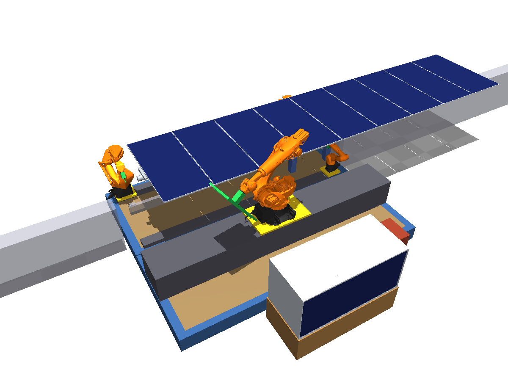
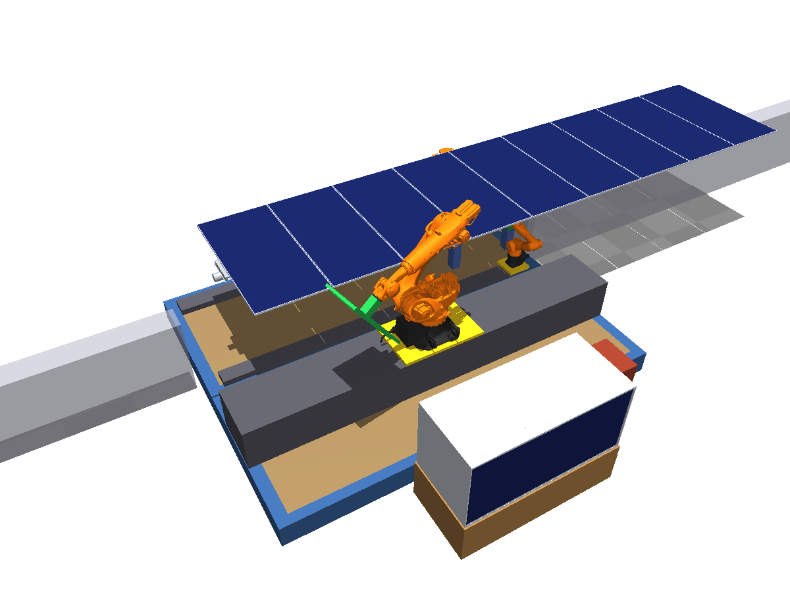

# The cell on two 20 ft flat racks, as checked

This is the second direction's cell: the robot cell that builds bays (one round tube, ten
rails, nine modules: `docs/bay-hardware.md`) on two 20 ft flat racks set down side by
side. It is designed and checked; since run 022 the planner and the verifier work in its
stages, but no complete plan of it exists (see "Planning in stages" below), so there is no
cycle time and no scorecard for it yet. Every figure below is
printed by `check_layout` on the two layout files (`layouts/two_flat_racks_2_pin_arms.json`
and `layouts/two_flat_racks_1_pin_arm.json`), run at the commit of this document, and
each says which row it comes from. Positions and envelopes in the files are `ours`
(designed in this work); every program result is `derived` and as firm as the `ours`
figures it rests on. The frame is the layout's: the origin on the ground under the
middle of the pair at the nominal gap, +Y along the racks, +X across, +Z up. Lengths are
metres, angles degrees, masses kilograms, times seconds.

## What the direction is

- Two 20 ft flat racks (`src/flat_rack.h`, namespace `twenty`; 6.058 x 2.438 m each,
  deck 0.370 m above the ground, tare 2,900 kg: `docs/bay-hardware.md`, "The 20 ft flat
  racks this project assumes") stand side by side with their long sides adjacent. They
  are structurally separate and work as one cell; arms may reach across the gap.
- The gap is 25 mm nominal. It is set down within 0 to 50 mm, and rack b may be shifted
  25 mm either way along Y. The checker checks the cell at the ends of both tolerances.
- Each rack carries at most 13,608 kg (30,000 lb) in transit (the owner's limit).
- The racks are the base only: no post, side, roof or end frame; the end frames are
  dropped or taken off while the cell works.
- Every arm is a KUKA (the owner, 2026-11-26): a KR 210 R2700-2 for the rails and modules,
  KR 20 R1810-2 arms for the pins and a KR 10 R1100-2 for the bolts
  (`src/arm_catalog.h`).
- A tube of 30 ft or more does not fit on one rack, so it is worked in sections, in stages.

## The form of the layout

The form is in the opening comment of `src/layout.h` ("The base", "Two racks", "Stages").
In short:

- `"two_flat_racks"` stands in the place of `"flat_rack"`, with the fields of a flat rack
  layout (margins, ports, approaches). Its state has `end_frames`, `gap_m` (0.025),
  `gap_lo_m` (0), `gap_hi_m` (0.050), `misalign_m` (0.025) and a note.
- Rack "a" stands on -X with its long side at x = -gap_m / 2, rack "b" on +X, both centred
  on y = 0. Every arm, the holder and every stock and item that travels has the field
  `rack`, "a" or "b"; a thing stands on one rack and travels on it.
- `staging` is optional: `why`, `transfer_s` and a list of `stages`. A stage has a name,
  `tube_offset_m` (the tube lies at "tube" moved by it along +Y), its `rails` and
  `modules` (ranges such as "0-3"), its `grips` of the holder, the stretch whose rivet
  holes fix the angle (`angle_pin_hold`) and what pins it (`angle_pin_by`, "holder" or
  "item:<name>"), and `held_by`, in words. Every rail and every module is in exactly one
  stage; a module's two rails are set at its stage or an earlier one.
- Work may be divided among arms: several `work` entries of one kind, each with an arm, a
  tool and its points ("all" or "0-11,14").

## The layout two_flat_racks_2_pin_arms



Rack a carries the holder and every arm that works on the tube from below or beside it.
Rack b carries only the module arm, which reaches across the gap. The tube's axis is at
x = -0.85, z = 1.75 (1.38 above the deck), its plain end at y = -2.474 at stage 1, held on
rack a.

| Thing | Rack | Where | Why |
|---|---|---|---|
| Holder | a | two stands under the axis at y = 1.690 and 2.834; column 0.16 x 0.16 x 1.2775, saddle 0.22 x 0.30 x 0.04; 180 kg | see the staging: a stand cannot let a rail pass it |
| Module arm, KR 210 R2700-2 | b | base (1.00, y, 1.10), yaw 90, track -2.37..2.37 on a raised beam 0.86 x 6.04 x 0.68 (1,600 kg) | 1.85 m across from the axis and 0.65 m below it, as on the 40 ft layouts, so its poses at the tube and the pallet are theirs |
| Pin arms, KR 20 R1810-2 | a | base (-2.10, y, 0.52), yaw 90; tracks -2.6..-0.86 and -0.34..2.6 (run 024; until then -2.6..-0.26 and 0.26..2.6) | 1.25 m from the axis, 1.23 m below it: the elbow stays under the modules; the line divided 0.6 m toward -Y so that pin arm B reaches holes 0 and 1 of modules 1, 4 and 6 (its track clamped at -0.34 there) |
| Bolt arm, KR 10 R1100-2 | a | base (-0.23, y, 0.52), yaw -90, track -2.6..2.5 | the bolts are driven along -X, so the arm stands on the tube's +X side, where there is room for a small arm only |
| Pallet | outside b | (3.15, 0), yaw -90, deck 0.652 m above the ground | its nearest edge is at x 2.59 (0.12 m inside the -x face of the modules port's zone at 2.47; row `port,pallet 0 in a zone`), just outside rack b (edge at 2.4505) |
| Rail rack | outside b | pick (2.80, 1.75, 1.43) | 1.80 m out so the body stands outside rack b |
| Pin lane, nests | a | lane at x = -1.38; nests at y = -2.6 and 2.6 | at 0.45 m from the pin arm's axis the magazine take left 5.13 deg of joint margin |
| Infeed, outfeed units, pin feeder | ports | not carried | their own design is not part of this cell |

Who does what:

- module_arm: rail_take, rail_set, module_take and module_set, every point, with one
  combined gripper that is never changed.
- pin_arm_a: locate, pin and swage of every hole of modules 0 and 3 (holes 0-3,
  12-15). pin_arm_b: every hole of modules 1, 2, 4, 5, 6, 7 and 8 (holes 4-11, 16-35).
  Each has its own magazine nest. Until run 024 pin_arm_a had all of modules 0, 1, 3, 4
  and 6 (0-7, 12-19, 24-27) and could not plan modules 4 and 6; run 024 gave B holes 1-3
  of modules 1, 4 and 6, and run 025 hole 0 of those modules too, so that the two arms
  share no module: see "Run 024" and "Run 025" below. B now has 28 holes and A 8.
- bolt_arm: all ten strap bolts.
- Loads (rows `load`): the module arm 68.4 kg of 210, the pin tool with its magazine
  8.5 kg of 20 on each KR 20, the nutrunner 3.0 kg of 5 on the KR 10.

## The staging of the tube

Three stages, with three modules each.

| Stage | Tube offset | Rails | Modules | Grips (holder) | What holds the angle |
|---|---|---|---|---|---|
| 1 | 0 | 0-3 | 0-2 | bay_hold_4, bay_hold_5 | the infeed unit's jaws on bay_hold_10 |
| 2 | -3.432 | 4-6 | 3-5 | bay_hold_7, bay_hold_8 | the infeed unit's jaws on bay_hold_10 |
| 3 | -5.720 | 7-9 | 6-8 | bay_hold_9 | the outfeed unit's head on bay_hold_0 |

Where the tube is held, from the layout's `held_by` and the rows `hold, stage n: ...`:
at stage 1 the plain end at y = -2.474 is on rack a and the neck end at 8.142 is in the
infeed unit beyond +Y; at stage 2 the built part (rails 0-3, modules 0-2) lies beyond -Y
on the outfeed unit and the neck end at 4.710 is in the infeed; at stage 3 the plain end
at -8.194 is against the outfeed's head and the neck end at 2.422 is on rack a, the
infeed having let go. The rows `hold, stage n: angle pin ...` give 0.0100, 0.0100 and
0.0050 m against a limit of 0.

Why this staging. A holder box that grips the tube must lie within the tube's radius
plus clearance_m (0.077 m) of the axis, and a rail's section surrounds the tube there, so
no such box is 0.015 m from a rail that slides past it. The checker counts holder geoms
near by design only against the tube, not against rails (`src/layout_check.cc`,
`SweepRow`), so the stands must stand where no rail passes in any transfer: on the
infeed side of the last rail set at each stage. That is the first reason for the offsets:
stand 1 (y = 1.690) grips the stretch just beyond the stage's last rail (stretches 4, 7
and 9), and stand 2, one pitch on (2.834), grips stretches 5 and 8 at stages 1 and 2; at
stage 3 it is beyond the neck end and grips nothing. This is also why a draft with three
stands spread along the work, and a head at the plain end, could not work.

The section length is three modules, 3.432 m of tube, and the rail and module stops
lie between y = -2.314 and 2.262 (4.576 m in all), which the tracks cover on racks of 6.058 m. Three stages, not
two: with two the second stage's work would span 5.8 m (module 4 to rail 9), more than a
track on a 6.058 m rack covers. Every rail is set at one of five places and every module
at one of four, all within 2.4 m of the racks' middle (notes of the layout designer; the
places are in the file). The tube is held where it must be: from below by the holder on
rack a at the stretches between rails, and at its end by the infeed or outfeed unit,
which also pins the angle.

## The checks that apply and what they found

Both layouts pass every row: 982 of 982 for the two-pin-arm layout and 960 of 960 for the
one-pin-arm layout (`check_layout` exits 0; the count is the designer's, the CSV has one
line per row). Each kind of the stages is checked once for each stage, its rows prefixed
"stage <name>: ". The margins are clearance_m 0.015 and joint_margin_deg 5, as the 40 ft
layouts.

**Each rack on its own** (rows `transport`, two_flat_racks_2_pin_arms):

| Row | Figure | Limit |
|---|---|---|
| `rack a mass` | 1,014 kg (arms 565, tracks 190, tools 19, holder 180, items 60) | 13,608 |
| `rack b mass` | 2,713 kg (arm 1,077, track 1,600, tools 36) | 13,608 |
| `rack a envelope` | 0.0060 m: along 0.0060 (the pin lane's end, 6 mm inside the +Y edge), across 0.0175 (the bolt arm's carriage), top 1.1435 | 0 |
| `rack b envelope` | 0.0090 m: along 0.0090 (the module arm's beam), across 0.5565, top 0.1224 | 0 |
| `nothing spans the gap` | 0.0175 m (the bolt arm's carriage to the band between the racks) | 0 |

Rack a in the one-pin-arm layout is 681 kg (`rack a mass`); the other rows are the same.

**The gap** (rows `gap`, eight variants, each the least of its rerun clearance, approach
and ways rows, limit 0.015):

| Variant | two_flat_racks_2_pin_arms | two_flat_racks_1_pin_arm |
|---|---|---|
| gap 0 mm | 0.0184 (approach, stage 3: module_set 7) | 0.0184 |
| gap 50 mm | 0.0187 | 0.0188 |
| misaligned +25 mm, and -25 mm | 0.0187, 0.0187 | 0.0188, 0.0188 |
| gap 0 mm, misaligned +25 mm | 0.0172 (approach, stage 2: module_set 3) | 0.0172 |
| gap 0 mm, misaligned -25 mm | 0.0187 | 0.0188 |
| gap 50 mm, misaligned +25 mm, and -25 mm | 0.0187, 0.0187 | 0.0188, 0.0188 |

Every variant passes, and no row newly fails or newly passes against the nominal gap in
any of them. The largest drops are all the module arm's rows, as expected, since it alone
stands on rack b. They are module_take 35 clearance 0.1951 to 0.1723 m (gap 0) and its retreat
0.1951 to 0.1708 m (gap 0, +25 mm), and the joint margins of rail_take 0 (56.41 to 55.45
deg) and module_take 0 (22.32 to 21.01 deg). The least figure, 0.0172, is the approach of
module_set 3 at stage 2 with rack b closest and shifted +Y (at the nominal gap the same row is
0.0347 m, the held module's frame to the module arm's link 2; the gap row does not name the pair
in the variant).

**The tightest margins** (two_flat_racks_2_pin_arms, with the one-pin-arm layout where
it differs):

| Margin | Figure | Where | What might widen it (suggestion, untried) |
|---|---|---|---|
| Least clearance row with a limit | 0.0187 m (0.0188 with one pin arm), against 0.015 | stage 1: locate 2/0, the nose of a pin arm to module 1's flange | a longer approach or a different spin of the nose; the margin of the layout is 0.015 and 0.020 would not pass |
| Ways (tube in, stage 1 to 2, 2 to 3, bay out) | 0.0405 m each | the tube to stand 1's column | a narrower column or a stand further from the path |
| Least joint margin, work poses | 17.54 deg | stage 3: module_take 35, module arm joint 2 | the module arm's base nearer the pallet |
| Least joint margin on an approach or retreat leg | 8.6 deg (joint 3) | stage 1: module_take 0 retreat (rows `approach`, detail "least joint margin"); the same in both layouts | a different pallet pose for the first take |
| Least joint margin, wait poses | 10.0 deg (module arm, joint 2) | module arm's wait pose; KR 20 15.0, KR 10 16.0 | another wait pose |
| `pins_take` | 24.66 deg (joint 3) | each pin arm | the nest further from the arm |
| `rack a envelope` | 0.0060 m | the pin lane's end along Y | a shorter lane |
| `rack b envelope` | 0.0090 m | the module arm's beam along Y | a shorter beam |
| `nothing spans the gap` | 0.0175 m | the bolt arm's carriage | a smaller carriage |
| Gap rows | 0.0172 m | gap 0 mm, rack b +25 mm | a wider nominal gap or a longer approach |

These are the figures that the designer's notes read from the CSV rows; the free-space
rows of the tools (nutrunner 0.0007 m, pin tool 0.0017 m, limit 0) and the angle pin of
stage 3 (0.0050 m) are tighter in absolute terms but have a limit of 0. The last column
is a list of suggestions, not results; none of it was tried.

**Time** (rows `time`, informative only: a time model with no limit, not a plan). The bay
is 615.8 s: stage 1 203.9 s, a transfer of 30 s, stage 2 140.9 s, a transfer of 30 s,
stage 3 211.0 s (row `time,bay`). Busy: module arm 208.3 s, pin_arm_a 230.0 s, pin_arm_b
189.8 s, bolt arm 88.3 s. The figure is not a cycle time of a planned bay.

## The layout two_flat_racks_1_pin_arm



It differs in one choice: the number of pin arms. One KR 20 on a track (-2.6..2.6, beam
0.30 x 5.70) works all 36 holes, with one nest at y = 2.6, in place of two KR 20 on one
line of track each over half. Everything else is the same: tube, holder, staging, module
arm, bolt arm, pallet, rails, ports, approaches and margins.

| | two_flat_racks_1_pin_arm | two_flat_racks_2_pin_arms |
|---|---|---|
| Rows pass | 960 of 960 | 982 of 982 |
| Arms | 3 | 4 |
| `rack a mass` | 681 kg | 1,014 kg |
| `rack b mass` | 2,713 kg | 2,713 kg |
| Least clearance | 0.0188 m | 0.0187 m |
| Least gap figure | 0.0172 m | 0.0172 m |
| Time model, stage 1 / 2 / 3 | 252.0 / 189.0 / 248.5 s | 203.9 / 140.9 / 211.0 s |
| `time,bay` | 749.5 s | 615.8 s |

The second pin arm adds 333 kg to rack a, far under 13,608 kg, and takes the time
model's bay from 749.5 s to 615.8 s (17.8 percent less): the pin arm is the bottleneck of
the one-arm layout.

**Plan `two_flat_racks_2_pin_arms` first.** By the precedent of the 40 ft layouts (the
shortest planned bay is chosen unless another is within 10 percent and has more
clearance) it is the likely choice: the model's difference is well over 10 percent, and
the clearances are the same to 0.1 mm. Its pin arms work separate halves with their
waits at opposite ends (y = -2.6 and 2.6), so the extra pair of arms may not be hard to plan (not tried).
`two_flat_racks_1_pin_arm` stays as the fallback if the two pin arms' moves near y = 0
prove hard to plan: both reach the holes on the rail at y = -0.026, from either side.

## What was tried and did not work

These are the layout designer's records of attempts on the way to the two layouts; the
figures in them come from check runs of layouts that were not kept, and no committed
output reproduces them.

- A first geometry (the module arm 2.05 m from the tube, the pallet's dock 1.2 m out)
  could not reach the pallet; KR 20 pin arms 0.7 m from the tube folded too tightly (28 mm
  short); a holder head at the tube's end stood in its path; three stands along the work
  would be passed by rails.
- The first run of the present arrangement had 30 failing rows: the KR 10 with yaw 180
  put its base 0.17 m over the gap; the module arm's track did not reach rail 0; the KR 20's
  first wait pose held its forearm 0.002 m from module 8. Each was fixed in the layout.
- The pin nest 0.45 m from the KR 20's axis left a joint margin of 5.13 deg and a link
  0.016 m from its nest; the lane was moved out (it is now at x = -1.38, 0.72 m from the pin arms' axis).
- Not tried: a KR 20 for the bolts (the +X side between the tube and the gap is 0.84 m)
  and the module arm on rack a.

## The rows that measure the units (run 022)

Run 020 named three gaps; run 022 closed them (`src/layout_stage_rows.h`,
`src/layout_sweep.h`, `tests/layout_stage_rows_test.cc`):

- The infeed and outfeed units are measured in every way and transfer sweep: the moving
  tube with its rails and modules against every box of every item. Near by design, and
  counted only below zero, are only a carrier's boxes within `clearance_m` of the tube at
  its place or at an end of the path, and only against the tube itself. Along `bay out`
  the outfeed unit's `head`, which pins the plain end and draws the bay out (the layout's
  `bay_out` text), moves with the bay: it is not measured against the bay, and it is
  measured, moved, against everything else. Measured fixed, it stood 0.042 m inside the
  tube's way.
- A row per stage, `ways` "stage <name>: tube at rest", holds the tube with the stage's
  rails and modules against every item box. Near by design are only the `jaw*` and
  `head` boxes of the stage's `angle_pin_by` unit. At stage 1 these are the jaws that
  grip it and the open stage-2 jaws 0.002 m beside it.
- The eight gap variants rerun the `port` rows too. For example, at gap 0 mm the row
  "stowed clear of zone bays_out" goes from 0.1200 to 0.0950 m.

From `bazel run --config=opt //:check_layout -- two_flat_racks_2_pin_arms` (985 rows,
none failing; 963 for `two_flat_racks_1_pin_arm`, none failing):

| Row (`ways`) | Figure, m | Nearest |
|---|---|---|
| tube in | 0.0405 | `bay_tube` to `holder_stand_1_column` |
| stage 1: tube at rest | 0.2880 | `bay_tube` to `item_infeed_unit_bed` |
| stage 1 to 2 | 0.0405 | `bay_tube` to `holder_stand_1_column` |
| stage 2: tube at rest | 0.2880 | `bay_tube` to `item_infeed_unit_bed` |
| stage 2 to 3 | 0.0405 | `bay_tube` to `holder_stand_1_column` |
| stage 3: tube at rest | 0.1100 | `bay_rail_0_foot_a_neg` to `item_outfeed_unit_head` |
| bay out | 0.0405 | `bay_tube` to `holder_stand_1_column` |

Still not checked by the rows: paths between poses (the planner's work), the arms at
the same time, and the time, which is a model without a limit.

## Planning in stages (run 022)

`src/layout_plan_stages.h` holds the rules; `src/layout_plan.h` points to it. In short:

- Each stage has its own scene, `StageLayout(layout, s)`: the tube at the stage's place.
  Every move of a step of stage s is planned there and verified there edge by edge. The
  bay at a move is the checker's, kept to the stage. A following arm's obstacle set holds
  the earlier stages' parts and this stage's, never a later stage's.
- A `transfer` event (from and to stage, counted from 1) lasts the layout's
  `transfer_s`, 30 s (our own figure). It starts when every arm stands at its wait pose
  with its first tool and nothing held. Every arm waits through it, and no step of the
  next stage starts before it ends. Per bay the events are `tube_in`, `clamp`,
  `transfer`, `transfer`, `release`, `bay_out`.
- The verifier (`VerifyPlan`) plays the tube and the bay built so far at each stage's
  place and moves them linearly through a transfer. It faults an arm off its wait pose
  during a transfer, a step that crosses one, a transfer of the wrong length, number or
  order, and a stage's first module take before that stage's strap bolts. Otherwise it
  makes today's clearance, segment, timing and parts checks.
  `tests/plan_replay_staged_test.cc` holds it. Its tests on the committed plan skip until
  that plan exists; it checks the same faults on a plan made from the checker's steps.
- Pin magazines: an arm takes its magazine before its stage's first module set and parks
  at its wait pose, because the take's approach pose of pin arm A is 0.0086 m from
  module 0's flange once that module is set. The checker solves that pose with no module
  set.
- A hole-to-hole move not found in its world, with the modules that may be set while it
  runs, is planned once more without them. Those modules' sets then wait for that move
  to end.
- A staged layout's moves get a fourth RRT budget of 640,000 iterations. A layout without
  staging keeps three budgets, and the three 40 ft plans re-plan byte-identical.

**What blocked the plan of `two_flat_racks_2_pin_arms` (run 022; one bay plans whole since run 025, below).** Stage 1 plans whole. From
`bazel run --config=opt //:plan_layout -- two_flat_racks_2_pin_arms --bays 1 --first-step 1
--last-step 62 --summary`: 47 of 47 moves found, the clamp ends at 45.00 s, stage 1 runs
45.00 to 283.33 s (238.33 s planned, against the time model's 203.9 s), and the first
transfer runs 283.33 to 313.33 s. That took 374 s of planning. The summary of such a
partial plan also prints a second transfer and a negative `end` phase; they belong to no
step it planned.

In bay 0, four of pin arm A's moves are not found with three budgets of up to 160,000
iterations: steps 93 and 99 (module 4, stage 2) and steps 135 and 141 (module 6,
stage 3). In each the arm swings joint 1 by about 180 deg between the two pose families
of one module's holes (hole 2 to hole 3 at the locates, swage 3 to swage 2). The stages
move the tube by whole pitches, so modules 4 and 6 are worked where module 1 stood at
stage 1. There the module one pitch beyond module 0's place, already set at an earlier
stage, blocks the swing. With that module taken out of the world, each move is found at
160,000. A run of step 93 alone with the fourth budget had not ended after 37 minutes.

What would fix it, each for a later run:

- the checker solves all four holes of a module in one pose family of the arm;
- the layout's `work` gives these holes to pin arm B, or places or tracks pin arm A
  differently (done: runs 024 and 025);
- a much larger search for these moves.

**Run 024: what the layout's `work` and tracks change (on branch
`org/024-pin-arm-a-s-four-blocked`, not on `main`).** Probes of bay 0 with
`--budgets 5000,40000,160000`:

- Holes 0 and 2 of a module are one pose family of pin arm A, holes 1 and 3 the other;
  at the place of modules 4 and 6 every move of A between the families is not found:
  2 to 3 (steps 93, 99, 135, 141 at `main`), 2 to 1 (holes 19 and 27 to pin arm B) and
  0 to 1 (holes 18, 19, 26, 27 to B), each at 160,000 and without the next modules.
- Pin arm B's moves between the families there (hole 2 to 3 and back) are found at
  5,000 to 40,000 iterations, but B does not reach hole 1: 0.165 m short with its track
  at its end, 0.26 m.
- With the line of the two pin tracks divided 0.6 m toward -Y (A -2.6..-0.86, B
  -0.34..2.6, beams to match) and holes 1-3 of modules 4 and 6 given to B, the checker
  passes (985 rows) and a whole bay planned 123 of 125 moves in 1,874 s: every move of
  stages 2 and 3 found, the four of `main` among them. The two not found were A's hole 2
  to 3 moves of module 1 at stage 1 (steps 36 and 42), which need A's track up to
  -0.26.
- Giving holes 1-3 of module 1 to B as well (A `0-4,12-16,24`, B `5-11,17-23,25-35`,
  the branch's layout): the checker passes and stage 1 (steps 1-62) finds 46 of 46
  moves in 260 s, but its schedule is reported blocked ("no arm's next step may start").
  Whether that comes of the partial plan or of the schedule itself, and a whole bay with
  this layout, are for the next run.

**Run 025: one bay plans whole.** What blocked, and what the layout now is:

- The blocked schedule came of the schedule itself, not of the partial plan. With the
  fault now naming each arm's next step: pin arm A's pin 1/0 waits "after another
  block" and B's locate 1/2 waits for pin 1/0. A, parked at hole 0 of module 1 with its
  swage 1/0 still to come, stood in B's way; giving way put pin 1/0 after B's locate
  1/2, which itself needs pin 1/0 (a module's holes go in one order, whichever arm has
  them). An arm that shares a module's holes with the other stands in its way between
  its holes.
- Every hole of module 1 to B (A `0-3,12-16,24`): stage 1 schedules, 47 of 47 moves in
  260 s. A whole bay then found 125 of 125 moves in 942 s and blocked the same way at
  module 4 (A's pin 4/0, B's locate 4/2).
- Hole 0 of modules 4 and 6 to B as well (A `0-3,12-15`, B `4-11,16-35`, the layout
  now): the checker passes 985 rows (B reaches hole 0 of modules 1, 4 and 6 with its
  track clamped at -0.34, 43.2 deg of joint margin), 126 of 126 moves are found and the
  schedule completes. The verifier then reported pin arm A's locate 0/0 and B's locate
  1/0 started at 52 s, before their modules were set: the park after a magazine take
  carries the number of the arm's next step, and R21's order counted the step from
  that park. The verifier now counts a step's order from its own segments, after a
  park before it (`src/layout_replay.cc`); the plan's step times are unchanged.
- `plan_layout -- two_flat_racks_2_pin_arms --bays 1 --summary` exits 0: 126 of 126
  moves found (module arm 41, pin arm A 18, pin arm B 54, bolt arm 13), `complete: true`,
  the bay planned at 1003.47 s against the time model's 669.83 s (stages 261.86, 275.09
  and 301.52 s; modules phase 637.15 s against 362.84 s), least clearance 0.0181 m, least
  arm to arm 0.0191 m, least joint margin 8.64 deg, 998.6 s of planning. Three bays,
  the plan file and the score are the next run's.

The pin arms are no longer balanced: B has 28 holes, A 8 (modules 0 and 3).

One staged bay took 29 minutes to plan with three budgets, so a plan of three bays would
take more than an hour and a half.

## Three bays (run 027)

`bazel run --config=opt --config=agent //:plan_layout -- two_flat_racks_2_pin_arms --bays 3
--out plans/two_flat_racks_2_pin_arms.json --summary` exits 0 with the layout of run 025
unchanged (sha256 `a78976cc…af54f`): 378 of 378 moves found (module arm 123, pin arm A 54,
pin arm B 162, bolt arm 39: three times bay 0's), `complete: true`, verified and committed. It is
version v11, a `candidate` of this direction weighed against v10.

| Bay | tube in to bay out (s) | Stage 1 | Stage 2 | Stage 3 |
|---|---|---|---|---|
| 0 | 0.00 to 1003.47 (1003.47) | 261.86 | 275.09 | 301.52 |
| 1 | 956.29 to 1956.01 (999.72) | 262.07 | 273.11 | 299.54 |
| 2 | 1908.83 to 2909.00 (1000.17) | 262.68 | 272.40 | 300.11 |

- `cycle_s` 969.67 s ((2909.00 - 0.00) / 3), against v10's 554.55 s: 1.75 times as long.
  `one_bay_s` 1003.47, `interval_s` 952.99. Bay n+1's tube comes in 47.19 s before bay n
  is out, both times.
- The time model: 669.83 s a bay against 1003.47 s planned (+49.8 %). Nearly all of the
  difference is the modules phase, 637.15 s planned against 362.84 s; the rails phase is
  183.66 against 129.89 s, the end 77.66 against 72.10 s. The two transfers are 60 s of
  every bay in both.
- Waits: 118 over the three bays, 8,319.15 s of arm waiting summed (module arm 1,884.1,
  pin arm A 2,477.7, pin arm B 1,364.0, bolt arm 2,593.3).
- The bottleneck is pin arm B. Busy (moving or working) over the 2,909 s of three bays:
  B 1,545.0 s (515 s a bay, 53 %), module arm 1,024.9 s, A 431.3 s, bolt arm 315.6 s. B
  has 28 of the 36 holes (A modules 0 and 3 only, see run 025), so each stage waits on
  B's locates, pins and swages while A stands idle. Balancing the pin arms by whole
  modules is spec 028's.
- Tightest margins of the plan: least clearance 0.0180 m against 0.015 m, least arm to
  arm 0.0189 m, least joint margin 8.64 deg against 5 deg.
- Planning: `planning_s` 252.1 s and 229,189,398 collision queries; the whole command
  took 319 s of wall time with a 41 s build. One bay took 998.6 s before run 026.
- The scorecard maps the step `move the tube to stage ...` to `unclamp`, `tube_in` and
  `clamp` (`docs/scorecard.md`); before this run no staged plan had been scored.

## What the next run needs that this run did not build

- A time model of the transfers: the 30 s of `transfer_s` is a figure of the layout, not
  the model of a move.
- The units' own design: the infeed unit, the outfeed unit and the pin feeder are boxes
  at their ports, not designed units.

## The pictures and the commands that made them

Both pictures show the `finished` state, which is static and ignores the staging: the
tube is at the layout's `tube` place (stage 1) with the whole bay built on it, so the
bay overhangs the racks toward +Y. The 25 mm gap between the racks is too narrow to see
at this scale. With Xvfb on display :7 (see docs/layout.md):

```bash
tools/video/shot_viewer.sh //:viewer_layout docs/img/two_flat_racks_2_pin_arms.png 1200x900 two_flat_racks_2_pin_arms --state finished --lookat 0,0,1.0 --distance 11 --azimuth 150 --elevation -40 --no-overlay --quit-at 0
tools/video/shot_viewer.sh //:viewer_layout docs/img/two_flat_racks_1_pin_arm.png 1200x900 two_flat_racks_1_pin_arm --state finished --lookat 0,0,1.0 --distance 11 --azimuth 150 --elevation -40 --no-overlay --quit-at 0
```

## How to check it

- `bazel run --config=opt //:check_layout -- two_flat_racks_2_pin_arms` prints every row
  as CSV, then the time model, the margins and the postures as `#` lines; it exits 0 only
  when every row passes. The same for `two_flat_racks_1_pin_arm`.
- `bazel run --config=opt //:check_layout -- two_flat_racks_2_pin_arms --checks gap` makes
  only the eight gap rows.
- `bazel run --config=opt //:check_layout -- --list` names the layouts.
